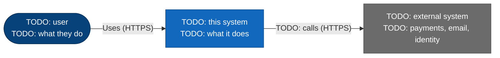
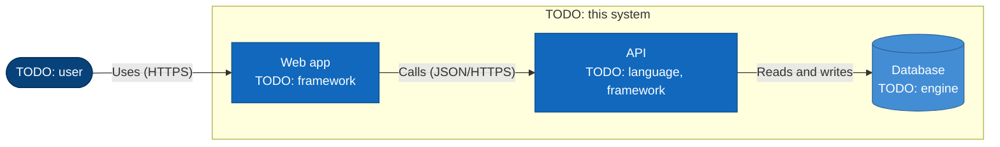
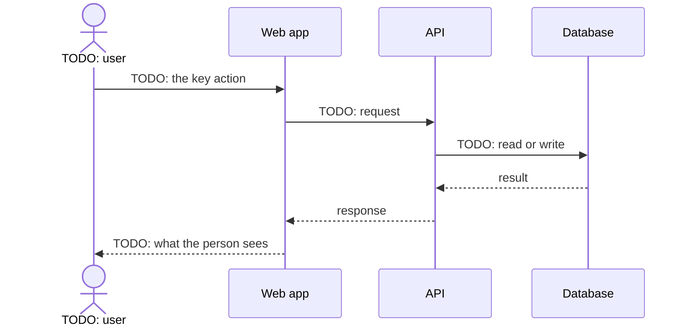

# Architecture overview: {{title}}

Written {{today}}. Living, never frozen: the system as it runs today. A tech spec starts from this page and shows only
what its change moves. After the change lands, a docs change folds the approved design back in here.

<!-- The architect writes this page (`aidd new architecture`) in the order of arc42 (arc42.org), with C4 diagrams
     (c4model.com). It keeps only what a new teammate and a reviewer need. Each diagram is Mermaid, so it diffs like
     code. Never argue a decision here: link its ADR in `docs/decisions/`. Keep the page true rather than
     complete. A section with nothing to say says "none yet". When a component outgrows its section, give it its own
     page, `docs/architecture/<component>.md`, and link it here: a change to it updates its line here. aidd writes no such file.
     Write the prose at the `instruction` level (the `aidd-team:plain-language` skill). -->

## Goals and constraints

<!-- What the system is for, in two sentences, and the top three quality goals (the Quality targets below rank them).
     Then the stakeholders: who reads this page or depends on the system, and what each expects (arc42 section 1).
     Then the constraints a design may not break: the ones in `project` of `.aidd/config.yaml` (hosting, budget, the
     stack radar, rules), and any law, contract, or legacy system. Point to them; never copy them. -->

TODO: the purpose, the three quality goals, the stakeholders, and the constraints.

## Context and scope

<!-- Who uses the system and which other systems it talks to, with what crosses each line (C4 system context). -->



- In scope: TODO. Out of scope: TODO.

## Solution strategy

<!-- The few decisions that shape everything else, one line each with its ADR. Cover the architecture style (a modular
     monolith by default), the main technologies, how the system meets its top quality goal, and how it is
     organized. -->

| Decision | Why, in one line | ADR |
| --- | --- | --- |
| TODO: a modular monolith in one repository | TODO | `docs/decisions/TODO` |

## Building blocks

<!-- The containers (C4): each deployable or data store, its technology, and who owns it. List the layers inside a
     container below the diagram, when the code declares any: a fitness function checks each rule. -->



| Container | Code | Owner | Layers, outermost first |
| --- | --- | --- | --- |
| API | `TODO: src/api/` | TODO | TODO: `api` then `service` then `domain`; `domain` imports neither |

## Module map

<!-- A modular monolith only (the `modular_monolith` product default, `aidd-team:modular-monolith`): delete this
     section when the default is off. One row for each module under `modules/`, 3 to 8 to start. Each module has one
     owner and owns its data. Events go from the module that publishes to the modules that consume. A dependency
     between modules, a new event, or a boundary move gets an ADR. Each module's own page is `modules/<name>/README.md`,
     from the aidd skill's `assets/module-readme.md`. -->

| Module | Purpose | Owner | Subdomain | Owned data | Publishes | Consumes |
| --- | --- | --- | --- | --- | --- | --- |
| TODO: orders | TODO: takes and tracks orders | TODO | core | TODO: its schema or table prefix | TODO: `orders.order.placed.v1` | TODO: `billing.payment.captured.v1` |

## Runtime view

<!-- One or two flows that matter most (the money path, the sign-in), as sequence diagrams. Not every endpoint. -->



## Deployment view

<!-- Where each container runs, per environment, and what sits between them (load balancer, queue, CDN). -->

| Container | Runs on | Environments | Scaled by |
| --- | --- | --- | --- |
| TODO | TODO | preview, production | TODO |

<!-- The environment inventory: every environment the project runs, and only those. -->

| Environment | Purpose | Data | Who deploys | URL |
| --- | --- | --- | --- | --- |
| production | TODO | TODO | TODO | TODO |

## Cross-cutting concepts

<!-- The rules every container follows. Each concept links the ADR that decided it. A concept without one is a
     decision that nobody wrote down yet. -->

| Concept | How it works here | Decided in |
| --- | --- | --- |
| Authentication and authorization | TODO | `docs/decisions/TODO` |
| Errors and logging | TODO | `docs/decisions/TODO` |
| Persistence and migrations | TODO | `docs/decisions/TODO` |
| Configuration and secrets | TODO | `docs/decisions/TODO` |
| User interface | the repository's `DESIGN.md` and `design/tokens.json` | `docs/decisions/TODO` |

## Architecture decisions

<!-- The index of the decisions that hold: link `docs/decisions/` (one record per decision, MADR), and list the few a new teammate
     must read first. A superseded ADR stays, marked by the one that replaced it. -->

TODO: the ADRs to read first, or "none yet".

## Quality targets

<!-- Three to five ISO/IEC 25010 qualities, ranked, each with a number a test or a dashboard can check. For a latency or
     availability target, link the service card's SLO (`aidd new service-card`), and never restate its number. -->

| Quality | Target | Checked by |
| --- | --- | --- |
| TODO: performance efficiency | TODO: the service card's SLO, linked | TODO: the SLO, a load test |
| TODO: maintainability | the layers above hold | the fitness functions below |

## Fitness functions

<!-- A fitness function is an architectural rule that a machine checks on every change. It is an ordinary test command
     in the repository's `tests` (or a Spec's `tests.commands`), so a change that breaks a layer turns tests red. The
     architect writes one for each layer rule that the Building blocks declare. Pick the checker from the stack's
     library standard (`aidd standard list`, the `module-boundaries` choice). With aidd-team, `aidd-team:modular-monolith`
     holds the import rules and the data checks that a module map adds. -->

```yaml
tests:
  - name: layers
    command: [TODO: the layer check]
```

## Risks and technical debt

| Risk or debt | Impact | What would retire it |
| --- | --- | --- |
| TODO | TODO | TODO |

## Glossary

The domain's terms live in one place: TODO: link the glossary (`docs/GLOSSARY.md`, `aidd new glossary`), or "none yet".
