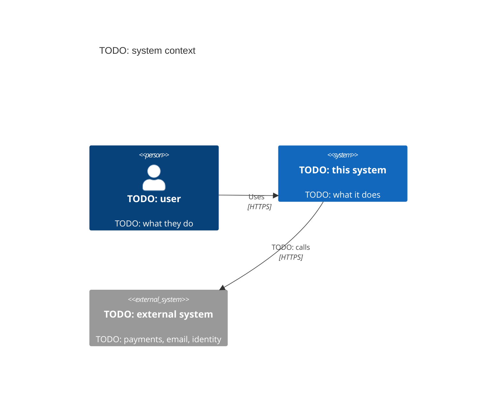
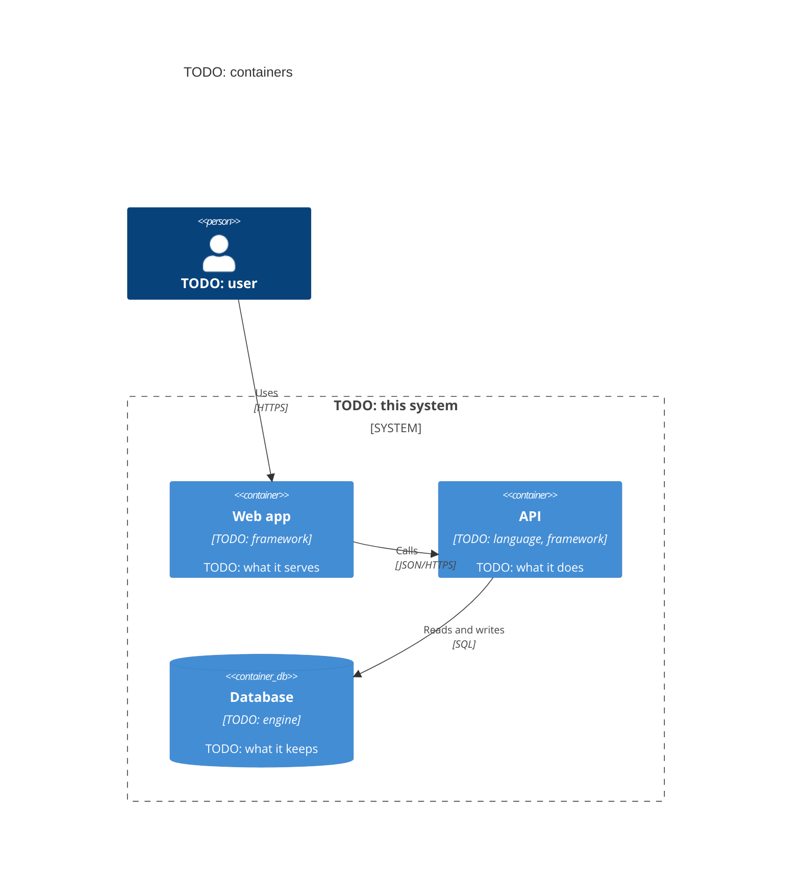
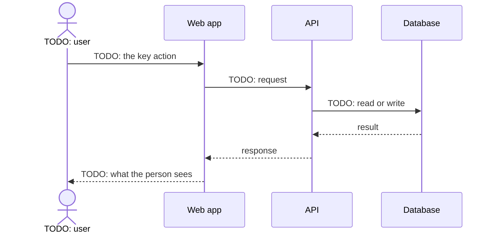

# Architecture overview: {{title}}

Written {{today}}. Living, never frozen: the system as it runs today. A tech spec starts from this page and shows only
what its change moves. After the change ships, a docs change folds the approved design back in here.

<!-- The architect writes this page (`aidd new architecture`) in the order of arc42 (arc42.org). It keeps only what a
     new teammate and a reviewer need: the goals and constraints, the context, the strategy, the building blocks, a few
     runtime flows, deployment, cross-cutting concepts, the decisions, quality targets, and risks. Each diagram is Mermaid, so it diffs like code. Never argue a decision here: link its ADR in
     `docs/adr/`. Keep the page true rather than complete. A section with nothing to say says "none yet".
     Write the prose at the `ste-80` level (the `aidd-team:plain-language` skill). -->

## Goals and constraints

<!-- What the system is for, in two sentences, and the top three quality goals (the Quality targets below rank them).
     Then the constraints a design may not break: the ones in `project` of `.aidd/config.yaml` (hosting, budget, the
     stack radar, rules), and any law, contract, or legacy system. Point to them; never copy them. -->

TODO: the purpose, the three quality goals, and the constraints.

## Context and scope

<!-- Who uses the system and which other systems it talks to, with what crosses each line (C4 system context). -->



- In scope: TODO. Out of scope: TODO.

## Solution strategy

<!-- The few decisions that shape everything else, one line each with its ADR: the architecture style (a modular
     monolith by default), the main technologies, how the system meets its top quality goal, and how it is
     organized. -->

| Decision | Why, in one line | ADR |
| --- | --- | --- |
| TODO: a modular monolith in one repository | TODO | `docs/adr/TODO` |

## Building blocks

<!-- The containers (C4): each deployable or data store, its technology, and who owns it. List the layers inside a
     container below the diagram, when the code declares any: the fitness functions check them. -->



| Container | Code | Owner | Layers, outermost first |
| --- | --- | --- | --- |
| API | `TODO: src/api/` | TODO | TODO: `api` then `service` then `domain`; `domain` imports neither |

## Module map

<!-- A modular monolith (the `modular_monolith` product default, `aidd-team:modular-monolith`): one row for each module
     under `modules/`, 3 to 8 to start. Each module has one owner and owns its tables. Events go from the module that
     publishes to the modules that consume. A dependency between modules, a new event, or a boundary move gets an ADR.
     Each module's own page is `modules/<name>/README.md`, from the aidd skill's `assets/module-readme.md`. A project
     with `modular_monolith` off writes "none" here. -->

| Module | Purpose | Owner | Subdomain | Owned data | Publishes | Consumes |
| --- | --- | --- | --- | --- | --- | --- |
| TODO: orders | TODO: takes and tracks orders | TODO | core | TODO: `orders` schema | TODO: `orders.order.placed.v1` | TODO: `billing.payment.captured.v1` |

## Runtime view

<!-- One or two flows that matter most (the money path, the sign-in), as sequence diagrams. Not every endpoint. -->



## Deployment view

<!-- Where each container runs, per environment, and what sits between them (load balancer, queue, CDN). -->

| Container | Runs on | Environments | Scaled by |
| --- | --- | --- | --- |
| TODO | TODO | preview, production | TODO |

<!-- The environment inventory: every environment the project runs, and only those. -->

| Environment | Purpose | Data | Who deploys | URL |
| --- | --- | --- | --- | --- |
| production | TODO | TODO | TODO | TODO |

## Cross-cutting concepts

<!-- The rules every container follows. Each concept links the ADR that decided it. A concept without one is a
     decision that nobody wrote down yet. -->

| Concept | How it works here | Decided in |
| --- | --- | --- |
| Authentication and authorization | TODO | `docs/adr/TODO` |
| Errors and logging | TODO | `docs/adr/TODO` |
| Persistence and migrations | TODO | `docs/adr/TODO` |
| Configuration and secrets | TODO | `docs/adr/TODO` |
| User interface | the repository's `DESIGN.md` and `design/tokens.json` | `docs/adr/TODO` |

## Architecture decisions

<!-- The index of the decisions that hold: link `docs/adr/` (one record per decision, MADR), and list the few a new
     teammate must read first. A superseded ADR stays, marked by the one that replaced it. -->

TODO: the ADRs to read first, or "none yet".

## Quality targets

<!-- Three to five ISO/IEC 25010 qualities, ranked, each with a number a test or a dashboard can check. -->

| Quality | Target | Checked by |
| --- | --- | --- |
| TODO: performance efficiency | TODO: p95 under 300 ms for checkout | TODO: the SLO, a load test |
| TODO: maintainability | the layers above hold | the fitness functions below |

## Fitness functions

<!-- A fitness function is an architectural rule that a machine checks on every change. It is an ordinary test
     command in the repository's `tests` (or a Spec's `tests.commands`). A change that breaks a layer then turns
     the gate red. The architect writes one for each rule that the Building blocks declare. Pick the checker for the
     stack. Each checker below is an example, not a requirement. -->

- Python: import-linter, a `layers` contract listing the layers outermost first, run with `lint-imports`.
- JavaScript and TypeScript: dependency-cruiser, a `forbidden` rule from the inner layer to the outer, run with `depcruise`.
- JVM: ArchUnit, `layeredArchitecture()` in a unit test, run by the build's test task.
- .NET: NetArchTest, `Types.InAssembly(...).That()...ShouldNot().HaveDependencyOn(...)` in a unit test.

```yaml
tests:
  - name: layers
    command: [lint-imports]
```

In a modular monolith, two more fitness functions hold the module map:

- Import rules: a module imports only another module's `api/` and `packages/`, `packages/` never imports a module, and
  no cycle joins two modules. The checker is the team's answer to the open choice `modular-monolith:module-boundaries`.
  It runs over the whole repository, and its violations baseline never grows.
- Data: no foreign key crosses two module schemas. On Postgres, this query returns zero rows. On SQLite or D1, which
  have no schemas, each module's SQL names only tables with its table prefix, checked by a lint script.

```sql
SELECT c.conname FROM pg_constraint c
JOIN pg_class t ON t.oid = c.conrelid
JOIN pg_class r ON r.oid = c.confrelid
WHERE c.contype = 'f' AND t.relnamespace <> r.relnamespace;
```

## Risks and technical debt

| Risk or debt | Impact | What would retire it |
| --- | --- | --- |
| TODO | TODO | TODO |

## Glossary

The domain's terms live in one place: TODO: link the glossary (`docs/GLOSSARY.md`, `aidd new glossary`), or "none yet".
