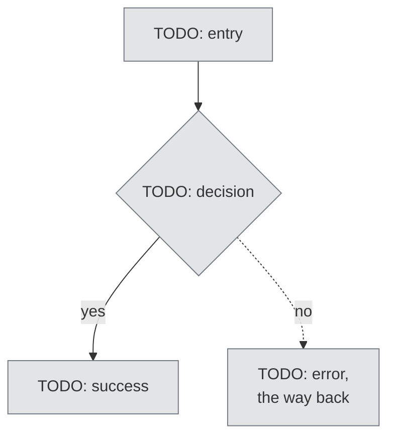

# Design spec: {{title}}

Spec: [{{spec}}][spec]. Written {{today}}. Frozen at Spec approval with the Spec, as the Spec's `design-spec` doc.

<!-- The product designer's design spec, next to the HTML prototype (`aidd new design-spec --prototype`, `prototype.html` in the
     design folder). Together they are the design source of truth that agents build against. An upstream design tool's
     handoff bundle or link may sit beside them, as an input only. It is never required, and never the source an agent
     reads. Export its frames as PNGs into the Spec's `design-files` docs. Export its tokens to a Design
     Tokens (DTCG) JSON file, proposed to design/tokens.json. Link them here. Link the Spec's Acceptance ids (A1, A2,
     ...) where a section answers one.
     Write the prose at the `instruction` level (the `aidd-team:plain-language` skill). -->

<!-- The light variant, for a small change or a solo founder, keeps these sections: Context of use, Flows, Screen
     inventory, Content and copy, Test hooks. `aidd new design-spec` writes it on the solo profile, and `--full`
     writes every section. On a team, delete the other sections for a small change. Either way, the Screen inventory
     lists only the targets you ship. A section that does not apply is left out, never filled with "not shipped". -->

## Context of use

<!-- ISO 9241-210 starts a design from the context of use. Link the Intent's "Who and what it touches" and the product
     brief's Users, and never copy them. Write only what this change adds or narrows. -->

- Users: TODO: who uses it, what they know, and what they need, assistive technology included
- Goals: TODO: what they want to get done
- Tasks: TODO: what they do to reach it, as the flows below show
- Environment: TODO: the device and connection, the place and light, interruptions, and who else is present

## Flows

<!-- One diagram per journey that the Spec's Acceptance names. Each diagram shows:
     - its entry points (a link, a notification, a deep link)
     - each decision, each error path, and the way back from it
     - its exit points (done, cancelled, abandoned).
     A screen is a box named as in the Screen inventory, a decision a diamond, an error path a dashed edge. When the
     Spec adds screens, draw the sitemap first. Mark the new screens "(new)" and the changed ones "(changed)". Put the
     Acceptance ids a journey covers in its heading. -->

Legend: a diamond is a decision, and a dashed line an error path.

## Screen inventory

<!-- Every screen, by every state it can be in, by every target it ships to, in each theme: one row for each. The Screen
     column holds the prototype's screen id (its `data-screen`). The flows, the screenshots, and the tests use the same
     name. The View cell links one of these:
     - a prototype deep link: `prototype.html#<screen>/<state>`, with `?theme=dark&frame=ios` for a theme and a
       frame, so a reviewer opens exactly that view
     - a screenshot in a `design-files` doc, named `<screen>-<state>-<frame>-<theme>.png` (such as
       `checkout-error-320-dark.png`).
     A product with one theme (`dark_mode` in `project.defaults.disabled`) drops the theme: `<screen>-<state>-<frame>.png`.
     "n/a" says why a state cannot happen.
     States: empty, loading, partial, error, success, offline, permission denied, first run, and a screen's own
     (no-results, submitting, validation-error). An error state answers each problem type the API returns (RFC 9457
     `type`): the design writes its copy, and shows `detail` only where the API localizes it. The example data covers the edges: the
     longest name the field allows, a missing image, a long list, and the last page.
     Targets: name only those the product ships to, such as
     - web breakpoints 320, 768, 1024, and 1440 CSS px
     - iOS
     - Android window size classes compact (under 600dp), medium (600 to 839dp), and expanded (840 to 1199dp)
     - or the product's own: a terminal, a desktop window, a TV.
     Theme: light and dark, the default. `aidd validate` warns when this table names no dark theme while dark_mode is
     on. -->

| Screen | State | Theme | Target | View |
| --- | --- | --- | --- | --- |
| TODO | error | light, dark | TODO: web 320 | #TODO/error?frame=320 |

## Tokens and components

<!-- Use the repository's design system (`DESIGN.md` and `design/tokens.json`) as it is, and never copy it here. List
     only the deltas this Spec needs: a new token, a changed component, a new variant. Each delta is a proposed change
     to the design system. Open it as its own change (its area routes it normal), and merge it before
     Spec approval. A value the system lacks is a question for a person, not an invention.
     For a component, prefer one that DESIGN.md lists; else use a registry item restyled with the roles. The registry
     is the component library the stack's standards pick, or else an accessible headless component library for the
     stack. Specify a new or changed component in DESIGN.md's Components section (its anatomy, props,
     states, and accessibility), in that same change. -->

| Token or component | Change | Why |
| --- | --- | --- |
| TODO | new / changed / none | TODO; a new or changed component names its row in DESIGN.md |

## Interactions and motion

<!-- What responds to what: gestures, transitions, and their durations. With reduced motion on (prefers-reduced-motion,
     iOS Reduce Motion, Android remove animations), every motion becomes a cut or a fade. -->

TODO: the interactions, and what happens under reduced motion.

## Platforms

<!-- Only the deltas from the shared design above, per platform the product ships to. Follow each platform's own
     guidance by name: Apple's Human Interface Guidelines for iOS, Material 3 for Android, and the target's own guide
     for any other. The prototype renders the
     same screens on every frame: a tab bar and a back affordance on iOS and Android, header navigation on the web.
     Write here what differs beyond that, and the prototype follows it. -->

### Web

TODO: navigation pattern, back behavior (browser history), dialogs and sheets, focus management. Delete this subsection
when the web has no delta, or the product does not ship to it.

### iOS

TODO, per the Human Interface Guidelines. Delete this subsection when the product does not ship to iOS:

- navigation (tab bar, navigation stack), and back (edge swipe)
- sheets and their detents, and haptic feedback
- permission prompts and their pre-prompt copy.

### Android

TODO, per Material 3. Delete this subsection when the product does not ship to Android:

- navigation (bar or rail by window size class), system back and predictive back
- bottom sheets and haptic feedback
- runtime permission prompts.

## Accessibility

<!-- WCAG 2.2 AA. Name each success criterion this change touches, then the platform detail. -->

- Criteria touched: TODO (such as 1.4.3 contrast, 2.4.7 focus visible, 2.5.8 target size minimum of 24 by 24 CSS px).
- Focus order: TODO, per screen, including where focus goes after an error or a dialog closes.
- Screen reader labels: TODO, the VoiceOver and TalkBack label, and the web accessible name, for each control without visible text.
- Text size: TODO, how each screen behaves at 200% zoom, the largest Dynamic Type size, and Android font scale 2.0.

## Content and copy

<!-- Every string a person sees, by key, in the product's voice; real copy, never lorem ipsum. -->

| String key | Copy | Where | Note |
| --- | --- | --- | --- |
| TODO.title | TODO | TODO | |

## Localization

<!-- Cover each of these:
     - text expansion: plan for about 30% longer, more for short labels
     - right-to-left (RTL) mirroring
     - plural rules: ICU plural categories, never "item(s)"
     - date, number, and currency formats. -->

TODO: expansion, RTL, plural forms, formats. Delete this section when the product ships in one locale.

## Analytics hooks

<!-- The events this UI fires, by name from the tracking plan (`aidd new tracking-plan`), and the element that fires each.
     Delete this section when the change fires no event. -->

| Event | Fired by | Tracking plan row |
| --- | --- | --- |
| TODO | TODO | TODO |

## Test hooks

<!-- One stable name per interactive element, the same on every platform, so the verifier's tests select it. Web uses
     `data-testid`, iOS `accessibilityIdentifier`, and Android Compose `testTag` (or the view's resource id). -->

| Element | Name (data-testid, accessibilityIdentifier, testTag) | States |
| --- | --- | --- |
| TODO: primary action | TODO-primary-action | all |

## Usability test

<!-- Before launch, test this prototype with five people who will use it (an exploration's sketch for an early direction).
     One round finds most problems in one flow. Run another round after the fixes. After launch, what users say goes in
     the feedback log (`aidd new feedback`) instead. No personal data here: a participant is a code (P1, P2, ...). A
     finding that changes the Spec goes back through Spec approval. A person decides each finding. Delete this section
     when the change needs no test with users. -->

Goals: TODO: the question this round answers (such as "can a first-time buyer finish checkout without help?") and the
Acceptance ids it checks.

Participants: TODO: the segment, how many (5 per round), at least one assistive technology user, how they are recruited,
the consent, and the incentive.

Tasks, one row each:

| Task | In the participant's words | Start point | Success criteria |
| --- | --- | --- | --- |
| T1 | TODO: "You want to ..." (never the button's label) | TODO: screen or state | TODO: what counts as done |

Script, in this order:

1. consent, and "we test the design, not you"
2. think aloud
3. each task read aloud, and no help until the time limit
4. "how easy was that?" (1 to 7) after each task
5. the SUS questionnaire at the end, if used.

Findings, one row each; the product designer proposes, a person decides:

| Finding | Task | Severity (4 blocks, 3 major, 2 minor, 1 cosmetic) | Evidence | Decision (fix now, later, or accept), by, date |
| --- | --- | --- | --- | --- |
| F1: TODO | T1 | TODO | TODO: P2, P4 at 03:12 | TODO |

[spec]: {{spec_link}}
