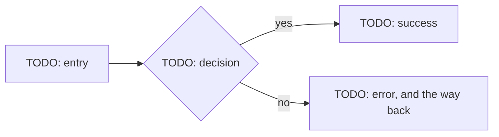

# Design spec: {{title}}

Spec: [{{spec}}][spec]. Written {{today}}. Frozen at Spec approval with the Spec, as the Spec's `design-spec` doc.

<!-- The product designer's design spec, next to the HTML prototype (`aidd new design-spec --prototype`, `prototype.html` in the
     design folder). Together they are the design source of truth that agents build against. A Claude Design handoff
     bundle, a Figma link, or another tool may sit upstream, as an input only. It is never required, and never the
     source an agent reads. Export its frames as PNGs into the Spec's `design.files`. Export its tokens to a Design
     Tokens (DTCG) JSON file, proposed to design/tokens.json. Link them here. Link the Spec's Acceptance ids (A1, A2,
     ...) where a section answers one.
     Write the prose at the `ste-80` level (the `aidd-team:plain-language` skill). -->

## Flows

<!-- One diagram per journey that the Spec's Acceptance names. Each diagram shows:
     - its entry points (a link, a notification, a deep link)
     - each decision, each error path, and the way back from it
     - its exit points (done, cancelled, abandoned).
     A screen is a box named as in the Screen inventory, a decision a diamond, an error path a dashed edge. When the
     Spec adds screens, draw the sitemap first. Mark the new screens "(new)" and the changed ones "(changed)". Put the
     Acceptance ids a journey covers in its heading. -->

## Screen inventory

<!-- Every screen, by every state it can be in, by every target it ships to, in each theme. The Screen column holds the
     prototype's screen id (its `data-screen`). The flows, the screenshots, and the tests use the same name.
     A cell links one of these:
     - a prototype deep link: `prototype.html#<screen>/<state>`, with `?theme=dark&frame=ios` for a theme and a
       frame, so a reviewer opens exactly that view
     - a screenshot in `design.files`, named `<screen>-<state>-<target>-<theme>.png` (such as
       `checkout-error-320-dark.png`).
     A product with one theme (`dark_mode` in `[project.defaults] off`) drops the theme: `<screen>-<state>-<target>.png`.
     "n/a" says why a state cannot happen.
     States: empty, loading, partial, error, success, offline, permission denied, first run.
     Targets: drop the ones the product does not ship to.
     - web breakpoints 320, 768, 1024, and 1440 CSS px
     - iOS
     - Android window size classes compact (under 600dp), medium (600 to 839dp), and expanded (840 to 1199dp).
     Theme: light and dark, the default. `aidd validate` warns when this table names no dark theme while dark_mode is
     on. -->

| Screen | State | Theme | Web 320 | Web 768 | Web 1024 | Web 1440 | iOS | Android compact | Android medium | Android expanded |
| --- | --- | --- | --- | --- | --- | --- | --- | --- | --- | --- |
| TODO | empty | light, dark | #TODO/empty?frame=320 | | | | | | | |
| TODO | loading | light, dark | #TODO/loading?frame=320 | | | | | | | |
| TODO | partial | light, dark | #TODO/partial?frame=320 | | | | | | | |
| TODO | error | light, dark | #TODO/error?frame=320 | | | | | | | |
| TODO | success | light, dark | #TODO/success?frame=320 | | | | | | | |
| TODO | offline | light, dark | #TODO/offline?frame=320 | | | | | | | |
| TODO | permission denied | light, dark | #TODO/permission-denied?frame=320 | | | | | | | |
| TODO | first run | light, dark | #TODO/first-run?frame=320 | | | | | | | |

## Tokens and components

<!-- Use the repository's design system (`DESIGN.md` and `design/tokens.json`) as it is, and never copy it here. List
     only the deltas this Spec needs: a new token, a changed component, a new variant. Each delta is a proposed change
     to the design system. Open it as its own change (`baseline:design-system` routes it normal), and merge it before
     Spec approval. A value the system lacks is a question for a person, not an invention.
     For a component, prefer one that DESIGN.md lists; else use a registry item restyled with the roles. The registry
     item is shadcn/ui on Radix primitives on a React stack, otherwise the stack's accessible headless component
     library. Specify a new or changed component in DESIGN.md's Components section (its anatomy, props, states, and
     accessibility), in that same change. -->

| Token or component | Change | Why |
| --- | --- | --- |
| TODO | new / changed / none | TODO; a new or changed component names its row in DESIGN.md |

## Interactions and motion

<!-- What responds to what: gestures, transitions, and their durations. With reduced motion on (prefers-reduced-motion,
     iOS Reduce Motion, Android remove animations), every motion becomes a cut or a fade. -->

TODO: the interactions, and what happens under reduced motion.

## Platforms

<!-- Only the deltas from the shared design above, per platform the product ships to. Follow each platform's own
     guidance by name: Apple's Human Interface Guidelines for iOS, Material 3 for Android. The prototype renders the
     same screens on every frame: a tab bar and a back affordance on iOS and Android, header navigation on the web.
     Write here what differs beyond that, and the prototype follows it. -->

### Web

TODO: navigation pattern, back behaviour (browser history), dialogs and sheets, focus management; or "no delta".

### iOS

TODO, per the Human Interface Guidelines, or "not shipped":

- navigation (tab bar, navigation stack), and back (edge swipe)
- sheets and their detents, and haptic feedback
- permission prompts and their pre-prompt copy.

### Android

TODO, per Material 3, or "not shipped":

- navigation (bar or rail by window size class), system back and predictive back
- bottom sheets and haptic feedback
- runtime permission prompts.

## Accessibility

<!-- WCAG 2.2 AA. Name each success criterion this change touches, then the platform detail. -->

- Criteria touched: TODO (such as 1.4.3 contrast, 2.4.7 focus visible, 2.5.8 target size minimum of 24 by 24 CSS px).
- Focus order: TODO, per screen, including where focus goes after an error or a dialog closes.
- Screen reader labels: TODO, the VoiceOver and TalkBack label, and the web accessible name, for each control without visible text.
- Text size: TODO, how each screen behaves at 200% zoom, the largest Dynamic Type size, and Android font scale 2.0.

## Content and copy

<!-- Every string a person sees, by key, in the product's voice; real copy, never lorem ipsum. -->

| String key | Copy | Where | Note |
| --- | --- | --- | --- |
| TODO.title | TODO | TODO | |

## Localization

<!-- Cover each of these:
     - text expansion: plan for about 30% longer, more for short labels
     - right-to-left (RTL) mirroring
     - plural rules: ICU plural categories, never "item(s)"
     - date, number, and currency formats. -->

TODO: expansion, RTL, plural forms, formats; or "one locale, because ...".

## Analytics hooks

<!-- The events this UI fires, by name from the tracking plan (`aidd new analytics`), and the element that fires each. -->

| Event | Fired by | Tracking plan row |
| --- | --- | --- |
| TODO | TODO | TODO |

## Test hooks

<!-- One stable name per interactive element, the same on every platform, so the tester's tests select it. Web uses
     `data-testid`, iOS `accessibilityIdentifier`, and Android Compose `testTag` (or the view's resource id). -->

| Element | Name (data-testid, accessibilityIdentifier, testTag) | States |
| --- | --- | --- |
| TODO: primary action | TODO-primary-action | all |

## Usability test

<!-- Before launch, test this prototype with five people who will use it (its wireframe mode for an early direction).
     One round finds most problems in one flow. Run another round after the fixes. After launch, what users say goes in
     the feedback log (`aidd new feedback`) instead. No personal data here: a participant is a code (P1, P2, ...). A
     finding that changes the Spec goes back through Spec approval. A person decides each finding. Delete this section
     when the change needs no test with users. -->

Goals: TODO: the question this round answers (such as "can a first-time buyer finish checkout without help?") and the
Acceptance ids it checks.

Participants: TODO: the segment, how many (5 per round), at least one assistive technology user, how they are recruited,
the consent, and the incentive.

Tasks, one row each:

| Task | In the participant's words | Start point | Success criteria |
| --- | --- | --- | --- |
| T1 | TODO: "You want to ..." (never the button's label) | TODO: screen or state | TODO: what counts as done |

Script, in this order:

1. consent, and "we test the design, not you"
2. think aloud
3. each task read aloud, and no help until the time limit
4. "how easy was that?" (1 to 7) after each task
5. the SUS questionnaire at the end, if used.

Findings, one row each; the product designer proposes, a person decides:

| Finding | Task | Severity (4 blocks, 3 major, 2 minor, 1 cosmetic) | Evidence | Decision (fix now, later, or accept), by, date |
| --- | --- | --- | --- | --- |
| F1: TODO | T1 | TODO | TODO: P2, P4 at 03:12 | TODO |

## Light variant

<!-- For a small change or a solo founder: keep Flows, Screen inventory (only the targets you ship), Content and copy,
     and Test hooks. Delete the other sections and this one. -->

[spec]: {{spec_link}}
