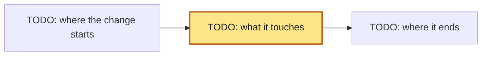

+++
aidd_version = "1.0.0"
kind = "spec"
id = "{{id}}"
title = "{{title}}"
owner_team = "{{owner_team}}"
type = "{{type}}"                 # feat, fix, refactor, perf, docs, test, build, ci, chore, deps, infra, data, security, compliance
route = "{{route}}"               # normal or major (emergency: backfill after the repair); never below the route `aidd next` computes
confidence = "high"               # high, medium, low (low: stop and answer open_questions)
open_questions = []               # facts still unknown; empty when confidence is high
trace_id = "{{trace_id}}"
assisted_by = []                  # "harness/model" for every agent that writes code or tests; fill before Spec approval
rollback = "Revert the PR/MR."    # name the steps on major and emergency, and what a revert cannot undo
residual_risk = "TODO: what stays true after release, or why nothing does"
# hypothesis = "TODO: metric, baseline, expected move, by when"  # frozen by Spec approval; required when the change is meant to move a metric

[risk]
summary = "TODO: who or what behaves differently after this change."
dimensions = []                   # data, security, privacy, financial, compliance, availability, third_party, cost
reversible = true                 # false when a revert does not restore the prior state; false forces major

[[tasks]]
id = "{{id}}-T1"
title = "TODO: first slice"
scope = ["src/TODO/"]             # globs this Task's diff may change. Never a test or design file, never a
                                  # catch-all, and never overlapping a sibling Task's scope without depends_on.
                                  # tests.files must cover every path literal your commands run.
depends_on = []                   # the order: Tasks that must finish first
risk = "TODO: what this Task could break, and how it guards against it"
proof = "TODO: the test command, screenshot, or check that shows this Task works"
assignee = "agent:developer"      # TODO pick the role by artifact, not from this default:
                                  # agent:developer, agent:ml-engineer, agent:data-engineer,
                                  # agent:platform-engineer, agent:tech-writer, or a person

# [design]                        # user-facing changes only: the approved look and flow, frozen at Spec approval.
# files = ["docs/design/TODO/**"] # Mockups, wireframes, the prototype, every state. Distinct from ## Design below.

[tests]
files = ["tests/TODO"]            # frozen by the Spec approval hash: the test files, plus the config they run through
                                  # (a Makefile target, a pytest config), so nobody can move the goalposts.

[[tests.commands]]
name = "acceptance"
command = ["TODO"]                # a vector, one argument per item; never a shell string
new_behavior = true               # feat and fix: must fail on base (red) and pass on head (green).
                                  # false for refactor, docs, build: passes on base too.
covers = ["A1"]                   # the Acceptance ids this command proves; `aidd validate` warns about an
                                  # Acceptance item no command covers (optional; delete to skip the check)
+++

<!-- Everything between the +++ lines is frozen into the Spec approval hash. `aidd validate` errors on a
     TODO left in a Task's scope, in tests.files, or in a command, so the placeholders below cannot be
     forgotten. Guidance is in HTML comments: invisible when rendered, harmless if you leave it in.
     A complete worked example: references/example.md. Field reference: references/spec.md. -->

## Intent

<!-- The originator's own words, captured before any design: quote the ticket, the message, or the
     conversation, and do not improve them. Five lines, in this order:
     Problem: what is wrong or missing, as they said it.
     Outcome: what they want to be true afterwards.
     Who is affected: the people or systems that feel it.
     Constraints: deadlines, budgets, what must not change.
     Open questions: what they did not say; each one is an `open_questions` entry above.
     Everything below is your reading of this; a reviewer checks the reading against these words.
     `aidd validate` warns while this section is empty. -->

## Problem

<!-- Who has it, what it costs them, and the evidence: a gate event, an incident, a metric, a support
     thread. Two to six sentences. If you cannot name who feels this, it belongs in Non-goals.
     This section answers "is this the right problem"; everything after it answers "is this the right
     solution", and an Approver decides them in that order. -->

## Context

<!-- What a reader must already know to judge the Design: the files involved and the patterns they
     follow, the constraints (compatibility, a frozen dependency, a deadline), and the assumptions you
     could not verify. Do not restate the Problem. No date here: the VCS and the gate record carry it. -->

## Goals

<!-- What is true after this change that is not true before. Three to seven lines. Each one is either an
     Acceptance scenario below or the front matter's `hypothesis`. A goal that is neither is a goal you
     cannot prove, which makes it a Non-goal. -->

## Non-goals

<!-- What this change deliberately does not do, and the adjacent thing a reader will assume it does.
     The gate enforces the Task's scope; only you can rule out the feature nobody asked for, the
     single-use abstraction, and the drive-by refactor. -->

## Acceptance

<!-- One behaviour per scenario. Gherkin for anything a person can observe; a schema, a table, a
     threshold, or an invariant for anything else. No implementation detail: "request 61 returns 429",
     not "the limiter raises RateLimited". Give each item an id, A1, A2, and so on, at the start of its
     scenario name or its table row, and list the ids each test command proves in its `covers`. -->

```gherkin
Scenario: A1 TODO: the behaviour in a few words
  Given ...
  When ...
  Then ...
```

<!-- Then show the mapping. "Every line maps to a test command" is a claim; a table is traceability.
     A row whose command you cannot name is an Acceptance line you cannot prove, so it is a Non-goal. -->

| Acceptance | Proven by | Red on base |
| --- | --- | --- |
| A1 | a `tests.commands` name | yes / no / n-a |

## Design

<!-- The approach, in prose first: the shape of the change, the data it moves, the interfaces it
     touches, and the invariant it keeps. Name the files and functions you will change, because that
     is what a reviewer checks your Task scopes against.

     A diagram earns its place only when it shows something prose cannot. Pick the view that answers
     the question a reviewer will actually ask, and caption it with that question:

| If the reviewer will ask | Draw |
| --- | --- |
| what talks to what, and who trusts whom | a flowchart of the data or call path, with the trust boundary marked |
| what states this can be in, and what moves between them | a state diagram |
| what happens in what order, across processes | a sequence diagram |
| what the structure looked like before and after | two flowcharts, or one with the changed nodes styled |

     A change that is a list of independent local fixes has no shape to draw. Say so in one line here
     and skip the diagram; `aidd validate` accepts a Design section that has prose and no picture.
     What it does not accept is an empty Design section. If you do draw one, this is the shape:


-->

## Alternatives considered

<!-- One row per option you seriously weighed, including "do nothing" and "do it later". This is the
     section a reviewer reads to find out whether you searched the design space or stopped at the
     first idea that worked. Link an ADR in the front matter's `decisions` when the choice outlives
     this change. `aidd validate` warns while this section is empty, so write the table here:

| Option | Why not |
| --- | --- |
| the approach in Design above | chosen |
| do nothing | |
-->

## Cross-cutting concerns

<!-- Answer every subsection. "Not applicable, because ..." is an answer; a blank is not. Delete a
     subsection only when the change cannot touch it at all, and say why in the one above it. -->

### Security and privacy

<!-- New attack surface, new trust boundary, new secret, new personal data, new permission, new
     untrusted input. Name the threat and the control that answers it. When any of these is yes, list
     `threat-model` or `secure-coding` in the Task's `skills`. -->

### Compatibility and migration

<!-- What breaks for an existing consumer: an API, a schema, a file format, a record already written,
     a config already deployed. How existing data moves, in what order, and whether the move is
     reversible. List `schema-migration` in the Task's `skills` when a stored record changes shape. -->

### Accessibility, locale, and content

<!-- Only when a person sees or reads the change. List `accessible-ui` or `internationalization` in
     the Task's `skills`. The config's `locale` governs ticket titles and PR summaries; it does not
     translate your strings. -->

### Compliance

<!-- Only when a law, a standard, or a contract binds the change: each obligation, the control that meets it, and
     the evidence that proves it (a test, a file, the gate record). With the delivery team, the compliance analyst's
     return template (references/spec.md) is folded in here. -->

### Observability

<!-- What a human looks at to know this is working, and what fires when it is not. This is the source
     of `observe.signals` in the front matter: if you cannot fill this, you cannot fill that. -->

## Policy conflicts

<!-- Where specialist input, a domain pack, or org policy contradict each other (security wants the
     data kept, privacy wants it deleted; a pack's standard against the org preset), list each
     conflict and the human who must decide it. Never settle one by picking a side yourself.
     Write `none` when there are none. `aidd validate` warns while this section is empty on a
     major Spec, or on one whose risk names more than one specialist pool:

| Conflict | Between | Who decides |
| --- | --- | --- |
| | | |
-->

## Rollout

<!-- How it lands, as distinct from how it is undone. Stages and their order, a feature flag and who
     flips it, a backfill or dual-write window, a deprecation date, and the point of no return.
     `rollback` in the front matter is the emergency exit; this is the plan. For type = data or
     compliance this section carries the change, and Design is the short one. -->

## Pre-mortem

<!-- Required on major. Assume this change failed in production three weeks after merge. Write why.
     Each cause is answered by exactly one of: an Acceptance scenario above, a rollback step, or an
     observe signal — say which, because a cause with no answer is a risk you are accepting silently
     and should move to `residual_risk`. `aidd validate` warns while this section is empty:

| If it failed, the cause was | Answered by |
| --- | --- |
| | acceptance / rollback / observe |
-->

## Learn

<!-- Filled after Ship, never before, and not part of what the Spec approval covers. What the observe window showed,
     whether the `hypothesis` was met, what you would tell the next person, and the PR that fed a
     lesson back into AGENTS.md, a skill, or a test — recorded in `outcome.learn_ref`. -->
