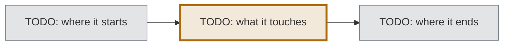

<!-- After approval, an edit between the --- lines is spec.revise. `aidd validate` errors on a TODO left in a Task's
     scope, in tests.files, or in a command. So nobody can forget the placeholders below. Guidance is in HTML
     comments: invisible when rendered, harmless if you leave it in. A complete worked example:
     references/example.md. Field reference: references/spec.md.
     Write the prose at the `instruction` level (the `aidd-team:plain-language` skill). -->

## Request

<!-- The person's own words, captured before any design. Quote the ticket, the message, or the conversation, and
     do not improve them. Leave out secrets, credentials, and others' personal data, each marked, as
     `[left out: a password]`. Five lines, in this order:
     1. Problem: what is wrong or missing, as they said it.
     2. Outcome: what they want to be true afterwards.
     3. Who is affected: the people or systems that feel it.
     4. Constraints: deadlines, budgets, what must not change.
     5. Open questions: what they did not say; each one is an `open_questions` entry above.
     Everything below is your reading of this. A reviewer checks the reading against these words. `aidd validate`
     warns while this section is empty. -->

## Problem

<!-- Who has it, what it costs them, and the evidence: an incident, a metric, a support ticket, a
     thread. Two to six sentences. If you cannot name who feels this, it belongs in Non-goals.
     This section answers "is this the right problem". Everything after it answers "is this the right solution". A
     person who approves decides them in that order. -->

## Context

<!-- What a reader must already know to judge the Design:
     - the files involved, and the patterns they follow
     - the constraints (compatibility, a frozen dependency, a deadline)
     - the assumptions you could not verify.
     Do not restate the Problem. No date here: git carries it. -->

## Goals

<!-- What is true after this change that is not true before. Three to seven lines. Each one is either an
     Acceptance scenario below or the front matter's `hypothesis`. A goal that is neither is a goal you
     cannot prove, which makes it a Non-goal. -->

## Non-goals

<!-- What this change deliberately does not do, and the adjacent thing a reader will assume it does.
     The Task's scope bounds the files. Only you can rule out the feature nobody asked for, the single-use
     abstraction, and the drive-by refactor. -->

## Acceptance

<!-- One behavior per scenario. Gherkin for anything a person can observe; a schema, a table, a
     threshold, or an invariant for anything else. No implementation detail: "request 61 returns 429",
     not "the limiter raises RateLimited". Give each item an id (A1, A2, and so on) at the start of its scenario name
     or table row. List the ids each test command proves in its `covers`.
     A business rule with three or more conditions is a decision table with a hit policy, one id per row
     (`aidd-team:product-discovery`, "Rules and decision tables"). -->

```gherkin
Scenario: A1 TODO: the behavior in a few words
  Given ...
  When ...
  Then ...
```

<!-- The traceability is each test command's `covers` in the front matter, never a table typed here. `aidd validate`
     warns about an id no command covers. `aidd test` shows red on base and green on head. An Acceptance line no
     command can prove is a Non-goal. -->

## Design

<!-- A major Spec links a tech spec (`aidd new tech-spec <topic> --spec {{id}}`). The tech spec holds the design in
     depth, the alternatives, the cross-cutting concerns, and the pre-mortem. This section stays the short version that
     a person reads at Spec approval. The rollout (its waves, the flag, the point of no return) is a `## Rollout` section
     after Rollback (`references/spec-release.md`), never part of this Design.
     Write the approach in prose first. Cover the shape of the change, the data it moves, the interfaces it touches,
     and the invariant it keeps. Name the files and functions you will change: a reviewer checks your Task scopes
     against them. Where a maintained project or a managed service already does the job (sign-in, notifications,
     search, billing, feature flags), adopt it, or say why you build instead.

     A diagram earns its place only when it shows something prose cannot. Pick the view that answers the question a
     reviewer will actually ask. Caption it with that question:

| If the reviewer will ask | Draw |
| --- | --- |
| what talks to what, and who trusts whom | a flowchart of the data or call path, with the trust boundary marked |
| what states this can be in, and what moves between them | a state diagram |
| what happens in what order, across processes | a sequence diagram |
| what the structure looked like before and after | two flowcharts, or one with the changed nodes styled |

     A change that is a list of independent local fixes has no shape to draw. Say so in one line here, and skip the
     diagram. `aidd validate` accepts a Design section that has prose and no picture. What it does not accept is an
     empty Design section. If you do draw one, this is the shape:


     Under it, one line of legend: the thick border marks what the change touches.
-->

## Non-functional requirements

<!-- The speed and size the change must hold, so it never ships working but slow. One row per hot path it touches: the
     request, job, page, or query, its data today and at 10x, and a budget with a percentile, a load, and an environment.
     The budget itself is an Acceptance line (`aidd-team:performance`), which this table names. This table is the one
     home of the hot-path budgets: the tech spec and the architecture page cite its Acceptance id and never restate the
     number. On no hot path, one line instead says why. -->

| Hot path | Data today | Data at 10x | Budget |
| --- | --- | --- | --- |
| TODO: e.g. `GET /orders` | TODO: 20,000 orders | TODO: 200,000 | TODO: e.g. A3 |

## Concerns

<!-- Each risk by area (security, privacy, compliance, UX, operations, domain) and the specialist who owns it. -->

none

## Policy conflicts

<!-- List each conflict between specialist input, a domain pack, and the company's rules. Name the person who must decide
     each one. For example: security wants the data kept, privacy wants it deleted; or a pack's standard against the org
     preset. Never settle one by picking a side yourself. Write `none` when there are none. `aidd validate` warns
     while this section is empty on a major Spec, or on one whose risk names more than one specialist pool:

| Conflict | Between | Who decides |
| --- | --- | --- |
| | | |
-->

## Rollback

<!-- How to undo it, beyond `rollback` in the front matter, and what a revert cannot restore (data written, messages
     sent, a migration's contract step). The staged rollout and its point of no return are `## Rollout`'s. -->

TODO: how to undo it.

## Learn

<!-- Fill this in after Roll out, never before. It is not part of what the Spec approval covers. Write:
     - what the observe window showed
     - whether the `hypothesis` was met
     - what you would tell the next person
     - the PR that fed a lesson back into AGENTS.md, a skill, or a test, recorded in `outcome.learn_ref`. -->
