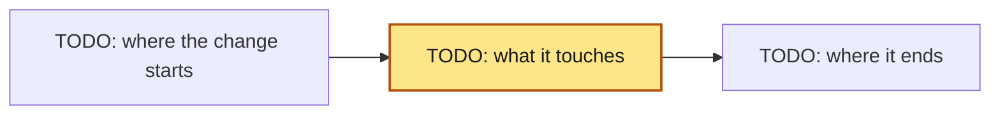

+++
aidd_version = "1.0.0"
kind = "spec"
id = "{{id}}"
title = "{{title}}"
owner_team = "{{owner_team}}"
type = "{{type}}"                 # feat, fix, refactor, perf, docs, test, build, ci, chore, deps, infra, data, security, compliance
route = "{{route}}"               # normal or major (emergency: backfill after the repair); never below the route `aidd assess` computes
confidence = "high"               # high, medium, low (low: stop and answer open_questions)
open_questions = []               # facts still unknown; empty when confidence is high
trace_id = "{{trace_id}}"
assisted_by = []                  # "harness/model" for every agent that writes code or tests; fill before Spec approval
rollback = "Revert the change."   # name the steps on major and emergency, and what a revert cannot undo
residual_risk = "TODO: what stays true after release, or why nothing does"
# hypothesis = "TODO: metric, baseline, expected move, by when"  # frozen by Spec approval; required when the change is meant to move a metric
# uat = true                      # people accept this change by hand (a client UAT, a QA owner, a device lab): asks for a test plan

[risk]
summary = "TODO: who or what behaves differently after this change."
dimensions = []                   # data, security, privacy, financial, compliance, availability, third_party, cost
reversible = true                 # false when a revert does not restore the prior state; false forces major

[[tasks]]
id = "{{id}}-T1"
title = "TODO: first slice"
scope = ["src/TODO/"]             # globs this Task's diff may change. Never a test or design file, never a
                                  # catch-all, and never overlapping a sibling Task's scope without depends_on.
                                  # tests.files must cover every path literal your commands run.
depends_on = []                   # the order: Tasks that must finish first
risk = "TODO: what this Task could break, and how it guards against it"
proof = "TODO: the test command, screenshot, or check that shows this Task works"
assignee = "agent:developer"      # TODO pick the role by artifact, not from this default:
                                  # agent:developer, agent:ml-engineer, agent:data-engineer,
                                  # agent:platform-engineer, agent:tech-writer, or a person

# [design]                        # user-facing changes only: the approved look and flow, frozen at Spec approval.
# files = ["docs/design/TODO/**"] # Mockups, wireframes, the prototype, every state. Distinct from ## Design below.

# [[docs]]                        # the detail this Spec links instead of carrying: `aidd new <kind> <topic> --spec {{id}}`
# kind = "tech-spec"              # writes the file from its template and adds the entry. Frozen by the Spec hash unless
# path = "docs/specs/{{id}}/tech-spec-TODO.md"  # frozen = false (a living runbook or SLO, only checked to exist).
#                                 # When to add each kind (`aidd validate` warns only; [docs.required] tunes it):
#                                 #   tech-spec     major: Design in depth, Alternatives, cross-cutting concerns, Test strategy, Pre-mortem
#                                 #   test-plan     compliance, regulated, a device path, uat, or 10+ Acceptance items
#                                 #   ui            a user-facing feat on major (or design.files): the design spec, or the prototype
#                                 #   migration     a data dimension or type, or reversible = false: expand, migrate, contract
#                                 #   analytics     a hypothesis: the tracking plan that measures it
#                                 #   threat-model  a security, privacy, or data risk dimension: written before Spec approval
#                                 #   adr           a decision that outlives this change (docs/adr/NNNN-<topic>.md)
#                                 #   runbook       major: the rollout (`aidd new runbook <ID> --spec {{id}}`, living)

[tests]
files = ["tests/TODO"]            # frozen by the Spec hash: the test files, plus the config they run through
                                  # (a Makefile target, a pytest config), so nobody can move the goalposts.

[[tests.commands]]
name = "acceptance"
command = ["TODO"]                # a vector, one argument per item; never a shell string
new_behavior = true               # feat and fix: must fail on base (red) and pass on head (green).
                                  # false for refactor, docs, build: passes on base too.
covers = ["A1"]                   # the Acceptance ids this command proves; `aidd validate` warns about an
                                  # Acceptance item no command covers (optional; delete to skip the check)
+++

<!-- Everything between the +++ lines is frozen into the Spec hash. `aidd validate` errors on a TODO left in a Task's
     scope, in tests.files, or in a command. So nobody can forget the placeholders below. Guidance is in HTML
     comments: invisible when rendered, harmless if you leave it in. A complete worked example:
     references/example.md. Field reference: references/spec.md.
     Write the prose at the `ste-80` level (the `aidd-team:plain-language` skill). -->

## Intent

<!-- The originator's own words, captured before any design. Quote the ticket, the message, or the conversation, and
     do not improve them. Five lines, in this order:
     1. Problem: what is wrong or missing, as they said it.
     2. Outcome: what they want to be true afterwards.
     3. Who is affected: the people or systems that feel it.
     4. Constraints: deadlines, budgets, what must not change.
     5. Open questions: what they did not say; each one is an `open_questions` entry above.
     Everything below is your reading of this. A reviewer checks the reading against these words. `aidd validate`
     warns while this section is empty. -->

## Problem

<!-- Who has it, what it costs them, and the evidence: a gate event, an incident, a metric, a support
     thread. Two to six sentences. If you cannot name who feels this, it belongs in Non-goals.
     This section answers "is this the right problem". Everything after it answers "is this the right solution". An
     Approver decides them in that order. -->

## Context

<!-- What a reader must already know to judge the Design:
     - the files involved, and the patterns they follow
     - the constraints (compatibility, a frozen dependency, a deadline)
     - the assumptions you could not verify.
     Do not restate the Problem. No date here: the VCS and the gate record carry it. -->

## Goals

<!-- What is true after this change that is not true before. Three to seven lines. Each one is either an
     Acceptance scenario below or the front matter's `hypothesis`. A goal that is neither is a goal you
     cannot prove, which makes it a Non-goal. -->

## Non-goals

<!-- What this change deliberately does not do, and the adjacent thing a reader will assume it does.
     The gate enforces the Task's scope. Only you can rule out the feature nobody asked for, the single-use
     abstraction, and the drive-by refactor. -->

## Acceptance

<!-- One behaviour per scenario. Gherkin for anything a person can observe; a schema, a table, a
     threshold, or an invariant for anything else. No implementation detail: "request 61 returns 429",
     not "the limiter raises RateLimited". Give each item an id (A1, A2, and so on) at the start of its scenario name
     or table row. List the ids each test command proves in its `covers`. -->

```gherkin
Scenario: A1 TODO: the behaviour in a few words
  Given ...
  When ...
  Then ...
```

<!-- The traceability is each test command's `covers` in the front matter, never a table typed here. `aidd validate`
     warns about an id no command covers. `aidd test` shows red on base and green on head. An Acceptance line no
     command can prove is a Non-goal. -->

## Design

<!-- A major Spec links a tech spec (`aidd new tech-spec <topic> --spec {{id}}`). The tech spec holds the design in
     depth, the alternatives, the cross-cutting concerns, and the pre-mortem. This section stays the short version that
     a person reads at Spec approval. The rollout (stages, the flag, the point of no return) is the runbook's (`aidd
     new runbook <ID> --spec {{id}}`). Link it, never restate it.
     Write the approach in prose first. Cover the shape of the change, the data it moves, the interfaces it touches,
     and the invariant it keeps. Name the files and functions you will change: a reviewer checks your Task scopes
     against them.

     A diagram earns its place only when it shows something prose cannot. Pick the view that answers the question a
     reviewer will actually ask. Caption it with that question:

| If the reviewer will ask | Draw |
| --- | --- |
| what talks to what, and who trusts whom | a flowchart of the data or call path, with the trust boundary marked |
| what states this can be in, and what moves between them | a state diagram |
| what happens in what order, across processes | a sequence diagram |
| what the structure looked like before and after | two flowcharts, or one with the changed nodes styled |

     A change that is a list of independent local fixes has no shape to draw. Say so in one line here, and skip the
     diagram. `aidd validate` accepts a Design section that has prose and no picture. What it does not accept is an
     empty Design section. If you do draw one, this is the shape:


-->

## Policy conflicts

<!-- List each conflict between specialist input, a domain pack, and org policy. Name the human who must decide
     each one. For example: security wants the data kept, privacy wants it deleted; or a pack's standard against the org
     preset. Never settle one by picking a side yourself. Write `none` when there are none. `aidd validate` warns
     while this section is empty on a major Spec, or on one whose risk names more than one specialist pool:

| Conflict | Between | Who decides |
| --- | --- | --- |
| | | |
-->

## Learn

<!-- Fill this in after Ship, never before. It is not part of what the Spec approval covers. Write:
     - what the observe window showed
     - whether the `hypothesis` was met
     - what you would tell the next person
     - the PR that fed a lesson back into AGENTS.md, a skill, or a test, recorded in `outcome.learn_ref`. -->
