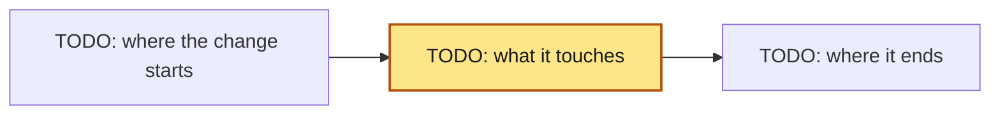
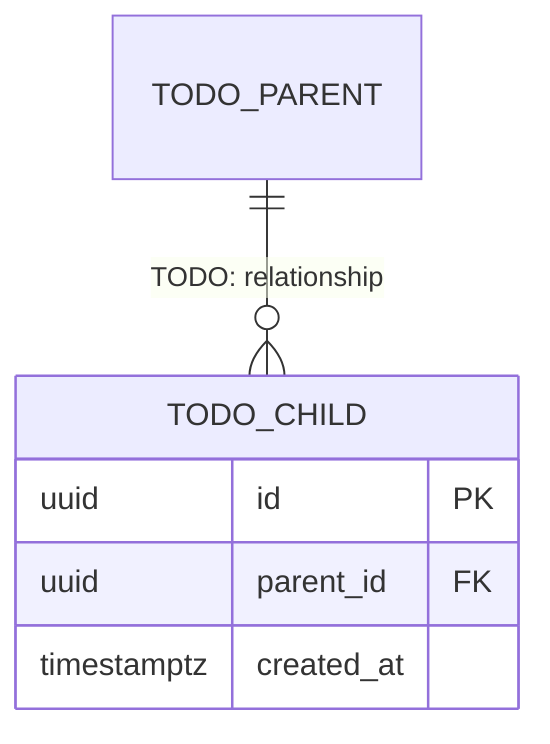

# Tech spec: {{title}}

Spec: [{{spec}}][spec]. Written {{today}}. Frozen at Spec approval with the Spec. A drift found while implementing goes in the verification report and a later docs-only change, never an edit here.

<!-- The Spec is the contract a person approves: intent, Acceptance ids, Tasks, risk, rollback, tests. This document
     holds the detail behind it, for a reader who must judge the design. The architect writes it in Specify. The
     `docs` entry that `aidd new tech-spec` added to the Spec pins it by hash. `aidd validate` warns while a TODO is
     left in it. Do not repeat the Spec: link its Acceptance ids (A1, A2, ...) where a section answers one. A major
     Spec needs one (the required-docs matrix). A normal Spec may use the light variant at the end.
     Write the prose at the `ste-80` level (the `aidd-team:plain-language` skill). -->

## Summary

<!-- Two to four sentences: what changes, for whom, and the one idea that makes it work. -->

TODO: the change in a few sentences.

## Context and scope

<!-- What a reader must already know to judge the design:
     - the files, and the patterns they follow
     - the constraints (compatibility, a frozen dependency, a deadline)
     - the assumptions you could not verify, and the non-goals.
     Start from the repository's architecture overview (`docs/architecture/README.md`, `aidd new architecture`). Link
     it, and draw only what changes. After the change lands, the approved design is folded back into it. -->

TODO: the context.

## Design

<!-- Write the approach in prose first. Cover the shape of the change, the data it moves, the interfaces it touches,
     and the invariant it keeps. Name the files and functions that change: a reviewer checks the Task scopes against
     them. A diagram earns its place only when it shows something prose cannot. Pick the view that answers the
     question a reviewer will ask:

| If the reviewer will ask | Draw |
| --- | --- |
| what talks to what, and who trusts whom | a flowchart of the data or call path, with the trust boundary marked |
| what states this can be in, and what moves between them | a state diagram |
| what happens in what order, across processes | a sequence diagram |
| what the structure looked like before and after | two flowcharts, or one with the changed nodes styled |
-->

### Data model

<!-- Only when the change adds or changes stored data; otherwise "no stored data changes". Show the entities it
     touches, with their keys (primary, foreign, unique) and relationships, as a Mermaid `erDiagram`. Mark what is new
     or changed. For each entity holding personal data, give its retention and deletion. Link the repository's data
     map (`docs/data-map.md`, `aidd new data-map`) that records it. A move of existing data is the migration plan's. -->

| Entity | Keys | Personal data | Retention (data map) |
| --- | --- | --- | --- |
| TODO | PK id; FK parent_id; unique TODO | none | TODO: how long, and the data map entry |

### Non-functional requirements

<!-- The targets the design must meet, each a number with its unit and where it is measured. A reviewer can then
     check the design against it, and the Test strategy's Non-functional checks can prove it. Name today's value where
     one is known. A row that does not apply says why. The SLO itself is the SRE's (`aidd new slo`): link it. -->

| Need | Target | Today | How it is checked |
| --- | --- | --- | --- |
| Availability | TODO: e.g. 99.9% of requests succeed over 28 days | TODO | the SLO and the observe window |
| Latency (performance budget) | TODO: e.g. p95 under 300 ms at the API edge; LCP 2.5 s | TODO | a load test or Lighthouse CI threshold |
| Throughput | TODO: e.g. 200 requests/s sustained, 1,000 peak | TODO | a load test |
| Scale and cost | TODO: e.g. 10x users at under 0.002 USD per request | TODO | the cost estimate on the plan |
| Capacity headroom and forecast | TODO: e.g. 40% headroom at peak; the forecast for 12 months | TODO | the capacity dashboard |
| Data volume | TODO: e.g. 5 GB/month growth, 2 years kept | TODO | the storage metric |

## Alternatives considered

<!-- One row per option you seriously weighed, including "do nothing" and "do it later". A reviewer reads this section
     to learn if you searched the design space, or stopped at the first idea that worked. A choice that outlives this
     change is an ADR too (`aidd new adr <topic> --spec {{spec}}`). -->

| Option | Why not |
| --- | --- |
| TODO: the approach in Design above | chosen |
| do nothing | TODO |

## Cross-cutting concerns

<!-- Answer every subsection. "Not applicable, because ..." is an answer; a blank is not. -->

### Security and privacy

<!-- New attack surface, trust boundary, secret, personal data, permission, or untrusted input. Name the threat and the
     control that answers it. With a security, privacy, or data risk dimension, the component's living threat model
     (`aidd new threat-model <component> --spec {{spec}}`) holds the whole picture, and this subsection holds this
     Spec's delta: the threat ids it adds, changes, or retires, each with its control and Acceptance id. -->

TODO: the threats and their controls, or why there are none.

### Compatibility and migration

<!-- What breaks for an existing consumer: an API, a schema, a file format, a record already written, a config already
     deployed. How existing data moves, in what order, and whether the move is reversible. A schema or data move in
     steps gets a migration plan (`aidd new migration`). A changed API contract gets an API doc (`aidd new api`). -->

TODO: what an existing consumer sees.

### Accessibility, locale, and content

<!-- Only when a person sees or reads the change. The prototype (`aidd new design-spec --prototype`) shows every screen and
     state. The design spec (`aidd new design-spec`) holds the accessibility, copy, and localization detail. -->

TODO: or "not applicable, because ...".

### Compliance

<!-- Only when a law, a standard, or a contract binds the change. Give each obligation, the control that meets it,
     and the evidence that proves it. Use the compliance analyst's return template (the aidd skill's Spec
     reference). -->

TODO: or "not applicable, because ...".

### Observability

<!-- What a person looks at to know this works, and what fires when it does not. This is the source of the Spec's
     `observe.signals` and rollback trigger, in the SRE's return template. The rollout itself lives in the runbook the
     Spec links (`aidd new runbook <ID> --spec {{spec}}`). -->

TODO: the signal, the SLO, and the rollback trigger; or "not applicable, because nothing runs after release (...)",
which the Spec records as `observe: {not_applicable: "<reason>"}`.

## Test strategy

<!-- The default home of testing. The Spec's Acceptance says what must hold. This section says how each item is
     proven. One row per Acceptance id of the Spec (A1, A2, ...): never a new id, never renumbered. `aidd validate`
     warns when an id here is not in the Spec, or when no test command `covers` it. The command that proves an id is
     its `covers`, and red on base is `aidd test`'s record. Neither is typed here. Level: unit, integration, contract,
     e2e, visual, or manual (a manual row names who checks it and how). A separate test plan (`aidd new test-plan`) is
     only for a regulator, a QA owner, a device matrix, or a client's UAT. -->

| Acceptance id | Level | Test file | Real or mocked |
| --- | --- | --- | --- |
| A1 | unit | tests/TODO | real |

### What is mocked, and why

<!-- Mock only what you do not own or cannot run in CI (a payment provider, a clock, the network). Never mock the code
     under test. Name each mock and the contract test or recorded fixture that keeps it honest. A database, queue, or
     cache you run is real at the integration level. Use a throwaway container per test run (Testcontainers), seeded
     by the tests, never a shared database. -->

TODO: what is real and what is mocked: each dependency, real (and how it starts) or mocked (and why), or "nothing is mocked".

### Non-functional checks

<!-- Only the ones this change can break, each as a command the Spec's tests run. Examples: a performance budget (a
     latency or bundle-size threshold), axe per UI state, contract tests against the API description, a load or soak
     run. -->

TODO: or "none, because ...".

### Prerequisite test work

<!-- Test infrastructure that must exist before the Acceptance tests can run. For example: a fixture factory, a fake
     service, a test database, a seam in legacy code (a characterization test first). It is part of the Spec's tests,
     written before Spec approval. -->

TODO: or "none".

### Rollout verification

<!-- The smoke test, the canary, and the rollback signal live in the runbook's Rollout section; link it here. -->

TODO: the runbook's path, or "no rollout beyond the merge".

## Pre-mortem

<!-- Required on major. Assume this change failed in production three weeks after merge, and write why. Exactly one
     of these answers each cause: an Acceptance item of the Spec, a rollback step, or an observe signal. A cause with
     no answer is a risk you accept silently: move it to the Spec's `residual_risk`. -->

| If it failed, the cause was | Answered by |
| --- | --- |
| TODO | acceptance (A?) / rollback / observe |

## Open questions

<!-- Each one is also an `open_questions` entry in the Spec; none left when confidence is high. -->

None.

## Light variant

<!-- For a normal change that still wants a tech spec:
     - keep Summary, Design, Alternatives considered, and Test strategy (its table at least)
     - answer each cross-cutting concern in one line
     - delete Pre-mortem, Open questions, and this section. -->

[spec]: {{spec_link}}
