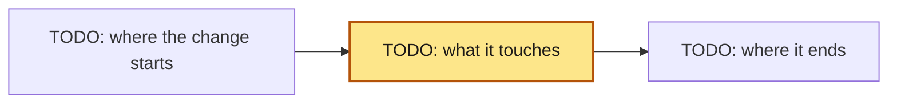
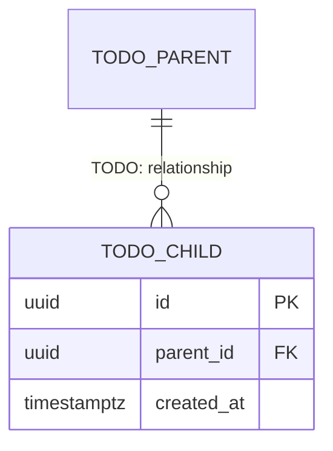

# Tech spec: {{title}}

Spec: [{{spec}}][spec]. Written {{today}}. Frozen at Spec approval with the Spec. A drift found while implementing goes in the verification report and a later docs-only change, never an edit here.

<!-- The Spec is the contract a person approves: intent, Acceptance ids, Tasks, risk, rollback, tests. This document
     holds the design behind it, for a reader who must judge it. The architect writes it in Specify. The `docs` entry
     that `aidd new tech-spec` added puts it under Spec approval. `aidd validate` warns while a TODO is left in it.
     Do not repeat the Spec: link its Acceptance ids (A1, A2, ...) where a section answers one. When a Spec needs one:
     `references/spec-docs.md`. On a normal Spec its own `## Design` may be enough.
     Size it by route. Normal, when you write one: Summary, Context and scope in one line, Design, Alternatives
     considered, and one line for each cross-cutting concern. Major: every section.
     Each fact has one owner, so link it and never copy it:
     - what must hold, and the open questions: the Spec (`## Acceptance`, `open_questions`)
     - how each id is tested, the checks, the environments: the test plan
     - the numbers: the Spec's budget items, the SLO, and `risk.cost_estimate`
     - the threats: the threat model. Terms: the repository glossary.
     Write the prose at the `instruction` level (the `aidd-team:plain-language` skill). -->

## Summary

<!-- Two to four sentences: what changes, for whom, and the one idea that makes it work. -->

TODO: the change in a few sentences.

## Context and scope

<!-- The system around the change: its neighbours, the interfaces it crosses, and the constraints (compatibility, a
     frozen dependency, a deadline). The Spec's `## Context` holds why, the non-goals, and the assumptions: link it.
     Start from the repository's architecture overview (`docs/architecture/README.md`, `aidd new architecture`). Link
     it, and draw only what changes. After the change lands, the approved design is folded back into it.
     Normal: one line. -->

TODO: the context.

## Design

<!-- Write the approach in prose first. Cover the shape of the change, the data it moves, the interfaces it touches,
     and the invariant it keeps. Name the files and functions that change: a reviewer checks the Task scopes against
     them. A diagram earns its place only when it shows something prose cannot. Pick the view that answers the
     question a reviewer will ask:

| If the reviewer will ask | Draw |
| --- | --- |
| what talks to what, and who trusts whom | a flowchart of the data or call path, with the trust boundary marked |
| what states this can be in, and what moves between them | a state diagram |
| what happens in what order, across processes | a sequence diagram |
| where each part runs (a service, a device, a firmware image) | a deployment diagram: nodes, and what is deployed on each |
| what the structure looked like before and after | two flowcharts, or one with the changed nodes styled |
-->

### Data model

<!-- Only when the change adds or changes stored data; otherwise "no stored data changes". Show the entities it
     touches, with their keys (primary, foreign, unique) and relationships, as a Mermaid `erDiagram`. Mark what is new
     or changed. Say whether each entity holds personal data, and link the repository's data map
     (`docs/data-map.md`, `aidd new data-map`) entry that records it and its retention. A move of existing data is
     the migration plan's. -->

| Entity | Keys | Personal data |
| --- | --- | --- |
| TODO | PK id; FK parent_id; unique TODO | none |

## Quality attributes

<!-- One row for each ISO/IEC 25010 quality the change touches: functional suitability, performance efficiency,
     compatibility, interaction capability, reliability, security, maintainability, flexibility, or safety. Say how
     the design meets it, and where its number lives: an Acceptance id, the SLO (`aidd new slo`), or `risk.cost_estimate`.
     Never type the number here. A quality the change leaves alone has no row. Normal: only when one applies. -->

| Quality | How the design meets it | Where the number lives |
| --- | --- | --- |
| performance efficiency | TODO: a cache, an index, a batch | A? |
| reliability | TODO: a retry budget, a fallback | the SLO |

## Alternatives considered

<!-- One row per option you seriously weighed, including "do nothing", "do it later", and adopting a maintained
     project or a managed service. A reviewer reads this section to learn if you searched the design space, or
     stopped at the first idea that worked. The chosen option names its own drawback too: what it costs. A choice
     that outlives this change is an ADR too (`aidd new adr <topic> --spec {{spec}}`). -->

| Option | Why not, or the drawback if chosen |
| --- | --- |
| TODO: the approach in Design above | chosen; its drawback: TODO |
| do nothing | TODO |

## Cross-cutting concerns

<!-- One line each. Link the document that owns the concern, and state only this Spec's delta. "Not applicable,
     because ..." is an answer; a blank is not. Normal: one line each. -->

### Security and privacy

<!-- The component's living threat model (`aidd new threat-model <component> --spec {{spec}}`) holds each threat's
     row, its one home. Link it, and list this Spec's delta by id: the threats it adds, changes, or retires. Never copy a row. -->

TODO: the threat model and this Spec's delta by threat id, or why there are none.

### Compatibility and migration

<!-- What an existing consumer sees: an API, a schema, a file format, a record already written, a config already
     deployed. Link the migration plan (`aidd new migration-plan`) and the API doc (`aidd new api`). -->

TODO: what an existing consumer sees, and the plan or doc that owns the move.

### Accessibility, locale, and content

<!-- Only when a person sees or reads the change. Link the design spec (`aidd new design-spec`) and its prototype. -->

TODO: the design spec, or "not applicable, because ...".

### Compliance

<!-- Only when a law, a standard, or a contract binds the change. Link the compliance record, or the compliance
     analyst's return in the Spec's `## Concerns`. -->

TODO: the compliance record, or "not applicable, because ...".

### Observability

<!-- What the design emits (logs, metrics, traces). The Spec's `observe` owns the signals and the rollback trigger, and
     the SLO owns the target. The rollout is the Spec's `## Rollout` (`references/spec-release.md`). -->

TODO: what the design emits, and the Spec's `observe`; or "not applicable, because nothing runs after release (...)",
which the Spec records as `observe: {not_applicable: "<reason>"}`.

### Testing

<!-- The test plan (`aidd new test-plan <topic> --spec {{spec}}`) owns how each id is tested, the checks, and the
     environments. On a normal Spec without one, the Spec's `tests` are the proof. State no test strategy here. -->

TODO: the test plan's path, or "the Spec's `tests`".

## Pre-mortem

<!-- Required on major. Assume this change failed in production three weeks after merge, and write why. Exactly one
     of these answers each cause: an Acceptance item of the Spec, a rollback step, or an observe signal. A cause with
     no answer is a risk you accept silently: move it to the Spec's `risk.residual`. Then name the debt the change
     adds: the shortcut taken, what it costs later, and when to repay it. -->

| If it failed, the cause was | Answered by |
| --- | --- |
| TODO | acceptance (A?) / rollback / observe |

Debt this change adds: TODO, or "none".

[spec]: {{spec_link}}
