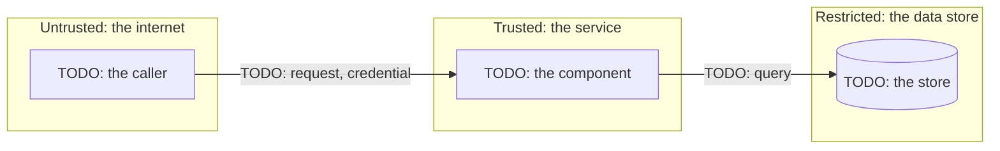

# Threat model: {{title}}

The living threat model of one component. First written for [{{spec}}][spec], {{today}}. Each later Spec that changes the component updates this file in the same change.

<!-- The security engineer writes and keeps this file: one per component, at docs/security/threat-models/<component>.md.
     `aidd new threat-model <component> --spec <ID>` writes it once; a later Spec runs the same command to link it
     again. It is living, so no Spec approval freezes it. A Spec that changes a boundary, a data flow, an asset, or an
     entry point states only its delta: the threat ids it adds, changes, or retires, each with its mitigation and
     Acceptance id. The delta goes in the tech spec's "Security and privacy", or in the Spec's Design when it has no tech
     spec, and Spec approval freezes it. The security engineer brings this file in line with the delta in the same
     change, before or after Spec approval. The file never counts as implementation, and Merge approval reviews it. A
     Spec that changes none of those says so in one line.
     Follow the four questions of the Threat Modeling Manifesto, and STRIDE per element (LINDDUN for personal data).
     Each threat keeps its id for good: `T-<COMPONENT>-NN`, never reused. Every threat ends in one of these:
     - a control, and the Acceptance id of the test that proves it
     - the residual risk that a named person accepts.
     Write the prose at the `ste-80` level (the `aidd-team:plain-language` skill). -->

## 1. What are we working on?

<!-- The component in two or three sentences, and its data flow: one subgraph per trust zone, each boundary crossing
     labelled with what crosses it. Update it when a Spec adds or moves a boundary. -->

## 2. What can go wrong?

<!-- One row per threat, per element or boundary crossing of the diagram, each starting with its id. Risk is the
     likelihood (remote, possible, probable) times the impact (minimal, significant, severe), as low, medium, or high:
     the highest rows are mitigated and tested first. Use STRIDE for every component. Add the LINDDUN rows when personal data crosses a boundary, and delete them otherwise. A retired
     threat stays, struck through, with the Spec that retired it. -->

| Threat (STRIDE or LINDDUN) | Trust boundary or asset | Risk | Mitigation | Acceptance id | Owner |
| --- | --- | --- | --- | --- | --- |
| T-TODO-01 Spoofing: TODO | internet → service | TODO: low, medium, or high | TODO | SPEC-?/A? | TODO |
| T-TODO-02 Tampering: TODO | | | | | |
| T-TODO-03 Repudiation: TODO | | | | | |
| T-TODO-04 Information disclosure: TODO | | | | | |
| T-TODO-05 Denial of service: TODO | | | | | |
| T-TODO-06 Elevation of privilege: TODO | | | | | |
| T-TODO-07 Linking: TODO | | | | | |
| T-TODO-08 Identifying: TODO | | | | | |
| T-TODO-09 Non-repudiation (of a person): TODO | | | | | |
| T-TODO-10 Detecting: TODO | | | | | |
| T-TODO-11 Data disclosure: TODO | | | | | |
| T-TODO-12 Unawareness: TODO | | | | | |
| T-TODO-13 Non-compliance: TODO | | | | | |

## 3. What are we going to do about it?

<!-- The controls above that are new work, as Acceptance items in the Spec that adds them: abuse cases that the tester
     turns into tests. Then the ASVS level, with the requirements it names. -->

TODO: the controls, and the Acceptance ids that prove them.

Access control: TODO: the authorization matrix (`aidd new authz <topic> --spec {{spec}}`), when the component authenticates or authorizes. Its deny rows answer the Elevation of privilege threats above, one test per cell. Write none when nothing here grants or checks access.

## 4. Did we do a good enough job?

<!-- Who reviewed the model, and what they challenged, for each Spec that changed it. The security pool's Approver
     checks the diff against the Spec's delta at Merge approval; their verdict goes in the review, never here. Review the
     whole model once per release. -->

TODO: the reviews.

## Residual risk

<!-- What stays true after the controls. A Spec that changes it repeats the text in its `residual_risk`, which Spec
     approval accepts. -->

TODO: the residual risk, or none.

[spec]: {{spec_link}}
