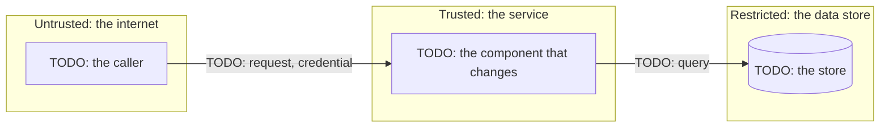

# Threat model: {{title}}

Spec: [{{spec}}][spec]. Written {{today}}. Frozen at Spec approval with the Spec.

<!-- The security engineer writes this in Specify, before Spec approval (`aidd new threat-model <topic> --spec <ID>
     --no-link`). The architect links it. Write it whenever the Spec's risk names security, privacy, or data. The
     required-docs matrix warns without one. It follows the four questions of the Threat Modeling Manifesto, and STRIDE
     per element (LINDDUN for personal data). Every threat ends in one of these:
     - a control, and the Acceptance id of the test that proves it
     - the residual risk that a named person accepts.
     Write the prose at the `ste-80` level (the `aidd-team:plain-language` skill). -->

## 1. What are we working on?

<!-- The change in two or three sentences, and the data flow: one subgraph per trust zone, each boundary crossing
     labelled with what crosses it. -->

## 2. What can go wrong?

<!-- One row per threat, per element or boundary crossing of the diagram. Use STRIDE for every change. Add the LINDDUN
     rows when personal data crosses a boundary, and delete them otherwise. -->

| Threat (STRIDE or LINDDUN) | Trust boundary or asset | Mitigation | Acceptance id | Owner |
| --- | --- | --- | --- | --- |
| Spoofing: TODO | internet → service | TODO | A? | TODO |
| Tampering: TODO | | | | |
| Repudiation: TODO | | | | |
| Information disclosure: TODO | | | | |
| Denial of service: TODO | | | | |
| Elevation of privilege: TODO | | | | |
| Linking: TODO | | | | |
| Identifying: TODO | | | | |
| Non-repudiation (of a person): TODO | | | | |
| Detecting: TODO | | | | |
| Data disclosure: TODO | | | | |
| Unawareness: TODO | | | | |
| Non-compliance: TODO | | | | |

## 3. What are we going to do about it?

<!-- The controls above that are new work, as Acceptance items in the Spec: abuse cases that the tester turns into
     tests. Then the ASVS level, with the requirements it names. -->

TODO: the controls, and the Acceptance ids that prove them.

Access control: TODO: the authorization matrix (`aidd new authz <topic> --spec {{spec}}`), when the change touches authentication or authorization. Its deny rows answer the Elevation of privilege threats above, one test per cell. Write none when nothing here grants or checks access.

## 4. Did we do a good enough job?

<!-- Written before Spec approval. Who reviewed the model in Specify, and what they challenged. Then what the security
     pool's Approver will check at Merge approval. Their verdict after approval goes in the review, never here. -->

TODO: the review.

## Residual risk

<!-- What stays true after the controls. The same text goes in the Spec's `residual_risk`, which Spec approval accepts. -->

TODO: the residual risk, or none.

[spec]: {{spec_link}}
