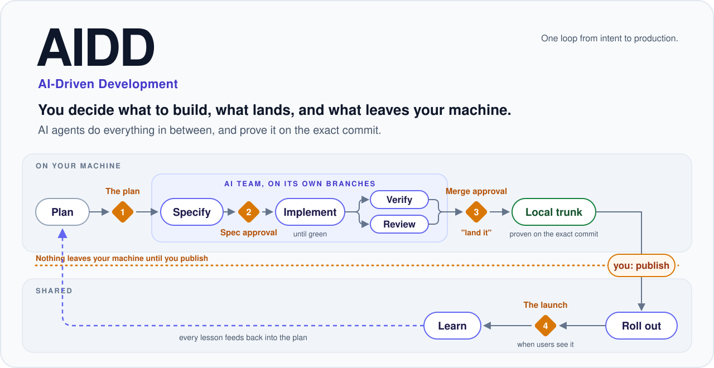
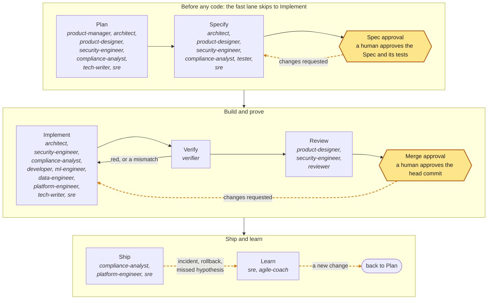

<p align="center">
  
</p>

<p align="center">
  <a href="#get-started"><b>Get started</b></a> ·
  <a href="docs/QUICKSTART.md"><b>Quickstart</b></a> ·
  <a href="docs/HOW-TO.md"><b>How do I…</b></a> ·
  <a href="docs/METHOD.md"><b>The method</b></a> ·
  <a href="docs/TEAM.md"><b>The delivery team</b></a> ·
  <a href="docs/ENTERPRISE.md"><b>Enterprise</b></a> ·
  <a href="docs/FAQ.md"><b>FAQ</b></a>
</p>

**AIDD is a method for delivering software with AI agents: one loop from intent to production, with change control at its core.** **aidd** is the toolkit that runs it.

At its center is **`aidd/gate`**, one required check on every pull request or merge request. Behind it is a *verifier*: a small program that reads only facts (the diff, your CI's test results, and who approved what on the platform) and never what an agent says about its work. It decides whether a change may merge. People decide at two points; agents do everything in between.

> [!IMPORTANT]
> **Pre-release.** aidd 1.0.0 is complete but not yet tagged or published, and no pull request has gone through a live gate yet. Install paths name `v1.0.0`, which does not exist yet, so install from a commit and pin the generated workflows to it with `aidd init --ref <sha>`: [before the first release](docs/INSTALL.md#before-the-first-release). GitHub is tested end to end against a faked API; GitLab is experimental. What is done, partial, and missing: [Enterprise readiness](docs/ENTERPRISE.md).

## The problem

Agents now write most of the code. What is hard is knowing that what came back is what you asked for, that it really works, and who decided what. Without a method:

- **the work drifts**: an agent solves a bigger or different problem, and touches things nobody mentioned;
- **"done" is claimed, not shown**: "all tests pass" is a sentence in a description, not a fact anyone checked;
- **accountability fades**: months later, nobody can say which decisions a person made and which an agent made.

Sprints, standups, and long reviews were built for people who write code slowly. Agents finish a change in minutes and then wait for people. AIDD keeps the decisions that need a person and drops the rest.

## The gate

`aidd/gate` turns green only when every rule holds for the exact commit that will merge:

- **The plan is the one approved.** The Spec (a one-page plan with its tests) is bound by a hash, so changing it or its tests voids the approval.
- **The tests prove it.** They failed before the change and pass on this commit, in your CI. An agent's "tests pass" never counts.
- **The change stayed in bounds.** Every changed line sits inside the scope people approved.
- **The right people approved.** An Approver who is not the author (under the solo profile, you, on record), never an agent account, and a specialist on high-risk changes.
- **The control fits the risk.** The gate recomputes how much control the change needs from the real diff, and never accepts less.

GitHub or GitLab enforces it as a required check, so it holds whatever the model does. Every run writes a record of what the gate saw and decided, and the gate starts in advisory mode, reporting without blocking, until you switch it on.

## How it works

You decide at two points. Agents do everything in between.

1. **Spec approval, before any code.** You approve a one-page Spec: what will change, why, what may be touched, how to roll it back, and the tests that define done. Agents cannot start until you do, and the tests are frozen from then on.
2. **Merge approval, on exactly what was built.** You approve the head commit. The proof comes from your CI, never from the agent: the tests failed before the change and pass on this exact commit, and every changed line stays inside what you approved.

**Not every change needs both.** Every change starts with `aidd next`, which computes the change's **route** from the paths it touches: how much control it needs (`standard`, `minor`, `normal`, `major`, or `emergency`). The route picks the **lane**, the change's path through the loop. The fast lane is the default. The gate recomputes the route from the real diff and can raise it, never lower it, which can move a change onto the spec lane.

| Lane | For | Steps | You decide |
| --- | --- | --- | --- |
| **Fast** (default) | small, routine changes | Implement ⟲ Verify → Review → Ship | the result (nothing, for a bot's dependency update) |
| **Spec** | anything worth planning | Specify → **Spec approval** → Implement ⟲ Verify → Review → **Merge approval** → Ship | the Spec and the result, plus a specialist on high-risk changes |
| **Emergency** | production is down, and a person declares it | Implement ⟲ Verify → Review → Ship → Learn | the incident commander and the result, with the full review after |

- **Implement ⟲ Verify** is the agents' tight loop: build, then re-run the Spec's tests on the exact commit you will approve, until it is green.
- **Learn** closes the loop: every incident, failed change, missed goal, and retrospective becomes a change of its own.
- **Changes requested** at either approval send the work back to Specify or to Implement; the diagram below draws those paths dashed.

The whole method: [docs/METHOD.md](docs/METHOD.md).

**One change, start to finish.** You ask your agent to add rate limiting to checkout.

1. It runs `aidd next`: the change touches checkout, so it needs a Spec.
2. It writes the Spec and the tests. The tests fail, because nothing is built yet.
3. **You approve the Spec.** The Spec and its tests are frozen.
4. It builds, touching only the files the Spec allows. CI proves the tests failed before and pass now.
5. **You, or a colleague, approve the result.** `aidd/gate` turns green, and the change merges.

The same walk-through with every command: [Quickstart](docs/QUICKSTART.md).

## What's in this repository

One repository, four parts. Each builds on the one before, and you can stop after any of them.

| Part | What it is | Where | Do you need it? |
| --- | --- | --- | --- |
| **1. The method** | AIDD itself: the loop, the lanes, and the two approvals, written down so any team or tool can follow it | [docs/METHOD.md](docs/METHOD.md) | It is the idea behind everything else. |
| **2. The gate** | The `aidd` CLI and its verifier, which decides what may merge (`aidd/gate`), plus the CI templates that run it | `src/aidd/`, `templates/`, `schemas/` | Yes. This is what enforces the method. |
| **3. Agent support** | The `aidd` skill that tells any coding agent how to work in the loop, and hooks that stop an agent from approving or merging its own work | `.agents/skills/aidd/`, and `hooks/` for the Claude Code plugin | Yes. `aidd init` installs the skill for the agents it finds, and `aidd init --agent-hooks` wires the same hooks without the plugin. |
| **4. The delivery team** | <!-- aidd:gen count:roles -->15<!-- aidd:end --> agent roles, their practice skills, and domain packs, as the `aidd-team` plugin | `plugins/aidd-team/` | Optional. Use it when you want a whole team, not one agent. |

**aidd governs; it does not run your agents.** Your coding agent, or a tool that runs many agents at once, does the work. aidd decides what may merge, on what evidence, and keeps the record of who approved it. It works the same whichever agents, tools, or services you use.

## Get started

**Ask your agent.** In Claude Code, Codex, Cursor, Copilot, Antigravity, or any agent that can run commands:

```text
Install thaithienvanid/aidd and apply it to this project.
```

It follows [llms-install.md](llms-install.md): installs the CLI, sets up the repository for the coding agents it finds, checks the result, and commits. It asks which profile you want, shows you what `aidd init --dry-run` proposes, and stops at branch protection, which is yours to switch on.

**Or by hand.**

1. **Install the CLI.** Python 3.11+ and nothing else, pinned to a commit until the first release: [Install](docs/INSTALL.md#the-cli).
2. **Set up the repository.** `aidd init` writes the config, the skill, and the CI workflows, and wires the coding agents it finds (<!-- aidd:gen count:harnesses -->26<!-- aidd:end --> are supported; [the list](docs/INSTALL.md#your-coding-agent)). The gate starts in advisory mode and blocks nothing until you switch it on.

   ```sh
   cd your-repo
   aidd init --dry-run                     # see what it finds and proposes; writes nothing
   aidd init --profile solo --approvers @you
   aidd init --profile team --approvers @your-org/leads --reviewer security=@your-org/security \
     --test "npm test" --goal "make checkout succeed on the first try"
   aidd doctor
   ```

3. **Ask what is next.** `aidd next` tells anyone on the team the next step for each open piece of work, and who takes it: you, your agent, or an Approver.
4. **Try one change locally, then go live.** The [Quickstart](docs/QUICKSTART.md) takes one change through the gate on your machine, with no CI. Going live (a GitHub App, an environment, and a ruleset that requires `aidd/gate`): [Platforms](docs/PLATFORMS.md#setup).

**No GitHub or GitLab yet?** Run the loop on your own machine: approve at your own terminal with `aidd approve spec` and `aidd approve merge`, and merge a passing branch with `aidd ship`. The setup is one command: [Local-first](docs/ADOPTION.md#local-first-no-github-or-gitlab).

**In Claude Code**, you can use the plugins instead of repository files: `/plugin marketplace add thaithienvanid/aidd`, then `/plugin install aidd@aidd`.

## From one person to a whole company

Pick a profile, and tighten it later. A repository can never loosen what its organization set.

| Profile | For | What it adds |
| --- | --- | --- |
| `solo` | one person directing agents | you approve your own work, on record; Spec approval only on major changes, which wait out a 30-minute cool-off before your approval counts; red-then-green is a warning |
| `team` | one team or a few | Spec approval before building, an Approver who is not the author, a specialist on high-risk changes |
| `org` | many teams and repositories | organization rules on high-risk and emergency changes |
| `regulated` | finance, health, public sector | two Approvers on high-risk changes, rules on every change, provenance on every commit |

When people and agents work as one team, they share one config, one skill, and one set of roles; nobody runs a private agent on the side.

- The team writes down a `goal` every agent steers by.
- `aidd owners` shows who decides and who works.
- `aidd metrics --autonomy` shows which agents have earned lighter review, from their record.

Rollout plans for each size, and domain experts as reviewers: [Adoption](docs/ADOPTION.md).

## The delivery team (optional)

The `aidd-team` plugin runs the loop as a cross-functional team of <!-- aidd:gen count:roles -->15<!-- aidd:end --> agent roles led by people: product manager, architect, designer, security engineer, tester, developer, verifier, reviewer, SRE, and more.

- Each role does its own step, writes only its own files, and hands off through a file and a short note.
- The tester who writes the tests never builds the code, and the verifier role, which runs the result, wrote neither.
- Approving, merging, and declaring an emergency stay with people; `aidd next` computes the lane, and the gate checks it.

<!-- aidd:gen roles:loop:diagram -->

<!-- aidd:end -->

Every role applies the current standards of its discipline, each with its edition and the date it was last checked, and loads the domain packs (web, APIs, mobile, AI, data, cloud, payments, health, and more) its work needs. Commands: `/aidd-team:propose`, `onboard`, `plan`, `specify`, `implement`, `verify`, `review`, `secure`, `sweep`, `ship`, `postmortem`, `retro`. Details: [The delivery team](docs/TEAM.md).

## Before the work: proposals

Some work needs a yes from someone outside the team first: a client choosing a supplier, or your own leadership deciding on a change.

1. `aidd new proposal` starts one, and `/aidd-team:propose` has the team write it, with no code: the needs and how each is answered, the solution and its options, a range estimate, the assumptions, exclusions, and risks.
2. A person decides go or no-go before the team drafts, and signs it off before it is sent.
3. Once accepted, `aidd proposal convert` turns it into an Initiative and Epics, so the work you deliver traces back to what you promised.

Details: [the method](docs/METHOD.md#47-proposal).

## Works with what you have

git and the repository are all aidd needs. Everything else is optional, and aidd uses it only if you already have it.

- **Your agents.** Every agent in the [install table](docs/INSTALL.md#your-coding-agent); anything else reads `AGENTS.md`. Tools that run many agents side by side, such as [Orca](docs/ORCA.md), work as they are.
- **Your platform, if you have one.** GitHub or GitLab adds approvals the platform enforces, and aidd reuses CODEOWNERS, your existing CI checks as evidence, rulesets, merge queues on GitHub, and organization rules in any language. With no platform, the [local-first path](docs/ADOPTION.md#local-first-no-github-or-gitlab) holds the two approvals on your machine.
- **Your other services, if you have them.** Issue trackers, design tools, and observability services are optional extensions the team uses when the project already has them. The Specs, their tests, and the decisions live in the repository either way.
- **Your planning tools.** Keep GitHub Spec Kit, OpenSpec, Kiro, or BMAD for planning: they plan, aidd gates, and `aidd import` turns their plan into a Spec.

## What it does not do

aidd proves who approved what, on which evidence. It does not judge code quality for you (the Approver still reads the report), it does not deploy, and it does not sandbox agents. Every known limit: [Rationale](docs/RATIONALE.md#known-limits-in-100).

## Documentation

| Start | Understand | Operate |
| --- | --- | --- |
| [Quickstart](docs/QUICKSTART.md) | [The method](docs/METHOD.md) | [CLI](docs/CLI.md) |
| [How do I…](docs/HOW-TO.md) | [What the team covers](docs/TEAM-REFERENCE.md#what-the-team-covers) | [`aidd next`](docs/HOW-TO.md#every-day) |
| [Install](docs/INSTALL.md) | [The delivery team](docs/TEAM.md) | [Config](docs/CONFIG.md) |
| [Adoption](docs/ADOPTION.md) | [Glossary](docs/GLOSSARY.md) | [Platforms](docs/PLATFORMS.md) |
| [FAQ](docs/FAQ.md) | [Rationale](docs/RATIONALE.md) | [Enterprise readiness](docs/ENTERPRISE.md) |
| [Changelog](CHANGELOG.md) | [Controls](docs/CONTROLS.md) | [Security](SECURITY.md) |
| [Contributing](CONTRIBUTING.md) | [Extending: plugins, skills, packs](plugins/README.md) | [Governance](GOVERNANCE.md) |
| | | [Running inside Orca](docs/ORCA.md) |

Apache-2.0. Open source, no dependencies, no telemetry. The schemas and the conformance suite are the contract, so the verifier can be reimplemented anywhere.
