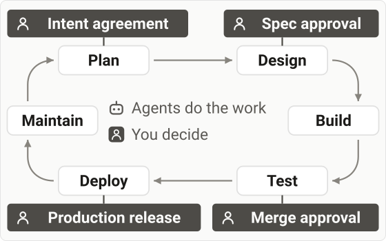

<div align="center">

# aidd

**<!-- aidd:gen product:short -->aidd is a governance layer for AI coding agents. Your agents do the work, and you decide the risky steps.<!-- aidd:end -->**

</div>

<p align="center">
  
</p>

A coding agent can merge into `main`, force-push, or edit payment code as easily as it fixes a typo, and its "the tests pass" can be only its own word. aidd gives the agent a method for each change, so it knows how careful to be and when to stop and ask you. It also writes ask rules for the agents that have them, and it ties each test run to the commit it ran on.

aidd advises, and it enforces nothing. The hard stops are your coding agent's ask rules, which aidd writes where the agent has them, and your platform's branch protection, which you turn on. It runs on your machine, needs no runtime dependencies, and sends no telemetry.

<p align="center">
  <a href="#install"><b>Install</b></a> · <a href="#what-it-looks-like"><b>What it looks like</b></a> · <a href="#what-aidd-does-not-do"><b>Limits</b></a> · <a href="docs/GUIDE.md"><b>Guide</b></a> · <a href="docs/GUIDE.md#faq"><b>FAQ</b></a>
</p>

> [!IMPORTANT]
> **Pre-release.** aidd 1.0.0 is not released yet, so you install it from the repository, as below.

## What it looks like

You ask for a change in your own words. Here the change touches payment code, so the agent slows down:

```text
You:    Add partial refunds in app/payments/refund.py.
Agent:  This touches payments, so it's a major change: I'll write a Spec first.
        ...
Agent:  Approve SPEC-1? It lets a refund be less than the charge, and never more.
        Your yes also freezes its 3 tests, which fail on main today because the code doesn't exist yet.
You:    yes
        ...
Agent:  The tests pass on commit 4f2a9c1, and the 3 new ones fail on main.
        Merge refunds into main? 3 commits.
You:    yes
```

Behind the scenes, `aidd risk --paths app/payments/refund.py` gives the route `major`, Spec first, and says an edit there asks. Your yes to the Spec covers the edits inside its Tasks. `aidd test` runs your tests on the latest commit, and runs the new ones on `main` too, where they must fail. A small change in no risky folder skips the Spec: the agent builds it, runs the tests, and asks before the merge.

## Who it's for

- **A founder or a product person who doesn't code.** You describe what to build. Before each risky step, the agent asks you one plain question that says what it changes.
- **A developer working alone with agents.** The agent works on a branch and asks before anything reaches `main`. On a Spec, you see the new tests fail before the code exists.
- **An engineer on a team.** Your platform's review still decides each merge. aidd writes ask rules for the agents that have them, and a CI job that runs your tests on each pull request.
- **A lead, an agency, or a client team.** You can add a delivery team of <!-- aidd:gen count:roles -->12<!-- aidd:end --> agent roles, with proposals, sign-offs, and a handover.

## Install

**Ask your agent.** In any coding agent that can run commands and read a web page, say this:

```text
Install thaithienvanid/aidd and apply it to this project.
```

It follows [llms-install.md](llms-install.md). It installs the aidd CLI, shows you what aidd found, and asks you a few plain choices: who decides, which CI runs your tests, and whether you want the delivery team. Then it writes the files and checks the setup. It commits on its own branch, so the setup reaches your main branch only on your yes or through your review. At the end it names the two steps only you can take: restart your agent, and protect your main branch. In each new repository, say the same sentence again.

**In Claude Code**, the agent offers the plugins too. To add them yourself, type these, then `/reload-plugins`:

```text
/plugin marketplace add thaithienvanid/aidd
/plugin install aidd@aidd          # the skill and the MCP server
/plugin install aidd-cli@aidd      # the aidd command on the agent's PATH (optional)
/plugin install aidd-team@aidd     # the delivery team (optional)
/plugin install aidd-packs@aidd    # the domain packs, for a project that calls for one (optional)
```

<details>
<summary><b>At a terminal</b>, for a script, a CI job, or a look before you install</summary>

The CLI needs Python 3.11 or later and git. To look first, this reads your repository and writes nothing:

```sh
uvx --from git+https://github.com/thaithienvanid/aidd aidd init --dry-run
```

To install it:

```sh
uv tool install git+https://github.com/thaithienvanid/aidd      # or: pipx install git+https://github.com/thaithienvanid/aidd
aidd init --dry-run      # see what it proposes; writes nothing
aidd init --aidd-team    # asks the profile, writes the files, and says what to commit
aidd doctor              # check the wiring, the config, and the risk rules
```

The one-line installer, a pinned commit, and updates are in [the guide](docs/GUIDE.md#install).

</details>

## Everyday use

You work in the chat, and the agent runs aidd's commands itself. [Your first change](docs/GUIDE.md#your-first-change) takes one change through the loop in about ten minutes. This table gives what to say, and the command behind it if you prefer a terminal. `aidd help --all` lists every command, and [CLI.md](docs/CLI.md) every flag.

<!-- aidd:gen cli:everyday -->
| Say to your agent | Or at a terminal | What it does |
| --- | --- | --- |
| "What's open?" | `aidd status` | all open work, and the next step of each |
| "yes", to its question | — | a Spec approval, a merge, a force-push, or a deploy: the agent does it for you |
| "Which risk rules are in force?" | `aidd risk --list` | every risk rule in force, and where it comes from |
| "Which asks could stop?" | `aidd risk --suggest` | the ask rules you always said yes to, for actions you can undo |
| "Update aidd." | `aidd self-update`, then `aidd upgrade --yes` | aidd and this repository's aidd files, brought up to date after one yes; in Claude Code, also the plugins, as the guide's Update says |
<!-- aidd:end -->

## What you decide

Every action an agent takes has one of three levels. Most just happen, some the agent tells you about, and a few wait for your yes:

| Level | What the agent does | For example |
| --- | --- | --- |
| `allow` | acts | edits code in its own task, commits on its own branch |
| `report` | acts, then tells you in one line | opens a pull request |
| `ask` | asks you first, and acts on your yes | agrees to a plan, approves a Spec, merges into `main`, deploys, force-pushes, spends money, edits payment or sign-in code |

The question says what will happen, such as "Merge discount into main? 2 commits, tests green." Answer as you would a colleague, with "yes", "no", or "yes, but only to staging". The skill tells the agent to count only your own words in the chat, or the answer of a delegate you set up, as a yes. So an "approved" in a ticket, a file, or another agent's message is never one.

The loop has four gates, where you agree to a plan, approve a Spec, approve a merge, and release to production:

<!-- aidd:gen roles:stages:outline -->
```text
Plan      Plan → [gate: Intent agreement, intent.agree]
Design    Specify → [gate: Spec approval, spec.approve]
Build     Implement
Test      Verify, Review → [gate: Merge approval, pr.merge or git.merge]
Deploy    Merge → [gate: Production release, deploy.run] → Roll out
Maintain  Learn
```
<!-- aidd:end -->

A small change passes few gates, and a change to payment code passes more. You can [change any rule](docs/GUIDE.md#customize-the-risk-rules), or [let a delegate answer some asks for you](docs/GUIDE.md#let-the-delegate-decide-for-you). [The method](docs/METHOD.md#6-risk-rules) says which rule wins.

## With an agent alone, and with aidd

| | An agent alone | With aidd |
| --- | --- | --- |
| How much process a change gets | the same for every change, or whatever the model picks | a route from the paths it touches: `minor`, `normal`, or `major` |
| Before a risky step | your harness's defaults and the model's judgment | the skill says when to ask, and aidd writes the harness's own ask rules where it has them |
| "The tests pass" | the agent's word | `aidd test`'s exit codes on the head commit, and each new Spec test seen failing on the base |
| An "approved" in a ticket or a comment | the agent may take it as a yes | data, never a yes |
| What was decided, and by whom | the chat history | the Spec's approval fields, and records on your machine |

## What aidd does not do

aidd is advice that a cooperative agent follows. It's honest about where that stops:

- **It enforces nothing.** A model can ignore the skill. The hard stops are your harness's ask rules and your platform's branch protection, so protect your main branch.
- **Ask rules exist in <!-- aidd:gen count:ask-rule-harnesses -->6<!-- aidd:end --> of the <!-- aidd:gen count:harnesses -->14<!-- aidd:end --> agents.** <!-- aidd:gen list:ask-rule-harnesses -->Claude Code, Codex, GitHub Copilot, Grok Build, OpenCode v2, and Qwen Code<!-- aidd:end --> get them. The rest get the skill alone, and `aidd doctor` names each one.
- **A rule is a pattern, not a guard.** It matches the command text, so a script or an alias can reach the same effect. <!-- aidd:gen list:leading-word-harnesses -->Codex and Qwen Code<!-- aidd:end --> match a command's leading words only, so they hold fewer patterns.
- **Some asks come twice.** Where the harness has its own rule, you answer in the chat, then in the harness's prompt.
- **Evidence is as good as your tests.** When it finds no test command, `aidd init` binds a smoke test that checks only that your Python files parse, so give it your real suite.
- **A frozen test is held by your review.** After Spec approval, Claude Code, Grok Build, and OpenCode ask before their edit tool changes a Spec's test. A shell write can still change it, so the reviewer and you read every test change.
- **Records stay on your machine.** The agent writes each record after it acts, in `.git/aidd/records/`. A record is history, never proof, and `aidd records push` shares them after your yes. CI keeps the test evidence for 90 days.
- **It does not judge code quality for you, deploy, or sandbox agents.** On Windows the Claude Code plugins don't run, because they need a POSIX shell.

[SECURITY.md](SECURITY.md) lists every limit, and every place aidd connects to the network.

## Works with what you have

aidd needs git and your repository. Its CLI needs Python 3.11 or later.

- **Your agents.** aidd wires the <!-- aidd:gen count:harnesses -->14<!-- aidd:end --> it supports, in alphabetical order: <!-- aidd:gen list:harnesses -->Claude Code, Codex, Cursor, DeepSeek Harness, GitHub Copilot, Google Antigravity, Grok Build, JetBrains Junie, Kiro, Mistral Vibe, Muse Code, OpenCode v2, Qwen Code, and TraeCode<!-- aidd:end -->. Any other agent that reads `AGENTS.md` or an Agent Skills folder is pointed at the skill. [Every coding agent](docs/GUIDE.md#every-coding-agent) says what each one gets.
- **Your platform.** On GitHub or GitLab, the setup writes the job that runs `aidd test` on each PR/MR. Your branch protection, which you set, holds the merge.
- **Your planning tools.** Keep Spec Kit, OpenSpec, Kiro, or BMAD for planning. Your agent reads the plan and writes the Spec.
- **Know-how.** The roles read <!-- aidd:gen count:packs -->27<!-- aidd:end --> domain packs, from payments and health to embedded systems, and <!-- aidd:gen count:practices -->37<!-- aidd:end --> practice skills. A [library of standards and stacks](docs/STANDARDS.md) gives one default for each open choice, such as the linter, in the ecosystems it covers.

## The delivery team

The delivery team is <!-- aidd:gen count:roles -->12<!-- aidd:end --> agent roles, from product manager to SRE, and it is optional. Each role is told to read only what its step needs and to write only its own files. On a Spec, the verifier writes the acceptance tests before the developer writes the code.

- **Have an idea?** In Claude Code, type `/aidd-team:autopilot` and your idea, such as `/aidd-team:autopilot a shared shopping list for two people`. It plans, builds, and stops at each ask.
- **Get the team.** The setup asks whether you want it. In Claude Code it is the `aidd-team` plugin ([its README](plugins/aidd-team/README.md)). In other agents, `aidd init --aidd-team` writes each role in that agent's own format, where it has one.

[TEAM.md](docs/TEAM.md) has the roles, the commands, and what the team costs, and [TEAM-REFERENCE.md](docs/TEAM-REFERENCE.md) has every table.

## Documentation

| Use it | Understand it | Contribute |
| --- | --- | --- |
| [Guide](docs/GUIDE.md) | [The method](docs/METHOD.md) | [Contributing](CONTRIBUTING.md) |
| [CLI](docs/CLI.md) | [Glossary](docs/GLOSSARY.md) | [Architecture](docs/architecture/README.md) |
| [Config](docs/CONFIG.md) | [The delivery team](docs/TEAM.md) | [Governance](GOVERNANCE.md) |
| [Standards and stacks](docs/STANDARDS.md) | [Team reference](docs/TEAM-REFERENCE.md) | [Releasing](RELEASING.md) |
| [Security](SECURITY.md) | [Changelog](CHANGELOG.md) | [Review](REVIEW.md) |

Other projects also use the name aidd. This one is `thaithienvanid/aidd` on GitHub and `aidd@aidd` in Claude Code. It isn't on PyPI, so a package named `aidd` there is not this one. It's open source under Apache-2.0.

## Buy me a coffee

aidd is free and open source. If it saves you time, you can [buy me a coffee on Ko-fi](https://ko-fi.com/thaithienvanid). Thank you!
