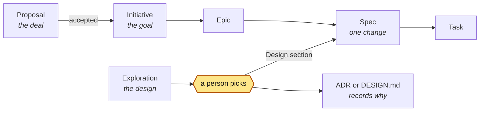

<p align="center">
  
</p>

<p align="center">
  <a href="#get-started"><b>Get started</b></a> ·
  <a href="docs/QUICKSTART.md"><b>Quickstart</b></a> ·
  <a href="docs/HOW-TO.md"><b>How do I…</b></a> ·
  <a href="docs/METHOD.md"><b>The method</b></a> ·
  <a href="docs/TEAM.md"><b>The delivery team</b></a> ·
  <a href="docs/ENTERPRISE.md"><b>Enterprise</b></a> ·
  <a href="docs/FAQ.md"><b>FAQ</b></a>
</p>

**aidd lets AI agents do the work while people keep control of what ships.**

For a change worth planning, you approve a short plan before an agent writes any code. Before the change merges, you approve the result. In between, agents write the plan and its tests, build the change, and prove that it works. You can be a developer, a product manager, or a founder: you read the plan and the result, not every line of code.

A check named **`aidd/gate`** runs on every pull request. It lets a planned change merge only when three things are true:

- the tests failed before the change and pass after it, in your CI;
- the change stayed inside the approved plan;
- the right person approved it, and that person is not an agent.

An agent's own report never counts as proof. The `solo` profile, for one person working alone, relaxes some of these checks.

AIDD (AI-Driven Development) is the method. **aidd** is the open-source toolkit that runs it: a command-line tool, the CI check, and a skill that your agent reads. It does not run your agents; it decides what may merge. It works with the coding agents you already use, such as Claude Code, Codex, Cursor, and Copilot. You can use it on GitHub, on GitLab, or on your own machine with no platform at all.

> [!IMPORTANT]
> **Pre-release.** aidd 1.0.0 is unreleased and Beta until it is tagged, published, and one pull request has passed this repository's own live gate. Until then, install it from a commit: [before the first release](docs/INSTALL.md#before-the-first-release). GitLab support is experimental. What is done, partial, and missing: [Enterprise readiness](docs/ENTERPRISE.md).

## The problem

Agents can now write much of the code. The hard part is to know three things. Is what came back what you asked for? Does it really work? Who decided what? Without a method:

- **the work drifts**: an agent solves a bigger or different problem, and touches things nobody mentioned;
- **"done" is claimed, not shown**: "all tests pass" is a sentence in a description, not a fact anyone checked;
- **accountability fades**: months later, nobody can say which decisions a person made and which an agent made.

AIDD keeps only the decisions that need a person: what to build, and what ships.

## How it works

You decide at two points. Agents do everything in between.

1. **Spec approval, before any code.** You approve a one-page Spec: what will change, why, which files may change, how to roll it back, and the tests that define done. The agent waits for your approval before it builds, and from then on the tests stay frozen.
2. **Merge approval, on exactly what was built.** You approve the head commit, after [the gate](#the-gate) has checked the proof.

**Not every change needs both approvals.** aidd sizes each change by what it touches. A small, reversible fix needs little control. A change to payments, auth, or personal data needs much more.

This size is the change's **route**. The route picks the **lane**, the change's path through the loop. The author can ask for more control, never less, and the gate checks the route again from the real diff.

| Lane | Routes | For | Steps | You decide |
| --- | --- | --- | --- | --- |
| **Fast** (default) | `minor`, `standard` | small fixes, and pre-approved routine changes such as a bot's dependency update | Implement ⟲ Verify → Review → Ship | the result (nothing, for a `standard` change) |
| **Spec** | `normal`, `major` | anything worth planning | Specify → **Spec approval** → Implement ⟲ Verify → Review → **Merge approval** → Ship | the Spec and the result, plus a specialist on a `major` change |
| **Emergency** | `emergency` | production is down, and a person declares it | Implement ⟲ Verify → Review → Ship → Learn | that it is an emergency, and the result; the full review comes after |

- **Implement and Verify, repeated until green,** is the agents' tight loop. They build, then re-run the Spec's tests on the exact commit you will approve, until it is green.
- **Learn** closes the loop: every incident, failed change, missed goal, and retrospective becomes a change of its own.
- **Changes requested** at either approval send the work back to Specify or to Implement.

**One change, start to finish.** You ask an agent to add rate limiting to checkout.

1. It runs `aidd assess --paths` on the files it plans to touch. The change is more than a small fix, so its route is `normal` and it needs a Spec.
2. It writes the Spec and the tests. The tests fail, because it has built nothing yet.
3. **You approve the Spec.** This freezes the Spec and its tests.
4. It builds, and changes only the files that the Spec allows. CI shows the tests now pass.
5. **You, or a colleague, approve the result.** `aidd/gate` turns green, and the change merges.

The same walk-through with every command: [Quickstart](docs/QUICKSTART.md). A person chooses which change to work on, and `aidd list` shows the open work and who holds each step. The whole method: [docs/METHOD.md](docs/METHOD.md).

## The gate

`aidd/gate` turns green only when every rule holds for the exact commit that will merge:

- **The plan is the one approved.** A hash binds the Spec and its tests. A change to either voids the approval.
- **The tests prove it.** They failed before the change and pass on this commit, in your CI.
- **The change stayed in bounds.** Every changed file sits inside the paths the Spec allows.
- **The right people approved.** An Approver who is not the author, never an agent account, and a specialist on high-risk changes. Under the `solo` profile, you approve your own work, on record.
- **The control fits the risk.** The gate never accepts a lower route than the real diff needs.

The gate reads only facts: the diff, your CI's results, and the approvals on the platform. Every run writes a record of what it saw and decided.

**Advisory first, then enforced.** The gate starts in advisory mode: it reports, and it blocks nothing. To make it block a red change, do three things:

1. Set `mode = "enforce"` in `.aidd/config.toml`.
2. Require `aidd/gate` on the platform. On GitHub, that is a ruleset; on GitLab, a pipeline execution policy.
3. On GitHub, create a GitHub App for the gate. Set the required check's expected source to that App, so that nobody else can post the status.

What holds before that:

- A person with merge rights can merge a red change.
- A private repository on GitHub Free has no rulesets, so there the gate stays advisory.
- With no platform, `aidd ship` at your own terminal is the gate, but your own git commands can still go around it.
- Only aidd's agent hook stops an agent at edit time. `aidd init` wires the hook for each coding agent it finds that can run one.

Setup: [Platforms](docs/PLATFORMS.md#setup).

## What's in this repository

One repository, four parts. Each builds on the one before, and you can stop after any of them.

| Part | What it is | Where | Do you need it? |
| --- | --- | --- | --- |
| **1. The method** | AIDD itself: the loop, the lanes, and the two approvals, written down so any team or tool can follow it | [docs/METHOD.md](docs/METHOD.md) | It is the idea behind everything else. |
| **2. The gate** | The `aidd` CLI and the gate, which decides what may merge (`aidd/gate`), plus the CI templates that run it | `src/aidd/`, `templates/`, `schemas/` | Yes. This is what enforces the method. |
| **3. Agent support** | The `aidd` skill that tells any coding agent how to work in the loop, and hooks that stop an agent from approving or merging its own work | `.agents/skills/aidd/`, and `hooks/` for the Claude Code plugin | Yes. `aidd init` installs the skill for the agents it finds, and `aidd init --agent-hooks` wires the same hooks without the plugin. |
| **4. The delivery team** | <!-- aidd:gen count:roles -->16<!-- aidd:end --> agent roles, their practice skills, and domain packs, as the `aidd-team` plugin | `plugins/aidd-team/` | Optional. Use it when you want a whole team, not one agent. |

You can also stop before the gate. The [five adoption levels](docs/ADOPTION.md#adoption-levels) say what each step adds, and what it does not guarantee.

Your coding agent, or a tool that runs many agents at once, does the work. aidd decides what may merge, on what evidence, and keeps the record of who approved it.

## Get started

**Ask an agent.** In Claude Code, Codex, Cursor, Copilot, Antigravity, or any agent that can run commands:

```text
Install thaithienvanid/aidd and apply it to this project.
```

It follows [llms-install.md](llms-install.md): installs the CLI, sets up the repository for the coding agents it finds, checks the result, and commits. It asks which profile you want, shows you what `aidd init --dry-run` proposes, and stops at branch protection, which is yours to switch on.

**Or by hand.**

1. **Install the CLI.** It needs Python 3.11+ and nothing else. Pin it to a commit until the first release: [Install](docs/INSTALL.md#the-cli).
2. **Set up the repository.** `aidd init` writes the config, the skill, and the CI workflows. It also wires the coding agents it finds (<!-- aidd:gen count:harnesses -->26<!-- aidd:end --> are supported; [the list](docs/INSTALL.md#your-coding-agent)). The gate starts in advisory mode. It blocks nothing until you switch it on.

   ```sh
   cd your-repo
   aidd init --dry-run                     # see what it finds and proposes; writes nothing
   aidd init --profile solo --approvers email:you@example.com --ci none   # alone, no platform yet: the email your commits use
   aidd init --profile team --approvers @your-org/leads --specialist security=@your-org/security \
     --test "npm test" --goal "make checkout succeed on the first try"
   aidd doctor
   ```

3. **See the work.** `aidd list` shows anyone on the team every open piece of work, its next step, and who holds it. The holder is the agent, the author, an Approver, a triager, or a decision maker. `aidd assess` shows the same for the change on your branch, with its route first.
4. **Try one change locally, then go live.** The [Quickstart](docs/QUICKSTART.md) takes one change through the gate on your machine, with no CI. Going live (a GitHub App, an environment, and a ruleset that requires `aidd/gate`): [Platforms](docs/PLATFORMS.md#setup).

**No GitHub or GitLab yet?** Run the loop on your own machine. Approve at your own terminal with `aidd approve spec`. Merge a passing branch with `aidd ship`, which records your Merge approval with the same one-time code. The setup is one command: [Local-first](docs/ADOPTION.md#local-first-no-github-or-gitlab). How a founder works with it every day: [A solo day](docs/ADOPTION.md#a-solo-day).

**In Claude Code**, you can use the plugins instead of repository files: `/plugin marketplace add thaithienvanid/aidd`, then `/plugin install aidd@aidd`. Add the optional delivery team with `/plugin install aidd-team@aidd`.

**Every part on at once** (both plugins, the team, and strict hooks): [Use all of aidd](docs/INSTALL.md#use-all-of-aidd).

## Which command when

Seven commands cover a normal day. The other commands do less frequent jobs. `aidd --help` lists the commands by group. `aidd --help --all` also lists the commands for maintainers and harnesses. Every command and flag: [CLI](docs/CLI.md).

<!-- aidd:gen cli:when -->
| Use | Command | When |
| --- | --- | --- |
| Every day | `aidd assess` | before the first edit (`aidd assess --paths`), or on a branch (`aidd assess`): see the change's route, its lane, and its next step |
|  | `aidd new spec` | when the route needs a Spec: start the Spec from its template |
|  | `aidd hash --line`, or `aidd approve spec` | to get Spec approval: an Approver posts the line; with no platform, a person approves at the terminal |
|  | `aidd test` | after each step: run the tests, red on the base and green on the head |
|  | `aidd gate` | before you ask for Merge approval: run every gate rule on this branch; CI runs it on every pull request or merge request |
|  | `aidd ship` | with no platform: merge a passing branch and record the Merge approval |
|  | `aidd list` | to see all open work and who holds each step |
| Now and then | `aidd init` | once in each repository: write the config, the skill, and the CI workflows |
|  | `aidd upgrade` | after you install a new aidd: bring the repository's aidd files up to it |
|  | `aidd uninstall` | to remove aidd from a repository |
|  | `aidd doctor` | after `init` or `upgrade`, or when something looks wrong: check the wiring |
|  | `aidd standard` | to see the choices the packs leave open, or to adopt one of aidd's opinionated standards (`add`) |
|  | `aidd stack` | to adopt a set of opinionated standards that go together, such as `python-cli` (`add`) |
|  | `aidd log` | to read one Spec's history: its status changes, its approvals, and its Assisted-by trailers |
|  | `aidd owners` | to see who decides and who does the work in the repository; `--changed` lists only the standards and project rules for some paths |
|  | `aidd metrics` | every week, or at a retrospective: see where changes wait, the DORA metrics, and agent autonomy |
|  | `aidd digest` | for a status report since a date or a tag: for the team, or for a client (`--client`) |
|  | `aidd new <kind>` | to start other work or a document: an Epic, an Initiative, a Proposal, an exploration, an ADR, a runbook |
|  | `aidd import` | to start from a plan in another planning tool, or from tracker issues |
|  | `aidd describe` | on the fast lane: print the Change Request block for the change description |
|  | `aidd proposal` | to make a proposal's tables (`matrix`), or to turn an accepted proposal into an Initiative and Epics (`convert`) |
|  | `aidd explore` | when an exploration is ready for a person: show its comparison page (`aidd new exploration` starts it) |
|  | `aidd validate` | to check the whole repository, or the files you name |
|  | `aidd record` | to check an agent change record (`verify`), or to export gate records and events (`export`) |
|  | `aidd autopilot` | experimental: run the AIDD loop between your decisions; aidd decides each next step and stops whenever a person must decide |
|  | `aidd context` | experimental: before a role's step, list what it reads by path, with a token estimate each |
|  | `aidd observe` | after a release: watch a Spec's rollback trigger, or a metric's control band |
|  | `aidd release-notes` | at a release: write the release notes from the Specs that shipped |
| Maintainers and harnesses | `aidd eval` | maintainers: run the example suite, the agent evals, or the standards check |
|  | `aidd mcp` | harnesses: serve aidd to agents as MCP tools; `aidd init` wires it |
|  | `aidd hook` | harnesses: the agent hooks that `aidd init` wires; you do not run them yourself |
|  | `aidd gen-docs` | maintainers: after a change to a schema or to the help, regenerate the generated blocks |
<!-- aidd:end -->

## From one person to a whole company

Pick a profile. You can tighten it later. A repository can never loosen what its organization set.

| Profile | For | What it adds |
| --- | --- | --- |
| `solo` | one person directing agents | you approve your own work, on record; Spec approval only on major changes, which wait out a 30-minute cool-off before your approval counts (on your own machine, `--skip-cooloff` skips it on record); red-then-green is a warning, unless you recorded a Spec approval |
| `team` | one team or a few | Spec approval before building, an Approver who is not the author, a specialist on high-risk changes |
| `org` | many teams and repositories | organization rules on high-risk and emergency changes |
| `regulated` | finance, health, public sector | two Approvers on high-risk changes, rules on every change, provenance on every commit |

When people and agents work as one team, they share one config, one skill, and one set of roles. Nobody runs a private agent on the side.

- The team writes down a `goal` every agent steers by.
- `aidd owners` shows who decides and who works.
- `aidd metrics --autonomy` shows which agents have earned lighter review, from their record.

Rollout plans for each size, and domain experts as specialist Approvers: [Adoption](docs/ADOPTION.md).

## The delivery team (optional)

The `aidd-team` plugin runs the loop as a cross-functional team of <!-- aidd:gen count:roles -->16<!-- aidd:end --> agent roles, led by people. The roles include product manager, architect, designer, security engineer, tester, developer, verifier, reviewer, SRE, and more.

- Each role does its own step, writes only its own files, and hands off through a file and a short note.
- The tester who writes the tests never builds the code, and the verifier role, which runs the result, wrote neither.
- Approving, merging, and declaring an emergency stay with people. `aidd assess` shows the route and lane, and the gate enforces it.
- Roles that make decisions no later check would catch, such as the architect and the reviewer, run on the strongest model. The others run on a mid-size model. `[agents.models]` changes either.
- The roles write for the reader. Docs for the team use short, simple sentences after the ASD-STE100 rules. Docs for a client use plain language (the `plain-language` skill).

Which role works at each step of the loop, and where the people decide: [the loop diagram](docs/TEAM.md).

Every role applies the current standards of its discipline. Each standard carries its edition and the date someone last checked it. Each role also loads the domain packs its work needs: web, APIs, mobile, AI, data, cloud, payments, health, and more. Commands: <!-- aidd:gen list:team-commands -->`/aidd-team:plan`, `refine`, `mvp`, `propose`, `onboard`, `explore`, `specify`, `implement`, `verify`, `review`, `sweep`, `fix`, `secure`, `ship`, `handover`, `postmortem`, `retro`, `maintain`, `autopilot`<!-- aidd:end -->. Details: [The delivery team](docs/TEAM.md).

## Work items at a glance

The work items, and how they connect:

<!-- aidd:gen workitems -->


Proposal, Initiative, and Epic are optional. A team may start with a Spec (METHOD §4.7). The diagram shows only the planning items. METHOD §4 lists all the object kinds.

A proposal is about the deal: should we take this work, for how much, and by when? Skip it when nobody outside the team must say yes. An exploration is about the design: which way to build one part. Skip it when the answer is obvious.
<!-- aidd:end -->

## Before the work: proposals

Some work needs a yes from someone outside the team first: a client choosing a supplier, or your own leadership deciding on a change.

1. `aidd new proposal` starts one. `/aidd-team:propose` has the team write it, with no code. The proposal holds the needs and how it answers each, the solution and its options, a range estimate, the assumptions, exclusions, and risks.
   - The estimate can break into parts, and `aidd validate` checks that the parts add up to the range.
   - Each claim names its evidence, and `aidd validate` warns on a claim with none.
2. A person decides go or no-go before the team drafts. A person signs it off before it goes out.
   - The sign-off binds the exact text by hash (`aidd hash <proposal>`). A later change to the promise needs a change order.
   - A log records each scope decision: who decided, when, and why.
3. Once accepted, `aidd proposal convert` turns it into an Initiative and Epics, so the work you deliver traces back to what you promised.

Details: [the method](docs/METHOD.md#47-proposal).

## Works with what you have

git and the repository are all aidd needs. Everything else is optional, and aidd uses it only if you already have it.

- **Your agents.** Every agent in the [install table](docs/INSTALL.md#your-coding-agent); anything else reads `AGENTS.md`. Tools that run many agents side by side, such as [Orca](docs/ORCA.md), work as they are.
- **Your platform, if you have one.** GitHub or GitLab adds approvals that the platform enforces. aidd reuses CODEOWNERS, your existing CI checks as evidence, rulesets, merge queues on GitHub, and organization rules in any language. With no platform, the [local-first path](docs/ADOPTION.md#local-first-no-github-or-gitlab) holds the two approvals on your machine.
- **Your other services, if you have them.** Issue trackers, design tools, and observability services are optional extensions the team uses when the project already has them. The Specs, their tests, and the decisions live in the repository either way.
- **Your planning tools.** Keep GitHub Spec Kit, OpenSpec, Kiro, or BMAD for planning. They plan, and aidd gates. `aidd import` turns their plan into a Spec.

## What it does not do

aidd proves who approved what, on which evidence. It does not judge code quality for you: the Approver still reads the report. It does not deploy, and it does not sandbox agents. Autopilot is experimental, and the gate has not yet judged a live pull request. Every known limit: [Rationale](docs/RATIONALE.md#known-limits-in-100).

## Documentation

| Start | Understand | Operate |
| --- | --- | --- |
| [Quickstart](docs/QUICKSTART.md) | [The method](docs/METHOD.md) | [CLI](docs/CLI.md) |
| [How do I…](docs/HOW-TO.md) | [What the team covers](docs/TEAM-REFERENCE.md#what-the-team-covers) | [`aidd list`](docs/HOW-TO.md#every-day) |
| [Install](docs/INSTALL.md) | [The delivery team](docs/TEAM.md) | [Config](docs/CONFIG.md) |
| [Adoption](docs/ADOPTION.md) | [Glossary](docs/GLOSSARY.md) | [Platforms](docs/PLATFORMS.md) |
| [FAQ](docs/FAQ.md) | [Rationale](docs/RATIONALE.md) | [Enterprise readiness](docs/ENTERPRISE.md) |
| [Changelog](CHANGELOG.md) | [Controls](docs/CONTROLS.md) | [Security](SECURITY.md) |
| [Contributing](CONTRIBUTING.md) | [Extending: plugins, skills, packs](plugins/README.md) | [Governance](GOVERNANCE.md) |
| [Troubleshooting](docs/TROUBLESHOOTING.md) | | [Running inside Orca](docs/ORCA.md) |

Apache-2.0. Open source, no runtime dependencies, no telemetry. The schemas and the conformance suite are the contract, so anyone can reimplement the gate anywhere.
