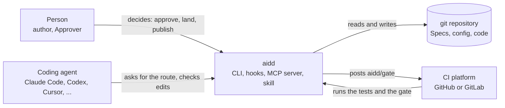
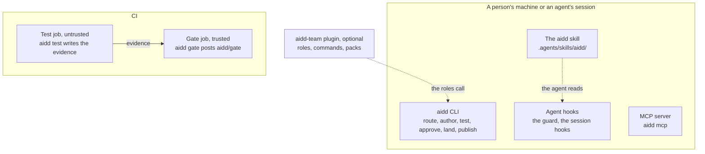
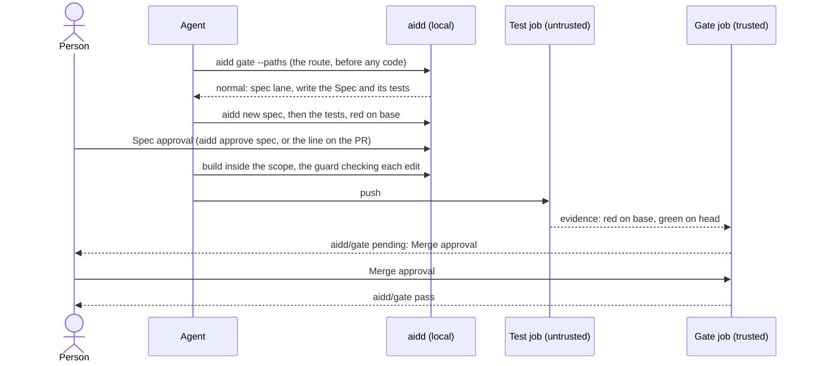

# Architecture: the aidd repository

Written 2026-10-13. It's a living page that describes this repository as it is today, and nobody freezes it. It's for
the people and the agents who maintain and improve aidd. It says what each part is, how the parts fit, which file is the source of each fact, the
formats and conventions every file follows, and where each kind of change goes. The method that aidd runs is in
[METHOD.md](METHOD.md), and why the method is the way it is, in [RATIONALE.md](RATIONALE.md).

## What aidd is

aidd is a command-line tool, a CI check, and a skill that coding agents read. It sits between the people who decide,
the agents who do the work, git, and the CI platform. One repository holds all of it, with the optional team plugin,
the standards library, and the conformance suite.

- **In scope** are the route of a change, the Spec and its approvals, red-then-green evidence, and the gate's decision.
  So are the guard on an agent's edits, the record of who approved what, and the team's knowledge that agents read.
- **Out of scope** are deploying, sandboxing an agent, judging code quality for the Approver, and running a model.
  aidd starts no agent and calls no model.

## The repository at a glance

| Path | What it holds | Who reads it |
| --- | --- | --- |
| `src/aidd/` | the Python package: the CLI, the gate, the guard, and everything they share | everyone who runs aidd |
| `schemas/` | the JSON Schemas of every file and output, `roles.json` (the team registry, with its parts `packs.json` and `industry-standards.json`), `baseline.json` (the built-in route rules), and `profiles.json` | the code, `aidd gen-docs`, and other implementations |
| `.agents/skills/aidd/` | the aidd skill: `SKILL.md`, its references, and the templates `aidd new` fills | every coding agent |
| `plugins/aidd-team/` | the optional team: agent roles, commands, domain packs, practice skills, and their evals | Claude Code, and agents that read skills |
| `.claude-plugin/`, `hooks/` | the Claude Code plugin and marketplace manifests, and the plugin's hook wiring | Claude Code |
| `standards/`, `stacks/` | the standards library, one file per standard, and the stacks that group them | `aidd standard`, `aidd stack` |
| `templates/` | what `aidd init` writes into an adopter's repository: CI workflows for GitHub and GitLab, the PR template, managed settings, the dev container | adopters |
| `action.yml` | the composite action that runs `aidd test` in GitHub Actions | adopters' test jobs |
| `examples/` | the conformance suite, plus a Policy example and a hook example | `aidd eval examples`, other gate implementations |
| `evals/` | the agent evals: routing scenarios, role scenarios, and plugin cases | `aidd eval routing`, `aidd eval roles` |
| `tests/` | the unit and integration tests, the fitness functions among them | CI, contributors |
| `docs/` | the method, the guides, and the reference | people |
| `tools/mermaid/` | the pinned Mermaid parser that checks every diagram in the docs | CI |
| `.github/` | this repository's own workflows, CODEOWNERS, the hash-pinned tool requirements, and the zizmor configs | GitHub |
| `.aidd/config.yaml`, `AGENTS.md`, `specs/` | aidd used on itself: its config, the agent instructions, and the Specs | aidd, agents |
| `.importlinter`, `.gitleaks.toml`, `pyproject.toml` | the module boundaries, the secret scan, and the package build | CI |
| `README.md`, `CHANGELOG.md`, `CONTRIBUTING.md`, `SECURITY.md`, `GOVERNANCE.md`, `RELEASING.md`, `REVIEW.md` | the project's front door and its policies | people |

## aidd runs on itself

aidd is built with aidd. Every rule it asks of adopters holds here first, so a rule that is too costly here is too
costly for anyone.

| What aidd asks of a repository | How this repository does it |
| --- | --- |
| a config the gate reads from the base branch | `.aidd/config.yaml`: the `solo` profile, one Approver, and the gate's own code, data, CI, plugins, and docs as protected paths, so a change to them is major |
| agents load the skill and follow the loop | `AGENTS.md` points every agent at `.agents/skills/aidd/`, and the aidd plugin carries it in Claude Code |
| red-then-green tests in the project's own CI | `.github/workflows/aidd-tests.yml` runs `aidd test` on the base and the head |
| the gate decides, from the default branch | `.github/workflows/aidd-gate.yml` calls the reusable `gate.yml` from the default branch, so a pull request cannot change the gate that judges it |
| a Spec for a normal or major change | `specs/`, written with `aidd new spec` |
| a commit an agent authors names it | `Assisted-by: <harness>/<model>` on every such commit |
| the modular-monolith rules | the package layers, the doors, and `lint-imports` ([The Python package](#the-python-package)) |
| a library standard for each open choice it fills | `.importlinter` follows the library standard `standards/python/import-linter.md` |
| an architecture overview from aidd's template | this page |
| the team's writing level | the sentence rule on every page (`tests/test_plain_language.py`) |

One thing isn't done yet. The gate hasn't judged a live pull request here, so the work in 1.0.0 has no Specs. The
first live run starts the loop for this repository, and every change after it goes through the loop.

## Sources of truth and generated files

Each fact has one source. Everything else is generated from it, and `aidd gen-docs --check` fails when a copy drifts.

| Fact | Source | Generated from it |
| --- | --- | --- |
| every file format and JSON output | `schemas/*.schema.json` | the field and vocabulary tables in the docs and the skill |
| the team: roles, the loop contract, handoffs, flows, domain packs, and the industry standards they cite | `schemas/roles.json`, with its parts `schemas/packs.json` and `schemas/industry-standards.json` | the agent files in `plugins/aidd-team/agents/`, every domain pack, the team docs, and the loop tables |
| the built-in route rules | `schemas/baseline.json` | the route tables in the docs and the skill |
| the commands and flags | `src/aidd/cli/grammar/` and `src/aidd/cli/parser.py` | the command tables in [CLI.md](CLI.md) and the README |
| the library standards and stacks | `standards/`, `stacks/` | the tables in [STANDARDS.md](STANDARDS.md) |
| the counts the docs state | the data each one counts | every `count:` block |

A generated block sits between `<!-- aidd:gen <kind>:<name> -->` and `<!-- aidd:end -->`. Never edit one by hand.
Change the source, then run `aidd gen-docs`. A domain pack is generated whole, so it is never edited by hand either.

## The Python package

`src/aidd/` is one package with no runtime dependency. It runs on Python 3.11 or later. It is fourteen packages, one
per capability, in thirteen layers. A package imports only from the packages below it, and only through its door, its
`__init__.py`. The rules for contributors are in [CONTRIBUTING.md](../CONTRIBUTING.md#code-and-imports).

| Layer, top first | Package | Holds |
| --- | --- | --- |
| 1 | `cli` | the command line (`app`, `parser`, `grammar/<group>`, `commands/<group>`) and the MCP server |
| 2 | `docsgen` | `aidd gen-docs`: every generated block, pack, and agent file, and the pack budget |
| 3 | `guard`, `evals` | the guard hook, the session hooks, and the edit and command checks; the example suite and the agent evals |
| 4 | `autopilot` | the engine's next action, the lease and journal, and the context pack |
| 5 | `tracking` | the forecast and the next steps, upkeep, the status rollup, metrics, export, observe, and control bands |
| 6 | `setup` | `aidd init`, `upgrade`, `uninstall`, and `doctor`, and the detection and import behind them |
| 7 | `platforms` | the GitHub, GitLab, and local-first adapters |
| 8 | `views` | the HTML pages people decide on, and the approval summaries |
| 9 | `gate` | the gate: its rules (`gate/rules/`), the rulebook, the route, the inputs, the Policy, the test runner, the change record, and the report |
| 10 | `workitems` | Specs, Epics, Initiatives, proposals, and explorations: parsing, status, authoring, and validation |
| 11 | `knowledge` | the team registry, role and practice text, the standards library, and owners |
| 12 | `config` | `.aidd/config.yaml`, the baseline, identities, harness settings, and `extends` |
| 13 | `kernel` | what knows no domain: git, globs, HTTP, bundled data, JSON Schema, documents, the YAML reader, processes, timestamps, text, and the doors |

- **Doors.** A package's `__init__.py` holds no code. It lists the names other packages may use, and reads each one
  from the child module that defines it when a caller uses it. So importing a package loads none of its children, and
  a test that patches a child reaches every caller. `kernel` has no door, so its modules are public.
- **Lazy commands.** Each command names its handler as `"group:cmd_name"`, and the CLI imports it only when the command
  runs. So `aidd hook pre-tool`, which runs before every edit an agent makes, loads only its own code.
- **Extensions at the top.** Installed packages can add commands, exporters, renderers, and packs through entry points.
  Only `cli` discovers them. The code that decides, proves, or guards never reaches them.

### aidd's own modular-monolith rules, applied to itself

aidd tells adopters to build a modular monolith, with the `aidd-team:modular-monolith` skill. Its own code follows the
same seven principles, shaped for a command-line tool instead of a service:

| Principle | In this repository |
| --- | --- |
| Modules follow capabilities, not technical layers | one package per capability: `gate`, `guard`, `tracking`, and the rest |
| One public door per module | the package's `__init__.py`; its children are internal |
| Each module owns its data | each kind of file has one reader: the config in `config`, the work items in `workitems`, the registry and the standards in `knowledge`, YAML in `kernel` |
| Dependencies point one way | the layers in `.importlinter`; no cycle inside a package |
| Machines enforce the rules | `lint-imports` in CI, with no `ignore_imports` |
| Each module could become a service | the gate decides from one context file, so another implementation can replace it and prove it with the conformance suite |
| The shared kernel stays small and generic | `kernel` knows no domain |

It differs in two ways, on purpose. aidd uses strict layers where a service would use peer modules with events, and its
code lives under `src/aidd/<package>/`, not `modules/<name>/`. It has no database, so "owns its data" means owns its files.

## The knowledge model

The team's know-how is data, so it can be checked, generated, and dated.

- **The registry**, `schemas/roles.json`, holds <!-- aidd:gen count:roles -->13<!-- aidd:end --> roles, the loop
  contract, and the handoffs and flows. It names its parts: the <!-- aidd:gen count:packs -->25<!-- aidd:end -->
  domains in `packs.json`, and every industry standard they cite in `industry-standards.json`. Each standard records
  its source and a sentence quoted from it where one is published, and its edition where it has one. It carries a `checked` date, or a `reviewed` date for a practice with no versioned source.
  `aidd eval standards` fails on an entry past its review.
- **A domain pack** is what every role checks in one domain, by loop step. It lives in
  `plugins/aidd-team/skills/<domain>/`, generated from its `domains` entry.
- **A practice skill** is how to do one kind of work well, such as `naming` or `modular-monolith`. It lives in
  `plugins/aidd-team/skills/<name>/`. There are <!-- aidd:gen count:practices -->34<!-- aidd:end -->, each hand-written, and a role lists
  the ones it uses.
- **An open choice** is a decision a pack or a practice skill leaves to the team. Each has aidd's default answer.
- **A library standard** fills one open choice for one ecosystem, such as Ruff for Python, in
  `standards/<group>/<topic>.md`. **A stack** is a set of library standards that go together, in `stacks/<name>.yaml`.

[STANDARDS.md](STANDARDS.md) defines these words, and [plugins/README.md](../plugins/README.md) says how to add each one.

### Knowledge files follow the ideas of OKF

The Open Knowledge Format, OKF, describes knowledge as Markdown files with YAML front matter, with provenance, sources,
and a trust tier. aidd's knowledge files follow its ideas, while OKF itself is young and has no validator, so aidd does
not use it as a storage format. The fields map one to one:

| OKF idea | aidd field |
| --- | --- |
| `type` | `type`: always `opinionated` for a library standard |
| `status` | `status` (`active`, `deprecated`), with `replaced_by` |
| `verified` and its actor | `checked` and `checked_by` (`agent:<harness>/<model>`), or `reviewed` by a person |
| `sources` with quoted claims | `source` and `evidence`, a sentence quoted from the source |
| `stale_after` | `review_every_days` or `review_due`, else 90 days for an emerging entry and 365 for an established one, spread by a stable offset from its id; `aidd eval standards` fails past it |
| the trust tier | derived from `checked_by`: checked by an agent, or reviewed by a person |

## File formats

- **Markdown with YAML front matter.** Every document aidd reads or writes is Markdown, with its fields as YAML between
  `---` lines, which GitHub renders as a table. The config is `.aidd/config.yaml`, and the Change Request block is a
  `yaml aidd` fence.
- **A strict subset of YAML.** aidd reads YAML with its own reader, `kernel/strict_yaml.py`, which accepts only what
  every YAML reader reads the same. A value such as `1.0.0`, a date, `yes`, or `on` must be quoted, and so must a key
  such as `on`. Anchors, tags, null, duplicate keys, and tabs are refused. Every error names the line and the fix.
  aidd's own edits keep a person's comments. No key is a YAML 1.1 boolean either, so the dates are `decided_on` and
  `triaged_on`, and the defaults a person turns off are `project.defaults.disabled`.
- **TOML only where another tool owns the file**, as in `pyproject.toml`, `Cargo.toml`, `.codex/agents/*.toml`, and
  `.gitleaks.toml`. aidd reads the TOML lockfiles with `tomllib`.
- **JSON Schema 2020-12.** Each schema has the `$id` `urn:aidd:1:<name>`. Every JSON output carries `schema_version`. A
  new key keeps it, and a renamed or removed key bumps it.
- **Agent Skills.** A skill is a folder with a `SKILL.md` whose front matter holds `name` and `description`, as the
  Agent Skills format says. The aidd skill is self-contained, so it links nothing outside its folder.
- **Claude Code.** The plugins follow Claude Code's plugin and marketplace manifests in `.claude-plugin/`, its hook
  wiring in `hooks/hooks.json`, and its subagent files in `plugins/aidd-team/agents/*.md`. For the
  <!-- aidd:gen count:harnesses -->26<!-- aidd:end --> coding agents it supports, `aidd init` writes each one's own
  format.
- **Diagrams** are Mermaid in the Markdown, so they diff like code. CI parses every one.

## Where each part runs

| Part | Runs on | Ships as | Trust |
| --- | --- | --- | --- |
| CLI | a person's machine, an agent's session, or a dev container | the GitHub Release's wheel, `aidd.pyz` (one zipapp), or a commit (`install.sh`) | the caller's |
| Guard and session hooks | the agent's harness, before each edit and at session events | wired by `aidd init` or the Claude Code plugin | denies what it cannot read; a hint never blocks |
| MCP server | the agent's harness | `aidd mcp`, whose tools are <!-- aidd:gen mcp:tools -->`check_edit`, `validate`, `describe`, `gate`, `approve_spec`, `approve_merge`, `land`, `publish`, `approve_all`, `decide_proposal`, and `sign_off_proposal`<!-- aidd:end -->; the approval tools ask the person in the client's dialog | advisory; the approval tools record only the person's answer |
| User launcher | each person's machine, at `~/.aidd/bin/aidd` | written by `aidd init`; the hooks and `.mcp.json` start aidd through it, so the repository names no machine's path | doctor runs only the launcher init writes, owned by its user |
| The skill and `AGENTS.md` | the adopter's repository | written by `aidd init` | text |
| Test job | the adopter's CI | `templates/github/aidd-tests.yml`, `action.yml`, or the GitLab template | untrusted |
| Gate job | the adopter's CI, from the default branch | the reusable workflow `.github/workflows/gate.yml`, run from its own commit with no package build | trusted |
| Status source | GitHub | a dedicated GitHub App, whose key only the gate job's environment holds | trusted |

## One change through aidd

One change on the spec lane, from the first edit to the merge. The fast lane skips the Spec and Spec approval.

## Design principles

These hold across the whole repository. A change that breaks one is a design change, not a fix.

- **aidd runs on itself.** Every rule aidd asks of adopters holds in this repository first, as
  [aidd runs on itself](#aidd-runs-on-itself) shows.

### People decide, and the decision is bound

- **Agents do the work; people decide.** No agent approves, lands, merges, or publishes. The guard denies an agent's approval
  command, and the gate counts no approval from an agent, a bot, or the change's own author. The one exception is a
  person's own choice. Under their standing approval, `approve all`, which only they start, the agent records each
  approval it covers, citing it.
- **A decision binds exact content.** Spec approval binds the Spec, its tests, and its design files as they read at the approved commit; the gate compares their hash there and at head. Merge
  approval binds the head commit. A change after the decision voids it, so nobody approves one thing and lands
  another.
- **Separation of duties.** Whoever writes a change never approves it, and in the team, whoever writes the tests never
  makes them pass. [METHOD.md §8](METHOD.md#8-approvals-and-separation-of-duties) has the rule.

### Trust is placed, never assumed

- **Trusted and untrusted parts are apart.** The gate job runs from the default branch, reads the change as git
  objects, and never runs its code. The test job runs the change's code and is untrusted, so its evidence binds to the
  commit, and a stale or substituted result is refused. The config comes from the base branch.
  [SECURITY.md](../SECURITY.md#trust-model) has the full model.
- **Fail closed.** An input the gate cannot read, a document outside the format, or an error inside a check fails or
  denies. Every stop says why and what to do next.
- **Evidence, not assertion.** A runner's exit codes on a known commit are evidence. An agent's summary, a chat
  message, or a self-reported result never is.
- **The core is sealed.** Installed extensions can add commands, exporters, renderers, and packs. Only `cli` discovers
  them, so the code that decides, proves, or guards never runs them.

### State lives in git, in files people can read

- **git is the store.** Specs, the config, and the work items are files; local approvals are git refs; the gate record
  binds base and head commits. aidd needs only git, so the whole loop runs on one machine, and a platform is an adapter.
- **Derive what can be proved; store only decisions.** Every status git or the platform can prove is derived. Only a
  person's decisions and outcomes nobody can observe are stored, as [METHOD.md §5.1](METHOD.md#51-status) says.
- **Files people edit by hand.** Documents are Markdown with YAML front matter that renders on GitHub, in a subset
  where every value means one thing. [File formats](#file-formats) has the details.
- **Where aidd writes.** It writes in three places, with one rule each, and `src/aidd/config/layout.py` holds them:

  | Where | What it holds | Rule |
  |---|---|---|
  | A file directly in `.aidd/` | `config.yaml`, `allowed_signers`, `team-roles.md` | A person's decisions: committed, and protected (`.aidd/**`), so an agent never edits them |
  | A folder in `.aidd/` | `evidence/` (the evidence, its logs, the gate record, and `preview/<head-sha>/`, what the verifier captured), and `views/` (the decision pages) | One worktree's output: git ignores it (`/.aidd/*/`), aidd writes it again on each run, and an agent's edit tools cannot forge it |
  | `.git/aidd/` (the git common directory) | the autopilot lease, journal, and run events, the local gate events (`aidd metrics` reads them), the session snapshots, and the guard's log | What every worktree shares: never in a working tree, so it has nothing to commit |

  A new file aidd writes takes the first row that fits. That's a person's decision first, then one worktree's output,
  then what every worktree must see.

### One owner for each fact

- **The gate owns the route.** `aidd gate --paths` forecasts it before any code, and the gate computes it again from
  the real diff, with the same code. So the forecast and the verdict cannot disagree, and the loop has no step before
  Plan.
- **The schemas own the contracts.** `schemas/` defines every file and every JSON output, and `roles.json` defines the
  team, as [Sources of truth](#sources-of-truth-and-generated-files) lists.
- **The gate decides from one context.** Each platform adapter gathers a context in the shape of `schemas/context.schema.json`,
  and one engine decides from it. Any other CI can build the context and run the same gate, and the conformance suite lets
  another implementation show that it decides the same.

### Deterministic, small, and quiet

- **No model, no runtime dependency.** aidd calls no model and starts no agent, and every check is deterministic. It
  uses the standard library only, so it installs anywhere and adds nothing to an adopter's supply chain. Its own CI
  pins each third-party action by commit and each tool by hash.
- **Load only what runs.** Packages open through lazy doors, and each command imports its handler only when it runs.
  So the guard, which runs before every edit an agent makes, starts fast.
- **No telemetry.** [SECURITY.md](../SECURITY.md#data-handling) lists every place aidd connects to a network, and
  `AIDD_OFFLINE=1` stops the optional checks. Hooks mask secret-looking values in what they print.
- **Plain words.** Every stop names its next step, and the docs and messages use short sentences.

## Conventions

- **Names.** Files and folders are lowercase with hyphens. Work items have ids such as `SPEC-12` and `SPEC-12-T1`. A
  finding code is the rule, a dot, and the reason, such as `route.too_low`. Each code has its anchor on the generated
  [ERRORS.md](ERRORS.md), so a new code needs its meaning in its owner's table. An agent identity is
  `agent:<harness>/<model>`, and a person is their login, such as `@alice`. The `aidd-team:naming` skill holds the rest.
- **Dates and versions** are ISO dates and semantic versions, quoted in YAML. The method, the schemas, the gate, the CI
  templates, the skill, and the team plugin share one version, as [CONTRIBUTING.md](../CONTRIBUTING.md#versioning)
  explains.
- **Commits.** A commit an agent authors carries `Assisted-by: <harness>/<model>`.
- **Writing.** aidd's docs, skills, and messages follow the ASD-STE100 sentence rules, in a natural voice. That means
  one idea a sentence, the active voice, and no sentence over 35 words on any page, which `tests/test_plain_language.py`
  checks. A message that stops someone names the next step, and `tests/test_next_step_messages.py` checks that.
- **Tests.** The suite uses the standard library's `unittest`, with shared helpers in `tests/helpers.py`. When a test
  fails, fix the code, never the test.
- **The conformance suite.** Each example in `examples/` is one change. It holds `context.json`, its `expected.json`,
  and `mutations/` that each change one fact and pin one finding code. Shared Specs and configs are in `examples/_specs/`
  and `examples/_configs/`. There are <!-- aidd:gen count:examples -->28<!-- aidd:end --> examples and
  <!-- aidd:gen count:mutations -->239<!-- aidd:end --> mutations.

## Where each kind of change goes

[AGENTS.md](../AGENTS.md) is the short version for agents, and [CONTRIBUTING.md](../CONTRIBUTING.md) the full one.

| To change | Edit | Then |
| --- | --- | --- |
| a gate rule | its module in `src/aidd/gate/rules/`, its row in `src/aidd/gate/rulebook.py`, and a passing and a failing example in `examples/` | an RFC first; `aidd eval examples` |
| a file format or a JSON output | its schema in `schemas/` | an RFC first; `aidd gen-docs` |
| a route, a profile, or the loop | `schemas/baseline.json`, `schemas/profiles.json`, or the loop in `schemas/roles.json` | an RFC first; `aidd gen-docs` |
| a role, a domain pack, or a standard's edition | `schemas/roles.json`, `schemas/packs.json`, or `schemas/industry-standards.json` | `aidd gen-docs`, `aidd eval standards` |
| a practice skill | `plugins/aidd-team/skills/<name>/SKILL.md`, and the roles that use it in `schemas/roles.json` | `aidd gen-docs` |
| a library standard or a stack | `standards/<group>/<topic>.md` or `stacks/<name>.yaml` | `aidd gen-docs`, `aidd eval standards` |
| a command or a flag | `src/aidd/cli/grammar/<group>.py`, its handler in `src/aidd/cli/commands/<group>.py`, and its row in `src/aidd/cli/parser.py` | `aidd gen-docs` |
| the skill agents read | `.agents/skills/aidd/`, which links nothing outside itself | the size budgets in `tests/test_loop_contract.py` |
| what `aidd init` writes | `templates/` and `src/aidd/setup/`; every third-party action pinned by commit | `aidd init --dry-run` in a scratch repository |

An RFC follows [docs/rfcs/0000-template.md](rfcs/0000-template.md). Every change then runs the checks in
[AGENTS.md](../AGENTS.md#verifying-your-work).

## Checks that keep it so

| What holds | Checked by |
| --- | --- |
| the layers, no cycle inside a package, extensions out of the gate and the guard, a door per package | `lint-imports` with `.importlinter`, which has no `ignore_imports`; `tests/test_import_boundaries.py` |
| the doors, imports in any order, patches that reach their callers, a parser that loads no command | `tests/test_package_doors.py`, `tests/test_isolated_imports.py`, `tests/test_patch_targets.py`, `tests/test_cli_handlers.py` |
| the hook loads only the code it runs, under a fixed cap of lines | `tests/test_startup_cost.py` |
| every conformance example and data mutation gives its pinned finding code | `aidd eval examples` |
| the guard denies exactly the writes bash makes, for the cases it reads | `tests/test_guard_oracle.py` |
| aidd's YAML reader agrees with PyYAML on every document it accepts | `tests/test_strict_yaml.py`, with PyYAML required in CI |
| a module that uses the network is on the list in SECURITY.md | `tests/test_egress.py` |
| no generated table or count drifts from its source | `aidd gen-docs --check` |
| every standard is current | `aidd eval standards` |
| every stop names its next step; no sentence over 35 words on any page | `tests/test_next_step_messages.py`, `tests/test_plain_language.py` |

## Risks and technical debt

[RATIONALE.md](RATIONALE.md#known-limits-in-100) lists the known limits of 1.0.0. These touch the architecture most:

| Risk or debt | Impact | What would retire it |
| --- | --- | --- |
| The guard reads only the writes it knows | an interpreter, a build tool, or a package manager can write past it | the gate in CI, on the real diff, stays the control |
| The gate has not judged a live pull request | the platform adapters are tested only against recorded contexts | the first live run of this repository's own gate |
| aidd owns its YAML reader | a reader bug could misread a document | the differential tests against PyYAML in CI |

## Glossary

The terms live in one place, [GLOSSARY.md](GLOSSARY.md).
