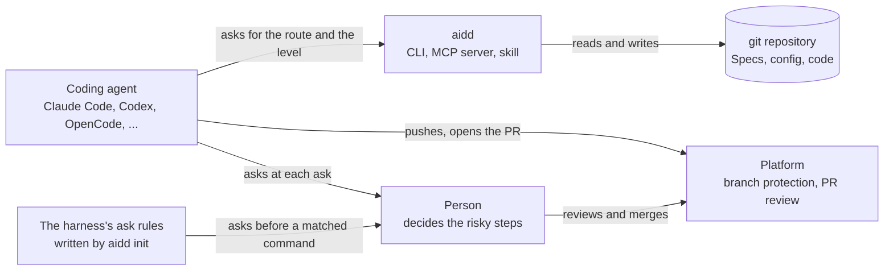
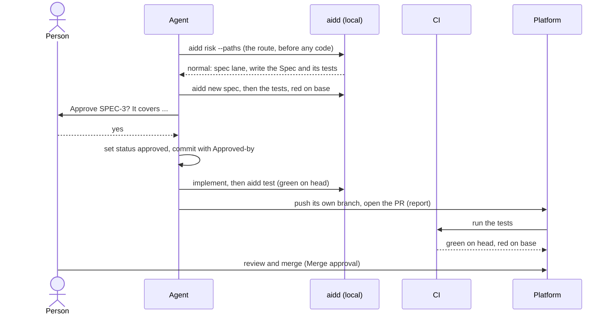

# Architecture: the aidd repository

It's a living page that describes this repository as it is today, and nobody freezes it. It's for the people and the
agents who maintain and improve aidd. It says what each part is, how the parts fit, which file is the source of each
fact, the formats every file follows, and where each kind of change goes. The method that aidd runs is in
[METHOD.md](METHOD.md).

## What aidd is

aidd is a command-line tool and a skill that coding agents read, with an optional team of agent roles and a standards
library. Agents do the work and follow one loop. A person decides the risky steps. aidd advises and records nothing: it
computes the route of a change and the level of each action, and the agent acts by that level.

- **In scope** are the route of a change, the risk rules and their levels, the Spec and its status, red-then-green
  evidence, the harness ask rules aidd writes, and the team's knowledge that agents read.
- **Out of scope** are enforcing anything, deploying, sandboxing an agent, judging code quality for the person, and
  running a model. aidd starts no agent and calls no model. The hard stops are the harness's own ask rules and the
  platform's branch protection, as [SECURITY.md](../SECURITY.md) says.

## The repository at a glance

| Path | What it holds | Who reads it |
| --- | --- | --- |
| `src/aidd/` | the Python package: the CLI, the risk rules' code, and the MCP server | everyone who runs aidd |
| `schemas/` | the JSON Schemas of every file and output, `risks.json` (the built-in actions, areas, and rules), `profiles.json`, and `roles.json` (the team registry, with its parts `packs.json` and `industry-standards.json`) | the code, `aidd gen-docs`, and other tools |
| `.agents/skills/aidd/` | the aidd skill: `SKILL.md`, its references, and the templates `aidd new` fills | every coding agent |
| `plugins/aidd-team/` | the optional team: agent roles, flow commands, domain packs, practice skills, and their evals | Claude Code, and agents that read skills |
| `plugins/aidd-cli/` | the plugin that puts the `aidd` command on the PATH in Claude Code | Claude Code |
| `.claude-plugin/` | the aidd plugin's manifest, with the skill and the MCP server, and the marketplace | Claude Code |
| `standards/`, `stacks/` | the standards library, one file per standard, and the stacks that group them | `aidd standard` |
| `templates/` | what `aidd init` writes into a repository: the CI test workflows for GitHub and GitLab, the PR template, `REVIEW.md`, and the dev container | adopters |
| `action.yml` | the composite action that runs `aidd test` in GitHub Actions | adopters' test jobs |
| `evals/` | the agent evals: routing scenarios, role scenarios, and plugin cases | `aidd eval routing`, `aidd eval roles` |
| `tests/` | the unit and integration tests, the fitness functions among them | CI, contributors |
| `docs/` | the guide, the method, the team, the library, and the reference | people |
| `tools/` | the pinned Mermaid parser that checks every diagram, and the pin sync script | CI, maintainers |
| `.github/` | this repository's own workflows, CODEOWNERS, rulesets, and the hash-pinned tool requirements | GitHub |
| `.aidd/config.yaml`, `AGENTS.md`, `specs/` | aidd used on itself: its config, the agent instructions, and the Specs | aidd, agents |
| `.importlinter`, `.gitleaks.toml`, `pyproject.toml` | the module boundaries, the secret scan, and the package build | CI |

## aidd runs on itself

aidd is built with aidd. Every rule it asks of adopters holds here first, so a rule that is too costly here is too
costly for anyone.

| What aidd asks of a repository | How this repository does it |
| --- | --- |
| a config the agents read | `.aidd/config.yaml`, with the `solo` profile |
| agents load the skill and follow the loop | `AGENTS.md` points every agent at `.agents/skills/aidd/`, and the aidd plugin carries it in Claude Code |
| the agent asks at each `ask` | the skill's loop, and the harness ask rules `aidd init` writes |
| red-then-green tests in the project's own CI | `.github/workflows/aidd-tests.yml` runs `aidd test` on the base and the head |
| a hard stop on the default branch | branch protection on `main`, from `.github/rulesets/main.json` |
| a Spec for a normal or major change | `specs/`, written with `aidd new spec` |
| a commit an agent authors names it | `Assisted-by: <harness>/<model>` on every such commit |
| the modular-monolith rules | the package layers, the doors, and `lint-imports` ([The Python package](#the-python-package)) |
| a library standard for each open choice it fills | `.importlinter` follows the library standard `standards/python/import-linter.md` |
| an architecture overview from aidd's template | this page |
| the team's writing level | the sentence rule on every page (`tests/test_plain_language.py`) |

The work in 1.0.0 has no Specs, because it was built before the loop ran here. Every change after the release goes
through the loop.

## Sources of truth and generated files

Each fact has one source. Everything else is generated from it, and `aidd gen-docs --check` fails when a copy drifts.

| Fact | Source | Generated from it |
| --- | --- | --- |
| every file format and JSON output | `schemas/*.schema.json` | the field tables in [CONFIG.md](CONFIG.md), the docs, and the skill |
| the built-in actions, areas, and risk rules | `schemas/risks.json` | the risk tables in the docs and the skill |
| the profiles | `schemas/profiles.json` | the profile tables |
| the team: roles, the loop contract, handoffs, flows, domain packs, and the industry standards they cite | `schemas/roles.json`, with its parts `schemas/packs.json` and `schemas/industry-standards.json` | the agent files in `plugins/aidd-team/agents/`, every domain pack, [TEAM-REFERENCE.md](TEAM-REFERENCE.md), and the loop tables |
| the commands and flags | `src/aidd/cli/grammar/` and `src/aidd/cli/parser.py` | [CLI.md](CLI.md) and the command tables in the README |
| the coding agents aidd supports | the harness table in `src/aidd/config/harnesses.py` | the harness tables in the guide and `llms-install.md` |
| the library standards and stacks | `standards/`, `stacks/` | the tables in [STANDARDS.md](STANDARDS.md) |
| the counts the docs state | the data each one counts | every `count:` block |

A generated block sits between `<!-- aidd:gen <kind>:<name> -->` and `<!-- aidd:end -->`. Never edit one by hand.
Change the source, then run `aidd gen-docs`. A domain pack is generated whole, so it is never edited by hand either.

## The Python package

`src/aidd/` is one package with no runtime dependency. It runs on Python 3.11 or later. It is eleven packages, one per
capability, in eleven layers. A package imports only from the packages below it, and only through its door, its
`__init__.py`. The rules for contributors are in [CONTRIBUTING.md](../CONTRIBUTING.md#code-and-imports).

| Layer, top first | Package | Holds |
| --- | --- | --- |
| 1 | `cli` | the command line (`app`, `parser`, `commands/<group>`) and the MCP server |
| 2 | `docsgen` | `aidd gen-docs`: every generated block, pack, and agent file |
| 3 | `evals` | the agent evals and the standards check |
| 4 | `setup` | `aidd init`, `upgrade`, `uninstall`, `doctor`, and `self-update`, and the harness wiring behind them |
| 5 | `views` | the exploration page and the product prototype page |
| 6 | `testing` | the test runner and its evidence |
| 7 | `risk` | the risk rules: load, merge, and match; the route for paths; the harness ask rules |
| 8 | `workitems` | Specs, Epics, Initiatives, Proposals, and explorations: their files, validation, authoring (`aidd new`), and the status their front matter stores |
| 9 | `knowledge` | the standards library, the team registry, the role text, and owners (who to ask) |
| 10 | `config` | `.aidd/config.yaml` and its `extends` presets, the profiles, and the harness table |
| 11 | `kernel` | what knows no domain: git, strict YAML, JSON Schema, globs, processes, text, resources, documents, HTTP, egress, and the doors |

- **Doors.** A package's `__init__.py` holds no code. It lists the names other packages may use, and reads each one
  from the child module that defines it when a caller uses it. So importing a package loads none of its children, and
  a test that patches a child reaches every caller. `kernel` has no door, so its modules are public.
- **Lazy commands.** Each command names its handler as `"group:cmd_name"`, and the CLI imports it only when the command
  runs. So a quick command such as `aidd risk --command` loads only its own code.
- **Import Linter holds the layers.** `.importlinter` lists the packages from `cli` to `kernel`, a door contract for
  each package, and no cycle inside one. It has no `ignore_imports`, so a wrong-way import is fixed, never listed.

### aidd's own modular-monolith rules, applied to itself

aidd tells adopters to build a modular monolith, with the `aidd-team:modular-monolith` skill. Its own code follows the
same seven principles, shaped for a command-line tool instead of a service:

| Principle | In this repository |
| --- | --- |
| Modules follow capabilities, not technical layers | one package per capability: `risk`, `testing`, `workitems`, and the rest |
| One public door per module | the package's `__init__.py`; its children are internal |
| Each module owns its data | each kind of file has one reader: the config in `config`, the work items in `workitems`, the risk rules in `risk`, the registry and the standards in `knowledge`, YAML in `kernel` |
| Dependencies point one way | the layers in `.importlinter`; no cycle inside a package |
| Machines enforce the rules | `lint-imports` in CI, with no `ignore_imports` |
| Each module could become a service | `risk` answers from the config and the paths alone, so the CLI, the MCP server, and the skill's tables all read one answer |
| The shared kernel stays small and generic | `kernel` knows no domain |

It differs in two ways, on purpose. aidd uses strict layers where a service would use peer modules with events, and its
code lives under `src/aidd/<package>/`, not `modules/<name>/`. It has no database, so "owns its data" means owns its files.

## The risk rules

The risk rules are modelled on authorization, with the shape and names of Cedar, Google Cloud IAM, and Kubernetes RBAC,
and no engine of their own. [METHOD.md](METHOD.md) is normative, and [GLOSSARY.md](GLOSSARY.md) defines each word.

- **An action** is `resource.verb`, such as `pr.open` or `git.push.force`. It has a description, shell `commands`
  patterns, optional harness `tools`, and `examples` that no pattern catches, which the agent judges.
- **An area** is a named set of path globs, such as `payments`, with an optional `route` it raises a change to.
- **A rule** is `{action, area?, branch?, role?, level, locked?}`, and its level is `allow`, `report`, or `ask`.
- **The winning rule** is the most specific one that matches, then the higher level. A config rule with the same
  selector replaces the built-in one, unless an `extends` preset locks it.
- **The sources**, in order: `schemas/risks.json`, then the profile in `schemas/profiles.json`, then the `extends`
  presets, then the config's `risks`. `aidd risk --list` names where each effective rule came from.
- **The harness ask rules.** `aidd init` and `aidd upgrade` write each `ask` rule's command patterns into the harness's
  own ask format, such as Claude Code's `permissions.ask`. aidd changes only the entries it listed in
  `.aidd/harness-rules.json`, never a person's own.

## The knowledge model

The team's know-how is data, so it can be checked, generated, and dated.

- **The registry**, `schemas/roles.json`, holds <!-- aidd:gen count:roles -->13<!-- aidd:end --> roles, the loop
  contract, and the handoffs and flows. It names its parts: the <!-- aidd:gen count:packs -->25<!-- aidd:end -->
  domains in `packs.json`, and every industry standard they cite in `industry-standards.json`. Each standard records
  its source and a sentence quoted from it where one is published, and its edition where it has one. It carries a
  `checked` date, or a `reviewed` date for a practice with no versioned source. `aidd eval standards` fails on an
  entry past its review.
- **A domain pack** is what every role checks in one domain, by loop step. It lives in
  `plugins/aidd-team/skills/<domain>/`, generated from its `domains` entry.
- **A practice skill** is how to do one kind of work well, such as `naming` or `modular-monolith`. It lives in
  `plugins/aidd-team/skills/<name>/`. There are <!-- aidd:gen count:practices -->36<!-- aidd:end -->, each
  hand-written, and a role lists the ones it uses.
- **An open choice** is a decision a pack or a practice skill leaves to the team. Each has aidd's default answer.
- **A library standard** fills one open choice for one ecosystem, such as Ruff for Python, in
  `standards/<group>/<topic>.md`. **A stack** is a set of library standards that go together, in `stacks/<name>.yaml`.

[STANDARDS.md](STANDARDS.md) defines these words, and [plugins/README.md](../plugins/README.md) says how to add each one.

### Knowledge files follow the ideas of OKF

The Open Knowledge Format, OKF, describes knowledge as Markdown files with YAML front matter, with provenance, sources,
and a trust tier. aidd's knowledge files follow its ideas, while OKF itself is young and has no validator, so aidd does
not use it as a storage format. The fields map one to one:

| OKF idea | aidd field |
| --- | --- |
| `type` | `type`: always `opinionated` for a library standard |
| `status` | `status` (`active`, `deprecated`), with `replaced_by` |
| `verified` and its actor | `checked` and `checked_by` (`agent:<harness>/<model>`), or `reviewed` by a person |
| `sources` with quoted claims | `source` and `evidence`, a sentence quoted from the source |
| `stale_after` | `review_every_days` or `review_due`, else 90 days for an emerging entry and 365 for an established one, spread by a stable offset from its id; `aidd eval standards` fails past it |
| the trust tier | derived from `checked_by`: checked by an agent, or reviewed by a person |

## File formats

- **Markdown with YAML front matter.** Every document aidd reads or writes is Markdown, with its fields as YAML between
  `---` lines, which GitHub renders as a table. A Spec's status lives there. The config is `.aidd/config.yaml`.
- **A strict subset of YAML.** aidd reads YAML with its own reader, `kernel/strict_yaml.py`, which accepts only what
  every YAML reader reads the same. A value such as `1.0.0`, a date, `yes`, or `on` must be quoted, and so must a key
  such as `on`. Anchors, tags, null, duplicate keys, and tabs are refused. Every error names the line and the fix.
  aidd's own edits keep a person's comments.
- **TOML only where another tool owns the file**, as in `pyproject.toml`, `Cargo.toml`, `.codex/agents/*.toml`, and
  `.gitleaks.toml`. aidd reads the TOML lockfiles with `tomllib`.
- **JSON Schema 2020-12.** Each schema has the `$id` `urn:aidd:1:<name>`. Every JSON output carries `schema_version`. A
  new key keeps it, and a renamed or removed key bumps it.
- **Agent Skills.** A skill is a folder with a `SKILL.md` whose front matter holds `name` and `description`, as the
  Agent Skills format says. The aidd skill is self-contained, so it links nothing outside its folder.
- **Each harness's own files.** The plugins follow Claude Code's plugin and marketplace manifests in `.claude-plugin/`,
  and its subagent files in `plugins/aidd-team/agents/*.md`. For the
  <!-- aidd:gen count:harnesses -->26<!-- aidd:end --> coding agents it supports, `aidd init` writes each one's own
  format, its ask rules among them where it has any.
- **Diagrams** are Mermaid in the Markdown, so they diff like code. CI parses every one.

## Where each part runs

| Part | Runs on | Ships as | What it can stop |
| --- | --- | --- | --- |
| CLI | a person's machine, an agent's session, a dev container, or CI | the GitHub Release's wheel, `aidd.pyz` (one zipapp), or a commit (`install.sh`) | nothing: it advises |
| MCP server | the agent's harness | `aidd mcp`, whose tools are <!-- aidd:gen mcp:tools -->`risk`, `status`, and `validate`<!-- aidd:end -->; the aidd plugin starts it through a hardened launcher | nothing: it advises |
| The skill and `AGENTS.md` | the adopter's repository | written by `aidd init`, or carried by the aidd plugin | nothing: the agent follows it |
| Harness ask rules | the agent's harness | written by `aidd init` and `aidd upgrade` into the harness's own settings | a matched command, until the person answers the harness's prompt |
| Test job | the adopter's CI | `templates/github/aidd-tests.yml`, `action.yml`, or the GitLab template | a merge, once branch protection requires it |
| Branch protection | the platform | the platform's own rules, which the person sets | a push or a merge to a protected branch |

## One change through aidd

One change on the spec lane, from the first edit to the merge, under the `team` profile. The fast lane skips the Spec
and Spec approval.

## Where aidd writes

aidd writes in two places, with one rule each, and `src/aidd/config/layout.py` holds them:

| Where | What it holds | Rule |
|---|---|---|
| A file directly in `.aidd/` | `config.yaml`, and `harness-rules.json`, the list of harness ask rules aidd wrote | committed, because a person's settings and aidd's own entries must travel with the repository |
| A folder in `.aidd/` | `evidence/` (the test evidence, its logs, and `preview/`, what the verifier captured), and `views/` (the exploration and prototype pages) | one worktree's output: git ignores it (`/.aidd/*/`), and aidd writes it again on each run |

A Spec's status, its `approved_by` and `approved_at`, and the `Approved-by` trailer are written by the agent, in the
Spec and its commit. aidd keeps no other state.

## Conventions

- **Names.** Files and folders are lowercase with hyphens. Work items have ids such as `SPEC-12` and `SPEC-12-T1`. An
  action is `resource.verb`, such as `git.push.force`, and an area a snake_case name, such as `personal_data`. An
  agent identity is `agent:<harness>/<model>`, and a person is their login, such as `@alice`. The `aidd-team:naming`
  skill holds the rest.
- **Dates and versions** are ISO dates and semantic versions, quoted in YAML. The method, the schemas, the risk rules,
  the CI templates, the skill, and the team plugin share one version, as
  [CONTRIBUTING.md](../CONTRIBUTING.md#versioning) explains.
- **Commits.** A commit an agent authors carries `Assisted-by: <harness>/<model>`. The commit that records a Spec
  approval carries `Approved-by: <person>`.
- **Writing.** aidd's docs, skills, and messages follow the ASD-STE100 sentence rules, in a natural voice. That means
  one idea a sentence, the active voice, and no sentence over 35 words on any page, which `tests/test_plain_language.py`
  checks. A message that stops someone names the next step, and `tests/test_next_step_messages.py` checks that.
- **Tests.** The suite uses the standard library's `unittest`, with shared helpers in `tests/helpers.py`. When a test
  fails, fix the code, never the test.

## Where each kind of change goes

[AGENTS.md](../AGENTS.md) is the short version for agents, and [CONTRIBUTING.md](../CONTRIBUTING.md) the full one.

| To change | Edit | Then |
| --- | --- | --- |
| a file format or a JSON output | its schema in `schemas/` | an RFC first; `aidd gen-docs` |
| a built-in action, area, or risk rule | `schemas/risks.json` | an RFC first; `aidd gen-docs` |
| a profile or the loop | `schemas/profiles.json`, or the loop in `schemas/roles.json` | an RFC first; `aidd gen-docs` |
| how rules match, or the route for paths | `src/aidd/risk/` | its tests; a security review |
| a harness's ask rules | the writer in `src/aidd/risk/` and the harness's row in `src/aidd/config/harnesses.py`, from the harness's own documentation | a test for that harness; `aidd gen-docs` |
| a role, a domain pack, or a standard's edition | `schemas/roles.json`, `schemas/packs.json`, or `schemas/industry-standards.json` | `aidd gen-docs`, `aidd eval standards` |
| a practice skill | `plugins/aidd-team/skills/<name>/SKILL.md`, and the roles that use it in `schemas/roles.json` | `aidd gen-docs` |
| a library standard or a stack | `standards/<group>/<topic>.md` or `stacks/<name>.yaml` | `aidd gen-docs`, `aidd eval standards` |
| a command or a flag | `src/aidd/cli/grammar/<group>.py`, its handler in `src/aidd/cli/commands/<group>.py`, and its row in `src/aidd/cli/parser.py` | `aidd gen-docs` |
| the skill agents read | `.agents/skills/aidd/`, which links nothing outside itself | the size budgets in `tests/budgets.py` |
| what `aidd init` writes | `templates/` and `src/aidd/setup/`; every third-party action pinned by commit | `aidd init --dry-run` in a scratch repository |
| a built-in tool of the team, such as the prototype tool | `plugins/aidd-team/tools/<name>/`: standard-library Python that runs without aidd | its tests in `tests/`; ruff and mypy cover the folder |

An RFC follows [docs/rfcs/0000-template.md](rfcs/0000-template.md). Every change then runs the checks in
[AGENTS.md](../AGENTS.md#verifying-your-work).

## Checks that keep it so

| What holds | Checked by |
| --- | --- |
| the layers, no cycle inside a package, a door per package | `lint-imports` with `.importlinter`, which has no `ignore_imports`; `tests/test_import_boundaries.py` |
| the doors, imports in any order, patches that reach their callers, a parser that loads no command | `tests/test_package_doors.py`, `tests/test_isolated_imports.py`, `tests/test_patch_targets.py`, `tests/test_cli_handlers.py` |
| the risk rules match as METHOD.md says, and each harness gets its ask rules in its own format | the `risk` package's tests, with a case for each harness |
| aidd's YAML reader agrees with PyYAML on every document it accepts | `tests/test_strict_yaml.py`, with PyYAML required in CI |
| a module that uses the network is on the list in SECURITY.md | `tests/test_egress.py` |
| no generated table or count drifts from its source | `aidd gen-docs --check` |
| every standard is current | `aidd eval standards` |
| every stop names its next step; no sentence over 35 words on any page | `tests/test_next_step_messages.py`, `tests/test_plain_language.py` |

## Risks and technical debt

| Risk or debt | Impact | What would retire it |
| --- | --- | --- |
| A command pattern is a net, not a control | an agent can reach the same effect through a script, an alias, or an API call that no pattern matches | branch protection on the platform stays the control, as [SECURITY.md](../SECURITY.md) says |
| A harness without ask rules gets the skill alone | the agent's own judgement is the only stop there | `aidd doctor` names each such harness; a harness that adds ask rules gets them |
| A Spec approval is a note the agent wrote | it shows what the person said, and proves nothing against an agent set on forging it | under `team`, the platform's PR review is the Merge approval |
| aidd owns its YAML reader | a reader bug could misread a document | the differential tests against PyYAML in CI |

## Glossary

The terms live in one place, [GLOSSARY.md](GLOSSARY.md).
