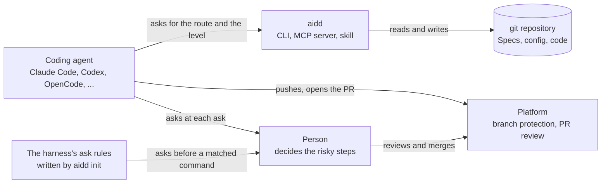
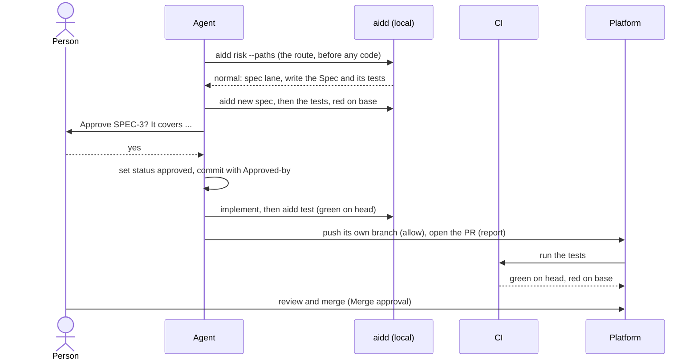

# Architecture: the aidd repository

This page describes the repository as it is today. It's for the people and the agents who maintain aidd. It says what
each part is, how the parts fit, which file is the source of each fact, and where each kind of change goes. The method
that aidd runs is in [METHOD.md](METHOD.md).

## What aidd is

aidd is a command-line tool and a skill that coding agents read, with an optional team of agent roles and a standards
library. Agents do the work and follow one loop. A person decides the risky steps.

aidd advises and enforces nothing. It computes the route of a change and the level of each action: `allow`, `report`, or
`ask`. The agent acts by that level. aidd has no guard, no gate, and no store. Its advice starts no agent and calls no model; only a maintainer's `aidd eval` runs an agent CLI.

- **In scope** are the route of a change, the risk rules and their levels, the Spec and its status, red-then-green
  evidence, the harness ask rules aidd writes, and the team's knowledge that agents read.
- **Out of scope** are enforcing anything, deploying, sandboxing an agent, judging code quality for the person, and
  running a model to give advice.
- **The hard stops** are the harness's own ask rules and the platform's branch protection, as
  [SECURITY.md](../SECURITY.md) says.

## The repository at a glance

| Path | What it holds | Who reads it |
| --- | --- | --- |
| `src/aidd/` | the Python package: the CLI, the MCP server, and the risk rules' code | everyone who runs aidd |
| `schemas/` | the data: file formats, JSON outputs, the risk rules, the profiles, and the team | the code, `aidd gen-docs`, other tools |
| `.agents/skills/aidd/` | the aidd skill: `SKILL.md`, its references, and the templates `aidd new` fills | every coding agent |
| `plugins/aidd-team/` | the optional team: agent roles, flow commands, domain packs, practice skills, evals, and the prototype tool | Claude Code, and agents that read skills |
| `plugins/aidd-cli/` | the plugin that puts the `aidd` command on the PATH in Claude Code | Claude Code |
| `.claude-plugin/` | the aidd plugin's manifest, with the skill and the MCP server, and the marketplace | Claude Code |
| `standards/`, `stacks/` | the standards library, one file per standard, and the stacks that group them | `aidd standard` |
| `templates/` | what `aidd init` writes: the CI test workflows for GitHub and GitLab, the PR template, `REVIEW.md`, and the dev container | adopters |
| `action.yml` | the composite action that runs `aidd test` in GitHub Actions | adopters' test jobs |
| `evals/` | the agent evals: routing scenarios, role scenarios, and plugin cases | `aidd eval` |
| `tests/` | the unit and integration tests, the fitness functions among them | CI, contributors |
| `docs/` | the guide, the method, the team, the library, and the reference | people |
| `tools/` | the pinned Mermaid parser that checks every diagram, and the pin sync script | CI, maintainers |
| `.github/` | this repository's own workflows, CODEOWNERS, rulesets, and hash-pinned tool requirements | GitHub |
| `.aidd/config.yaml`, `AGENTS.md`, `specs/` | aidd used on itself: its config, the agent instructions, and the Specs | aidd, agents |
| `.importlinter`, `.gitleaks.toml`, `pyproject.toml` | the module boundaries, the secret scan, and the package build | CI |

Each part works alone. The skill works without the CLI, the CLI without the team, and the loop without a platform.

## Sources of truth and generated files

The design is data first. A file format, a JSON output, a risk rule, a profile, the loop, and the team are data in
`schemas/`. The code reads it, and the docs are generated from it. Each fact has one source, and `aidd gen-docs --check`
fails when a copy drifts.

| Fact | Source | Generated from it |
| --- | --- | --- |
| every file format and JSON output | `schemas/*.schema.json` | the field tables in [CONFIG.md](CONFIG.md), the docs, and the skill |
| the built-in actions, areas, and risk rules | `schemas/risks.json` | the risk tables in the docs and the skill |
| the profiles | `schemas/profiles.json` | the profile tables |
| the team: roles, the loop contract, handoffs, flows, domain packs, and the industry standards they cite | `schemas/roles.json`, with its parts `schemas/packs.json` and `schemas/industry-standards.json` | the agent files in `plugins/aidd-team/agents/`, every domain pack, [TEAM-REFERENCE.md](TEAM-REFERENCE.md), and the loop tables |
| the commands and flags | `src/aidd/cli/parser.py` | [CLI.md](CLI.md) and the command tables in the README |
| the coding agents aidd supports | the harness table in `src/aidd/config/harnesses.py` | the harness tables in the guide and `llms-install.md` |
| the library standards and stacks | `standards/`, `stacks/` | the tables in [STANDARDS.md](STANDARDS.md) |
| the counts the docs state | the data each one counts | every `count:` block |

A generated block sits between `<!-- aidd:gen <type>:<name> -->` and `<!-- aidd:end -->`. Never edit one by hand.
Change the source, then run `aidd gen-docs`. A domain pack is generated whole, so it is never edited by hand either.

## The Python package

`src/aidd/` is one package with no runtime dependency. It runs on Python 3.11 or later. It is thirteen packages, one per
capability, in twelve layers. A package imports only from the packages below it, and only through its door, its
`__init__.py`. The entry points `__main__` and `pyz` (the zipapp builder) sit above `cli`. The rules for contributors are
in [CONTRIBUTING.md](../CONTRIBUTING.md#code-and-imports).

| Layer, top first | Package | Holds |
| --- | --- | --- |
| 1 | `cli` | the command line (`app`, `parser`, `commands/<group>`) and the MCP server (`mcp_server`, `mcp_tools`) |
| 2 | `docsgen` | `aidd gen-docs`: every generated block, pack, and agent file |
| 3 | `evals` | the agent evals and the standards check |
| 4 | `setup` | `aidd init`, `upgrade`, `uninstall`, `doctor`, and `self-update`; the harness wiring behind them; and `team_install`, which writes the team without the plugin |
| 5 | `views` | the exploration page (`aidd explore`) and the work-item page (`aidd status --html`) |
| 6 | `testing` | the test runner and its evidence |
| 7 | `risk` | the risk rules: load, merge, and match; the route for paths; the harness ask rules |
| 7 | `recall` | `aidd recall`: a search of what the team already wrote, through the index; independent of `risk` |
| 8 | `workitems` | Specs, Epics, Initiatives, Proposals, and explorations: their files, validation, authoring (`aidd new`), and the status their front matter stores. It also holds the open work in every worktree and branch (`all_branches`, `aidd status --all-branches`), the trace (`tracing`, `aidd trace`), the generated SRS (`srs`), the living-document checks (`living_docs`), and the check of an Orca message payload (`orca_payload`) |
| 9 | `records` | the records of history: their types, writing one after checking it, and reading them back from `.git/aidd/records/` |
| 10 | `knowledge` | the standards library, the team registry, the role text, owners (who to ask), and the command pins (`command_pins`): the exact tool versions that packs and skills name |
| 11 | `config` | `.aidd/config.yaml` and its `extends` presets, the profiles, the harness table, and where aidd writes |
| 12 | `kernel` | what knows no domain: git, strict YAML, JSON Schema, globs, processes, text, resources, documents, secret patterns, the SQLite index with its full-text passages, HTTP, and egress |

- **Doors.** A package's `__init__.py` holds no code. It lists the names other packages may use, and reads each one
  from the child module that defines it when a caller uses it. So importing a package loads none of its children, and
  a test that patches a child reaches every caller. `kernel` has no door, so its modules are public.
- **Lazy commands.** Each command names its handler as `"group:cmd_name"`, and the CLI imports it only when the command
  runs. So a quick command such as `aidd risk --command` loads only its own code.
- **Import Linter holds the layers.** `.importlinter` lists the packages from `cli` to `kernel`, a door contract for
  each package, and no cycle inside one. It has no `ignore_imports`, so a wrong-way import is fixed, never listed.

### The modular-monolith rules, applied to itself

aidd tells adopters to build a modular monolith, with the `aidd-team:modular-monolith` skill. Its own code follows the
same principles, shaped for a command-line tool instead of a service:

| Principle | In this repository |
| --- | --- |
| Modules follow capabilities, not technical layers | one package per capability: `risk`, `testing`, `workitems`, and the rest |
| One public door per module | the package's `__init__.py`; its children are internal |
| Each module owns its data | each kind of file has one reader: the config in `config`, the work items in `workitems`, the risk rules in `risk`, the records in `records`, the registry and the standards in `knowledge`, YAML in `kernel` |
| Dependencies point one way | the layers in `.importlinter`; no cycle inside a package |
| Machines enforce the rules | `lint-imports` in CI, with no `ignore_imports` |
| Each module could become a service | `risk` answers from the config and the paths alone, so the CLI, the MCP server, and the skill's tables all read one answer |
| The shared kernel stays small and generic | `kernel` knows no domain |

It differs in two ways, on purpose. aidd uses strict layers where a service would use peer modules with events, and its
code lives under `src/aidd/<package>/`, not `modules/<name>/`. It has no database, so "owns its data" means owns its files.

## The risk rules

The risk rules are modelled on authorization, with the shape and names of Cedar, Google Cloud IAM, and Kubernetes RBAC,
and no engine of their own. [METHOD.md](METHOD.md) is normative, and [GLOSSARY.md](GLOSSARY.md) defines each word.

- **An action** is `resource.verb`, such as `pr.open` or `git.push.force`. It has a description, shell `commands`
  patterns, optional harness `tools`, `examples` that no pattern catches, which the agent judges, and `irreversible`.
- **An area** is a named set of path globs, such as `payments`, with an optional `route` it raises a change to.
- **A rule** is `{action, area?, branch?, role?, level, reason?, locked?}`, and its level is `allow`, `report`, or `ask`.
- **The winning rule** is the one an `extends` preset locked, else the most specific one that matches, then the higher
  level. A config rule with the same selector replaces a built-in one, unless a preset locked it.
- **The sources**, in order: `schemas/risks.json`, then the profile in `schemas/profiles.json`, then the `extends`
  presets, then the config's `risks`. `aidd risk --list` names where each effective rule came from.
- **The harness ask rules.** `aidd init` and `aidd upgrade` write each `ask` rule's command patterns into the harness's
  own ask format, such as Claude Code's `permissions.ask`. aidd changes only the entries it listed in
  `.aidd/harness-rules.json`, never a person's own.

## The knowledge model

The team's know-how is data, so it can be checked, generated, and dated.

- **The registry**, `schemas/roles.json`, holds <!-- aidd:gen count:roles -->13<!-- aidd:end --> roles, the loop
  contract, and the handoffs and flows. It names its parts: the <!-- aidd:gen count:packs -->27<!-- aidd:end -->
  domains in `packs.json`, and every industry standard they cite in `industry-standards.json`. Each standard records
  its source and a sentence quoted from it where one is published, and its edition where it has one. It carries a
  `checked` date. `aidd eval standards` fails on an entry past its review.
- **A domain pack** is what every role checks in one domain, by loop step. It lives in
  `plugins/aidd-team/skills/<domain>/`, generated from its `domains` entry.
- **A practice skill** is how to do one kind of work well, such as `naming` or `modular-monolith`. It lives in
  `plugins/aidd-team/skills/<name>/`. There are <!-- aidd:gen count:practices -->36<!-- aidd:end -->, each
  hand-written, and a role lists the ones it uses.
- **An open choice** is a decision a pack or a practice skill leaves to the team. Each has aidd's default answer.
- **A library standard** fills one open choice for one ecosystem, such as Ruff for Python, in
  `standards/<group>/<topic>.md`. **A stack** is a set of library standards that go together, in `stacks/<name>.yaml`.

[STANDARDS.md](STANDARDS.md) defines these words, and [plugins/README.md](../plugins/README.md) says how to add each one.

Knowledge files follow the ideas of the Open Knowledge Format (OKF): Markdown with YAML front matter, with provenance
and sources. aidd does not use OKF as a storage format, because it is young and has no validator. The fields map like this:

| OKF idea | aidd field |
| --- | --- |
| `type` | `type`: always `opinionated` for a library standard |
| `status` | `status` (`active`, `deprecated`), with `replaced_by` |
| `verified` and its actor | `checked` and `checked_by` (`agent:<harness>/<model>`), and, for an edition, its `evidence` |
| `sources` with quoted claims | `source` and `evidence`, a sentence quoted from the source |
| `stale_after` | `review_every_days` or `review_due`, else 90 days for an emerging entry and 365 for an established one, spread by a stable offset from its id; `aidd eval standards` fails past it |

## File formats

- **Markdown with YAML front matter.** Every document aidd reads or writes is Markdown, with its fields as YAML between
  `---` lines, which GitHub renders as a table. A Spec's status lives there. The config is `.aidd/config.yaml`.
- **A strict subset of YAML.** aidd reads YAML with its own reader, `kernel/strict_yaml.py`, which accepts only what
  every YAML reader reads the same. A value such as `1.0.0`, a date, `yes`, or `on` must be quoted, and so must a key
  such as `on`. Anchors, tags, null, duplicate keys, and tabs are refused. Every error names the line and the fix.
- **TOML only where another tool owns the file**, as in `pyproject.toml`, `.codex/agents/*.toml`, and `.gitleaks.toml`.
  aidd reads TOML with `tomllib`.
- **JSON Schema 2020-12.** Each schema has the `$id` `urn:aidd:1:<name>`. Every JSON output carries `schema_version`.
  [CONTRIBUTING.md](../CONTRIBUTING.md#versioning) says which change bumps a version.
- **Agent Skills.** A skill is a folder with a `SKILL.md` whose front matter holds `name` and `description`, as the
  Agent Skills format says. The aidd skill is self-contained, so it links nothing outside its folder.
- **Each harness's own files.** The plugins follow Claude Code's plugin and marketplace manifests in `.claude-plugin/`,
  and its subagent files in `plugins/aidd-team/agents/*.md`. For the
  <!-- aidd:gen count:harnesses -->26<!-- aidd:end --> coding agents it supports, `aidd init` writes each one's own
  format, its ask rules among them where it has any.
- **Diagrams** are Mermaid in the Markdown, so they diff like code. CI parses every one.

## Where each part runs

| Part | Runs on | Ships as | What it can stop |
| --- | --- | --- | --- |
| CLI | a person's machine, an agent's session, a dev container, or CI | the GitHub Release's wheel, `aidd.pyz` (one zipapp), or a commit (`install.sh`) | nothing: it advises |
| MCP server | the agent's harness | `aidd mcp`, whose tools are <!-- aidd:gen mcp:tools -->`risk`, `status`, `recall`, `record`, and `validate`<!-- aidd:end -->; the aidd plugin starts it through a hardened launcher | nothing: it advises |
| The skill and `AGENTS.md` | the adopter's repository | written by `aidd init`, or carried by the aidd plugin | nothing: the agent follows it |
| Harness ask rules | the agent's harness | written by `aidd init` and `aidd upgrade` into the harness's own settings | a matched command, until the person answers the harness's prompt |
| Test job | the adopter's CI | `templates/github/aidd-tests.yml`, `action.yml`, or the GitLab template | a merge, once branch protection requires it |
| Branch protection | the platform | the platform's own rules, which the person sets | a push or a merge to a protected branch |

## One change through aidd

One change on the spec lane, from the first edit to the merge, under the `team` profile. The fast lane skips the Spec
and Spec approval.

## Where aidd writes

Inside `.aidd/`, aidd writes in two places, with one rule each. `src/aidd/config/layout.py` holds them:

| Where | What it holds | Rule |
| --- | --- | --- |
| A file directly in `.aidd/` | `config.yaml`, `harness-rules.json` (the harness ask rules aidd wrote), and `team-roles.md` (the roles reference `aidd init --team` installs) | committed, because a person's settings and aidd's own entries must travel with the repository |
| A folder in `.aidd/` | `evidence/` (the test evidence, its logs, and `preview/`, what the verifier captured), and `views/` (the pages `aidd explore` and `aidd prototype` write) | one worktree's output: git ignores it (`/.aidd/*/`), and aidd writes it again on each run |

A Spec's status, its `approved_by` and `approved_at`, and the `Approved-by` trailer are written by the agent, in the
Spec and its commit. aidd keeps no other record of a decision, and a person can read all of it.

## aidd runs on itself

Every rule aidd asks of adopters holds here first, so a rule that is too costly here is too costly for anyone.

| What aidd asks of a repository | How this repository does it |
| --- | --- |
| a config the agents read | `.aidd/config.yaml`, with the `solo` profile |
| agents load the skill and follow the loop | `AGENTS.md` points every agent at `.agents/skills/aidd/`, and the aidd plugin carries it in Claude Code |
| the agent asks at each `ask` | the skill's loop, and the harness ask rules `aidd init` writes |
| red-then-green tests in the project's own CI | `.github/workflows/aidd-tests.yml` runs `aidd test` on the base and the head |
| a hard stop on the default branch | branch protection on `main`, from `.github/rulesets/main.json` |
| a Spec for a normal or major change | `specs/`, written with `aidd new spec` |
| a commit an agent authors names it | `Assisted-by: <harness>/<model>` on every such commit |
| the modular-monolith rules | the layers, the doors, and `lint-imports` ([The Python package](#the-python-package)) |
| an architecture overview from aidd's template | this page |

Changes before the 1.0.0 release have no Specs, because they were built before the loop ran here. Every change after
it goes through the loop.

## Where each kind of change goes

[AGENTS.md](../AGENTS.md) is the short version for agents. To add a pack, a practice skill, a role, a standard, a plugin,
a risk rule, or a coding agent, follow the "Extend aidd" table in [CONTRIBUTING.md](../CONTRIBUTING.md#extend-aidd). For
the rest:

| To change | Edit | Then |
| --- | --- | --- |
| a file format or a JSON output | its schema in `schemas/` | an RFC first; `aidd gen-docs` |
| a profile or the loop | `schemas/profiles.json`, or the loop in `schemas/roles.json` | an RFC first; `aidd gen-docs` |
| how rules match, the route for paths, or a harness's ask rules | `src/aidd/risk/` | an RFC first (the owner's plan before the tag); its tests; a security review |
| a command or a flag | its row in `src/aidd/cli/parser.py` and its handler in `src/aidd/cli/commands/<group>.py` | `aidd gen-docs` |
| the skill agents read | `.agents/skills/aidd/`, which links nothing outside itself | the size budgets in `tests/budgets.py` |
| what `aidd init` writes | `templates/` and `src/aidd/setup/`; every third-party action pinned by commit | `aidd init` in a scratch repository, then `aidd uninstall` |
| a built-in tool of the team, such as the prototype tool | `plugins/aidd-team/tools/<name>/`: standard-library Python that runs without aidd | its tests in `tests/`; ruff and mypy cover the folder |

An RFC follows [docs/rfcs/0000-template.md](rfcs/0000-template.md). Every change then runs the checks in
[AGENTS.md](../AGENTS.md#verifying-your-work).

## Conventions

- **Names.** Files and folders are lowercase with hyphens. Work items have ids such as `SPEC-12` and `SPEC-12-T1`. An
  agent identity is `agent:<harness>/<model>`, and a person is their login, such as `@alice`. The rest is in
  [AGENTS.md](../AGENTS.md#principles-and-conventions) and the `aidd-team:naming` skill.
- **Dates and versions** are ISO dates and semantic versions, quoted in YAML. The method, the schemas, the risk rules,
  the CI templates, the skill, and the team plugin share one version, as
  [CONTRIBUTING.md](../CONTRIBUTING.md#versioning) explains.
- **Commits.** A commit an agent authors carries `Assisted-by: <harness>/<model>`. The commit that records a Spec
  approval carries `Approved-by: <person>`.

## Checks that keep it so

| What holds | Checked by |
| --- | --- |
| the layers, no cycle inside a package, a door per package | `lint-imports` with `.importlinter`; `tests/test_import_boundaries.py` |
| the doors, imports in any order, patches that reach their callers, a parser that loads no command | `tests/test_package_doors.py`, `tests/test_isolated_imports.py`, `tests/test_patch_targets.py`, `tests/test_cli_handlers.py` |
| the risk rules match as METHOD.md says, and each harness gets its ask rules in its own format | the `risk` package's tests, with a case for each harness |
| aidd's YAML reader agrees with PyYAML on every document it accepts | `tests/test_strict_yaml.py`, with PyYAML required in CI |
| a module that uses the network is on the list in SECURITY.md | `tests/test_egress.py` |
| no generated table or count drifts from its source | `aidd gen-docs --check` |
| every standard is current | `aidd eval standards` |
| every stop names its next step; no sentence over 35 words on any page | `tests/test_cli_errors.py`, `tests/test_plain_language.py` |

## Risks and technical debt

| Risk or debt | Impact | What would retire it |
| --- | --- | --- |
| A command pattern is a net, not a control | an agent can reach the same effect through a script, an alias, or an API call that no pattern matches | branch protection on the platform stays the control, as [SECURITY.md](../SECURITY.md) says |
| A harness without ask rules gets the skill alone | the agent's own judgement is the only stop there | `aidd doctor` names each such harness; a harness that adds ask rules gets them |
| A Spec approval is a note the agent wrote | it shows what the person said, and proves nothing against an agent set on forging it | under `team`, the platform's PR review is the Merge approval |
| aidd owns its YAML reader | a reader bug could misread a document | the differential tests against PyYAML in CI |

## Glossary

The terms live in one place, [GLOSSARY.md](GLOSSARY.md).
