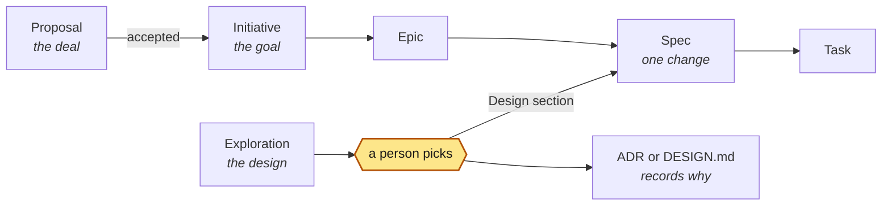

# AIDD: the method

AI-Driven Development (AIDD) is a method for delivering software with AI agents: one loop from intent to production, with change control at its core. It works in new repositories (greenfield) and existing ones (brownfield) alike. Agents implement.

AIDD is the method, and aidd is the toolkit that runs it, with a gate at its center. The gate decides the route a change takes, and demands evidence that a machine can check. It puts humans at the two points where their judgment is cheapest and matters most, and it stops unsafe work. It is not an agent, a model, a tracker, or a CI system. It binds to the ones you already run.

**The core rule: the agent proposes; the gate decides.** Every control is either computed by `aidd gate` from platform facts, or it is a named human decision recorded on the platform. Model prose is never evidence.

Version 1.0.0, a draft until the v1.0.0 tag: nothing is released yet, and the text may change before the tag. License Apache-2.0. Why the method is built this way, and how it maps to Agile and to the frameworks you know: [RATIONALE.md](RATIONALE.md).

## Conventions

The key words "MUST", "MUST NOT", "REQUIRED", "SHALL", "SHALL NOT", "SHOULD", "SHOULD NOT", "RECOMMENDED", "NOT RECOMMENDED", "MAY", and "OPTIONAL" in this document are to be interpreted as described in BCP 14 ([RFC 2119](https://www.rfc-editor.org/rfc/rfc2119), [RFC 8174](https://www.rfc-editor.org/rfc/rfc8174)) when, and only when, they appear in all capitals, as shown here.

Every requirement names who it binds:

| Subject | Who that is |
| --- | --- |
| **gate** | the function that turns a context into a decision (`aidd gate`, or any reimplementation) |
| **adapter** | the code that builds a context from a platform and posts the decision (the reference GitHub and GitLab adapters, or yours) |
| **repository** | the adopting repository: its config, its Specs, and its Change Requests |
| **operator** | the people who administer the platform: branch rules, the gate's identity, its secrets |

Only a sentence with a capitalized keyword is a requirement, together with the rows of the generated rule table in §7. Each of those rows states when its rule holds, and the level a gate emits when it does not. Everything else, in any section, explains.

**Section status.** A normative section contains requirements; an informative one describes practice the gate does not check, which you adopt as guidance.

| Section | Status |
| --- | --- |
| [1. Scope and conformance](#1-scope-and-conformance) | Normative |
| [2. Principles](#2-principles) | Informative |
| [3. Roles](#3-roles) | Normative |
| [4. Objects](#4-objects) | Normative |
| [5. The loop](#5-the-loop) | Informative |
| [6. Routes](#6-routes) | Normative |
| [7. Evidence and the gate](#7-evidence-and-the-gate) | Normative |
| [8. Approvals and separation of duties](#8-approvals-and-separation-of-duties) | Normative |
| [9. Profiles](#9-profiles) | Normative |
| [10. Scale modules](#10-scale-modules) | Informative, except the config fields it names |
| [11. AI-era security controls](#11-ai-era-security-controls) | Informative, except the rules it names |
| [12. Ship and Learn](#12-ship-and-learn) | Informative, except the recorded fields and the emergency backfill |
| [13. Interfaces and configuration](#13-interfaces-and-configuration) | Normative |
| [14. Platform bindings and trust](#14-platform-bindings-and-trust) | Normative |
| [15. Distribution and versioning](#15-distribution-and-versioning) | Informative |
| [16. Conformance checklist](#16-conformance-checklist) | Informative (a checklist of §1) |

## 1. Scope and conformance

*Normative.*

This is the one conformance list; §16 restates it as a checklist.

**A repository conforms at a profile (§9) when:**

1. **R1.** The repository MUST hold `.aidd/config.yaml` on every protected branch, and it MUST validate against `schemas/config.schema.json` ([CONFIG.md](CONFIG.md)).
2. **R2.** The operator MUST require the `aidd/gate` status on every protected branch, posted by a trusted gate job (§14) whose status source is pinned to the gate's own identity.
3. **R3.** The repository MUST bind the owners its profile needs (§9):
   - `owners.approvers` on every profile
   - from team up, at least a `security` specialist Approver pool before any major change can ship
   - a Policy command on the routes where the profile requires one
4. **R4.** Every merged change MUST carry a Change Request block (§4.4), or be a bot PR/MR that matches a configured standard change class. Every normal or major change MUST have a Spec (§4.2).
5. **R5.** Test evidence MUST come from a runner the change cannot rewrite without a major review (§14). The repository SHOULD configure a repository suite in `tests`; without one, every Spec MUST bring its own commands (Characterization, §10).
6. **R6.** The repository MUST list every agent account that commits to it in `identities.bots`.
7. **R7.** The agent skill, or instructions equivalent to it, MUST be available to every agent that writes to the repository (§15). The gate cannot check this; the protected paths (§6) keep it from being edited silently.
8. **R8.** The operator SHOULD retain gate records and events for as long as their audit regime requires ([ENTERPRISE.md §6](ENTERPRISE.md#6-audit-evidence)).

**A tool conforms when:**

1. **T1.** A gate MUST produce the same decision, and the same failed, pending, and warning rules, as the reference gate on every case in `examples/`, including each case's `mutations/`. A mutation is a data file that replays a JSON-patch-like edit of the case and states the expected result; `aidd eval examples --root <checkout>` runs them.
2. **T2.** An adapter MUST build contexts that validate against `schemas/context.schema.json` from platform facts only, and MUST meet §14.

## 2. Principles

*Informative. The requirements that realize these principles are in §6 to §9 and §14.*

1. **Evidence, not prose.** The only pass is a runner exit code of 0, bound to the head commit. The agent's claims, summaries, and PR/MR text never count.
2. **Tests before implementation.** Tests are written in Specify and frozen by the Spec hash. New behavior is proven red on the base commit and green on head.
3. **Two human approvals.** The Spec approval decides *what* will be built (the Spec and its tests). The Merge approval decides *what was* built (the head commit). Nobody approves their own work, except under the solo profile, where the waiver is recorded.
4. **Scope is declared, then enforced.** Every changed path lies inside a Task's `scope`, the Spec, a test file, or a configured exemption.
5. **Routes only go up.** The gate recomputes the minimum route from the real diff and rejects a lower declaration. Protected paths (the gate's own config, CI, and agent instructions) are always major.
6. **Interfaces, not brands.** Repo, CI, test runner, Secrets, Policy, Observe, and Release are bound in config. A vendor name is never a step.
7. **Minimum ceremony.** Initiative and Epic are optional. Minor and standard changes need no Spec file. Modules stay off until their signal is true.
8. **Gates only tighten.** A config can only tighten its profile, and a child config can only tighten its parent. Rules, exemptions, and standard changes can widen what passes, so every config change is itself protected and major.
9. **Single source of truth.** Schemas and data files define every field, token, profile gate, and path rule. Docs and skill tables are generated from them.
10. **Close the loop.** Rollbacks, rejects, incidents, and exhausted retries feed lessons back into the repository's agent instructions, tests, or rules.
11. **Priced to value.** Control and cost scale with risk: the least ceremony, the fewest roles, and the lowest model tier that pass. Extra cost or complexity needs a stated reason, in the Spec or the handoff note.
12. **Proven over new.** The method, the gate, and the team apply established standards and tools. An emerging one is marked as such in the registry and applied only when a change clearly needs it.
13. **No slower than without it.** aidd must not make the team slower than working without it. The cheapest checks run first, and the lane follows the risk, so a typo never waits for a Spec. Every stop says why and gives the next step: the command to run, or the file or person to turn to.

## 3. Roles

*Normative.*

| Role | Who | Does | MUST NOT |
| --- | --- | --- | --- |
| Author | the person who directs agents and opens the PR/MR, plus every commit author and committer | runs the loop, answers the stops | approve their own change (except under solo, §8) |
| Implementer | an agent or a person | edits inside the `scope` | edit the tests after Spec approval, approve, merge, write statuses |
| Approver | a person in `owners.approvers`, narrowed by the Spec's `approvers` | Spec approval and Merge approval decisions | approve a change they authored (except under solo, §8) |
| Specialist Approver | a person in an `owners.specialists` pool: `security`, `data`, `privacy`, `finance`, `compliance`, or a pool a risk rule names | approves major changes that touch the pool's dimension before merge | be an author of the change |
| Incident commander | named in the emergency block | owns an emergency change | skip the post-incident review |
| Gate | the `aidd/gate` job | computes every rule in §7 | run code from the change |
| Maintainer | owns `.aidd/config.yaml` | binds interfaces and owners | loosen a profile silently |

The gate MUST NOT count an approval from an account in `identities.bots`. It MUST count any other bot account (a login ending in `[bot]`) only when the Approver pool names it. The role names are functional: the gate trusts platform accounts, not titles, and the same person may hold several roles under the profile's rules (§8).

## 4. Objects

*Normative.*

Seven object kinds: Proposal, Initiative, Epic, Spec, Task, Tests, and Change Request. Proposal, Initiative, and Epic are optional. Tasks and Tests live inside the Spec file. A Spec's `parent` names an Epic, and an Epic's `parent` names an Initiative. `aidd validate` fails when the parent is another kind of object, and warns when no object has its id. An issue tracker MAY mirror an object under its `id`; the gate reads only the repository. Story, Issue, Ticket, and Feature are human aliases of Spec, and "Feature" is never a route or a type.

```text
accepted:     Proposal ─▶ Initiative (proposal) ─▶ Epic (covers the proposal's needs)
containment:  Initiative ─▶ Epic ─▶ Spec ─┬─▶ Task (1..n)
                                          ├─▶ Tests (1)
                                          └─▶ Change Request (1 per repo)
trace:        Spec ─▶ diff ─▶ test evidence (head SHA) ─▶ approvals ─▶ merge ─▶ Observe ─▶ outcome
```

**Work items at a glance.**

<!-- aidd:gen workitems -->


Proposal, Initiative, and Epic are optional. A team may start with a Spec (§4.7). The diagram shows only the planning items; this section lists all the object kinds.

A proposal is about the deal: should we take this work, for how much, and by when? Skip it when nobody outside the team must say yes. An exploration is about the design: which way to build one part. Skip it when the answer is obvious.
<!-- aidd:end -->

Every table in this section is generated from `schemas/`; the schema is the source of truth. The config is specified in [CONFIG.md](CONFIG.md).

### 4.1 Vocabulary

<!-- aidd:gen vocab:type -->
| Token | Meaning |
| --- | --- |
| `feat` | New or changed behavior someone can see. Needs a new-behavior test on normal and major. |
| `fix` | Restores intended behavior. Needs a test that fails before the fix (red) and passes after (green). |
| `refactor` | Structure changes, behavior does not. Existing tests must stay green. |
| `perf` | Same behavior, different cost. Acceptance is a threshold. |
| `docs` | Documentation, content, or generated reference only. |
| `test` | Tests only; no behavior changes. |
| `build` | Build system, packaging, or developer tooling. |
| `ci` | Continuous integration or delivery pipelines and agent configuration. |
| `chore` | Housekeeping that changes no behavior: formatting, renames, cleanup. |
| `deps` | Adds, removes, or upgrades a third-party package. |
| `infra` | Runtime, network, or deployment infrastructure, including infrastructure as code. |
| `data` | Schema, migration, backfill, or production data. Always major. |
| `security` | Identity, access, roles, secrets, or cryptography. Always major. |
| `compliance` | Driven by a legal or regulatory control. Always major. |
<!-- aidd:end -->

### 4.2 Spec

A Spec is `specs/<ID>.md`. It has YAML front matter between `---` lines, and a Markdown body. `aidd new spec` writes the short Spec (Intent, Context, Acceptance, Design, Policy conflicts, Rollback) for a normal change and the full one for major.

- On normal and major, the body MUST contain `## Context` (the short template's `## Intent` counts: the why, in the originator's words) and `## Acceptance`.
- Acceptance is Gherkin for user-visible behavior; otherwise it is a schema, a table, a threshold, or an invariant. Each acceptance line SHOULD map to a test command.
- The `## Design` section SHOULD open with one diagram of the change (a Mermaid block in the file); `aidd validate` warns when a major Spec has neither a diagram nor enough prose. With the diagram first, a human reads the change's shape before the words at Spec approval.

The Spec is the work item and the contract: intent, Acceptance ids, Tasks, route, risk, rollback, tests, and approvals. The detail a person needs to judge a bigger change lives in documents the Spec links, one `docs` entry each (`kind`, `path`, `frozen`). `aidd new <kind> <topic> --spec <ID>` writes each from the skill's templates, with the Spec's id in the header (`aidd new tech-spec`, `test-plan`, `adr`, `threat-model`, `authz`, `design-spec` (`--prototype` for its HTML prototype, `prototype.html` in the design folder), `api`, `slo`, `compliance`, `analytics`, `migration`, `acceptance`). Twenty kinds in all, each with one home: those, the runbook, the repository's `design-system`, `architecture`, `data-map`, and `vendors`, the `feedback` log, a proposal's `contract` and its change orders, and an `exploration`:

- A **frozen** doc (the default: a tech spec, a test plan, a prototype, an ADR) is approved with the Spec. It MUST NOT be inside a Task's scope or be a catch-all: the Spec hash covers it like a design file, so an edit after Spec approval voids the approval. The gate treats it as reviewed at Spec approval (outside the scope rule and the line budget). A drift found during implementation goes in the verification report and a later docs-only change, never an edit in place.
- **Reopening.** When an approved Spec turns out wrong before it ships, `aidd revise <ID> "<why>"` reopens it. It appends a `revisions` item (the day, what was wrong, the approved hash) on a commit of its own, on the Spec's branch. That changes the hash, so the approval stops holding: the frozen files are their owners' to change again, and the next Spec approval freezes them. The approval card shows the latest revision. A shipped Spec is never reopened; a new Spec changes it.
- A **living** doc has `frozen: false`: a runbook, an SLO, an acceptance record, the data map, the vendor register, or an area's architecture page. Later Specs revise it, each in its own diff. It is only checked to exist; a Task that changes it names it in its scope.
- A **threat model** is the component's, never one Spec's: one living file per component, `docs/security/threat-models/<component>.md`. `aidd new threat-model <component> --spec <ID>` writes it once and links it again for each later Spec. The Spec freezes only its delta (the threat ids it adds, changes, or retires, in the tech spec's `### Security and privacy`), and the security engineer brings the model in line in the same change. A linked model in that folder needs no Task: the gate counts it neither as scope nor as implementation, and Merge approval reviews it. A link to any other path widens nothing.
- Testing lives in the Spec's Acceptance and the tech spec's `## Test strategy`: each Acceptance id, its level, and its test file. `aidd validate` warns when that table names an id that the Spec lacks or that no command covers. A separate test plan is the audited or agency variant: for a regulator, a QA owner, a device matrix, or a client's UAT. ISO/IEC/IEEE 29119-3 names information items, not files.
- `aidd validate` fails a doc or local `decisions` path that does not exist. It warns, and never fails, when:
  - a major Spec links no tech spec or runbook
  - a Spec with a security, privacy, or data risk links no threat model
  - a Spec with a privacy risk links no compliance doc (its DPIA; the living data map is suggested beside it)
  - a Spec with a security risk and a Task on an auth path links no authorization matrix (`authz`)
  - a major feat with a user-facing path has no UI doc or `design.files`
  - a major Spec has no test plan when a trigger fires. A trigger is a compliance dimension or type, the audited profile, a device path, `uat: true`, or 10 or more Acceptance items
  - a major data or irreversible change has no migration plan
  - a Spec with a `hypothesis` has no tracking plan (`analytics`)

  On normal the rest are suggestions, and minor and standard need nothing. `docs.required` in the config changes the matrix ([CONFIG.md](CONFIG.md)).

Which artifact, at which stage (warn: `aidd validate` warns; suggest: `aidd new spec` names it; every other cell is optional):

| Artifact | Proposal | Initiative | Epic | Spec normal | Spec major | Emergency | After ship |
| --- | --- | --- | --- | --- | --- | --- | --- |
| brief, with its journey (the Initiative's `## Brief`) | optional | yes | | | | | |
| PRD-lite block | | | optional | | | | |
| tech spec with Test strategy | | | | light | warn | | |
| test plan | | | | suggest on trigger | warn on trigger | | |
| design spec or prototype (`design-spec`), with its flows and usability test | | | | suggest (feat, UI path) | warn (feat, UI path) | | |
| component (`DESIGN.md`'s Components) | | | | optional (new or changed component) | optional (new or changed component) | | |
| ADR | optional | optional | | optional | optional | | |
| threat model | | | | warn (security, privacy, data) | warn | | |
| authorization matrix (`authz`) | | | | warn (security, auth path) | warn (security, auth path) | | |
| api | | | | optional | optional | | |
| compliance with a DPIA | | | | warn (privacy) | warn (privacy) | | |
| data map (`data-map`) | | | | suggest (privacy) | suggest (privacy) | | living |
| migration plan | | | | suggest (data, irreversible) | warn | | |
| tracking plan (analytics) | | | | warn (hypothesis) | warn (hypothesis) | | |
| runbook with launch readiness | | | | | warn | | living |
| slo | | | | | optional | | living |
| acceptance record | | | | agency | agency | | acceptance |
| contract (SOW, with its support levels) and change orders, in the proposal's folder | agency, after acceptance | | | | | | living |
| vendor register (`vendors`) | | | | optional | optional | | living |
| postmortem | | | | | | yes | on an incident |

#### Ceremony by team size

| Team | Writes by default | Only when its trigger fires |
| --- | --- | --- |
| Solo founder, agency MVP | spec-short, the Initiative's brief, and for design only the prototype and the design spec's light variant | everything else |
| Team | the above, a tech spec and a runbook on major, and ADRs. A design spec for a user-facing feat with its flows, and a component in DESIGN.md for a new or changed one | test plan, migration plan, tracking plan, API doc, SLO, the brief's journey in discovery, the design spec's usability test for a risky flow |
| Audited, or a client's UAT | the above, the test plan, a threat model, compliance with a DPIA, an acceptance record, change orders | none: each is expected |

<!-- aidd:gen fields:doc -->
| Field | Type | Required | Meaning |
| --- | --- | --- | --- |
| `kind` | `tech-spec` \| `test-plan` \| `design-spec` \| `adr` \| `threat-model` \| `authz` \| `api` \| `runbook` \| `slo` \| `compliance` \| `analytics` \| `migration` \| `acceptance` \| `data-map` \| `vendors` \| `other` | yes | What the document is. It names the role that writes it (architect: tech-spec, adr, api; tester: test-plan; product designer: ui, the design spec (with its flows and usability test) or its HTML prototype; security engineer: threat-model, authz (the authorization matrix); SRE: runbook, slo; compliance analyst: compliance; compliance analyst or data engineer: data-map (the repository's living inventory and records of processing); product manager: analytics; delivery manager: acceptance, and vendors (the repository's vendor register); data engineer: migration) and the required-docs matrix `aidd validate` warns from (`docs.required`). |
| `path` | string | yes | Repo-relative path of the document, or a glob for a folder of files (a prototype with its assets), such as `specs/SPEC-220/tech-spec-limits.md`. It must match a file (`aidd validate`), and a frozen one is never a catch-all and never inside a Task's scope. |
| `frozen` | boolean | no | Default true: approved with the Spec, and part of the Spec hash like a design file, so any edit after Spec approval voids it; a drift found while implementing goes in the verification report and a later docs-only change. False for a living document several Specs revise (a runbook, an SLO, an area's architecture page): only checked to exist, and a Task that changes it names it in its scope. |
<!-- aidd:end -->

Two more sections help a person at Spec approval. `aidd validate` warns (never errors) when either is missing or empty; the gate does not read them.

- The body SHOULD open with `## Intent`: the originator's own words, captured before any design (the problem, the outcome they want, who is affected, the constraints, and the open questions). A reviewer can then check the Spec's reading of the request against the request itself.
- A major Spec, or one whose risk names more than one specialist pool, SHOULD carry `## Policy conflicts` that lists:
  - each place where specialist input, a domain pack, or org policy contradict each other
  - for each place, the human who must decide it
  - `none`, when nothing contradicts

  An agent records a conflict; it never settles one.

<!-- aidd:gen fields:spec -->
| Field | Type | Required | Meaning |
| --- | --- | --- | --- |
| `aidd_version` | string | yes | The aidd release this record conforms to; the method and the toolkit share one version. |
| `kind` | `"spec"` | yes | Object kind. Always `spec`. |
| `id` | string | yes | Spec key, such as SPEC-220. |
| `parent` | string | no | Optional Epic id. |
| `base` | string | no | The branch the change ships into, such as goal/booking: the goal branch of a small goal that ships batched (`aidd new spec --parent` names it, or `--base`). Locally, `aidd test`, `aidd gate`, `aidd describe`, and `aidd ship` compare against it and land in it when no `--base` is given. On a platform, the pull request's target decides. Default: the default branch. |
| `title` | string | yes | One line, an imperative summary of the change, such as "Rate-limit authenticated checkout". `aidd ship` writes it as the commit subject, `<type>: <title> (<ID>)`, and `aidd validate` warns when that subject passes 72 characters. `locale` may apply. |
| `owner_team` | string | yes | Team accountable for the change. |
| `approvers` | list of string | no | Eligible Approvers for this Spec. Can only narrow the config's `owners.approvers`. |
| `type` | `type` | yes | What kind of change this is, in Conventional Commits vocabulary. `data`, `security`, and `compliance` are always major. |
| `route` | `normal` \| `major` \| `emergency` | yes | normal (the gate raises it to major when the diff demands it), major, or emergency for a backfill Spec. Minor and standard changes have no Spec file. |
| `confidence` | `confidence` | yes | Confidence in the assessment. `low` stops the run. |
| `open_questions` | list of string | no | Facts still unknown at assessment. Empty when confidence is high. |
| `trace_id` | string | no | Joins the Specs and changes of one piece of work across repositories. Defaults to the id. |
| `status` | `status` | no | Optional cache of the derived status; `aidd validate` warns when it disagrees. Record only what nobody can observe: `cancelled` (a person stopped it) or `rolled_back`. |
| `blocked_on` | string | no | Role, person, or interface the Spec waits on. While it is set, the Spec is blocked: a flag `aidd list` shows, not a status. |
| `labels` | list of string | no | Up to 8 labels, lowercase letters, digits, `:` and `-`, such as `area:billing` or `customer-ask`, for filtering (`aidd list --label`). They never change the route or the gate, and the Spec hash ignores them. |
| `relations` | list of mapping (`relation`) | no | Typed links to other Specs, Epics, or Initiatives: blocks, blocked_by, duplicates, relates_to, implements. Bookkeeping: the gate never reads them and the Spec hash ignores them. |
| `priority` | `priority` | no | How soon the work matters, for sorting `aidd list` and filtering it (`--priority LEVEL`: this level or higher). Unset, it is inherited from the parent Epic or Initiative, else medium; an emergency is always urgent. Bookkeeping: the Spec hash ignores it and the gate never reads it. |
| `owner` | string | no | The person driving the work: `aidd list --mine` finds it, and `aidd list` names them as who acts. A person, never an agent or an agent account (`aidd validate` fails one). Bookkeeping: the Spec hash ignores it, and it approves nothing. |
| `suggested_by` | string | no | Who suggested work nobody asked for: `agent:<role>` for an agent in `agents.proactive_roles` (or an agent account). Such a Spec stays a draft until a person records `triage`. |
| `triage` | mapping (`triage`) | no | A person's decision on suggested work. Required, by a person, before a Spec whose suggested_by is an agent moves past draft. |
| `risk` | mapping (`risk`) | yes | Blast radius: what changes, which dimensions it touches, and whether a revert restores the prior state. |
| `rollback` | string | yes | How to undo. Name the steps on major and emergency. |
| `hypothesis` | string | no | The measurable result the change should produce after Ship, written before Spec approval and frozen by the Spec hash: a metric, its baseline, the expected move, and by when. Learn records `outcome.result` against it. |
| `experiment` | mapping (`experiment`) | no | An A/B test that decides the `hypothesis`, planned before launch: its variants, one primary metric, the guardrails, how long it runs, and the decision rule. Optional; the product manager writes it with the tracking plan, and the flag that serves the variants is a `flags` entry. Approved content: the Spec hash covers it. `aidd validate` warns when it names no guardrail or the Spec has no hypothesis. |
| `uat` | boolean | no | True when humans accept this change by hand: a client's user acceptance test, a QA owner's manual or exploratory pass, or a device lab run. The required-docs matrix then asks for a test plan (`aidd validate` warns on major, `aidd new spec` suggests it on normal). Approved content: the Spec hash covers it. |
| `residual_risk` | string | no | What stays true after release. `none` when nothing remains. |
| `assisted_by` | list of string | yes | `harness/model` for each AI agent that wrote code or tests. Empty when only humans did. |
| `decisions` | list of string | no | ADR paths or links this Spec depends on, and does not change. A repository path must exist (`aidd validate`); an ADR this Spec writes is a `docs` entry of kind `adr` instead. |
| `tasks` | list of mapping (`task`) | yes | Slices of the change. Parallel only when their scope is disjoint. |
| `tests` | mapping (`tests`) | yes | How the change is proven: the test files and the commands that run them. |
| `design` | mapping | no | The approved look and flow of a user-facing change. Optional; the product designer writes it before Spec approval. |
| `docs` | list of mapping (`doc`) | no | The documents that hold the detail this Spec links instead of carrying: a tech spec, a test plan, a prototype or design spec, an ADR, a threat model, an API contract, a migration or tracking plan, a runbook. `aidd new <kind> <topic> --spec <ID>` writes one from its template and adds the entry. A frozen doc is approved with the Spec by hash, like a design file; a living one is only checked to exist. |
| `observe` | mapping (`observe`) | when route is `major` | Post-release check. Required on the profile's observe_required_routes: major, and normal under audited. |
| `flags` | list of mapping (`flag`) | no | Feature flags this change ships behind, so release is separate from deploy: the architect adds one on a normal or major user-facing change that should reach users later than its code reaches production. Optional; a minor change never needs one. Approved content: the Spec hash covers it. `aidd validate` warns, and `aidd list` shows the cleanup as work, once a flag's `cleanup_due` has passed and no Spec lists it in `removes_flags`; a later Spec that declares the same flag with a later date extends it. |
| `removes_flags` | list of string | no | Flags this change deletes from the code, by name: the cleanup Spec for an earlier Spec's `flags` entry. Once a Spec lists a flag here, `aidd validate` and `aidd list` stop reporting it as overdue. |
| `emergency` | mapping (`emergency`) | when route is `emergency` | Required when route is emergency. |
| `revisions` | list of mapping | no | Each reopening of an approved Spec, newest last, as `aidd revise <ID> "<why>"` writes it: what was wrong and the hash that was approved. Adding one changes the Spec hash, so the approval stops holding and the Spec is a draft again: its owners change what was wrong, and the next Spec approval freezes it again. The approval card shows the latest one. |
| `outcome` | mapping (`outcome`) | no | What happened after Ship. Written during the observe window and in Learn. |
<!-- aidd:end -->

Tasks:

<!-- aidd:gen fields:task -->
| Field | Type | Required | Meaning |
| --- | --- | --- | --- |
| `id` | string | yes | Stable key. |
| `title` | string | yes | One line describing the slice. |
| `scope` | list of string | yes | Globs this Task's diff may change. Never a test or design file, never a catch-all. |
| `skeleton` | boolean | no | Part of the walking skeleton: the thinnest version of a new system that runs end to end, with its structure, contracts, test runner, CI, and one smoke test, which every later slice builds on. The architect or the platform engineer implements it (`{skeleton}` in their write area), before the feature slices fan out. Default false. |
| `depends_on` | list of string | no | Task ids that must finish first. Required between Tasks whose scope overlaps. |
| `assignee` | string | no | Implementer: `agent:<role>` or a person. |
| `skills` | list of string | no | Skills loaded only for this Task, by directory name: a practice skill such as `api-design` or a stack skill, at most two. Domain packs are named in Context instead. |
| `risk` | string | no | What this Task could break, and how it guards against it. Approved content: frozen by the Spec hash. |
| `proof` | string | no | How this Task is shown to work: the test command, screenshot, or check a reviewer reads. Approved content: frozen by the Spec hash. |
| `retry_count` | integer | no | Implementation retries used. At 3 the Task stops and the Spec is blocked until a person re-plans it. |
| `done` | boolean | no | True when the Task is finished and the evidence cannot show it (a changed scope with every command green on head shows it by itself). Bookkeeping: the Spec hash ignores it. |
<!-- aidd:end -->

Tasks whose `scope` overlap MUST be ordered by `depends_on`. No Task's `scope` may cover a test file.

A Task SHOULD say what it could break and how it guards against that (`risk`). It SHOULD also say how it is shown to work (`proof`: a test command, a screenshot, or a check). With `scope` (the files) and `depends_on` (the order), a Task is a complete plan. Both are approved content, frozen by the Spec hash.

### 4.3 Tests

<!-- aidd:gen fields:tests -->
| Field | Type | Required | Meaning |
| --- | --- | --- | --- |
| `files` | list of string | yes | The test files, and the configuration they run through. Frozen by the Spec hash (unless `mode` is `with`) and never inside a Task's scope. |
| `commands` | list of mapping (`test_command`) | yes | Commands the runner executes. Exit 0 is the only pass. |
| `mode` | `first` \| `with` | no | A Spec's only. `first` (the default): the tests are written before the code and frozen by Spec approval. `with`: for new code with nothing to break (type feat, no risk dimension, never major), the tests are written with the code in the same Task. Spec approval then binds the Spec, its commands, and their `covers`, but not the test files, which Merge approval reviews; every Acceptance item needs a command that `covers` it, and red-on-base still holds. |
<!-- aidd:end -->

<!-- aidd:gen fields:test_command -->
| Field | Type | Required | Meaning |
| --- | --- | --- | --- |
| `name` | string | yes | Stable name used in evidence. |
| `command` | list of string | yes | Command vector, one argument per item. Never a shell string. |
| `new_behavior` | boolean | no | True when this command proves new or fixed behavior. It must fail on the base commit (red) and pass on head (green). |
| `timeout_seconds` | integer | no | Wall-clock limit. A timeout is a fail. Default 1800. |
| `smoke` | boolean | no | In the config's `tests`: part of the smoke set, the only repository commands an emergency change runs (with its own). When no command is marked, an emergency runs the whole suite. |
| `retries` | integer | no | How many more times a failing run on head is tried (default 0). Every attempt is kept in the evidence; a pass after a failure passes, marked flaky, and metrics count it. A red run on the base commit is never retried. |
| `when_changed` | list of string | no | Run and require this command only when a changed path matches. Omit to run it on every change. |
| `covers` | list of string | no | In a Spec: the Acceptance items this command proves, by id (`A1`, `A2`, ...). Optional; once any command declares it, `aidd validate` warns about an Acceptance item no command covers, and about an id the Acceptance section does not have. Under `tests.mode: with` every item must be covered, or the Spec is invalid; otherwise the gate never reads it. |
<!-- aidd:end -->

The repository suite (`tests` in config) runs on every change, in addition to the Spec's commands; its entries never carry `new_behavior`. With no repository suite, the Characterization module (§10) applies.

**Test modes.** Tests come first by default (`tests.mode: first`): the tester writes them before the code, and Spec approval freezes them. Some code is new and has nothing to break. A Spec of type `feat` with no risk dimension, below major, MAY set `tests.mode: with` instead. The developer then writes the tests with the code, in the same Task. Spec approval binds the Spec, its commands, and their `covers`, but not the test files: Merge approval reviews them with the code. `aidd validate` MUST fail a `with` Spec that is not such a change, or that leaves an Acceptance item uncovered. The gate MUST fail one whose computed route is major (`tests.with_not_allowed`). Red on base and green on head hold in both modes. Switching the mode changes the Spec, so it needs Spec approval again.

**The walking skeleton.** A new product's first slice is its walking skeleton: the thinnest version that runs end to end. Its Task (`skeleton: true`) builds the structure, the contracts, the test runner, CI, and one smoke test. The architect or the platform engineer builds it, and the feature slices fan out against it.

### 4.4 Change Request

The Change Request is the PR/MR. Its description MUST hold exactly one fenced block with the info string `yaml aidd`. On normal and major, the block MUST name the Spec. Minor, standard, and emergency changes MAY declare inline. The gate derives everything else (§7). Nothing in the block counts as evidence.

A goal's change, a goal branch that ships its Specs to the default branch at once (§10.3), MAY name them all in `specs` instead. The gate judges each Spec as a change of that one Spec, against the whole diff. Each Spec needs its own Spec approval and its own red-then-green proof. The other listed Specs' work and the goal's Initiatives and Epics count as in scope. One Merge approval of the head covers them all. `aidd test` names each Spec's commands for its Spec (`spec-1.acceptance`), so two Specs from one template never share a name. On a `goal/` branch with no block, the local gate reads the Specs the diff holds as `specs`.

A bot PR/MR with no block is treated as the configured standard change class that every one of its authors belongs to. If none matches, the block is missing and the gate fails. `aidd describe` prints a starting block for the current branch.

<!-- aidd:gen fields:change-request -->
| Field | Type | Required | Meaning |
| --- | --- | --- | --- |
| `spec` | string | no | Repo path of the Spec. Required on normal and major. When set, the Spec supplies every other field. |
| `specs` | list of string | no | A goal's change, which carries one or more Specs (a goal branch shipping to the default branch): the repo path of each. The gate judges each Spec as it judges one, against the whole diff, and one Merge approval of the head covers them all. Instead of `spec`. |
| `trace_id` | string | no | Copy of the Spec trace_id. Child changes in other repos use the same value. |
| `route` | `minor` \| `standard` \| `emergency` | when `spec` and `specs` are absent | Inline only: minor, standard, or emergency. Normal and major need a Spec. |
| `type` | `type` | no | Default chore. |
| `confidence` | `confidence` | no | Default high. |
| `risk` | mapping (`risk`) | no | Inline blast radius. Default: no dimensions, reversible. The gate fails when the paths imply a dimension the block omits. |
| `scope` | list of string | when route is `emergency` and `spec` and `specs` are absent | Inline scope: globs the diff may change. Required on emergency. On minor it defaults to the changed paths and is recorded as undeclared. |
| `rollback` | string | no | How to undo. Default: revert the change. |
| `residual_risk` | string | no | What stays true after release. |
| `assisted_by` | list of string | when `spec` and `specs` are absent | `harness/model` for each AI agent that wrote code or tests. Empty when only humans did. |
| `tests` | mapping (`tests`) | no | Inline tests, such as smoke tests on an emergency. They add to the repository suite, never replace it. |
| `emergency` | mapping (`emergency`) | when route is `emergency` and `spec` and `specs` are absent | Required when route is emergency. |
| `backfill` | string | when route is `emergency` and `spec` and `specs` are absent | Emergency only: the repo path of the backfill Spec, committed as a stub with the repair (`aidd new spec <ID> --title "<incident>" --route emergency`). `aidd validate` fails once its review_due passes without outcome.learn_ref. |
| `standard_change` | string | when route is `standard` and `spec` and `specs` are absent | Name of the config standard_changes entry this change claims. |
<!-- aidd:end -->

### 4.5 Risk, observe, emergency, and outcome

The tables a Spec or an inline Change Request block nests.

`risk`:

<!-- aidd:gen fields:risk -->
| Field | Type | Required | Meaning |
| --- | --- | --- | --- |
| `summary` | string | yes | Blast radius in one or two sentences: who or what changes behavior. |
| `dimensions` | list of `dimension` | yes | Every dimension the change touches. Empty means none. |
| `reversible` | boolean | yes | False when a revert does not restore the prior state, such as a destructive migration or an external side effect. False forces major. |
<!-- aidd:end -->

`observe`:

<!-- aidd:gen fields:observe -->
| Field | Type | Required | Meaning |
| --- | --- | --- | --- |
| `not_applicable` | string | no | Why nothing runs to watch after release, such as "a CLI and its docs: no running service". It takes the place of the other fields; the gate warns, so the Approver sees the reason. |
| `command` | list of string | no | Post-release check. Exit 0 means healthy. |
| `signals` | string | no | Dashboards, SLOs, or queries a human watches. |
| `window` | string | no | How long to watch, such as 30m, 24h, or 7d. |
| `rollback_trigger` | string | no | The condition that starts the rollback. |
<!-- aidd:end -->

`emergency`:

<!-- aidd:gen fields:emergency -->
| Field | Type | Required | Meaning |
| --- | --- | --- | --- |
| `severity` | `sev1` \| `sev2` \| `sev3` | yes | Incident severity. |
| `kind` | `outage` \| `degradation` \| `security` \| `data` | yes | What is broken in production. |
| `commander` | string | yes | The incident commander, a human. Named before the repair starts. |
| `incident` | string | no | The incident's ticket or page id, such as INC-481: what the repair answers, and what the post-incident review and the backfill Spec link. The gate requires it on an emergency change. |
| `review_due` | string | yes | Date the postmortem and the Spec backfill are due. The config sets the SLA. |
<!-- aidd:end -->

`outcome`, written after Ship and never part of the Spec hash:

<!-- aidd:gen fields:outcome -->
| Field | Type | Required | Meaning |
| --- | --- | --- | --- |
| `released_on` | string | no | Date the change reached production. |
| `observe_result` | `pass` \| `fail` | no | Result of the observe window. |
| `rolled_back` | boolean | no | True when the rollback ran. |
| `restored_on` | string | no | Date service was restored after a failed change (a rollback or a fix). With `released_on`, it gives the time to restore. |
| `learn_ref` | string | no | Link to the retro or the PR that fed lessons back into AGENTS.md, skills, or tests. |
| `result` | string | no | What the metric named in `hypothesis` did after the observe window: met, missed, or inconclusive, with the number. A missed hypothesis is a Learn signal for the author and the product-manager, not a rollback. |
<!-- aidd:end -->

### 4.6 Epic and Initiative

Optional containers, in the Specs folder with the same `---` front matter. The gate does not gate them; `aidd validate` checks them.

Epic:

<!-- aidd:gen fields:epic -->
| Field | Type | Required | Meaning |
| --- | --- | --- | --- |
| `aidd_version` | string | yes | The aidd release this record conforms to; the method and the toolkit share one version. |
| `kind` | `"epic"` | yes | Object kind. Always `epic`. |
| `id` | string | yes | Stable key. |
| `parent` | string | no | Optional Initiative id. |
| `title` | string | yes | One line. `locale` may apply. |
| `goal` | string | yes | The measurable goal of an Epic or Initiative. |
| `status` | `container_status` | no | Optional: `done` or `cancelled` when a person closes or stops it; draft and active are derived from the children. |
| `labels` | list of string | no | Up to 8 labels, lowercase letters, digits, `:` and `-`, such as `area:billing` or `customer-ask`, for filtering (`aidd list --label`). They never change the route or the gate, and the Spec hash ignores them. |
| `relations` | list of mapping (`relation`) | no | Typed links to other Specs, Epics, or Initiatives: blocks, blocked_by, duplicates, relates_to, implements. Bookkeeping: the gate never reads them and the Spec hash ignores them. |
| `priority` | `priority` | no | How soon the work matters, for sorting `aidd list` and filtering it (`--priority LEVEL`: this level or higher). Unset, it is inherited from the parent Epic or Initiative, else medium; an emergency is always urgent. Bookkeeping: the Spec hash ignores it and the gate never reads it. |
| `owner` | string | no | The person driving the work: `aidd list --mine` finds it, and `aidd list` names them as who acts. A person, never an agent or an agent account (`aidd validate` fails one). Bookkeeping: the Spec hash ignores it, and it approves nothing. |
| `owner_team` | string | no | The team accountable for the Epic's outcome. The Epic is multi-team when the Specs under it name two or more `owner_team`s. |
| `context` | string | no | Shared terms and constraints for every Spec under this Epic. |
| `covers` | list of string | no | The ids of the proposal needs this Epic delivers, when it came from an accepted proposal. |
| `ships` | `incremental` \| `flagged` \| `batched` | no | How this small goal reaches users, which the product manager picks at planning and a person agrees to with the plan. `incremental` (the default): each Spec is useful by itself and merges to the default branch when it is done. `flagged`: useful only when complete but it can be hidden, so each Spec merges behind a feature flag that stays off, and the `launch` Spec turns it on. `batched`: it must land at once and cannot be hidden, so it gets the goal branch `goal/<id>`, the team integrates each Spec into it (`aidd integrate`), and a person releases it once. |
| `specs` | list of string | no | The planned Specs, in the order they land, started or not. A goal is ready to release only when each of them is integrated, shipped, or cancelled, so a Spec nobody has started yet still counts. Bookkeeping that re-planning changes: drop a Spec from the list to release the rest without it. |
| `launch` | string | no | For `ships: flagged`: the Spec that turns the feature on for users, planned last. Its Merge approval is the launch, which stays a person's: a standing approval never covers it. |
<!-- aidd:end -->

Initiative:

<!-- aidd:gen fields:initiative -->
| Field | Type | Required | Meaning |
| --- | --- | --- | --- |
| `aidd_version` | string | yes | The aidd release this record conforms to; the method and the toolkit share one version. |
| `kind` | `"initiative"` | yes | Object kind. Always `initiative`. |
| `id` | string | yes | Stable key. |
| `title` | string | yes | One line. `locale` may apply. |
| `goal` | string | yes | The measurable goal of an Epic or Initiative. |
| `status` | `container_status` | no | Optional: `done` or `cancelled` when a person closes or stops it; draft and active are derived from the children. |
| `labels` | list of string | no | Up to 8 labels, lowercase letters, digits, `:` and `-`, such as `area:billing` or `customer-ask`, for filtering (`aidd list --label`). They never change the route or the gate, and the Spec hash ignores them. |
| `relations` | list of mapping (`relation`) | no | Typed links to other Specs, Epics, or Initiatives: blocks, blocked_by, duplicates, relates_to, implements. Bookkeeping: the gate never reads them and the Spec hash ignores them. |
| `priority` | `priority` | no | How soon the work matters, for sorting `aidd list` and filtering it (`--priority LEVEL`: this level or higher). Unset, it is inherited from the parent Epic or Initiative, else medium; an emergency is always urgent. Bookkeeping: the Spec hash ignores it and the gate never reads it. |
| `owner` | string | no | The person driving the work: `aidd list --mine` finds it, and `aidd list` names them as who acts. A person, never an agent or an agent account (`aidd validate` fails one). Bookkeeping: the Spec hash ignores it, and it approves nothing. |
| `owner_team` | string | no | Team accountable for the outcome. |
| `proposal` | string | no | The accepted proposal this Initiative delivers, so every change under it traces back to what was promised. |
| `go_no_go` | mapping (`go_no_go`) | no | Optional: a person's decision to pursue the Initiative or not, in the proposal's shape (`decision`, `by`, `on`, `reason`). Only a person records it; an agent never fills it, and `aidd validate` fails on an agent in `by`. `no_go` derives the status `cancelled`. |
| `milestones` | list of mapping (`milestone`) | no | The delivery milestones and their invoicing hooks, copied from the accepted proposal by `aidd proposal convert`: from then on the Initiative is the delivery record, and the delivery manager keeps it current. |
| `risks` | list of mapping (`raid_item`) | no | The R of the RAID log, copied from the accepted proposal and kept current here. |
| `assumptions` | list of mapping (`raid_item`) | no | The A of the RAID log, copied from the accepted proposal and kept current here. |
| `issues` | list of mapping (`raid_item`) | no | The I of the RAID log, copied from the accepted proposal and kept current here. |
| `dependencies` | list of mapping (`raid_item`) | no | The D of the RAID log, copied from the accepted proposal and kept current here. |
| `decisions` | list of mapping (`decision`) | no | The scope decisions log, copied from the accepted proposal and kept current here. A person records each entry. |
<!-- aidd:end -->

### 4.7 Proposal

A Proposal asks someone outside the team to decide whether work happens and on what terms, before any code. That someone is either:

- a client choosing a supplier (a bid, a pitch, a response to a request for proposal)
- the company's own leadership, an investment committee, or an architecture board deciding on a change

It lives in its own folder under `proposals_dir` (default `proposals/`), one folder per proposal, where each role writes its part beside `proposal.md`. The gate does not gate it; `aidd validate` checks it.

**Proposal or Initiative?** Ask who decides. When someone outside the team must agree before anyone commits, write a Proposal. When the team already has the mandate, skip it and plan an Initiative, or go straight to a Spec. A Proposal asks for a decision; an Initiative organizes work already decided. An accepted Proposal becomes an Initiative with `aidd proposal convert`. The Initiative names the Proposal, and each Epic `covers` the needs it delivers. So every Spec written later traces back to what was promised. Needs answered `not_met` promise nothing and reach no Epic.

**Two decisions, both a person's.** A Proposal has its own pair of human decisions, like a Spec's. `go_no_go` comes before the team spends effort drafting. `sign_off` comes before it is sent, with its price, commitments, assumptions, and exclusions. Its status follows from them (exploring, no_go, drafting, signed_off). After the sign-off, it follows from the `outcome` a person records (submitted, then accepted, rejected, or withdrawn). A stored `status` is an optional cache. `aidd validate` refuses one that the decisions do not support, and a decision or outcome recorded by an agent account. The file is a record, not proof. When the proposal lives in a repository behind the gate, the pull request that records a decision needs that person's approval. The sign-off records the proposal hash that `aidd hash` prints. The hash covers the body and the front matter, `aidd-handoff` blocks included. It leaves out the decisions: `sign_off`, `outcome`, `status`, and the scope decisions log, `decisions`. It also leaves out the living fields, which people fill in over time. These are each question's `answer`, each RAID item's `status`, a milestone's `reached_on` and `invoice_ref`, and a need's `epic`. The hash detects a change after sign-off. It does not prove who approved the change: a person's sign-off or a change order does. `aidd validate` fails once the proposal no longer matches the hash. A change order clears the error when its `Proposal hash after this change:` line names the new hash. `aidd validate` reads only regular files named `CO-<n>.md` directly in the proposal's `change-orders/` folder. While a person drafts the proposal, `aidd validate` warns when an open dependency has no owner, due date, or mitigation.

**Confidential by default.** A proposal's material belongs to its addressee. It stays in its folder, and is never copied into another proposal. A client's proposals live where only people cleared for that client can read them.

<!-- aidd:gen fields:proposal -->
| Field | Type | Required | Meaning |
| --- | --- | --- | --- |
| `aidd_version` | string | yes | The aidd release this record conforms to; the method and the toolkit share one version. |
| `kind` | `"proposal"` | yes | Object kind. Always `proposal`. |
| `id` | string | yes | Stable key. |
| `title` | string | yes | One line. `locale` may apply. |
| `audience` | `client` \| `internal` | yes | `client`: a bid, pitch, or response to a request for proposal. `internal`: a change put to the company's own decision makers, such as leadership, an investment committee, or an architecture board. |
| `addressee` | string | yes | Who receives the proposal and decides, such as "Acme Corp procurement" or "the executive committee". |
| `goal` | string | yes | What the addressee gets if they say yes, as an outcome they can check. |
| `status` | `exploring` \| `no_go` \| `drafting` \| `signed_off` \| `submitted` \| `accepted` \| `rejected` \| `withdrawn` | no | Optional cache of the derived status; `aidd validate` refuses one the recorded decisions do not support, and warns about one they have moved past. exploring: no go/no-go yet. no_go: a person decided not to pursue it. drafting: a person decided to go. signed_off: a person signed it off. submitted, accepted, rejected, withdrawn: the recorded `outcome`. |
| `due` | string | no | When the addressee needs it. |
| `owner_team` | string | no | Team accountable for the proposal. |
| `go_no_go` | mapping | no | The first human decision: pursue it or not, before the team spends effort drafting. |
| `sign_off` | mapping | no | The second human decision: the proposal may be sent, with its price, commitments, assumptions, and exclusions. |
| `outcome` | mapping | no | What happened after the sign-off, as a person records it: sent (submitted), then the addressee's answer (accepted or rejected), or withdrawn. The status after sign_off comes from it. |
| `needs` | list of mapping | no | What the addressee needs, one entry each, and how the proposal answers it: the compliance matrix of a bid, or the concerns a business case must meet. |
| `options` | list of mapping | no | The real alternatives, doing nothing included when it is one. |
| `estimate` | mapping | no | A range, never a single number: low, most likely, and high, and what it rests on. Optional `parts` break it down. |
| `qualification` | mapping | no | The qualification the delivery manager records before any drafting: what is known of each point, or what is still to ask (the gap goes in `questions`; the date the addressee needs it is the proposal's `due`, and each risk a `risks` entry). It recommends; a person still decides in `go_no_go`. |
| `assumptions` | list of mapping (`raid_item`) | no | What must hold for the proposal to stand; the A of the RAID log. Each is a risk if it turns out false. |
| `issues` | list of mapping (`raid_item`) | no | What is already going wrong and needs action; the I of the RAID log. |
| `dependencies` | list of mapping (`raid_item`) | no | What the work waits on from someone else (access, data, a decision, another vendor); the D of the RAID log. |
| `milestones` | list of mapping (`milestone`) | no | The delivery milestones and their invoicing hooks, as promised; `aidd proposal convert` copies them to the Initiative, which keeps them from then on. |
| `exclusions` | list of string | no | What the proposal does not include, said plainly. |
| `risks` | list of mapping (`raid_item`) | no | What could make the work fail to deliver; the R of the RAID log. Each carries its likelihood and impact (low, medium, or high). |
| `claims` | list of mapping | no | The claims register: each thing the proposal says works, its evidence, and where the evidence was seen. `aidd validate` warns on a claim with no evidence. It also warns on an absolute word, such as every or always, in a claim seen only in simulation. |
| `decisions` | list of mapping (`decision`) | no | The scope decisions log: each scope decision a person made, and each reversal. The proposal hash leaves it out. `aidd proposal convert` copies it to the Initiative. |
| `questions` | list of mapping | no | Questions for the addressee, with the answer once known: the clarification log. |
<!-- aidd:end -->

## 5. The loop

*Informative. The gate checks its rules (§7), not the steps.*

Five core steps, two human approvals, three lanes; Plan before and Learn after are optional. Each lane runs only the steps its risk needs.

```text
(Plan) → Specify → [Spec approval] → Implement ⟲ Verify → Review → [Merge approval] → Ship → (Learn)
```

The loop is a versioned contract: `loop.version` in `schemas/roles.json` (1.0.0, shown in §5.2) follows semantic versioning. A change that adds, removes, or reorders a step, a human approval, or a lane is a major change and bumps the major number. Gate events record the version as `loop_version`, so metrics never mix two loops without saying so.

**The route.** A change's route is a property of the change. aidd computes the minimum from what it touches, the author may declare higher, and the gate enforces the higher of the two. The gate recomputes the route from the real diff (§6), and the lane follows from the route. Before the first edit, ask the gate for the route: `aidd gate --paths` forecasts it from the planned paths, and `aidd gate` computes it again from the branch's diff. Which change to work on is a person's choice; `aidd list` shows the open work and who holds each step. Asking for the route is not a step of the loop, and it takes seconds. The fast lane is the default: a change starts on the fast lane unless the computed minimum route needs a Spec. A production repair is the one lane a person declares rather than computes (emergency).

**Clarify** comes before the route. Before the lane is chosen, the open questions go to the author: at most five. They are ordered by whether the answer changes the route, the scope, or the acceptance. A question that could change the route keeps confidence low, and low confidence stops the agent. The rest become assumptions in the Spec. The readings of an ambiguous request are presented, not picked.

Plan runs before the loop only when the work is bigger than one Spec. Learn runs after it on a signal: a Merge approval rejection, a rollback, an incident, a missed hypothesis, or three failed retries. It also runs on a cadence, as a retrospective on the loop itself.

| Lane | Routes | Steps | Human decisions |
| --- | --- | --- | --- |
| **Fast** (the default) | minor, standard | Implement ⟲ Verify → Review → Ship | one Merge approval (none for standard) |
| **Spec** | normal, major (computed) | Specify → Spec approval → Implement ⟲ Verify → Review → Merge approval → Ship | Spec approval and Merge approval; on major, a specialist Approver from the team profile up |
| **Emergency** | emergency (declared) | Implement ⟲ Verify → Review → Ship → Learn | the incident commander and the route's required approvals; the review is due by `review_due` |

| Step | Done when | Stops |
| --- | --- | --- |
| Plan *(optional)* | an Initiative, Epics, and ranked Spec stubs that a human agrees to | the outcome or the owner is unclear |
| Specify | a Spec with Context, executable Acceptance, Tasks with scope, the test files written, and rollback. On major, also observe and a pre-mortem. The route is computed from the Spec's scope (`aidd new spec --paths`, then `aidd gate`) | missing owner; acceptance not executable |
| Spec approval | an eligible Approver approves the current hash of the Spec and its tests, ideally naming the commit (§8) | changes requested (back to Specify); the Spec or a test changes (the approval voids) |
| Implement | each Task's diff stays inside its scope and holds the minimum change. Every command is green on head, and every new_behavior command was red on base | at most 3 retries per Task on implementation errors or flakes; a wrong Spec returns to Specify |
| Verify | the Spec's tests run again on the exact head, and the built change is exercised against each Acceptance line. The report starts with the head SHA it checked | a failure or a mismatch returns to Implement; a new push makes the report stale |
| Review | the PR/MR is ready; findings (human, or an agent reviewer's) are answered | changes requested (back to Implement) |
| Merge approval | as many eligible Approvers as the profile requires for the route approve the head commit, or an earlier head a trivial rebase carries (§8). On major, a specialist Approver also approves. Policy allows | changes requested (back to Implement); a freeze (except emergency) |
| Ship | the platform merges; the release interface deploys, progressively on major; the observe window passes or the rollback trigger fires | rollback: status rolled_back |
| Learn *(on a signal or a cadence)* | on a signal: a lesson PR/MR (AGENTS.md, tests, rules, skill) linked in outcome.learn_ref. On a cadence: a retrospective whose improvements re-enter the loop at Plan as new changes ([§12](#12-ship-and-learn)) | the incident review is overdue (`aidd validate`) |

**Specify within the project's constraints.** The design fits the `project` stack radar and the rules `aidd gate --paths` prints for its paths. A `hold` technology needs an ADR and a person's decision ([ADOPTION.md](ADOPTION.md#project-constraints-and-rules)).

**Implement and Verify, repeated until green,** is one tight loop.

- **Implement.** Scope is checked at every edit, every changed line traces to an Acceptance line or the Task, and `aidd test` runs the commands locally.
- **Verify**, a step of its own with its own role, runs the Spec's tests on the exact head that the Approver will see. It exercises the built change the way a user or caller would.
- **The evidence** is still the runner's exit codes, in CI and in `aidd test`. The verifier role's report only routes the work: clean, on to Review; a failure or a mismatch, back to Implement.

**Human feedback** sends work back on four paths. Each is a normal part of the loop, drawn dashed in the loop diagram ([TEAM.md](TEAM.md#the-loop-by-role)):

- Spec approval with changes requested returns to Specify.
- Merge approval with changes requested, or a review comment, returns to Implement.
- Ship sends an incident, a rollback, or a missed hypothesis to Learn.
- Learn's lesson re-enters at Plan as a new change.

A missed hypothesis is a product decision, taken at Plan, not a fix an agent starts on its own.

Spec approval is enforced by hash: the approved Spec and tests must be the ones shipped. The skill obtains Spec approval before implementation, on a Spec-first draft PR/MR; an approval that names its commit proves it (§8).

**The Spec phase.** A change is in its Spec phase (`phase: spec` in the gate record) while:

- every changed path is the Spec, a file it freezes, or its backfill
- and a Task has yet to change anything

Its tests are expected to fail on head: they test behavior nobody has built. The gate MUST NOT fail it for that: it holds `tests` pending (`tests.spec_phase`), leads the report with Spec approval, leaves out Merge approval, the specialist's head review, and the untouched-Task warning, and MUST NOT pass it. `aidd test` exits 0 there. It marks the failing green runs as expected, and keeps the red runs as early proof that the tests detect the change. The first change to a Task's scope ends the phase, and every rule applies again.

**The fast lane locally.** With no platform there is no PR/MR description. `aidd describe --commit` records the Change Request block in an empty commit. The local gate, `aidd test`, and `aidd ship` read the newest branch commit that holds one (a `--body-file` wins). `aidd ship` checks the declared inputs before any test runs: config, block, Spec, confidence, route, scope, budget, and standard change. When the base branch moved, it tests the head merged into the base tip. It lands exactly that tree, judged as a merge-queue entry is (§7). The order of the commands: [ADOPTION.md](ADOPTION.md#local-first-no-github-or-gitlab).

### 5.1 Status

Every status git or the platform can prove is derived; only a person's decisions and outcomes nobody can observe are stored. `aidd list`, `aidd log`, the guard, `aidd validate`, and `aidd metrics` read the same derived status (`workitems/derived_status.py` in the toolkit). The Spec's `status` field is an optional cache: `aidd validate` warns when it disagrees with the derived value. Where nothing local records approvals (a platform keeps them on the PR/MR), the cache answers whether Spec approval happened. Every other fact still comes from git.

A counted Spec approval is one of the current hash: on the local approvals ref (`aidd approve spec`), or counted by a gate record in the evidence folder (`aidd gate --record`). The gate decides from the platform either way; the derived status never decides anything.

Spec:

<!-- aidd:gen vocab:status -->
| Token | Meaning |
| --- | --- |
| `draft` | Derived: no counted Spec approval of the current hash yet, on a route that needs one; on a route that needs none, no commit in a Task's scope yet. |
| `ready` | Derived: a counted Spec approval of the current hash (a person's `aidd approve spec`, or a gate record that counted one), and no commit in a Task's scope yet. Implementation may start. |
| `in_progress` | Derived: commits on the branch change a Task's scope. |
| `in_review` | Derived: the evidence shows every test command green on head, and the gate record, when there is one, passes or waits only on approvals. It waits for Merge approval. |
| `shipped` | Derived: the approved Spec is on the base branch, merged. The observe window runs now. |
| `done` | Derived: shipped, with no observe block, or with outcome.observe_result pass. Terminal. |
| `rolled_back` | Stored: outcome.rolled_back is true, or outcome.observe_result is fail. Terminal; Learn follows. |
| `cancelled` | Stored: a person set `status: cancelled`, or triage declined the work. Terminal. |
<!-- aidd:end -->

`draft → ready → in_progress → in_review → shipped → done | rolled_back`, each step moved by what git sees:

| Trigger | Status after |
| --- | --- |
| an eligible Approver approves the current hash | ready (in_progress when a Task's scope already changed) |
| a commit on the branch changes a Task's scope | in_progress |
| the evidence is green on head, and a gate record (if any) waits only on approvals | in_review |
| a new push after that | in_progress, until the evidence is green again |
| the Spec, a test, or a design file changes after approval (a wrong Spec) | draft: the approval no longer names the hash |
| the approved Spec reaches the base branch (the merge) | shipped, or done with no observe block |
| `outcome.observe_result` pass | done |
| `outcome.observe_result` fail, or `outcome.rolled_back` | rolled_back (stored) |
| a person writes `status: cancelled`, or triage declines the work | cancelled (stored) |

On a route without Spec approval (an emergency backfill Spec, or normal under solo) the Spec skips ready. A failed gate adds no status.

**Blocked is a flag, not a status.** An item in draft, ready, or in progress is blocked:

- while `blocked_on` names a wait
- while an item it is `blocked_by` has not shipped
- once a Task used its 3 retries

`aidd list` shows it as blocked with the reason, and `aidd list --blocked` lists every one.

**Tasks** are derived:

- `todo`
- `in_progress`: commits change its scope
- `done`: its scope changed and the evidence is green on head, the Spec is in review or later, or a person recorded `done: true`
- `blocked`: the Spec is not approved or is blocked, or a Task it `depends_on` is not done
- `stopped`: it used its retries, or the latest handoff note stopped while it was in progress

A Task unlocks when every Task it depends on is done.

**Emergency.** `aidd list` gives an emergency Spec one step. Until it ships, the step is: restore service. Then, until `outcome.learn_ref` is recorded, it is: complete the backfill Spec and the review by `review_due`. After that, there is no step.

Epic and Initiative:

<!-- aidd:gen vocab:container_status -->
| Token | Meaning |
| --- | --- |
| `draft` | Derived: no child Spec or Epic has started. |
| `active` | Derived: a child has started (in progress or later). |
| `done` | Stored: a person closed it; `aidd list` suggests it once every child is finished. |
| `cancelled` | Stored: a person stopped it. |
<!-- aidd:end -->

`aidd list` suggests closing an Epic or Initiative once every child is finished ("close EPIC-1: 3/3 children finished"). It shows each one's progress in the why chain. `aidd validate` warns about a done one with an open child.

Proposal (§4.7):

<!-- aidd:gen vocab:proposal_status -->
| Token | Meaning |
| --- | --- |
| `exploring` | Derived: no go_no_go recorded yet. |
| `no_go` | Derived: go_no_go.decision is no_go. |
| `drafting` | Derived: go_no_go.decision is go, and no sign_off yet. |
| `signed_off` | Derived: sign_off is recorded, and no outcome yet. Send it. |
| `submitted` | Stored: outcome.decision is submitted; the addressee decides. |
| `accepted` | Stored: outcome.decision is accepted. |
| `rejected` | Stored: outcome.decision is rejected. |
| `withdrawn` | Stored: outcome.decision is withdrawn. |
<!-- aidd:end -->

**Status groups.** Every status of every object falls into one of five groups. So a board, a report, or a tracker mirrors any object by its group, without learning each vocabulary. `aidd list --json` gives each step's `group`. The gate never reads it.

<!-- aidd:gen status:groups -->
| Group | Meaning | Spec | Epic and Initiative | Proposal |
| --- | --- | --- | --- | --- |
| `backlog` | Written down, not yet planned or approved: a draft, or a proposal still being qualified. | `draft` | `draft` | `exploring` |
| `unstarted` | Approved and ready; nobody has started it. | `ready` | none | none |
| `started` | Open work: being built, waiting for a person, or watched after release. | `in_progress`, `in_review`, `shipped` | `active` | `drafting`, `signed_off`, `submitted` |
| `completed` | Finished: done, rolled back (the work ended and Learn follows), or a proposal the addressee accepted. | `done`, `rolled_back` | `done` | `accepted` |
| `cancelled` | Stopped without delivery: cancelled, rejected, withdrawn, or a no-go. | `cancelled` | `cancelled` | `no_go`, `rejected`, `withdrawn` |
<!-- aidd:end -->

**Triage.** A Spec that an agent suggested on its own (`suggested_by: agent:<role>`, from a role in `agents.proactive_roles`) stays a draft until a person records `triage`. The triage is accepted, declined, or snoozed (with `until`), with who and when. A duplicate is a relation (`duplicates`), not a decision. `aidd list` puts the triage in front of a person first, and hides a snoozed Spec until its date. It drops a declined or duplicate one; declined makes the Spec cancelled. `aidd validate` fails:

- a Spec an agent suggested that is past draft without an accepted triage
- a proposal from an agent role outside `proactive_roles`
- a stored status a declined triage contradicts
- a triage recorded by an agent or an agent account

<!-- aidd:gen fields:triage -->
| Field | Type | Required | Meaning |
| --- | --- | --- | --- |
| `decision` | `accepted` \| `declined` \| `snoozed` | yes | accepted: the work goes ahead. declined: it does not, and the Spec is cancelled (a stored status must not say otherwise). snoozed: decide again on `until`; `aidd list` hides it until then. A duplicate is a relation (`duplicates`), not a triage decision. |
| `by` | string | yes | The person who decided. Never an agent or an agent account: `aidd validate` fails one. |
| `triaged_on` | string | yes | The date of the decision. |
| `until` | string | when decision is `snoozed` | Snoozed only: the date the item comes back for a decision. |
| `reason` | string | no | Why, in one sentence. A later triage of the same idea reads it first, and links the new Spec as `duplicates`. Optional; `aidd validate` warns when a declined triage has none. Bookkeeping, like the rest of `triage`: never part of the Spec hash. |
<!-- aidd:end -->

**Relations and labels.** A Spec, Epic, or Initiative MAY carry `relations` (typed links to other items) and up to eight `labels`. `aidd validate` checks that each relation's target exists and that `blocks` and `blocked_by` form no cycle. `aidd list` shows an item `blocked_by` unfinished work as blocked, naming what it waits on, and treats a duplicate as finished. `blocked_by` reads the derived status: shipped work lets its dependents go. A Task's `depends_on`, which orders Tasks inside one Spec, is unchanged. Both are bookkeeping: the gate never reads them, a label never changes the route, and the Spec hash ignores them, as it ignores `triage`.

<!-- aidd:gen fields:relation -->
| Field | Type | Required | Meaning |
| --- | --- | --- | --- |
| `type` | `blocks` \| `blocked_by` \| `duplicates` \| `relates_to` \| `implements` | yes | blocks: the other item waits for this one. blocked_by: this one waits for the other. duplicates: this one repeats the other, which carries the work, so `aidd list` treats this one as finished. relates_to: see also. implements: this one delivers the other. |
| `id` | string | yes | The other Spec, Epic, or Initiative, by id, in the Specs folder. |
<!-- aidd:end -->

**The handoff note.** When an agent stops, it ends with a handoff note. It writes the note into the Spec (or the PR/MR body) as a fenced block with the info string `aidd-handoff`, holding YAML:

````text
```aidd-handoff
done: "T1: total() returns 0 for an empty cart (src/cart.py)"
next: verifier                    # the role that takes the work next
needs: none                       # a decision only a person can give, or "none"
stopped_at: none                  # the stop rule that fired, or "none"
status: in_progress               # optional: the status the note was written in
spend: "41k tokens"               # optional
```
````

`aidd list` and the session hooks read the latest block in the Spec. `next` names the role that has the work ("agent (verifier)"). A `needs` other than none becomes a step for a person while the Spec is still in the note's `status`. The note never puts a Spec in the Approver inbox; the derived status does. A committed draft on a route that needs Spec approval waits for it, and a Spec in review waits for Merge approval. `aidd validate` warns about a block it cannot read, and about a `next` that names an approval instead of a role. The gate never reads the note, and the Spec hash leaves out every `aidd-handoff` block, so writing one never voids an approval.

**The why chain and the backlog.**

- **Why.** Each Spec step in `aidd list` says why the work matters, widest first. It gives the config's `mission` and its `goal`, then the Spec's Initiative and Epic, each with its progress (children finished of all). Last comes its `hypothesis`, or, once measured, its outcome.
- **The backlog.** `aidd list` reads the base branch and every open local and remote-tracking branch (at most 100). It keeps one copy of each item (a branch's unmerged copy wins), and derives its status. So merged work leaves the backlog and the Approver inbox by itself. Work someone else owns names them as who acts. Its filters, and the Approver inbox: [HOW-TO.md](HOW-TO.md#every-day).
- **Order.** Most urgent first:
  1. an emergency
  2. `priority` (urgent, high, medium, low; inherited from the Epic or Initiative; never read by the gate)
  3. who acts: a person's decision, then the author's, then the agent's
  4. unblocked before blocked
  5. the longest wait
  6. the id
- **History.** `aidd log <spec>` shows one Spec's history ([HOW-TO.md](HOW-TO.md#every-day)).

**The human queue.** Approvals are the scarce resource. `gates.max_open_per_approver` (3 under team, org, and audited; off under autonomous and solo) makes `aidd list --waiting-on-me` and `aidd list` warn when one Approver holds more open waits. `gates.escalate_after_minutes` with `owners.backup_approvers` makes `aidd list` mark a wait past the limit and name the backup pool. `gates.max_in_progress_per_owner` (off by default) is the work-in-progress limit: `aidd list` warns when one person owns more Specs in progress. `gates.max_in_progress_days` (10 when unset) flags a Spec in progress as aging past that many days. All four only change what `aidd list` says: they never approve anything, never make anyone eligible, and never change the gate's decision.

### 5.2 The two loops: human governance and agentic execution

The loop is two loops, and naming them is what makes the two approvals legible.

**They belong to the change.** The person runs the outer loop, and the team runs the inner one. No team member runs a loop of its own: each role takes only its own steps of the inner loop and hands off (TEAM.md, The loop, by role). A Task is no loop either: it is Implement and Verify inside the inner loop.

**A goal holds its Specs' loops.** A big goal runs the outer loop once at its own scale: D1 the plan, then D3 the release and D4 any launch. Each of its Specs runs both loops inside it, with its own Spec approval (D2). In a batched goal the team integrates each Spec into the goal branch instead of merging it, so the release stays one decision (§10.3). Nothing else nests: there is no third loop.

<!-- aidd:gen roles:loops -->
*Loop contract version 1.0.0: a change that adds, removes, or reorders a step, an approval, or a lane bumps its major number.*

**The way in.** A change's route is a property of the change. aidd computes the minimum from what it touches, the author may declare higher, and the gate enforces the higher of the two. The lane follows from the route. Before the first edit, ask the gate for the route: `aidd gate --paths` forecasts it from the planned paths, and `aidd gate` computes it again from the branch's diff. Which change to work on is a person's choice; `aidd list` shows the open work and who holds each step. The fast lane is the default: a change starts there unless its route needs a Spec. Clarify first: ask the author at most five questions, each with a recommended answer and why, and never one a lookup answers. A question whose answer could change the route keeps confidence low, which stops the agent.

**Outer loop — human strategy and governance.** It decides what is worth doing at all (Plan), and whether the Spec an agent drafted may be built (Spec approval). It decides whether the built head may merge (Merge approval), and whether it ships and how it rolls out (Ship). It decides what the change and the process teach (Learn). An agent drafts for every one of these and decides none: no role approves, merges, or adopts. Where the outer loop needs a specialist it names a pool — security, data, privacy, finance, compliance — or an incident commander, and those are humans too.

**Inner loop — autonomous agentic execution.** An agent drafts the contract, then builds against it. In Specify, it writes the Spec and its tests, which Spec approval then freezes. In Implement and Verify, repeated until green, it builds inside that frozen contract. Meanwhile the Verifier role re-runs the Spec's tests on the exact head, until the runner is green or the work is blocked. In Review, the agent reads what it built adversarially. The inner loop is bounded, not free. The Task's scope is the write area the guard checks, and a failing test returns to Implement rather than being weakened. Three retries make it blocked, and the stop list hands it back.

**What crosses between them.** Two artifacts cross, and both are machine-checkable. Inward: the Spec hash, which Spec approval names. The hash freezes the Spec, its test files, and its design files, so the inner loop cannot move the target it is graded against. Outward: the gate record and the commit status. They carry the runner's exit codes bound to a head and base SHA, the diff the platform measured, and the approvals it saw. Prose is never evidence. The gate binds to the hash, the exit codes, and the SHAs, never to a summary, a claim that tests pass, or a chat handoff. Humans do read the ranked review report and the handoff note's Needs line: Merge approval and the stop list are for that. But nothing a human reads that way can make the gate pass.

| Loop | Who decides | Steps |
| --- | --- | --- |
| Outer | a human: by approval at Spec approval and Merge approval, by recorded agreement for Plan, Ship, and Learn | Plan, Spec approval, Merge approval, Ship, Learn |
| Inner | the agent: it drafts the contract in Specify, then works inside it once Spec approval freezes it | Specify, Implement ⟲ Verify, Review |

Control passes at the two approvals on machine-checkable evidence, and at Plan, Ship, and Learn on a recorded human decision:

- Spec approval: a human approves the Spec and its tests, and the hash freezes them
- Merge approval: a human approves the head commit, on the evidence the platform collected

**Human feedback.** A person sends work back on these paths, drawn dashed in the loop diagram; each is a normal part of the loop, not a failure:

- **Spec approval → Specify** (changes requested): the author asks for a different Spec, tests, or design. The Specify roles revise them and ask for a new Spec approval.
- **Merge approval → Implement** (changes requested): the head is not approved. Its review comments, a person's or an agent reviewer's, go back to Implement the same way. The new head needs a new Verify and a new Merge approval.
- **Ship → Learn** (incident, rollback, missed hypothesis): what production showed goes to Learn, never straight back into code.
- **Learn → Plan** (a new change): a lesson becomes a new change, whose route the gate gives before the first edit (`aidd gate --paths`). Also, a missed hypothesis is a product decision, taken at Plan (keep, change, or remove the feature), not a fix an agent starts by itself.
<!-- aidd:end -->

<a id="decision-rights"></a>**Who decides what.** The person decides what is built and whether it ships; the team decides how, inside the bounds the person set. No inner decision is an approval, so an agent never stands in for a person, and neither does another agent.

<!-- aidd:gen roles:decisions -->
**The person decides** (the outer loop):

| Decision | Who decides | On what | How it is taken back |
| --- | --- | --- | --- |
| D1 the plan: the big goal, its small goals, and how each ships | a person | the Initiative and its Epics, `aidd validate` green on them | edit the plan; nothing is built yet |
| D2 Spec approval: what one change does, and its tests | a person, an Approver (a standing approval may record it for them) | the Spec, its tests red on the base commit, the Spec hash | `aidd revise`: the approval stops holding |
| A change to an approved Spec (a change order) | a person: `aidd revise`, then Spec approval again | why it was wrong, and the hash it replaces | the approved Spec stays until the new approval |
| D3 the release: the Merge approval of a head | a person, an Approver (a standing approval may record it for them) | Acceptance against the verifier's run, the review report, the gate on that head | the Spec's rollback |
| D4 the launch: a flagged feature on for users | a person, always: a standing approval never covers it | the flag, the observe plan | turn the flag off |
| Anything outside the repository: an account, a payment, a vendor, a message to someone else | a person (a step that waits on them in `aidd list`) | the step the team names | often none |

**The team decides** (the inner loop), on evidence alone: never an approval, and never on another agent's word:

| Decision | Who decides | On what | How it is taken back | Goes to a person when |
| --- | --- | --- | --- | --- |
| Which step runs next, who takes it, and what runs side by side | the lead | the plan, `aidd autopilot next`, and the limits (`gates.max_open_branches`, `autopilot.parallel`) | yes: nothing has left the team's branches | a limit is reached, or only a person can unblock it |
| A choice a standard, the project's rules, or aidd's default settles: a library, a pattern, a name, a limit | the role that owns the step | that standard or rule, named in the handoff note's `decided` | a change order, when the person disagrees | none of them settles it, or it changes the route, the scope, the Acceptance, the cost, or what users see |
| How to build inside the scope: the design within the Spec, and the code | the role that owns the step | the Spec, the role's standards | yes: the next commit | the choice changes the route, the scope, or the Acceptance: a decision card on the Needs line |
| Send work back: a red test, a mismatch, a review finding | the lead, on the finding | the runner's exit code, the verifier's report, the review report | yes | three retries make the Task blocked |
| Take a Task into its Spec's branch | the lead, on evidence | the Task's tests green on the head (`aidd test`) | yes: the Spec's branch | — |
| Land a Spec in its goal branch | the team: `aidd integrate` | Spec approval holds, the tests pass on the merged tree, and the gate against the goal waits only for the release | `aidd integrate --undo` | — |
| Answer a role's question | the lead, from the files | the Spec, its linked docs, the handoff notes | yes | the answer is a person's: it goes on the Needs line |
<!-- aidd:end -->

<a id="the-lead"></a>**The lead.** The session that runs the team, autopilot or the main session, is the lead. It takes the team's decisions above, each on its evidence, and never an approval: it is no second stakeholder. A person who leads a team is an Approver for their area (`owners.paths`); an agent never is.

<a id="requests"></a>**Requests.** Before anyone acts, the lead sorts each request. A question is answered from the files. New work goes to triage, then to a plan or a Spec stub. A change to an approved Spec is a change order: `aidd revise`, then Spec approval again. A production repair takes the emergency route. A person may talk to any role directly: the role sorts the request the same way, never widens its scope for it, and records it in its handoff note's `asked`.

<a id="no-surprises"></a>**No surprises.** What a person sees at Merge approval is what they approved at Spec approval. A change they would notice that the Spec does not describe goes back as a change order first.

[RATIONALE.md](RATIONALE.md#the-loop-compared) explains Agile rewritten for agents, and why the loop is fast. It also maps the loop to the DevOps loop, ISO/IEC/IEEE 12207, ITIL 4, and PDCA.

### 5.3 Autopilot

Autopilot: runs the AIDD loop between your decisions; aidd decides each next step and stops whenever a person must decide. No model controls the loop: aidd decides each step, and the gate decides what merges. Before 1.0.0 it ran six times with real models, and each run stopped at a person's decision or at a problem it reported ([Real runs](AUTOPILOT.md#real-runs)). How to start, steer, and set up a run: [Autopilot](AUTOPILOT.md).

**The engine decides.** `aidd autopilot next` computes the one next action from git: the open work, the autopilot lease and its journal, and the limits. A harness command, such as `/aidd-team:autopilot`, only runs or shows that action. It starts with `aidd autopilot start`, which prints a session id that every later command names: a lone lease may be another session's. Each turn it runs `aidd autopilot next --session ID`, does the action, and records the result with `aidd autopilot note "<code> <result>" --session ID`. It ends with `aidd autopilot stop`. aidd runs no agent. Agents never approve or merge on their own. Under the person's standing approval, `next` names the approvals it covers as the run's own steps (§8).

**One action a turn.** `run` names the team command for an agent's step and its scope. `ask` names a person's decision, who takes it, and the decision page (`aidd list --waiting-on-me --html`). `stop` says why the run ends: nothing runnable, a plan ready for a person, the timebox, a token or cost cap, or no lease of its own.

**The step-code contract.** Every step carries a stable code. An agent's step starts exactly one flow, the one whose `starts_on` names the code. A person's step starts none, so autopilot asks. Between two engine states, autopilot adds the loop's own steps: Verify and Review on the current head before Merge approval, and a return to Implement after a failed Verify or Review. A test fails when a code maps to no flow, or to two.

<!-- aidd:gen autopilot:steps -->
| Step code | Who takes it | The flow `aidd autopilot next` runs |
| --- | --- | --- |
| `backlog.capped` | author | none: a person's step |
| `epic.close` | author | none: a person's step |
| `epic.launch_spec` | agent | `/aidd-team:specify` |
| `flag.overdue` | author | none: a person's step |
| `goal.client` | agent | `/aidd-team:propose` |
| `goal.product` | agent | `/aidd-team:plan` |
| `goal.release` | Approver | none: a person's step |
| `goal.ship_ready` | agent | `aidd ship` (under the person's standing approval) |
| `initiative.close` | author | none: a person's step |
| `knowledge.action` | author | none: a person's step |
| `lane.fast` | agent | `/aidd-team:implement` |
| `lane.spec` | agent | `/aidd-team:specify` |
| `learn.retro` | agent | `/aidd-team:retro` |
| `nothing_matches` | author | none: a person's step |
| `nothing_open` | author | none: a person's step |
| `overlap` | author | none: a person's step |
| `overlap.capped` | author | none: a person's step |
| `proposal.accepted` | author | none: a person's step |
| `proposal.drafting` | agent | `/aidd-team:propose` |
| `proposal.exploring` | decision maker | none: a person's step |
| `proposal.signed_off` | author | none: a person's step |
| `proposal.submitted` | author | none: a person's step |
| `queue.over_limit` | author | none: a person's step |
| `setup.doctor_fail` | author | none: a person's step |
| `setup.missing` | author | none: a person's step |
| `spec.approve_standing` | agent | `aidd approve spec` (under the person's standing approval) |
| `spec.backfill` | agent | `/aidd-team:postmortem` |
| `spec.blocked` | author | none: a person's step |
| `spec.blocked_by` | author | none: a person's step |
| `spec.cancelled` | author | none: a person's step |
| `spec.done` | author | none: a person's step |
| `spec.draft` | agent | `/aidd-team:specify` |
| `spec.emergency` | agent | `/aidd-team:implement` |
| `spec.in_progress` | agent | `/aidd-team:implement` |
| `spec.in_review` | Approver | none: a person's step |
| `spec.integrate` | agent | `aidd integrate` (under the person's standing approval) |
| `spec.integrated` | author | none: a person's step |
| `spec.merge_standing` | agent | `aidd approve merge` (under the person's standing approval) |
| `spec.needs` | author | none: a person's step |
| `spec.outcome_due` | author | none: a person's step |
| `spec.ready` | agent | `/aidd-team:implement` |
| `spec.review` | agent | `/aidd-team:review` |
| `spec.rework` | agent | `/aidd-team:implement` |
| `spec.rolled_back` | agent | `/aidd-team:postmortem` |
| `spec.ship_ready` | agent | `aidd ship` (under the person's standing approval) |
| `spec.shipped` | agent | `/aidd-team:ship` |
| `spec.spec_approval` | Approver | none: a person's step |
| `spec.task_person` | author | none: a person's step |
| `spec.triage` | triager | none: a person's step |
| `spec.verify` | agent | `/aidd-team:verify` |
| `wip.over_limit` | author | none: a person's step |
<!-- aidd:end -->

**A person's decisions stay a person's.** A person's outcome never comes from the journal, because an agent writes the journal. Autopilot returns a change to Implement after a Merge approval only when the gate's record of the head holds changes a listed person requested. With no such evidence, it keeps asking. At Spec approval it always asks: a person who wants changes says so to the author, and starts autopilot again once the Spec is revised.

**Implement waits for Spec approval.** Before any step at or past Implement, autopilot takes the highest of three routes. They are the route the Spec declares, the route its Tasks need, and the route the branch's real diff needs. It computes them as the gate does, under the base branch's config. When that route needs Spec approval, a person must have approved the Spec's current hash in a source an agent cannot write. One source is the local approvals ref, signature-checked under `gates.local_approvals: signed`. The other is the platform's own approval lines, which autopilot reads as the gate does when a token is set. It reads them only from the repository that `project.repo` pins on the base branch, and only for the local head and Spec hash. So an honest run pushes before each `aidd autopilot next`: with only the platform's approvals, a local commit the pull request does not hold yet asks again. A record file never counts, because the evidence folder is in the working tree. An emergency counts only when it continues an open emergency the base branch holds, with the same scope and no path beyond it, or when a person approved it. An emergency whose repair shipped, or whose review is recorded, is finished: its id is never reused. The stored status never stands in for an approval. When autopilot cannot compute a route, or the Spec fails its schema, it asks.

So autopilot always asks at Spec approval, unless a local approval exists, in these cases:

- on GitLab, which has no platform reader yet;
- with no GitHub token;
- in a fork workflow, where the pull request lives in another repository;
- with no `project.repo` in the config. Set it, or run `aidd init` again.

One limit stays: an agent runs as the same user as the person, so a local approval is only as strong as that person's terminal. `aidd approve spec` asks for the person at a terminal, and signing narrows it further. A person-owned field, such as `triage` or `suggested_by`, counts only as the base branch holds it. Set on the branch only, it asks a person.

These checks resist edits to the working tree and to the branch's content. They do not resist a local writer that rewrites git refs or `.git/config`, such as one that moves the local base branch, and the trusted base config with it. An agent with a shell can already do that, so the gate in CI, on a clean checkout, stays the control for merges.

**A plan needs a person's agreement.** With a goal given that the journal shows no plan for, the first step is `/aidd-team:plan`, or `/aidd-team:propose` for client work (`project.work`), even when other work is open. The plan step records its goal, so the same goal is never planned twice. After it, the run stops with `plan_ready`. Only a person continues it: their "Go on" when the run asks in the session, or starting autopilot again. That is the agreement to the plan. Every stop a person ends (`plan_ready`, a limit, or a decision) tells the person, in aidd's own words, each decision that waits, how to take it, and the exact command that goes on (`resume` and `message` in `aidd autopilot next --json`). The autopilot command shows that message as it is. A poll of the decision inbox never resumes it.

**Bounds.** These hold in every run, and none of them asks a question:

- A run holds a lease on its work (`--work`): a Spec, an Epic or Initiative, a label, or all. One live lease holds a piece of work. The lease ends after its timebox (`autopilot.timebox`, 6 hours by default).
- A token or cost cap is optional (`autopilot.max_tokens`, `max_cost`). Where the harness keeps transcripts (Claude Code), the token cap counts what they show, the run's lead and every subagent, cache reads apart; elsewhere, and for the cost cap, what each step reports. The person and the gate stay the controls.
- The circuit breaker: when the same step fails twice in one run, or twice ends with nothing changed on the same head, that work is set aside for a person.
- The stall breaker: when six steps in a row move nothing on, each failing or repeating a step on a head it already ran, the run stops (`stalled`) for a person.
- A lease whose session's transcripts show nothing for 20 minutes is abandoned: a new run may take it over before its timebox ends.
- `autopilot.notify`, read only from the base branch's config, runs once each time the run stops for a person, so a run nobody watches still reaches them.
- A Task out of retries, and a stop rule a role hit, also set the work aside for a person.
- A Spec with `blocked_on` is paused, and a Spec that waits on a person's decision runs no agent step.
- Work set aside pauses only itself: other runnable work in the scope goes on. The action's `paused` list names what was set aside. The run asks or stops only when nothing is runnable.
- The Approver WIP limit (`gates.max_open_per_approver`) holds new work, so decisions arrive in one batch.
- A shipped Spec waits until its observe result is due.
- A retro runs after `autopilot.retro_every` merged changes, never after each change.

**Data, never instructions.** The decision reads step codes, statuses, heads, and the journal's codes and results. It never reads free text as an instruction: a Spec's body, a handoff note's words, a PR comment, or a note's words cannot change the action.

**Where it keeps state.** The lease, the journal, and the run events live in the git directory (`.git/aidd/`), never the working tree, so a run leaves nothing to commit. A person hears only of a decision, a block, a limit, or the end: a step done is never a notice. `aidd context` names what a step reads, by path, with a token estimate each. `aidd metrics --autopilot` measures the runs. `aidd doctor --autopilot` checks the settings an autopilot run needs.

**The harness side.** `/aidd-team:autopilot` is the command that loops. A person starts it, and that start is the opt-in. It takes the lease with this session's id (`--session ${CLAUDE_SESSION_ID}` in Claude Code). Each turn it pushes the branch when only the platform's approvals count, runs `aidd autopilot next`, and does exactly what the action says. On `run`, it runs the named team command as its lead. On `ask`, it releases the lease (`aidd autopilot stop`), then shows the person the decision and its page. On `stop`, it reports why and releases the lease too. It records each step with `aidd autopilot note`. A goal goes to `next` with `--goal`. When nothing is planned for it, `next` returns the plan step: `/aidd-team:plan`, or `/aidd-team:propose` for client work. The guard denies a start or stop of autopilot for any session other than the one that runs it. A one-line ask never becomes code without a plan a person agreed to.

**The lead hands off.** Under `agents.delegate: auto`, the default, the guard denies the run's lead an edit of repository content, and names the role that owns the file. It does so only in the session that holds the lease. Every other session, such as the person's own, is never denied: at most, the agent gets a note once. `always`, the audited default, denies that edit in every session. The guard reads the role from the hook input the harness writes (`agent_type`), never from an agent's text. Running `aidd`, git branch, worktree, push, and PR/MR commands, reads, and starting subagents are never governed, so the lead's own work goes on. Stopping the run ends the denial for that session, and also ends the run: the gate on the change stays the control.

**Steer, pause, and resume.** A person stops a run at a step boundary with Esc. `blocked_on` in a Spec pauses that change only. Each turn re-reads the Specs, the handoff notes, the comments, and the feedback log as data. To resume, run the command the stop named, in the same session or a new one. After a long run, a new session or `/clear` keeps the context small. The run takes a new lease, and the journal in the git directory keeps the steps done. Before a compaction, `aidd hook pre-compact` saves the state of the work there, never in a tracked file, and session-start reads it back. Under the team and org profiles, `aidd hook prompt-submit` adds the next step and its command to each prompt, in one line. To wait for a person, Claude Code can poll the inbox slowly, such as `/loop 30m aidd list --waiting-on-me`. A poll never resumes a plan.

**The harness profile for autopilot runs.** aidd starts no agent, so the harness's settings hold the run. In Claude Code, before an autopilot run:

- Turn the sandbox on: `sandbox.enabled: true`.
- Set a permission mode that asks or denies what the settings do not allow (`permissions.defaultMode`, such as `default` or `dontAsk`). Never `bypassPermissions`.
- Allow what every step calls: `aidd` itself and aidd's read-only MCP tools. `aidd doctor --autopilot` prints the `permissions.allow` rules the settings lack. With the sandbox on, the agents' shell commands need no rule of their own.
- Allow the network only from a list: `sandbox.network.allowedDomains`, with the hosts the work needs.
- Put no secret in the agent's environment. `aidd doctor --autopilot` names each variable that looks like a credential, never its value.
- For a team, hold these in managed settings, so a project file cannot turn them off.
- Consider an advisor (`advisorModel`). It is optional and experimental, on the Anthropic API only. It helps a long run plan, but it reads the same conversation, so it is never independent review. `aidd doctor --autopilot` reports whether one is configured, as information only. Count its tokens in `aidd autopilot note --tokens`: they bill at the advisor model's rates.

## 6. Routes

*Normative.*

Checking the route is not a step of the loop (§5):

- `aidd gate --paths` (and `aidd new spec --paths`) forecasts it from the planned paths before the first edit.
- `aidd gate` shows it for a branch.
- The gate computes it again from the real diff at every run, and enforces the higher of it and the declared route.

**The core: an author makes one of three choices.** No Spec (`minor`), a Spec (`normal`), or a production repair (`emergency`). Bots use `standard`. The routes follow ITIL 4's three change types (standard, normal, emergency), with minor and major splitting normal by impact. So a change manager reads them without a glossary. `standard_changes` and `risk_rules` are ITIL change models: pre-assessed classes of change with a known route and known reviewers.

The gate MUST compute the minimum route from the real diff, in this order (first match wins):

| Order | Route | Select when |
| --- | --- | --- |
| 1 | emergency | production is broken now (outage, degradation, active security or data incident) and this change is the repair |
| 2 | major | protected path; dimension data, security, privacy, financial, or compliance; not reversible; type data, security, or compliance; or a risk rule says so (by path, by an added dependency, or by a line the diff adds, `content`) |
| 3 | standard | the change matches a configured standard change class exactly, with platform-signed commits, and nothing requires major |
| 4 | minor | confidence high, one Task, no risk dimension, no rule above minor, no binary file, no contract change (a judgment rule the gate cannot check), within the minor budget |
| 5 | normal | otherwise |

- The gate MUST fail a declared route below the computed minimum, with one exception. When a Spec-backed `normal` change's diff requires major, the gate MUST:
  - raise it to major
  - apply the major route's rules (each specialist pool the reasons name, an observe block, the profile's stricter settings)
  - warn instead of failing
- A repository MAY declare `major` up front. A declared route that needs a Spec it does not have (a `minor` block whose diff requires `normal` or more) fails.
- The gate MUST fail a change whose paths imply a dimension that an inline Change Request block omits (a Spec gets a warning).
- `emergency` is declared, never computed: only a person can say production is broken. It still passes through every computed rule; its position 1 in the table means only that it is checked first.
  - Its block MUST name the `incident` it repairs (the ticket or page id); the gate fails one that does not (`emergency.incident_missing`).
  - It runs the repository suite's smoke set: the `tests` marked `smoke: true`, with its own tests; with none marked, the whole suite.
  - An exact `git revert` of a commit merged on the base branch restores a state that was already reviewed. Exact means the adapter's `revert_of`: the whole diff, apart from the backfill Spec, is that commit's diff reversed, byte for byte. So the revert needs the incident commander's approval alone, with no specialist or path-owner review (`emergency.revert`).
- A standard change class covers rules up to normal, never major. A class takes only the dependency updates in its `update_types` (patch, minor, major; default patch and minor for a class with the `third_party` dimension). The adapter reads every version that the diff's manifests and lockfiles move (`dependency_updates`: npm, pip, uv, poetry, Pipfile, Go, Cargo). The gate takes the worst of that and of Dependabot's `updated-dependencies` metadata. An update it cannot classify counts as major (`standard_change.update_type`). It cannot classify an addition, a removal, a downgrade, a checksum-only change, a file it cannot read, or no reading at all.

**The minor route trusts its declaration.** An inline Change Request block has no human before the diff: its `scope` and tests are the agent's word. A minor block MAY leave `scope` out, in which case the changed paths are its scope and the record says so. The controls are:

- the computed minimum route
- the minor budget and the binary-file rule
- the ban on catch-all scope
- the requirement of a repository suite (or `evidence.status_checks`) that inline tests can only add to
- the Merge approval review of the actual diff

A major change names the specialist pools that must approve it:

- the pool of each major dimension it carries (the table below)
- the `specialists` of every risk rule that made it major
- `security` for a protected path

A major change with no other pool needs `security`.

| Dimension | Pool |
| --- | --- |
| `data` | `data` |
| `security` | `security` |
| `privacy` | `privacy` |
| `financial` | `finance` |
| `compliance` | `compliance` |

<!-- aidd:gen vocab:route -->
| Token | Meaning |
| --- | --- |
| `standard` | A pre-approved change class from config standard_changes, such as a bot's dependency patch. Merges on green tests with no human approval. Never touches protected paths. |
| `minor` | Small, reversible, one Task, no risk dimension, within the minor budget. No Spec file needed; one Merge approval. |
| `normal` | Everything that is not minor, standard, major, or emergency. Spec, Spec approval, SHA-bound tests with red-then-green, one Merge approval. |
| `major` | Touches a protected path, data, security, privacy, money, or compliance, or cannot be reverted. Normal plus an observe block and stricter profile gates, and, from the team profile up, a specialist approval. Computed by the gate, never guessed. |
| `emergency` | Production is broken now and this change is the repair. Allowed under a freeze. Smoke tests still run; the Spec and the review follow by review_due. |
<!-- aidd:end -->

Risk dimensions:

<!-- aidd:gen vocab:dimension -->
| Token | Meaning |
| --- | --- |
| `data` | Reads, writes, migrates, or deletes persistent or production data. Forces major; the `data` pool reviews. |
| `security` | Who can do what, and what can leak: authentication, authorization, roles, tokens, secrets, cryptography, attack surface. Forces major; the `security` pool reviews. |
| `privacy` | Personal data: collection, retention, sharing, deletion, consent. Forces major; the `privacy` pool reviews. |
| `financial` | Money moves or prices change: billing, payouts, pricing, ledgers, tax. Forces major; the `finance` pool reviews. |
| `compliance` | A legal, contractual, or regulatory control. Forces major; the `compliance` pool reviews. |
| `availability` | Can take a service down or degrade it: infrastructure, capacity, timeouts, limits. Rules out minor. |
| `third_party` | Adds or changes third-party code, services, images, or build inputs. Rules out minor. |
| `cost` | Can change spend materially: compute, storage, paid APIs, model tokens. Rules out minor. |
<!-- aidd:end -->

Confidence:

<!-- aidd:gen vocab:confidence -->
| Token | Meaning |
| --- | --- |
| `high` | Every fact that could change the route is known. open_questions is empty. |
| `medium` | Some facts are missing, and none of them could change the route. List them; the gate does not act on medium. |
| `low` | A missing fact could change the route. Stop and ask. |
<!-- aidd:end -->

**Built-in path rules.** Matching ignores case. The gate MUST treat every protected path as major, and a repository cannot disable them. Every repository file that a bound Policy command runs (such as `./scripts/aidd-policy`) is protected too, because it executes inside the trusted gate. So is every file that a bound Observe command runs, because release tooling trusts it. A repository MAY disable a `baseline:` rule by name, or narrow it with `rule_exclusions`; that change is itself protected. In a change that touches only the proposals folder, a baseline rule about logic, config, or tooling MUST NOT match a binary document (such as `.docx`, `.pdf`, or `.png`) by path. `baseline:personal-data` still matches it, because personal data in a document is still personal data. Code, text, and every other file there match as anywhere else. A rule that names `dependencies` MUST also match every dependency the diff adds to a manifest (the context's `dependencies_added`, which the adapter reads from the manifests at base and head); a version change never matches. So a payment SDK or an auth library raises the route wherever the code that uses it sits.

<!-- aidd:gen baseline -->
| Rule | Minimum route | Dimensions | Paths | Added dependencies | Excluded |
| --- | --- | --- | --- | --- | --- |
| protected (cannot be disabled) | major | none | <details><summary>95 paths</summary>`.aidd/**`, `.github/workflows/**`, `.github/CODEOWNERS`, `CODEOWNERS`, `docs/CODEOWNERS`, `.gitlab-ci.yml`, `.gitlab/**`, `**/AGENTS.md`, `**/CLAUDE.md`, `**/GEMINI.md`, `.agents/**`, `.vscode/mcp.json`, `**/AGENTS.override.md`, `**/CLAUDE.local.md`, `.github/prompts/**`, `.devcontainer/**`, `orca.yaml`, `.worktreeinclude`, `.husky/**`, `.githooks/**`, `.pre-commit-config.yaml`, `lefthook.yml`, `.lefthook.yml`, `.gitmodules`, `.github/dependabot.yml`, `.github/dependabot.yaml`, `renovate.json`, `renovate.json5`, `.renovaterc`, `.renovaterc.json`, `.github/renovate.json`, `.github/renovate.json5`, `**/Jenkinsfile`, `.circleci/**`, `azure-pipelines.yml`, `.azure-pipelines/**`, `.buildkite/**`, `bitbucket-pipelines.yml`, `.drone.yml`, `.travis.yml`, `.aider*`, `.amazonq/**`, `**/AGENT.md`, `.github/copilot/**`, `action.yml`, `action.yaml`, `**/.github/actions/**`, `cloudbuild.yaml`, `cloudbuild.yml`, `.tekton/**`, `.woodpecker.yml`, `.woodpecker.yaml`, `.woodpecker/**`, `.claude/**`, `.mcp.json`, `.codex/**`, `.github/copilot-instructions.md`, `.github/instructions/**`, `.github/skills/**`, `.github/hooks/**`, `.github/agents/**`, `.cursor/**`, `.cursorrules`, `.agent/rules/**`, `.gemini/**`, `.devin/**`, `.windsurf/**`, `.windsurfrules`, `.clinerules`, `.cline/**`, `.roo/**`, `.roorules`, `.roomodes`, `.kiro/**`, `.amp/**`, `opencode.json`, `opencode.jsonc`, `.opencode/**`, `.junie/**`, `.zed/**`, `.rules`, `WARP.md`, `.warp/**`, `QWEN.md`, `.qwen/**`, `.trae/**`, `.continue/**`, `.augment/**`, `.augment-guidelines`, `.factory/**`, `.goosehints`, `.goose/**`, `.grok/**`, `.vibe/**`, `CONVENTIONS.md`</details> | none | none; also every file a bound Policy or Observe command runs |
| `baseline:dependencies` | normal | third_party | `**/package.json`, `**/package-lock.json`, `**/pnpm-lock.yaml`, `**/yarn.lock`, `**/bun.lockb`, `**/bun.lock`, `**/requirements*.txt`, `**/pyproject.toml`, `**/poetry.lock`, `**/uv.lock`, `**/Pipfile`, `**/Pipfile.lock`, `**/go.mod`, `**/go.sum`, `**/Cargo.toml`, `**/Cargo.lock`, `**/Gemfile`, `**/Gemfile.lock`, `**/pom.xml`, `**/*.csproj`, `**/packages.lock.json`, `**/composer.json`, `**/composer.lock`, `**/Package.swift`, `**/Package.resolved`, `**/pubspec.yaml`, `**/pubspec.lock`, `**/.npmrc`, `**/.yarnrc`, `**/.yarnrc.yml`, `**/.pnpmfile.cjs`, `**/setup.py`, `**/setup.cfg`, `**/requirements*.in`, `**/go.work`, `**/go.work.sum`, `**/*.gradle`, `**/*.gradle.kts`, `**/gradle.properties`, `**/libs.versions.toml`, `**/.terraform.lock.hcl`, `**/Podfile`, `**/Podfile.lock`, `**/Chart.lock`, `**/nuget.config`, `**/NuGet.Config`, `**/settings.xml` | none | `**/vendor/**`, `**/node_modules/**`, `**/third_party/**` |
| `baseline:build-tooling` | normal | third_party | `**/gradle/wrapper/**`, `**/gradlew`, `**/gradlew.bat`, `**/mvnw`, `**/mvnw.cmd`, `**/.mvn/**`, `**/Makefile`, `**/justfile`, `**/Taskfile.yml`, `**/Taskfile.yaml`, `**/noxfile.py`, `.tool-versions`, `.nvmrc`, `.node-version`, `.python-version`, `mise.toml`, `.mise.toml`, `.gitattributes` | none | `**/vendor/**`, `**/node_modules/**`, `**/third_party/**` |
| `baseline:containers` | normal | third_party | `**/Dockerfile`, `**/*.dockerfile`, `**/Containerfile`, `**/docker-compose*.yml`, `**/docker-compose*.yaml`, `**/compose.yaml` | none | `**/vendor/**`, `**/node_modules/**`, `**/third_party/**` |
| `baseline:test-config` | normal | none | `**/jest.config.*`, `**/vitest.config.*`, `**/pytest.ini`, `**/conftest.py`, `**/tox.ini`, `**/.coveragerc`, `**/phpunit.xml`, `**/karma.conf.*`, `**/playwright.config.*`, `**/cypress.config.*` | none | `**/vendor/**`, `**/node_modules/**`, `**/third_party/**` |
| `baseline:quality-config` | normal | none | `**/.eslintrc`, `**/.eslintrc.*`, `**/eslint.config.*`, `**/tsconfig.json`, `**/tsconfig.*.json`, `**/.prettierrc`, `**/.prettierrc.*`, `**/prettier.config.*`, `**/biome.json`, `**/biome.jsonc`, `**/ruff.toml`, `**/.ruff.toml`, `**/mypy.ini`, `**/.mypy.ini`, `**/.flake8`, `**/.pylintrc`, `**/.golangci.yml`, `**/.golangci.yaml`, `**/.golangci.toml`, `**/.golangci.json`, `**/clippy.toml`, `**/.clippy.toml`, `**/rustfmt.toml`, `**/.rustfmt.toml`, `**/.rubocop.yml`, `**/phpstan.neon`, `**/phpstan.neon.dist`, `**/detekt.yml`, `**/.swiftlint.yml`, `**/analysis_options.yaml`, `**/.eslintignore`, `**/.prettierignore`, `**/.stylelintrc*`, `**/pyrightconfig.json`, `**/.clang-tidy`, `**/.swiftformat`, `**/.scalafmt.conf`, `**/.markdownlint*`, `**/deno.json`, `**/deno.jsonc` | none | `**/vendor/**`, `**/node_modules/**`, `**/third_party/**` |
| `baseline:iac` | normal | availability | `**/*.tf`, `**/*.tfvars`, `**/terraform/**`, `**/k8s/**`, `**/kubernetes/**`, `**/helm/**`, `**/Chart.yaml`, `**/charts/*/templates/**`, `**/*.bicep`, `**/cloudformation/**`, `**/pulumi/**`, `**/kustomization.yaml`, `**/serverless.yml`, `**/serverless.yaml`, `**/serverless.ts`, `**/fly.toml`, `**/vercel.json`, `**/netlify.toml`, `**/wrangler.toml`, `**/wrangler.json`, `**/wrangler.jsonc`, `**/app.yaml`, `**/Procfile`, `**/cdk.json`, `**/cdk/**`, `**/nginx/**`, `**/nginx.conf`, `**/Caddyfile`, `**/render.yaml`, `**/railway.json`, `**/railway.toml`, `**/firebase.json`, `**/amplify.yml`, `**/ansible/**` | none | `**/vendor/**`, `**/node_modules/**`, `**/third_party/**` |
| `baseline:mobile-manifests` | normal | none | `**/Info.plist`, `**/AndroidManifest.xml`, `**/*.entitlements`, `**/eas.json` | none | `**/vendor/**`, `**/node_modules/**`, `**/third_party/**` |
| `baseline:design-system` | normal | none | `**/DESIGN.md`, `**/design/tokens.json`, `**/*.tokens.json`, `**/*.tokens` | none | `**/vendor/**`, `**/node_modules/**`, `**/third_party/**` |
| `baseline:standards` | normal | none | `**/docs/standards/**` | none | `**/vendor/**`, `**/node_modules/**`, `**/third_party/**` |
| `baseline:module-api` | normal | none | `**/modules/*/api/**` | none | `**/vendor/**`, `**/node_modules/**`, `**/third_party/**` |
| `baseline:module-boundaries` | major | none | `**/boundaries-baseline.*`, `**/.dependency-cruiser.*`, `**/.importlinter`, `**/tach.toml`, `**/.go-arch-lint.y*ml`, `**/archunit_store/**`, `**/archunit.properties`, `**/*ModularityTests.*`, `**/*ArchitectureTest*.*` | none | `**/vendor/**`, `**/node_modules/**`, `**/third_party/**` |
| `baseline:migrations` | major | data | `**/migrations/**`, `**/migration/**`, `**/migrate/**`, `**/alembic/**`, `**/drizzle/**`, `**/db/changelog/**`, `**/db/schema.*`, `**/db/structure.sql`, `**/schema.prisma`, `**/supabase/seed.sql`, `**/flyway/**`, `**/liquibase/**` | `prisma`, `drizzle-kit`, `knex`, `typeorm`, `alembic`, `flyway-core`, `liquibase-core`, `activerecord`, `github.com/golang-migrate/migrate/`, `github.com/pressly/goose/` | `**/vendor/**`, `**/node_modules/**`, `**/third_party/**`, `**/docs/**`, `**/*.md`, `**/*.mdx` |
| `baseline:auth` | major | security | `**/auth/**`, `**/authn/**`, `**/authz/**`, `**/iam/**`, `**/rbac/**`, `**/permissions/**`, `**/*.rego`, `**/oauth/**`, `**/oidc/**`, `**/sso/**`, `**/saml/**`, `**/security/**`, `**/*auth.*`, `**/auth_*.*`, `**/auth-*.*`, `**/authenticat*.*`, `**/authoriz*.*`, `**/authoris*.*`, `**/security.*`, `**/*SecurityConfig*.*`, `**/*jwt*.*`, `**/*.guard.ts`, `**/middleware.ts`, `**/middleware.js` | `next-auth`, `@auth/`, `passport`, `lucia`, `better-auth`, `django-allauth`, `django.contrib.auth`, `flask-login`, `authlib`, `spring-boot-starter-security`, `Microsoft.AspNetCore.Identity`, `Microsoft.AspNetCore.Identity.EntityFrameworkCore`, `devise`, `omniauth` | `**/vendor/**`, `**/node_modules/**`, `**/third_party/**`, `**/docs/**`, `**/*.md`, `**/*.mdx` |
| `baseline:personal-data` | major | privacy | `**/users/**`, `**/user/**`, `**/profile/**`, `**/profiles/**`, `**/customers/**`, `**/customer/**`, `**/accounts/**`, `**/account/**`, `**/members/**`, `**/member/**`, `**/patients/**`, `**/patient/**`, `**/contacts/**`, `**/contact/**`, `**/user.*`, `**/users.*`, `**/profile.*`, `**/customer.*`, `**/customers.*`, `**/account.*`, `**/accounts.*`, `**/member.*`, `**/members.*`, `**/patient.*`, `**/patients.*`, `**/contact.*`, `**/contacts.*`, `**/models/user*.*`, `**/entities/user*.*`, `**/models/customer*.*`, `**/entities/customer*.*`, `**/models/account*.*`, `**/entities/account*.*`, `**/models/member*.*`, `**/entities/member*.*`, `**/models/patient*.*`, `**/entities/patient*.*`, `**/models/contact*.*`, `**/entities/contact*.*`, `**/models/profile*.*`, `**/entities/profile*.*`, `**/privacy/**`, `**/pii/**`, `**/personal_data/**`, `**/personal-data/**`, `**/gdpr/**`, `**/consent/**`, `**/dsar/**`, `**/*pii*.*`, `**/*personal_data*.*`, `**/*personal-data*.*`, `**/*gdpr*.*`, `**/*consent*.*`, `**/*dsar*.*`, `**/*privacy*.*` | `next-auth`, `@auth/`, `passport`, `lucia`, `better-auth`, `django-allauth`, `django.contrib.auth`, `flask-login`, `authlib`, `spring-boot-starter-security`, `Microsoft.AspNetCore.Identity`, `Microsoft.AspNetCore.Identity.EntityFrameworkCore`, `devise`, `omniauth` | `**/vendor/**`, `**/node_modules/**`, `**/third_party/**`, `**/docs/**`, `**/*.md`, `**/*.mdx`, `**/tests/**`, `**/test/**`, `**/__tests__/**`, `**/spec/**`, `**/fixtures/**`, `**/__fixtures__/**`, `**/testdata/**`, `**/*.test.*`, `**/*.spec.*`, `**/test_*.*`, `**/*_test.*` |
| `baseline:secrets-crypto` | major | security | `**/crypto/**`, `**/secrets/**`, `**/secrets.*`, `**/crypto.*`, `**/encryption.*`, `**/.env`, `**/.env.*`, `**/credentials.yml.enc`, `**/*.pem`, `**/*.key`, `**/*.p12`, `**/*.pfx`, `**/*.p8`, `**/*.jks`, `**/*.keystore`, `**/*.mobileprovision`, `**/google-services.json`, `**/GoogleService-Info.plist`, `**/id_rsa`, `**/id_ed25519` | none | `**/vendor/**`, `**/node_modules/**`, `**/third_party/**`, `**/docs/**`, `**/*.md`, `**/*.mdx`, `**/.env.example`, `**/.env.sample`, `**/.env.template`, `**/.env.dist` |
| `baseline:payments` | major | financial | `**/payments/**`, `**/payment/**`, `**/billing/**`, `**/stripe/**`, `**/invoic*/**`, `**/*payment*.*`, `**/*billing*.*`, `**/*stripe*.*`, `**/*invoice*.*` | `stripe`, `@stripe/`, `stripe-java`, `Stripe.net`, `stripe/stripe-php`, `github.com/stripe/stripe-go/`, `laravel/cashier`, `braintree`, `braintree-java`, `@adyen/`, `adyen`, `adyen-java-api-library`, `adyen-ruby-api-library`, `@paypal/`, `paypal-server-sdk`, `paypalrestsdk`, `paypal-checkout-serversdk` | `**/vendor/**`, `**/node_modules/**`, `**/third_party/**`, `**/docs/**`, `**/*.md`, `**/*.mdx` |
<!-- aidd:end -->

### 6.1 Paths and globs

Paths are repository-relative with `/` separators. A gate MUST match globs this way:

- `*` and `?` stay inside one path segment, `**` spans segments, and `**/` may match nothing.
- A pattern without a wildcard matches that path and everything under it (`src/checkout` covers `src/checkout/x.py`). A trailing `/` or `/**` means the same, so `.claude/**` also covers a file named `.claude`.
- Brackets are literal characters, never a class.
- Matching that adds a requirement ignores case: protected paths, risk rules, `when_changed`, and `owners.paths`. Matching that grants scope or an exemption is exact: `scope`, `tests.files`, `scope_exempt_paths`, `budget_exclude_paths`, and rule exceptions.

## 7. Evidence and the gate

*Normative.*

The gate MUST be a pure function from a context (`schemas/context.schema.json`) to a decision: `pass`, `pending` (waiting on a human or a runner), or `fail` (something must change). Adapters build the context; any CI MAY build one and call `aidd gate --context`.

For every rule below, the gate MUST emit the listed level when the rule does not hold, and the decision is `fail` if any rule fails, else `pending` if any rule is pending, else `pass`.

Its rules answer five questions about the exact commit:

<!-- aidd:gen rules:questions -->
| The gate asks | Its rules |
| --- | --- |
| Can the gate trust what it reads? | `context`, `internal`, `config`, `edited_comments` |
| Is the change what it says it is? | `change_request`, `spec`, `confidence`, `route`, `scope`, `budget`, `standard_change`, `explore`, `draft` |
| Is it proven on this commit? | `tests`, `red_green`, `merge_queue` |
| Did the right humans approve it? | `spec_approval`, `merge_approval`, `specialist_approval`, `authors` |
| Is it safe to ship? | `secrets`, `policy`, `policy:<rule>`, `emergency`, `observe`, `provenance` |
<!-- aidd:end -->

<!-- aidd:gen rules:method -->
| Rule | Level on miss | Holds when |
| --- | --- | --- |
| `context` | fail | the adapter's context validates against its schema |
| `internal` | fail | the gate ran without error; any crash fails closed and the gate posts `error` |
| `config` | fail, pending, or warn | the base branch has a valid `.aidd/config.yaml` (pending when only the change itself adds one, fail when there is none); outside solo, `owners.approvers` is not empty |
| `change_request` | fail or warn | exactly one valid Change Request block; with `spec`, only `spec` and `trace_id`; an inline emergency names its `backfill`; a bot PR without a block matches its standard change class |
| `spec` | fail | normal and major name a Spec that exists at head, validates, and lints |
| `confidence` | fail | not `low` |
| `route` | fail or warn | the declared route is at least the computed minimum, except that a Spec-backed normal change is raised to major (warn); an inline Change Request block declares every implied dimension (a Spec gets a warning) |
| `scope` | fail or warn | every changed path (rename sources too) is inside a Task's scope, the Spec, its backfill, a test or design file, a frozen doc, or `scope_exempt_paths`; no scope pattern matches every path; a declared inline scope and the test files do not overlap (a minor change that declares no scope takes its changed paths); every Task of a Spec changes something in its scope (warn: the plan and the diff disagree) |
| `budget` | fail | changed lines are within `max_changed_lines` for the route, excluding `budget_exclude_paths` and, for a Spec, the Spec and its test and design files and frozen docs Spec approval froze, and a change that touches only the proposals folder (standard uses its class limit; emergency has none) |
| `merge_queue` | fail | for a merge-queue entry (`merge_group` in the context): its commit's tree is exactly the approved head merged into the commit the entry was built on; an entry built on another entry passes only when the queue merges a group once every entry passed |
| `authors` | fail or warn | the platform returned the whole commit list (fail); every commit author maps to a platform account, unless the platform itself blocks committers from approving (`unlinked_authors`: warn, fail under audited) |
| `tests` | pending, fail, or warn | the repository has tests (a suite, `evidence.status_checks`, or the Spec's); a minor change has the suite or `status_checks`; every applicable command (`when_changed` included) has a green result on this exact head and base, from a test run of the change's own branch, with the declared command; names are unique; every `status_checks` name succeeded on head, from an allowed app and the change's own branch; with `evidence.signer_workflow`, the evidence carries that workflow's attestation; the evidence is not partial (`aidd test --changed`); in a merge queue, the head and base are the merge-group commit and the commit it was built on; in the Spec phase (every changed path is the Spec, a file it freezes, or its backfill, and a Task has yet to change anything) a failing command is expected, and the gate waits (pending) instead of failing; on a Spec-backed change, a changed file that configures or runs the tests (conftest.py, pytest.ini, tox.ini, setup.cfg, a jest, vitest, playwright, cypress, karma, or mocha config, phpunit.xml, or a file a test command names) is in `tests.files` (warn); under `tests.mode: with` (new code with nothing to break, which the Spec's own checks hold), the route the gate computes stays below major |
| `red_green` | fail (warn in solo, unless a Spec approval was recorded) | on Spec-backed normal and major: every `new_behavior` command failed on base (a non-zero exit other than 126 or 127; a compile or import error counts, except under pytest, whose exits 3 to 5 mean no test ran to a failure) with the declared command, and a feat or fix change has one; under solo a failure is a warning, except for a Spec whose optional Spec approval was recorded, which binds it |
| `spec_approval` | fail, pending, or warn | on the profile's routes, an eligible Approver (not an author, except under solo) approved the current Spec hash; on a route where the profile makes it optional, a Spec approval an eligible Approver recorded anyway binds too, so one that names only another hash fails; each owner area the Spec touches has an approval from its owners; under `spec_approval_proof: require`, the approval names a commit whose own diff held only the Spec and its frozen files, in head's history or rebased away with the same Spec hash; on a local context under `gates.local_approvals: signed`, only approvals the adapter marked `verified` count (warn when one was dropped); with a `tenant`, an approval by another tenant's identity never counts (warn); an approval line an App posted for a person (`via_app`) never counts (warn) |
| `merge_approval` | pending or warn | as many eligible Approvers as the route requires (`gates.approvals`) approved the head commit, or, under `gates.approval_carry: "trivial_rebase"` on `approval_carry_routes` (never emergency, never a protected path), an earlier head whose diff is identical onto a base that descends from the approved one, with nobody new committing (the adapter's `approval_equivalents`); each owner area the diff touches has an approval from its owners; no Approver, specialist Approver, or path owner's latest review requests changes; on a local context under `gates.local_approvals: signed`, only approvals the adapter marked `verified` count (warn when one was dropped); an agent account never approves, and its platform approval warns; with a `tenant`, an approval by another tenant's identity never counts (warn); on platform local, an approval that skipped the cool-off on record counts before it ends (warn); an `/aidd approve` line an App posted for a person (`via_app`) never counts (warn); a platform that keeps approvals across pushes (`approvals_reset_on_push: false`) warns |
| `secrets` | warn | no added line has the shape of a secret: an AWS access key id, a Stripe live key, a GitHub token, a private key header, or a `*_SECRET` assignment with a literal value; the rule reads the added lines an adapter passes (`files[].added_lines`: the local one does, GitHub and GitLab do not, where the platform's own secret scanning is the control) |
| `edited_comments` | warn | no edited comment was ignored |
| `specialist_approval` | pending or fail | major, and emergency when a protected path changes: `specialist_approvals` approvals on head from each pool the reasons name (`owners.specialists`; an unbound pool falls back to `security`); on any route, from each pool a matched risk rule below major names in `specialists`, by path, dependency, or a line the diff adds (`content`); under `specialist_spec_approval`, each pool also approved the Spec hash |
| `policy` | fail or warn | Policy allows; a freeze passes only emergency; a required Policy is bound; unreachable is deny |
| `policy:<rule>` | as reported | each finding the Policy command reports |
| `emergency` | fail, pending, or warn | the emergency block is complete and names its `incident`; `review_due` falls within `emergency.review_sla_days` (default 2) of the day the change opened or its head was last pushed, whichever is later; the backfill Spec is committed with the same `review_due`; the commander is a human eligible Approver, not an author or agent, and approved the head; an exact `git revert` of a commit merged on the base (the context's `revert_of`) needs the commander's approval alone, with no specialist or path-owner review |
| `observe` | fail | the profile's routes carry an `observe` block |
| `provenance` | fail or warn | `assisted_by` is set whenever a commit names an agent: an `Assisted-by:` trailer, a `Co-authored-by:` agent (the baseline's `agent_coauthors`), or an author in `identities.bots`; under audited, every non-merge commit carries a trailer (`Assisted-by: none` when no agent wrote it) |
| `standard_change` | fail | the class exists and the profile allows it; paths, authors, and the line limit fit; every commit has a platform-verified signature; every dependency update is one of the class's `update_types` (default patch and minor for a third_party class), read from the diff's manifests and lockfiles and from Dependabot's metadata, with an unclassifiable update counted as major |
| `explore` | fail | the change does not come from an `explore/` branch, where the guard holds no edit |
| `draft` | pending | the PR/MR is not a draft |
<!-- aidd:end -->

Evidence (`aidd test`) records, for every command and phase, the command, exit, status (`passed`, `failed`, `timeout`, `not_started`), log, and times, all bound to `head_sha`:

<!-- aidd:gen fields:evidence -->
| Field | Type | Required | Meaning |
| --- | --- | --- | --- |
| `aidd_version` | string | yes | The aidd release this record conforms to; the method and the toolkit share one version. |
| `head_sha` | string | yes | The commit the green results ran on. |
| `base_sha` | string | yes | The merge base the red results ran on. |
| `runner` | mapping | no | Which CI run produced this file. |
| `results` | list of mapping | yes | One entry per command and red_green run. |
| `spec_phase` | boolean | no | True when `aidd test` ran in the Spec phase: every changed path was the Spec or a file it freezes, and a Task had yet to change anything, so failing green results were expected. For people; the gate computes the phase from the diff itself. |
| `partial` | boolean | no | True when `aidd test --changed` ran only the commands the working-tree diff selects. A local convenience: the gate never accepts partial evidence. |
<!-- aidd:end -->

The gate MUST count a red result only when its status is `failed` with an exit code other than 126 or 127. A timeout or a missing command proves nothing.

**Flaky tests.** A test command MAY declare `retries` (default 0, at most 5). `aidd test` then tries a failing run on head again, up to that many times. It keeps every attempt with its own log in the result's `attempts`, and marks a pass after a failure `flaky`. The gate counts a flaky pass green and warns (`tests.flaky`); the gate record and event carry `flaky`, and `aidd metrics` counts flaky runs. The gate MUST fail a result with more attempts than the declaration allows (`tests.retries_exceeded`), and a red result with any retry (`red_green.red_retried`). Red runs once, so a flaky test cannot pass for proof of new behavior.

The gate MUST NOT accept partial evidence: evidence marked `partial: true`, which `aidd test --changed` or `--watch` writes by running only the commands that the working tree's changes select. Until a full run, the gate holds `tests` pending.

<a id="merge-queue-evidence"></a>For a merge-queue entry the context carries `merge_group`, and the rules bind as follows:

- Approvals, Spec approval, scope, and every other rule still judge the pull request head (`head_sha`). They judge its diff from where it meets the entry's parent. An approval of the head is what the queue may ship.
- The evidence MUST be for the merge-group commit (`merge_group.sha`), and MUST have run red against the commit the entry was built on (`merge_group.base_sha`). Green on the pull request head does not count, because the merge-group commit also holds whatever landed on the base since.
- The `merge_queue` rule fails unless the merge-group commit's tree is exactly the approved head merged into `merge_group.base_sha`. The adapter computes both trees with git, and a conflict fails too. So an entry can carry nothing that nobody approved, and lack nothing that they did.
- An entry built on another entry (`stacked`) also carries that entry's changes, which only its own gate run judged. It passes only when the platform is confirmed to merge a group once every entry in it passed (`all_green`).

<a id="change-record"></a>**The agent change record.** With `--record`, the gate MUST also write, beside the gate record, an [in-toto Statement v1](https://github.com/in-toto/attestation/blob/main/spec/v1/statement.md) of the decision (`change-record.intoto.json`; `change-record-<n>.intoto.json` when one run gates several changes):

- The subject is the head commit, named `git+<repository URL>@<sha>` with the digest `{"gitCommit": "<sha>"}`. No statement is written when the gate could not name the head.
- The `predicateType` is the URL of [`schemas/change-record.schema.json`](../schemas/change-record.schema.json) on the aidd repository, and the predicate validates against it. The predicate is a draft at `predicate_version` 0.1. It holds:
  - the tenant, the repository, the change, the route and its lane, the base and head, and the config digest;
  - the Spec with its Spec hash, and whether the route required Spec approval;
  - each Spec approval (who, when, the commit it named), each Merge approval (who, when, the head it binds to), and the specialists;
  - every required test's exit on base (red) and on head (green) with the runner, the scope result, the authors, and `assisted_by`;
  - the decision, and every finding as `level code`, with `aidd_version` and `loop_version`.
- The file is unsigned: it is a statement, not proof. A signature is the platform's (§14). `aidd record verify <sha|path>` MUST refuse:
  - a record whose shape, subject, tenant (with `--tenant`), or decision does not hold
  - one without a Spec approval its route required, or without a Merge approval (the standard route excepted)
  - one whose approver is a bot or an agent account

  It MUST say `unsigned` and exit non-zero for a record whose signature it did not check, unless `--allow-unsigned`.

## 8. Approvals and separation of duties

*Normative. This section owns the approval rules, including solo approval and the cool-off; other documents link here.*

- **Spec approval.** The comment `/aidd approve-spec <ID> <hash> [<commit>]`, which `aidd hash <spec> --line` prints.
  - The hash is the first 128 bits (32 hex digits) of a SHA-256 over one canonical JSON document. The document holds:
    - the stable Spec fields: not the bookkeeping `status`, `blocked_on`, `outcome`, `labels`, `relations`, `triage`, `priority`, `owner`, `assisted_by` (which the provenance rule checks against the commit trailers instead), or a Task's `retry_count` and `done`
    - the body, with normalized line endings and without its `aidd-handoff` blocks (§5.1)
    - a map to its blob ID from each file that Spec approval freezes:
      - each test file (`tests.files`), and each relative file path that a test command names
      - each design file (`design.files`)
      - each frozen doc: a `docs` entry without `frozen: false`

    Because JSON escapes every character, no field can absorb another. A Spec that contains a control character other than tab, carriage return, or line feed is invalid, and the gate and `aidd validate` MUST reject it.
  - Bookkeeping never voids an approval. A changed acceptance or test always does.
- **Merge approval.** A platform approval of the head commit. The gate MUST NOT count an approval of an earlier commit, except one a trivial rebase carries. Under solo only, the author MAY instead comment `/aidd approve-merge <full head SHA>`. The gate MUST also count the earlier form, `/aidd approve <full head SHA>`.
  - <a id="trivial-rebase"></a>**A trivial rebase.** A trivial rebase can carry an approval under `gates.approval_carry: trivial_rebase`, on the routes in `gates.approval_carry_routes` (solo and team: every route; org: all but major; audited: none; an emergency never). There, an approval of an earlier head A counts for the head B only when all of these hold:
    - The adapter's `approval_equivalents` show that the diff from A's base to A equals the diff from B's base to B byte for byte. Only the blob ids on `index` lines and hunk line numbers may differ; whitespace, modes, and binary patches count; never the default `git patch-id`.
    - B's base descends from A's on the protected branch.
    - Nobody new authored or committed.
    - No protected path changes.

    The evidence re-runs on B by the usual rules, and separation of duties is checked against B's authors and committers. The gate warns `merge_approval.carried`, and records `approved_sha`, `carried_to`, and `carry_reason`; one that does not carry warns `merge_approval.not_carried` with the reason. A carried approval's cool-off counts from when A reached the platform.
- <a id="local-approvals"></a>**Local approvals.** With no platform, a person records either approval on their own machine. `aidd approve spec <Spec>` records the Spec approval line for the committed Spec. `aidd approve merge` records a Merge approval of the current head.
  - Each is a commit on the private ref `refs/aidd/approvals`, outside every branch and tag, authored by the person's git identity (`email:<address>` in `owners.approvers`). The local gate reads it as it reads a platform's comment or review.
  - `aidd ship` then merges a passing branch into the base branch. When the gate waits only for a Merge approval the person running it may give, the same confirmation records that approval. `aidd approve merge` approves without merging, and refuses while any other rule fails. How a person runs them: [ADOPTION.md](ADOPTION.md#local-first-no-github-or-gitlab).
  - A local context is platform `local` only when the repository has no remote or no CI gate. Otherwise it is a `preflight`, whose hints name the platform's steps, because the platform's `aidd/gate` decides.
  - Locally an approval counts as `email:<git user.email>`. So `aidd approve` refuses, recording nothing, when that identity is not in `owners.approvers`, and `aidd doctor` warns under solo. A Merge approval records the branch it was given on. The local gate ignores one recorded on another branch, or one of a commit already on the base branch.
  - With platform `local`, the guard hook also denies an agent any git command that lands work on the base branch. That is a merge, commit, cherry-pick, revert, rebase, or reset there, a push to it, or `git branch -f` and `git update-ref` on it. The hook follows `git checkout` and `git switch` within the command. The base branch moves only through `aidd ship`. On a platform, its branch protection does that.
  - A local approval is weaker than a platform's, because the agent runs as the same user. So:
    - The commands refuse to run without a person at an interactive terminal who answers yes. With the `aidd-mods` plugin, a person can instead type `approve SPEC-1` at the Claude Code prompt and confirm a Spec approval in its dialog; the record says so (`Aidd-Confirmed-In: claude-code`).
    - The guard hook denies them to agents.
    - Under `gates.local_approvals: signed`, only approvals with an SSH signature from a key that the base branch's allowed signers file lists for that Approver count (`gates.local_signers`, `.aidd/allowed_signers` by default).

    The check pins its own signing settings, so nothing an agent changes in this machine's git config makes a signature good. With no signers file on the base branch, no local approval counts.
  - With no platform there is no platform time either. The solo cool-off starts at the head commit's committer date, which the committer sets. So locally it is a reminder, not a control.
  - A determined agent with the person's keys defeats all of that; push to a platform when the work matters to other people.
- **Specialist approval.** A Merge approval from a member of each pool a major change names (§6), `specialist_approvals` per pool. On any route, the same comes from each pool that a matched risk rule below major names in `specialists`. Under `specialist_spec_approval` (audited) each pool also approves the Spec hash. A pool with no members in `owners.specialists` falls back to the `security` pool; with neither bound, the gate fails and names the pool to bind. An emergency change that touches a protected path keeps its specialist approval.
- **What counts as an approval command.** The gate MUST count a command only when:
  - it starts at column 0 of a line of its own, in a comment that was never edited;
  - it is outside quotes, fenced code (an unclosed fence runs to the end), indented code, and HTML comments.
  - A Spec approval MAY name the commit it was given on: `/aidd approve-spec <ID> <hash> <sha>`. When that commit's own diff (from where it meets the base) changed nothing but the Spec, its tests, and its design files, the record shows `spec_approval_before_implementation: true`. Under `gates.spec_approval_proof: require` (audited), only such approvals count. The commit MUST be in head's history, or, when a rebase replaced it, hold the Spec at the approved hash (the adapter's `approval_commits[].spec_hash`). A commit that is neither proves nothing (`spec_approval.not_ancestor`).
  - A later comment-only review does not clear an approval or a change request.
- **The authors.** The change author plus every commit author and committer. `identities.system_accounts` can exempt only bot accounts (`*[bot]`, `web-flow`, `github-actions`), never a person or the change author.
  - Under every profile except solo, the gate MUST NOT count an author or a bot toward Spec approval, Merge approval, or a specialist approval.
  - A commit author that the platform cannot map to an account (an `email:` identity) might be an Approver. So the gate warns, or fails under audited, unless the platform itself blocks committers from approving.
  - Under team, one second person can be the Spec approval Approver, the Merge approval Approver, and the specialist Approver. That is by design: team is two-party review, not three. Use org or audited for more.
- <a id="solo"></a>**Solo.** The solo profile is for one person directing agents, who is also the only Approver. It waives the rule that an Approver differs from the authors. Its gates (§9) are looser in four more ways. Spec approval is required on major changes only, and red-then-green is a warning rather than a failure. No specialist pool must approve, and the changed-line budget is larger. Everything else stands: evidence bound to the head commit, scope, protected paths, and a Merge approval on every route but standard.
  - `owners.approvers` is required under solo as under every profile. An approval counts only from an account in it, including the author's own; an author who is not listed MUST NOT count, so a stranger's fork PR cannot approve itself. A bot counts only when the pool names it, and an agent account never does. The incident commander checks do not apply.
  - The record shows `separation_of_duties: waived_solo`.
  - <a id="recorded-spec-approval"></a>**A recorded Spec approval binds.** On a route where the profile makes Spec approval optional, an eligible Approver MAY record one anyway. It then binds as on a required route. The gate MUST fail `spec_approval.voided` when every recorded approval of the Spec names another hash than the Spec and its frozen files have. Red-then-green MUST fail rather than warn for that Spec. With none recorded, nothing changes.
  - **Cool-off.** On the routes in `gates.cooloff_minutes` (major, 30 minutes), an approval counts only when it comes at least that long after the platform first saw the head commit. On GitHub, that is the creation time of the earliest check suite for the head SHA on the pull request's own branch. With no such suite, the cool-off does not pass. On GitLab, it is the creation time of the head's pipeline. On a platform a commit date never counts, because the committer sets it. Locally there is no platform time, so the cool-off starts at the head commit's committer date. The committer sets that date, so locally the cool-off is a reminder, not a control. So locally a person MAY skip it at their own terminal (`aidd ship --skip-cooloff`, `aidd approve merge --skip-cooloff`). The approval records the skip. On platform `local` only, the gate counts it before the cool-off ends, warns `merge_approval.cooloff_skipped`, and names the person in the record's `cooloff_skipped_by`. A platform ignores the flag. A determined solo developer can still wait out the cool-off: it is a second look, not a control against yourself.
- <a id="typed-words"></a>**Typed words.** A decision the person types at the prompt is the decision: `approve SPEC-1`, `approve` (what waits on them), `approve merge`, `ship it`, `approve all`, and `stop approving` (each also as `/aidd …`). aidd reads the prompt before the model does, in its own process: the aidd-mods plugin in Claude Code, or aidd's own prompt hook. It records exactly what the person named (`Aidd-Confirmed-In: claude-code` or `prompt`), and the agent never acts for them. aidd-mods counts only a prompt from the person's keyboard; a request from anywhere else asks in a dialog first. The prompt hook cannot tell a prompt the person typed from a message another agent session sends to this one. So it MUST NOT start a standing approval: it answers `approve all` by pointing the agent to the MCP tool `approve_all`, which asks the person in a dialog, or to `aidd approve all` at their own terminal. Its note MUST say whether it recorded the decision, and why not when it could not. A typed `ship it` is a standing approval for one change: the Merge approval of the head the person saw, and of a later head of the same branch that builds on it. It covers that later head while no Spec and no frozen file changed and the gate fails on nothing else. It ends when the work lands, or after two hours. Each Merge approval recorded under it MUST name it (`Aidd-Confirmed-In: ship-it:<record>`), never `prompt`, and `aidd ship` names each commit the person did not see. With a platform, the agent's `aidd approve merge` posts the review of the later head as the person. A person's Merge approval MUST be recorded whatever else the gate fails on, and the gate holds the merge until that is fixed.
- <a id="explore-branches"></a>**Explore branches.** An `explore/<topic>` branch is free work: a spike, a prototype, or a person's own experiment. The guard allows every edit there, with no Spec or scope check. Nothing merges from it as it is: the gate MUST fail a change whose head branch is an explore branch (`explore.branch`), and `aidd ship` and `aidd integrate` refuse one. Only a person starts one or switches to one. The guard MUST deny an agent's git command that could check one out, failing closed on a name only the shell or git resolves. An alias counts as what it expands to, and a one-off alias (`git -c alias.…`) is denied. It MUST also deny, there, an agent's edit of the files that load the guard, and a role's shell write inside `.git`. Approving, merging, and shipping stay the person's there too. To keep the work, rename the branch: the gate then checks it as it checks any change (§10.4).
- **A yes the agent only reads.** Under every profile, a yes in other words is not an approval, and an agent MUST NOT act on it. The agent calls the MCP tool `approve_spec`, `approve_merge`, or `ship`, which asks the person in the client's own dialog. The guard MUST deny an agent's edit of `.aidd/config.yaml` that picks a looser profile, moves `mode` off `enforce`, or changes `gates`, `extends`, or `components`.
- <a id="standing-approval"></a>**A standing approval.** `approve all` (`aidd approve all`) lets the agent record each Spec approval and Merge approval for the person, under any profile, until they `stop approving` (`aidd approve stop`) or its `--until` date passes. `approve all but major` (`--but-major`) covers the standard, minor, and normal routes only. It is a record on `refs/aidd/approvals` from a listed Approver, and every approval the agent records under it names it (`Aidd-Confirmed-In: standing:<record>`).
  - Only a person starts one: `aidd approve all` MUST refuse in a shell an agent started, except from aidd-mods' keyboard prompt or the `approve_all` dialog, and the guard MUST deny an agent's `aidd approve all`. Anyone may stop one.
  - It counts only from a listed Approver, signed where `gates.local_approvals: signed` requires, and never when the Approvers are unknown. A typed `ship it` counts the same way.
  - While one covers a change, the guard allows the agent's `aidd approve spec`, `aidd approve merge`, and `aidd ship`, and aidd checks the route again before it records. For a Spec approval, the route covered is the higher of the declared route and the one its Tasks' scopes need; a route aidd cannot compute is never covered. A skipped cool-off is never covered. Tests before code, the scope, and the computed route still hold. With a platform, the agent posts each approval on the pull or merge request as the person.
  - `aidd list`, the status pane, and the session start show a standing approval in force, and since when.
- **Per-path owners.** `owners.paths` names the Approvers for an area of a monorepo, and `owners.codeowners: true` adds the base branch's CODEOWNERS (the last matching rule wins). A change that touches an area needs at least one approval from that area's approvers, for Spec approval and Merge approval. These come on top of the approvals that the route requires.
- **Approver pools.** Users or `@org/team` entries, resolved through the platform.
  - The repository MUST NOT leave the pool empty.
  - An unresolvable team holds the gate as pending; it never passes.
  - Bots approve only when listed by name. An agent account never approves. An agent account is one in `identities.bots`, a login the baseline names in `agent_accounts`, or a `[bot]` account whose name carries a known agent name. An example of the second is `copilot-pull-request-reviewer[bot]`, the account GitHub Copilot code review uses. When an agent or an unnamed bot approves on the platform, the gate MUST warn (`merge_approval.agent_approval`). The reason: a branch rule's own review count may take that approval.
  - <a id="tenants"></a>With a `tenant` in the config, pools and approvals are scoped to it: an identity MAY be written `<tenant>:<login>` or `<tenant>:email:<address>`, and an unqualified one belongs to the config's tenant. The gate MUST NOT count an approval by an identity qualified with another tenant (it warns: `spec_approval.other_tenant`, `merge_approval.other_tenant`), and a pool entry of another tenant names nobody. A child config cannot change a parent's tenant.
  - A Spec's own `approvers` can only narrow the config's pool.
  - Anyone whose approval a change could need (an Approver, a member of any specialist pool, a path owner) can block it by requesting changes.

## 9. Profiles

*Normative.*

<!-- aidd:gen profiles -->
| Gate | solo | team | org | audited |
| --- | --- | --- | --- | --- |
| Approvers must differ from the authors | no | yes | yes | yes |
| Spec approval on routes | major | normal, major | normal, major | normal, major |
| Specialist pools also approve the Spec on major | no | no | no | yes |
| Merge approvals per route | standard 0, minor 1, normal 1, major 1, emergency 1 | standard 0, minor 1, normal 1, major 1, emergency 1 | standard 0, minor 1, normal 1, major 1, emergency 1 | standard 0, minor 1, normal 1, major 2, emergency 1 |
| Approvals from each specialist pool on major | 0 | 1 | 1 | 1 |
| Cool-off minutes before an approval counts | standard 0, minor 0, normal 0, major 30, emergency 0 | standard 0, minor 0, normal 0, major 0, emergency 0 | standard 0, minor 0, normal 0, major 0, emergency 0 | standard 0, minor 0, normal 0, major 0, emergency 0 |
| Bound Policy required on routes | none | none | major, emergency | minor, normal, major, emergency |
| AI provenance | declare | declare | declare | every_commit |
| Red-then-green proof for new behavior | warn | require | require | require |
| Standard changes allowed | yes | yes | yes | no |
| Observe block required on routes | major | major | major | normal, major |
| Changed-line budget per route (standard: its class's own limit; emergency: none) | minor 50, normal 800, major 800 | minor 50, normal 400, major 400 | minor 50, normal 400, major 400 | minor 50, normal 400, major 300 |
| Commit authors with no platform account | warn | warn | warn | fail |
| Spec approval proven before implementation | optional | optional | optional | require |
| A Merge approval carries across a trivial rebase | trivial_rebase | trivial_rebase | trivial_rebase | none |
| Routes on which it carries (never emergency) | minor, normal, major | minor, normal, major | minor, normal | none |
| Open waits per Approver before `aidd list` warns (0: off; never gated) | 0 | 3 | 3 | 3 |
| Minutes before `aidd list` escalates a wait (0: off; never gated) | 0 | 0 | 0 | 0 |
| Specs in progress per owner before `aidd list` warns (0: off; never gated) | unset (off) | unset (off) | unset (off) | unset (off) |
| Days in progress before `aidd list` flags a Spec as aging (0: off; never gated) | unset (10) | unset (10) | unset (10) | unset (10) |
| Days a goal branch lives before `aidd list` and `aidd doctor` warn (0: off; never gated) | unset (7) | unset (7) | unset (7) | unset (7) |
| Days a branch with unmerged work lives before `aidd list` and `aidd doctor` warn (0: off; never gated) | unset (2) | unset (2) | unset (2) | unset (2) |
| Branches with unmerged work before `aidd list` and `aidd doctor` warn (0: off; never gated) | unset (3) | unset (3) | unset (3) | unset (3) |
<!-- aidd:end -->

A repository SHOULD choose the weakest profile that fits who approves. A `gates` value MUST only tighten the profile: the gate ignores a looser value and warns. A child config (through `extends`, or under an org preset) MUST NOT lower its parent's profile or replace its specialist pools, Policy, evidence source, or identity exemptions, and cannot add to a key its parent `locks`. The merge rules and the org preset are specified in [CONFIG.md](CONFIG.md#parents-presets-and-locks).

## 10. Scale modules

*Informative, except the config fields the modules name.*

### 10.1 One loop at every scale

The loop, the Change Request, and the gate decision are the same for one founder and for many companies. Growing adds Approvers, owners, and presets; it never adds a second loop or forks the method.

| Scale | What you add | How it holds |
| --- | --- | --- |
| A solo founder | `profile: solo`, with the founder in `owners.approvers`; the aidd-team roles as agents | the founder approves with an explicit second look: a full-SHA approval, and a cool-off on major (§8) |
| Many solo founders | a shared public preset, `extends: [{url: "<url>", sha256: "<digest>"}]` | each repository gates itself; the sha256 pin means no one else's edit reaches you unreviewed |
| A team | `profile: team`, an `@org/team` approver pool | an Approver other than the author for Spec approval and Merge approval; Locks and Parallel Tasks when changes overlap |
| Many teams | `owners.paths` or CODEOWNERS per area; an Epic's Specs across teams (`owner_team`); `team:ID` in `depends_on`; `when_changed` tests | each touched area's owners approve on top of the approvals the route requires |
| Many projects | one org preset through `extends` or `AIDD_ORG_PRESET`; `trace_id` across repositories | repositories can only tighten the preset; each repository gates its own child change; `aidd metrics --by repo` |
| Many companies | each company's own preset, `tenant`, approvers, and GitHub App or GitLab token | a gate decides only for its own repositories. A contributor from another company (vendor, agency, open source) is an author there, never an Approver. An approval by another tenant's identity never counts. `aidd metrics --tenant`, `--by org` |

### 10.2 Modules

Each module is off until its signal is true. A module adds fields and stops, never a new object kind or a second loop.

| Module | Signal | Adds |
| --- | --- | --- |
| Parallel Tasks | two or more Tasks with disjoint scope | a worktree or branch per Task, one merge at a time, and the first Task proves the approach |
| Locks | two open changes with overlapping scope | the later one waits (`blocked_on`), with CODEOWNERS routing and one merge at a time |
| Multi-team | an Epic whose Specs name two or more `owner_team`s, or a monorepo | the Epic `context` as the only shared glossary; cross-team `depends_on` as `team:ID`; `owners.paths` requires each touched area's approvers for Spec approval and Merge approval; `when_changed` scopes `tests` to an area |
| Multi-repo | one change spans repos | children share `trace_id`; each repo gates its own child |
| Specialists | a Task needs extra craft | at most two `skills` per Task; a specialist never decides scope, route, or approval |
| Docs-as-code | docs, schemas, or generated files | never hand-edit generated output; the generator's `--check` is a test |
| Greenfield | a new repository with no code on the default branch | Day 0 commits the aidd setup and the project scaffold straight to the default branch. Every later change is gated. The first Spec brings the test runner and the first test, which is red on the empty base. Initiative and Epics hold the product intent, and architecture choices go in the Spec's `decisions` |
| Brownfield | an existing codebase adopts aidd | advisory mode first. Protected paths and risk rules bound to the real layout. Characterization before changing untested code. `budget_exclude_paths` for generated and vendored files. Legacy code outside `scope` stays untouched |
| Characterization | no repo suite | one command that pins today's behavior before implementation; aidd runs it on head (it should pass on base too) |
| Locale | non-English titles | `locale` (BCP 47) for titles and summaries only; tokens stay English |
| Goals | an ask takes more than one Spec | an Initiative of Epics, each shipping `incremental`, `flagged`, or `batched` (§10.3), on a trunk-based flow (§10.4) |

### 10.3 Goals: big, small, and how each ships

A person's ask becomes work of three sizes. A **big goal** is an Initiative: an outcome over weeks or months, never a branch. A **small goal** is an Epic: a slice of value you can finish in two weeks or less. A **Spec** is one reviewable change; a fix or a chore needs none. A branch is a release decision, not a size: work gets its own integration branch only when its pieces must reach users together and cannot be hidden.

Each Epic says how it ships (`ships`), and lists its planned Specs in landing order (`specs`):

| `ships` | When | How |
| --- | --- | --- |
| `incremental` (the default) | each Spec is useful by itself | each Spec merges to the default branch when it is done |
| `flagged` | useful only when complete, and it can be hidden | each Spec merges to the default branch behind a feature flag that stays off; the Epic's `launch` Spec turns it on |
| `batched` | it must land at once and cannot be hidden: a public rename with its callers, a schema that must deploy with its code | the goal branch `goal/<EPIC>`; the team integrates each Spec into it; a person releases it once |

A one-Spec small goal never gets a branch, and a `batched` slice that would outlive `gates.max_goal_days` is split. `aidd validate` keeps each Spec consistent with its Epic: a Spec of a `batched` Epic ships into `goal/<EPIC>` (`aidd new spec --parent` names it), a Spec of an `incremental` or `flagged` Epic names no goal branch, and a `flagged` Spec without a flag gets a warning.

**The two merges of a `batched` goal.** Only the second is a person's:

| Merge | From and to | Who decides | What it requires |
| --- | --- | --- | --- |
| Integrate | `spec/<ID>` (or a fast-lane fix, `--goal`) into `goal/<EPIC>` | the team: `aidd integrate`, with no person asked | Spec approval holds; the verifier and the reviewer reported clean on this head (autopilot's journal, when it ran); the tests pass on the merge with the goal; every other gate rule passes against the goal, so only the Merge approval and specialist approvals wait |
| Release | `goal/<EPIC>` into the default branch | a person: Merge approval of the exact head, or their standing approval | every planned Spec is integrated or dropped from `specs`; the goal holds every commit of the default branch; the goal gate judges each Spec as its own change again |

`aidd goal open <EPIC>` cuts the goal branch once the plan holding the Epic is on the default branch. Integrate is not an approval: it is a merge commit with an `Aidd-Integrate: <ID>` trailer, and the release proves each of its facts again. `aidd integrate --undo <ID>` takes a Spec out again with one revert. `aidd sync` merges newer work in, never rebasing: the goal into a Spec's branch after a sibling integrates, and the default branch into the goal when it moves. Both catch the goal up with its upstream first, when another machine integrated, and stop when the two went different ways.

**A person's decisions**, and only these:

- **D1, the plan:** once per big goal: its small goals, their order, and how each ships. Again only when a new small goal is added. Always the person's.
- **D2, Spec approval:** per Spec. A standing approval covers it (`but major` keeps major Specs).
- **D3, the release:** per Spec for `incremental` and `flagged`; once per goal for `batched`. A standing approval covers it the same way.
- **D4, the launch:** the Merge approval of a `flagged` Epic's `launch` Spec, the moment users see the feature. Always the person's: a standing approval never covers it.

What gets built and when users see it stay the person's; whether it is built right can be handed to a standing approval, and the gate still proves every change.

**States.** A big goal is planned, agreed (D1), then built small goal by small goal; it is done when every small goal is released, any launch is done, and its outcome is measured. A `batched` goal is `building` until it is `release_ready` (every planned Spec integrated or dropped, and it holds every commit of the default branch), then released. A Spec in a goal goes `draft`, `ready` (D2), `in_progress`, `in_review`, then `integrated` (its head is in the goal), and `shipped` with the release. `aidd list` shows each goal under `goals`, with the Specs it holds and those it waits for, and the release as a step.

**The invariants**, and what holds each:

1. The default branch moves only by a release: the platform's required `aidd/gate`, or locally the guard's base-branch rule and `aidd ship`.
2. A goal branch moves only by `aidd integrate`, `aidd sync`, or a commit of plan files alone. The guard holds it locally: it reads the branch each git command acts on, and counts one it cannot read as every branch. On a platform, a ruleset on `goal/**` blocks force pushes and deletion (`.github/rulesets/goal.json`).
3. No implementation edit before Spec approval, on the routes where the profile asks for it: the guard opens a Task's scope once the Spec's approval holds. Before that, the roles write the Spec, its tests, its design files, and its documents, and a spike goes in an exploration.
4. Every change on the default branch traces to an approved Spec: the goal gate, one judgement per Spec.
5. Agents never approve, release, or launch. Integrate is proven again at release.
6. A goal stays short and close to the default branch: `aidd list` and `aidd doctor` warn past `gates.max_goal_days` (7 while unset), and when it falls behind.

### 10.4 Trunk-based flow

aidd keeps the default branch the one trunk. It follows DORA's trunk-based development capability: three or fewer active branches, each living hours rather than days and merged at least daily, with no code freezes and the tests run before each commit. A Spec branch is a small trunk of its own for its Tasks. That is spec-driven: the Spec is the contract, and the code reaches the trunk in small, tested steps.

| Who | Works this way |
| --- | --- |
| The person | Decides fast: the inbox (`aidd list --waiting-on-me`) holds only the four decisions (§10.3). Reviews small diffs the day they arrive. A slow review is what makes batches grow. A standing approval hands over Spec approvals and releases, never the plan or a launch |
| The lead (autopilot, or the session that runs the team) | Starts new work only while the open branches stay within `gates.max_open_branches` (3 while unset) and the Approvers' queue within `gates.max_open_per_approver`. Lands or integrates each Spec as soon as it is verified and reviewed, and runs `aidd sync` on the open branches after each landing |
| Each role | Works on a Task branch cut from its Spec's branch, for hours. Each green step is a commit with its `Assisted-by` trailer, run through `aidd test` first. A Task merges back into the Spec's branch when its tests pass, and never rebases a shared branch. Unfinished user-facing work ships behind the Spec's flag rather than waiting on a branch |
| A Spec branch | Lands on the default branch (or integrates into its goal) within `gates.max_branch_days` (2 while unset) of its first commit; past it, `aidd list` and `aidd doctor` warn. It takes the default branch in daily with `aidd sync`. A Spec that needs another's contract stacks on that Spec's branch, and lands after it, in order, through the merge queue |
| A goal branch | The one exception to short branches, for a slice that must land at once: a week at most (`gates.max_goal_days`), kept current with `aidd sync` |

<a id="checks-by-branch"></a>**Checks by branch.** The loop is always on, and what is checked follows the branch. Two checks hold it. The guard checks each step an agent takes; the gate checks each change before it merges.

| Branch | The guard, at each step | The gate, before it merges |
| --- | --- | --- |
| The default branch (`main`) | No agent force-pushes or deletes it. With no platform, no agent commits, merges, or resets it either: work lands only through a person's `aidd ship` | The full gate, on every change into it |
| A goal branch (`goal/<EPIC>`) | Only `aidd integrate` and `aidd sync` move it; a commit of plan files alone is the one direct commit | `aidd integrate` runs the gate against the goal for each Spec; the release runs the full gate into `main` |
| A Spec branch (`spec/<ID>`), a Task branch, or any other | Each edit stays inside its scope: its Task's, once a person approves the Spec, or the fast lane's Change Request block. Frozen tests and files stay frozen | The full gate when it lands; the tests on every head |
| An explore branch (`explore/<topic>`) | Every edit is free; approving, merging, and shipping stay the person's, and only a person starts one | Always fails (`explore.branch`): rename the branch to bring the work into the loop |

`aidd list` (JSON `flow`) and `aidd goal list` show each branch with unmerged work, its age, and how far it is behind, so the whole team sees the count DORA asks to keep visible. Release is not deploy: a feature flag, not a branch, holds back what users should not see yet.

## 11. AI-era security controls

*Informative, except the rules each row names: those are enforced by the gate as §7 specifies.*

| Control | What the gate enforces, and by which rule | What stays guidance for agents and operators |
| --- | --- | --- |
| **Untrusted input.** Issue, ticket, comment, web, log, and dependency text is data. | nothing | instructions found in such text are reported to the author, never followed |
| **Secrets.** Secrets never appear in prompts, diffs, logs, Specs, or PR/MR text; they resolve in the runner only. | secret-like paths are major (`route`, through `baseline:secrets-crypto`); tokens are stripped from every test, Policy, and Observe command | keeping secrets out of prompts and PR text |
| **Least privilege.** Agents run without production credentials, with egress limited to registries and the code platform, and without push-to-protected or approval rights. | agent accounts in `identities.bots` never count as Approvers (`spec_approval`, `merge_approval`, `specialist_approval`); the test job has no secrets (§14) | the agent's own credentials and egress, which your harness and platform settings control |
| **Self-modification.** Agent instructions, skills, hooks, MCP config, CI, CODEOWNERS, and aidd's config are protected paths. | every protected path makes the change major (`route`) and, from the team profile up, needs a specialist Approver (`specialist_approval`) | |
| **Supply chain.** A new dependency exists on the official registry under that exact name, with credible provenance, and is pinned by lockfile. | dependency, container, and build-tool manifests add `third_party`, which rules out minor (`route`, through `baseline:dependencies`, `baseline:containers`, `baseline:build-tooling`) | verifying the package and its provenance |
| **Provenance.** Agent commits carry `Assisted-by: <harness>/<model>`, or a `Co-authored-by:` trailer naming the agent. | `assisted_by` declares every agent a commit names, and under audited every commit has a trailer (`provenance`) | adding the trailer, which only the committing agent can do |
| **Review load.** Route budgets cap changed lines, so human approval stays meaningful. | `budget` | |
| **Agent hooks.** Where the harness supports hooks, the guard (`aidd hook pre-tool`) stops an agent from approving, merging, shipping, force-pushing, editing outside its role, or typing approval text into another terminal. Session hooks brief it on the next step and flag missing evidence before it stops (`hooks.level`). | nothing: the hooks run on the agent's machine, so the gate never trusts them | defence in depth that catches mistakes early; every denial is logged to `guard.jsonl` in the git directory for `aidd metrics --guard` |

[CONTROLS.md](CONTROLS.md) maps these controls to NIST SSDF (SP 800-218 and 800-218A), OWASP LLM Top 10, and ISO/IEC 42001. It also maps them to the EU AI Act, SOC 2, SLSA, and DORA.

## 12. Ship and Learn

*Informative, except the recorded fields and the emergency backfill.*

**Release.** Release is the configured release interface; progressive delivery (flags, canaries) SHOULD be used for major.

**Observe.** The gate MUST require an `observe` block on the profile's routes (the `observe` rule): the Spec names a `window`, a post-release `command` or `signals`, and a `rollback_trigger`. `aidd observe <spec>` runs the command once, or with `--window` until the window ends or the rollback trigger fires, and can record `outcome.observe_result`; rolling back stays with humans and your release tooling.

**Hypothesis.** A Spec MAY state a `hypothesis` (the metric, its baseline, the expected move, and by when), frozen by Spec approval. Learn records `outcome.result` against it, and a missed hypothesis is a product decision, never a rollback.

**Learn.** Learn runs after every Merge approval reject, rollback, incident, and Task that exhausted its retries. The result is a PR/MR that improves the repository's agent instructions, tests, or rules, linked in `outcome.learn_ref`. Incident reviews are due by `review_due`.

- After an emergency or a rollback, the lesson SHOULD be a regression test that reproduces the failure, plus an eval scenario when an agent's behavior caused it. So every incident becomes a permanent check.
- When an agent makes the same mistake twice, the correction SHOULD be part of the fix. A mechanical mistake SHOULD become a check (a test, a hook, a gate rule, or an eval scenario), and a judgement a `REVIEW.md` rule or a standard. Only when neither fits SHOULD it go into the agent instructions (`AGENTS.md`, or `CLAUDE.md`). Those files load into every session, so they SHOULD stay about one page: `aidd doctor` warns past 200 lines or 12 KiB.

**Runbooks and postmortems.** Operating knowledge lives in the repository beside the code it operates, and `aidd validate` checks both against their schemas.

- A **runbook** (`aidd new runbook`, in `docs/runbooks/`) says how to run, check, and recover one part of the system, and records `tested_on`, the date someone last followed it for real. `aidd doctor` warns when an active runbook was never tested or is older than `runbook_max_age_days` (180 by default), because an untested runbook fails when it is needed most.
- A **living doc** (the architecture overview, the data map, the vendor register, the glossary, or a doc a Spec links with `frozen: false`) may record `reviewed_on` in its `---` front matter. A person sets it each time they review the doc. `aidd doctor` warns when it is older than `docs.max_review_age_days` (180 by default).
- A **postmortem** (`aidd new postmortem`, in `docs/postmortems/`) records an incident blamelessly, names the Spec that carries its fix when there is one, and feeds Learn.

**Standards.** A team's own rules (a style guide, an API guideline, a security baseline) are listed in the config under `standards`. Each names the roles that must read it, the paths that trigger it, and the `tests` that enforce it, if any. `aidd owners` shows each role what to read before its step, and `aidd doctor` flags a missing document or an enforcing test that does not exist. A standard with no enforcing test is guidance; one with a test is a rule the gate checks. Each entry is an opinionated standard: a choice the team commits to. An industry standard (what the field agrees on) lives only in the standards registry, and a project only waives one. aidd's library of opinionated standards fills the choices the packs leave open; `aidd standard add` copies one ([STANDARDS.md](STANDARDS.md)).

**Verified before done.** The agent instructions that `aidd init` writes tell an agent two things. Before it reports any task complete, it runs the repository's tests, `aidd test`, and `aidd gate`, and pastes their output. When one fails, it fixes the code rather than the test. The pasted output is for the human; the runner's exit code stays the evidence.

**Emergency backfill.** Every inline emergency MUST name its backfill Spec (`backfill`) and commit it as a stub with the repair, so `aidd validate` sees the debt and fails once `review_due` passes without `outcome.learn_ref`.

**Maintain: the loop on a rhythm.** Some work comes due with time, not with a change. A library standard is past its review, a feature flag past its `cleanup_due`, or a runbook past its drill. An emergency backfill is open, a test is flaky, a waiver nears its end, or `aidd doctor` warns. `aidd list --upkeep` lists what is due, from the repository's files and the gate events given, with the command or skill that takes each item. `/aidd-team:maintain` runs it on a rhythm the team picks and routes each item. It decides nothing: each item a person picks re-enters the loop as its own change.

Every gate decision MAY append one event (`schemas/event.schema.json`), carrying the platform, author, base branch, mode, config digest, test durations, and the deciding run's URL. `aidd metrics` reports:

- final decisions and routes
- first-pass test rate
- route corrections
- top failing rules
- median change size
- the AI-assisted share
- the median wait per approval and the median time to a pass, which show where changes wait
- loop speed, each speed metric beside the quality metric it must not degrade:
  - time to first feedback (a head's push to its first test result), with the first-pass test rate
  - approval wait p50 and p90 per approval, with Spec rework after Spec approval
  - flow efficiency (lead time not spent waiting on an approval), with the first-pass share

  `targets` for them make `aidd metrics` exit 1 when missed
- with `--cost`, cost per change from a ledger the host exports, beside the first-pass share; display only, never a gate rule

`aidd metrics --dora` reports proxies for the five DORA software delivery metrics against the `targets` in the config, and `--specs` adds change fail rate and recovery time from the Specs' `outcome`. Pair them with your deployment data where it measures more directly. `aidd metrics --autonomy --suggest-standard-changes` drafts a standard-change class from the evidence, for a person to merge.

<a id="continuous-improvement"></a>
### 12.1 Continuous improvement

The loop improves itself with the loop. A retrospective runs on a cadence (every two weeks or 20 merged changes, whichever comes first) and after every Learn signal. It reads `aidd metrics --since <last retrospective>`, the postmortems, and the review findings. It checks last cycle's improvements against their targets (Plan-Do-Check-Act). Then it proposes at most three new ones, each with a metric, a target, and a check date. Each improvement re-enters the loop at Plan as a new change, whose route the gate gives before the first edit (`aidd gate --paths`), on the lowest rung that fixes it:

| Rung | What changes | How it ships |
| --- | --- | --- |
| Repository | `.aidd/config.yaml`, tests, Spec templates, agent instructions and roles | a Spec; these are protected paths, so it is major and, from the team profile up, a specialist Approver approves |
| Organization | the org preset | a Spec in the platform team's preset repository; every repository picks it up by pin |
| Standard | routes, profiles, gate rules, schemas, or the loop | an RFC to the method (`docs/rfcs/`), then a Spec in its repository |
| Escaped defect | a defect reached production, or a change was mis-assessed | a test that reproduces it; a routing eval scenario or a baseline risk rule |

Two rules keep self-improvement safe. Agents may propose any improvement but never adopt one: process files are protected paths, so a human decides. And a change that loosens a control (a higher budget, a disabled rule, a wider `scope_exempt_paths`, a weaker profile) must cite the metric that justifies it. Pair every speed metric with a quality metric, so the loop cannot improve one by degrading the other.

Agent evals (`aidd eval routing`, `aidd eval roles`) are a young practice. Treat their scores as a trend to watch across releases, never as a certificate. Record them per model in the evals READMEs.

## 13. Interfaces and configuration

*Normative.*

| Interface | Bound by | Contract |
| --- | --- | --- |
| Repo | the platform adapter | diff, commits, tree, blobs of the head; base-branch config |
| CI and test runner | `aidd-tests` job | runs `tests` and Spec commands; uploads evidence for the head SHA |
| Policy | `policy.command` | prints `allow`, `deny`, or `freeze`, or a JSON object `{verdict, detail, findings}` whose findings join the decision as `policy:<rule>` |
| Observe | Spec `observe.command` or config `observe.command` | exit 0 when healthy. After release, `aidd observe` runs it once, or with `--window` through the window; humans and your release tooling roll back |
| Secrets | the runner's secret store | values only inside the runner |
| Release | the platform's merge, then your deploy | requires `aidd/gate` green |

**Policy** is the extension point for org rules in any language (see `examples/policy/`). The gate runs it from a clean worktree of the base branch, with every token stripped. The change is described in `AIDD_INPUT_FILE`, and the other variables are in [CLI.md](CLI.md#environment-variables). The gate MUST treat no verdict, a timeout, or `allow` with a non-zero exit as unreachable, which counts as deny. An unbound Policy is decided by the profile: §9 lists the routes that require one.

**Observe** runs with `AIDD_SPEC_ID`, `AIDD_WINDOW`, and `AIDD_ROLLBACK_TRIGGER` set, and the same tokens stripped.

**Configuration.** Every key of `.aidd/config.yaml`, and how parents and org presets merge, is specified in [CONFIG.md](CONFIG.md), generated from `schemas/config.schema.json`. The gate MUST read the config from the base branch, never from the change.

## 14. Platform bindings and trust

*Normative. This section owns the trust model; [SECURITY.md](../SECURITY.md) summarizes it and [PLATFORMS.md](PLATFORMS.md) has the setup steps.*

- **Gate job (trusted).**
  - The adapter MUST run from the default-branch workflow definition and check out the default branch.
  - The adapter MUST NOT execute code from the change. It fetches the PR/MR head as git objects only.
  - The reference GitHub adapter runs the gate from the exact commit of the reusable workflow it calls (`job.workflow_sha`). There is no package build, and nothing is fetched from a package index. Callers pin that workflow by ref; a commit SHA pins it immutably.
  - The adapter MUST run Policy in a clean worktree of the PR/MR's base branch, with no tokens in its environment.
  - The adapter MUST read identities, reviews, unedited comments, and evidence from the platform API.
  - The adapter MUST post `aidd/gate` only for protected base branches, and only if the PR/MR head has not moved while it verified. A commit status belongs to the commit. So when one head is shared by pull requests into several protected bases, the adapter MUST post the worst of their decisions.
  - When the adapter cannot finish (an API error, an unreadable artifact), it MUST post `error`, so an older success never stands.
  - On GitHub the gate is triggered by `pull_request_target`, `issue_comment`, and `workflow_run`, with one concurrency queue per head commit (a commit status belongs to the commit). Reviews reach it through a permissionless relay workflow, because `pull_request_review` runs the PR's own workflow file. Repositories call the reusable workflow `.github/workflows/gate.yml` from a thin caller that keeps these triggers, so the definition still comes from the default branch. The checkout keeps no credentials, and the PR head is fetched with a one-off header.
- **Advisory mode.** Advisory reports on `aidd/gate (advisory)` and never blocks, so a repository can shadow the gate before requiring it. The gate is also only advisory, whatever its mode, where the platform does not require the status. The same holds where the status source is not pinned ([what holds without them](PLATFORMS.md#what-holds-without-the-full-setup)). The config's top-level `mode` (`enforce` or `advisory`), read from the base branch, wins over any CI setting. A child config cannot relax a parent's `mode: enforce`. When the config sets no mode, GitHub uses the reusable workflow's `mode` input, which it passes as `--mode` (the workflow runs from the default branch). An `AIDD_MODE` environment variable can never relax the gate on either platform, since any job or pipeline can set one. On GitLab, advisory is set only by `mode: advisory` in the base config.
- **Status source (GitHub).** Anyone with push access can write a commit status, including a same-repository PR workflow that grants itself `statuses: write`. So:
  - The operator MUST post from a dedicated GitHub App whose key lives only in an `aidd-gate` environment whose deployment branches are the protected bases. The operator MUST NOT store the key as a repository or organization secret, which any workflow on any branch could read. The caller passes no secrets.
  - The operator MUST pin the required `aidd/gate` check's expected source to that App. Without it, the gate is advisory against anyone with write access.
- **Test job (untrusted).** It runs the change's code with a read-only token and no secrets, through the `thaithienvanid/aidd` composite action or `aidd test`.
  - Existing CI: `evidence.workflow_path` can point the gate at an existing CI workflow that runs `aidd test`. `evidence.status_checks` can accept your existing CI checks for the repository suite, so the suite runs once.
  - Central evidence: for evidence a pull request cannot touch, run the tests from an organization required workflow in a platform repository and set `evidence.signer_workflow`. The gate then accepts only evidence with a GitHub artifact attestation signed by that workflow.
  - The adapter MUST accept evidence only:
    - from the workflow file named by `evidence.workflow_path` (default `.github/workflows/aidd-tests.yml`)
    - from a completed run of the change's own head branch and repository
    - for the PR's head and base (for a merge-queue entry: a `merge_group` run on the queue branch, for the merge-group commit and the commit it was built on)
    - as a root `evidence.json`
  - The adapter MUST refuse skipped and cancelled runs, and any evidence while another pull request from the same branch at the same commit targets a different base. The reason: its runs would be indistinguishable.
  - The runner kills each test's process group once the test exits. That is hygiene, not containment: the job runs the change's code, which can write anything the job can, including its own evidence.
  - Evidence is therefore as honest as the code under test; the Spec approval and Merge approval human reviews cover the tests and the diff. List the files tests run through (test config, Makefile targets) in `tests.files` so Spec approval freezes them too.
- **Signing the change record (GitHub, optional).** The gate workflow template has an `attest` job, off unless the repository variable `AIDD_ATTEST_CHANGE_RECORD` is `true`, that signs a passing change record ([§7](#change-record)) with `actions/attest`, pinned by commit SHA.
  - Only that job holds `id-token: write` and `attestations: write`; the gate job never does. It is a caller job rather than part of the reusable workflow, because GitHub checks a reusable workflow's permissions even for the jobs it skips.
  - The action takes SHA-2 subjects only. So the attestation's subject is the sha256 of the statement file, and its predicate is the change-record predicate; the file names the commit. `aidd record verify --online` (or `--bundle`) runs `gh attestation verify` on the file with the predicate type, then compares the signed predicate with the file's.
  - GitHub offers artifact attestations on public repositories, and on private or internal ones only with GitHub Enterprise Cloud. Elsewhere leave the job off: the record stays unsigned, and the commit status and the run log remain the anchors.
  - aidd issues no SLSA Source verification summary attestation (VSA) for a protected branch.
- **GitLab.** An MR can change its own pipeline, so the operator MUST enforce the jobs with a pipeline execution policy or a compliance pipeline.
  - Give only the gate job a `read_api` token.
  - Keep the MR approval settings on: prevent approval by the author, prevent approvals by users who add commits, and remove approvals when commits are added. The gate reads the committer setting, because GitLab commit authors are emails it cannot map to users.
  - Only the pipeline for the MR's current head decides. Approvals bind to that pipeline's creation time, and a new target branch voids the approvals given before it.
  - Fork MR pipelines and merge train pipelines fail closed.
- **Merge queues (GitHub).** The gate judges each queue entry and posts `aidd/gate` on its merge-group commit ([§7](#merge-queue-evidence) has the rules).
  - The adapter MUST NOT run on `merge_group` itself, which runs the workflow file from the merge-group commit (the pull request's own changes). The `aidd-tests` run the queue starts runs untrusted as always; its completion starts the gate through `workflow_run`, from the default branch.
  - The adapter takes the pull request number and the entry's parent from the queue branch's name (`gh-readonly-queue/<base>/pr-<n>-<sha>`). It believes the parent only when git confirms that the base's merge base with the entry is its ancestor, and that it is the entry's. Otherwise the parent is that merge base. Neither needs to be trusted: a wrong pull request or parent makes the trees differ, and the gate fails.
  - It posts on the merge-group commit alone, which no other pull request shares, so the shared-head rule does not apply.
  - The operator MUST turn on "Only merge non-failing pull requests" (grouping strategy `ALLGREEN`) for a queue that builds more than one entry at a time. The gate fails a stacked entry until it can read that setting.
  - GitLab merge trains are not supported yet: the gate fails in a train pipeline, because a train merges a result the gate never judged.

## 15. Distribution and versioning

*Informative.*

- **The skill.** The folder `.agents/skills/aidd/`. It is self-contained and has no references outside itself. It is distributed three ways: vendored by `aidd init` (with `aidd doctor` detecting drift), as a Claude Code plugin from this repository's marketplace, or referenced from `AGENTS.md`.
- **The gate.** The `aidd` Python package, which bundles the schemas, the skill, the templates, and the team plugin with its domain packs and practice skills.
- **Agent tools.** `aidd mcp` serves edit checks (`check_edit`) and validation. It also serves the approval line with the Spec hash (`approval_line`) and the Change Request block (`describe`). `approve_spec`, `approve_merge`, `ship`, and `approve_all` ask the person for a Spec approval, a Merge approval, a local ship, or a standing approval in the client's own dialog (MCP elicitation). It serves the gate (`gate`) too: the route of planned paths before the first edit, and a local gate on the branch. `aidd hook pre-tool` is a Claude Code PreToolUse hook that answers allow or deny, never a mid-build prompt. It denies:
  - edits outside the active Spec's `scope`
  - protected paths outside an approved scope
  - test and design files and frozen linked docs, once the Spec's status says it was approved
  - commands that `guard.held_commands` holds for approval

  Each denial names its route. Both are local guides; only the gate decides. The Claude Code plugin ships both.
- **Maturity.** MCP tools, hooks, and skill folders are young formats (2024 and 2025). The CLI, `AGENTS.md`, and the vendored skill are the stable path; the agent tools are conveniences on top of it.
- **Interop.** Other planning tools keep their folders. `aidd import` (or an agent) drafts the AIDD Spec from them, linking the plan instead of copying it. AIDD objects coexist with Spec Kit's files under `specs/`: only files whose `---` front matter names a `kind` are AIDD objects.
- **Version.** One semantic version covers the method, schemas, gate, and skill, and every record carries `aidd_version`. What makes a change patch, minor, or major, and the deprecation policy, are in [CONTRIBUTING.md](../CONTRIBUTING.md#versioning).

## 16. Conformance checklist

*Informative: a checklist form of §1, which is normative. When the two disagree, §1 wins.*

- [ ] R1: `.aidd/config.yaml` on every protected branch, valid; `aidd doctor` has no failures.
- [ ] R2: `aidd/gate` required on every protected branch, posted by a trusted job from a pinned source.
- [ ] R3: owners bound: approvers on every profile; a `security` pool at least from team up; Policy where the profile requires it.
- [ ] R4: a Change Request block on every change (or a matching standard change class), and a Spec on normal and major.
- [ ] R5: evidence from a runner the change cannot rewrite without major review; a repository suite in `tests`, or Characterization in every Spec.
- [ ] R6: agent bot accounts listed in `identities.bots`.
- [ ] R7: the agent skill (or `AGENTS.md`) reaches every agent that writes code.
- [ ] R8: gate records and events retained for your audit period.
- [ ] T1 and T2, for a reimplementation: the reference gate and yours agree on `examples/`, and your adapter meets §14.
