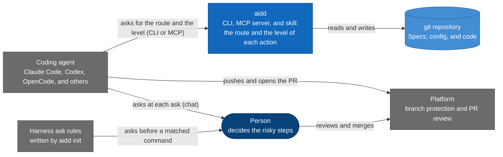
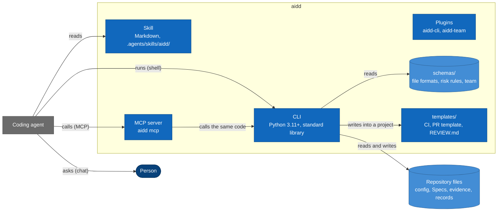
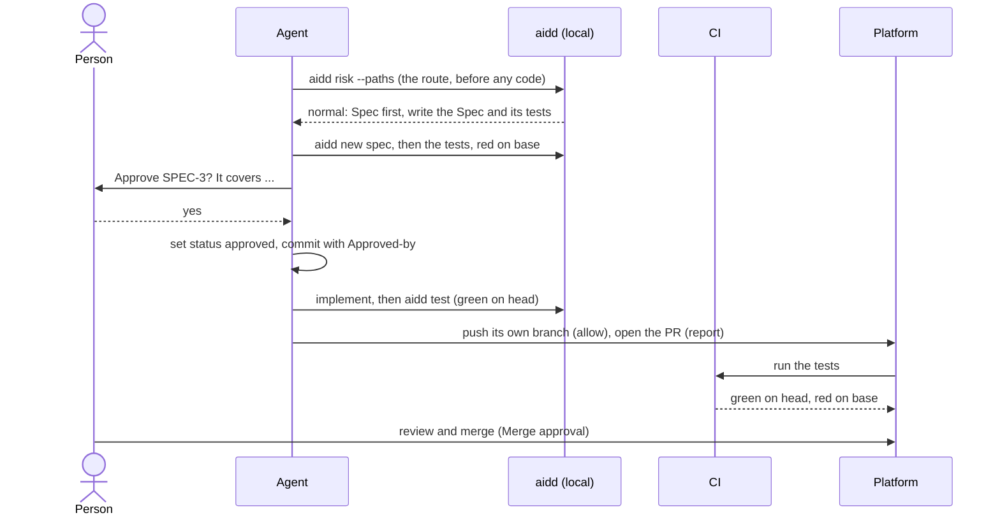

# Architecture overview: aidd

Written 2026-11-10. Living, never frozen: the system as it runs today. A tech spec starts from this page and shows only
what its change moves. After the change lands, a docs change folds the approved design back in here.

This page is for the people and the agents who maintain aidd. It says what each part is, how the parts fit, which file
owns each fact, and where each kind of change goes. [METHOD.md](../METHOD.md) holds the method aidd runs, and
[GLOSSARY.md](../GLOSSARY.md) defines every term. [AGENTS.md](../../AGENTS.md) is the short version for agents.

## Goals and constraints

aidd is a governance layer for AI coding agents. A command-line tool and a skill that agents read advise how much process
each change needs, and which steps wait for a person. Agents do the work in one loop, and a person decides the risky
steps. Every record aidd keeps is a plain file a person can read.

The top quality goals, ranked in [Quality targets](#quality-targets):

1. Deterministic and quiet: the same input gives the same advice, and nothing leaves the machine unannounced.
2. Fail closed: a rule aidd cannot read is an error, never an `allow`, and silence is never a yes.
3. Maintainable: strict layers and one owner for each fact, so a contributor changes one place.

| Stakeholder | What they expect |
| --- | --- |
| A person who adopts aidd | the least ceremony the risk allows, and a stop only where the risk asks for one |
| A coding agent | one skill every harness reads, with the same behavior in each |
| A contributor | one current page on how aidd is built, and checks that say what broke |
| A security reviewer | a stated trust model, a short list of network calls, and no telemetry ([SECURITY.md](../../SECURITY.md)) |
| A maintainer | a release that is one tag, and generated docs that cannot drift ([RELEASING.md](../../RELEASING.md)) |

The constraints a design may not break are the principles in [AGENTS.md](../../AGENTS.md#principles-and-conventions).
Those that shape the design:

- **Standard library only.** `src/aidd/` has no runtime dependency and runs on Python 3.11 or later.
- **Advise, never enforce.** [Context and scope](#context-and-scope) names the hard stops.
- **No model in the advice.** Only a maintainer's `aidd eval` starts an agent.
- **Quiet.** No telemetry, and every network call is on [SECURITY.md](../../SECURITY.md)'s list.
- **Change control.** A change to the loop, the schemas, the profiles, the routes, or the built-in risk rules needs an
  RFC first ([CONTRIBUTING.md](../../CONTRIBUTING.md)).

## Context and scope



- **In scope** are the route of a change, the risk rules and their levels, the Spec and its status, red-then-green
  evidence, the harness ask rules aidd writes, and the team's knowledge that agents read.
- **Out of scope** are enforcing anything, deploying, sandboxing an agent, judging code quality for the person, and
  running a model to give advice.
- **The hard stops** are the harness's own ask rules and the platform's branch protection, because aidd advises and
  enforces nothing ([SECURITY.md](../../SECURITY.md)).

## Solution strategy

| Decision | Why, in one line | Decided in |
| --- | --- | --- |
| Advise, never enforce | tools that already enforce hold the stops | [Context and scope](#context-and-scope) |
| A modular monolith in one package | one capability per package keeps the parts apart, with no service to run | [Module map](#module-map) |
| Data first | one owner for each fact, so the code reads it and the docs are generated | [Data first](#data-first-sources-of-truth-and-generated-files) |
| Strict layers, not events | a command-line tool has no running peers to send events to | [Module map](#module-map) |
| Each part works alone | adopters take only the parts they need | [Building blocks](#building-blocks) |

### Data first: sources of truth and generated files

A file format, a JSON output, a risk rule, a profile, the loop, and the team are data in `schemas/`. The code reads it,
and the docs are generated from it. Each fact has one source, and `aidd gen-docs --check` fails when a copy drifts.

| Fact | Source | Generated from it |
| --- | --- | --- |
| every file format and JSON output | `schemas/*.schema.json` | the field tables in [CONFIG.md](../CONFIG.md), the docs, and the skill |
| the built-in actions, areas, and risk rules | `schemas/risks.json` | the risk tables in the docs and the skill |
| the profiles | `schemas/profiles.json` | the profile tables |
| the names aidd retired, and what replaced each | `schemas/retired-names.json` | what `aidd upgrade` moves, the loaders' errors for an old name, and the table in the [guide](../GUIDE.md) |
| the languages aidd knows: their source files and manifests | `schemas/languages.json` | the files `aidd risk` takes for new source, and the manifests `aidd init` opens |
| the test runners aidd knows: their names, the exits their own documentation gives for a run in which no test failed, and what it says of a mode that runs only the tests related to changed files | `schemas/test-runners.json` | the runners `aidd init` lists, which red runs prove new behavior, and the `related_tests` form `aidd test --changed` suggests |
| each type of thing aidd tracks or writes: its group, form, id, folder, templates, schema, and statuses | `schemas/item-types.json` | `aidd new` and `aidd new --list`, the work-item checks of `aidd status` and `aidd validate`, `aidd explain`, the status-group table, and the skill's list of repository documents |
| the statuses of each work item, the moves between them, and the sets of statuses that code reads | the status node that each row of `schemas/item-types.json` points to (`schemas/common.schema.json` for a Spec and an Intent, `schemas/proposal.schema.json` for a proposal) | `aidd status`, `aidd validate`, the delegate's check, `aidd explain`, the status-group table, and the move tables of METHOD.md and the skill's `references/state.md` |
| each thing that can be open: who opens it, what closes it, who may close it, and what finds one left open | `schemas/lifecycles.json`, whose work items point to their rows of `schemas/item-types.json` | the notes `aidd doctor` gives for what a run left open on the machine |
| the codes aidd gives when a check finds something, and what each means | `schemas/findings.json` (the step codes and the stop codes are `step_code` and `stop_code` in `schemas/common.schema.json`) | the reasons a delegate check gives, the `findings` and the error object of the `--json` outputs, `aidd explain <code>`, and the table in the [CLI reference](../CLI.md) |
| what aidd says about itself: its description in a long and a short form, and its keywords | `schemas/product.json` | the package metadata, the Claude Code manifests, the lead of the README, `llms.txt`, and the opening of `aidd --help` |
| the team: roles, the loop contract, handoffs, flows, domain packs, and the industry standards they cite | `schemas/roles.json`, with its parts `schemas/packs.json` and `schemas/industry-standards.json` | the agent files in `plugins/aidd-team/agents/`, every domain pack, [TEAM-REFERENCE.md](../TEAM-REFERENCE.md), and the loop tables |
| the commands and flags | `src/aidd/cli/grammar.py`, with the help groups in `src/aidd/cli/parser.py` | [CLI.md](../CLI.md) and the command tables in the README |
| the coding agents aidd supports | the harness table in `src/aidd/config/harnesses.py` | the harness tables in the guide and `llms-install.md` |
| the library standards and stacks | `standards/`, `stacks/` | the tables in [STANDARDS.md](../STANDARDS.md) |
| the counts the docs state | the data each one counts | every `count:` block |

A generated block sits between `<!-- aidd:gen <type>:<name> -->` and `<!-- aidd:end -->`. Never edit one by hand.
Change the source, then run `aidd gen-docs`. A domain pack is generated whole, so it is never edited by hand either.

### aidd runs on itself

Every rule aidd asks of adopters holds here first.

| What aidd asks of a repository | How this repository does it |
| --- | --- |
| a config the agents read | `.aidd/config.yaml`, with the `solo` profile |
| agents load the skill and follow the loop | `AGENTS.md` points every agent at `.agents/skills/aidd/`, and the aidd plugin carries it in Claude Code |
| the agent asks at each `ask` | the skill's loop, and the harness ask rules `aidd init` writes |
| red-then-green tests in the project's own CI | `.github/workflows/aidd-tests.yml` runs `aidd test` on the base and the head |
| a hard stop on the default branch | branch protection on `main`, from `.github/rulesets/main.json` |
| a Spec for a normal or major change | `specs/`, written with `aidd new spec` |
| a commit an agent authors names it | `Assisted-by: <harness>/<model>` on every such commit |
| the modular-monolith rules | the layers, the doors, and `lint-imports` ([Module map](#module-map)) |
| an architecture overview from aidd's template | this page |

Changes before the 1.0.0 release have no Specs, because they were built before the loop ran here. Every change after
it goes through the loop.

## Building blocks



Each part works alone. The skill works without the CLI, the CLI without the team, and the loop without a platform.

| Path | What it holds | Who reads it |
| --- | --- | --- |
| `src/aidd/` | the Python package: the CLI, the MCP server ([its tools](#mcp-tools)), and the risk rules' code | everyone who runs aidd |
| `schemas/` | the data: file formats, JSON outputs, the risk rules, the profiles, and the team | the code, `aidd gen-docs`, other tools |
| `.agents/skills/aidd/` | the aidd skill: `SKILL.md`, its references, and the templates `aidd new` fills | every coding agent |
| `plugins/aidd-team/` | the optional team: agent roles, flow commands, practice skills, and the prototype tool | Claude Code, and agents that read skills |
| `plugins/aidd-packs/` | the optional domain packs, one skill each, generated from `schemas/packs.json`: a plugin of its own, because no setting keeps a skill both loadable by a model and out of Claude Code's skill listing | Claude Code, and agents that read skills |
| `plugins/aidd-cli/` | the plugin that puts the `aidd` command on the PATH in Claude Code | Claude Code |
| `.claude-plugin/` | the aidd plugin's manifest, with the skill and the MCP server, and the marketplace | Claude Code |
| `standards/`, `stacks/` | the standards library, one file per standard, and the stacks that group them | `aidd standard` |
| `templates/` | what `aidd init` writes: the CI test workflows for GitHub and GitLab, the PR template, `REVIEW.md`, and the dev container | adopters |
| `action.yml` | the composite action that runs `aidd test` in GitHub Actions | adopters' test jobs |
| `evals/` | the agent evals: routing scenarios, role scenarios, and the cases of the aidd and team plugins | `aidd eval` |
| `tests/` | the unit and integration tests, the fitness functions among them | CI, contributors |
| `docs/` | the guide, the method, the team, the library, the reference, and this overview | people |
| `tools/` | the pinned Mermaid parser that checks every diagram, and the pin sync script | CI, maintainers |
| `.github/` | this repository's own workflows, CODEOWNERS, rulesets, and hash-pinned tool requirements | GitHub |
| `.aidd/config.yaml`, `AGENTS.md`, `specs/` | aidd used on itself: its config, the agent instructions, and the Specs | aidd, agents |
| `.importlinter`, `.gitleaks.toml`, `pyproject.toml` | the module boundaries, the secret scan, and the package build | CI |

### The risk rules

The risk rules are modelled on authorization, with the shape and names of Cedar, Google Cloud IAM, and Kubernetes RBAC,
and no engine of their own. [METHOD.md](../METHOD.md) is normative, and [GLOSSARY.md](../GLOSSARY.md) defines each word.
The code is in `src/aidd/risk/`: `rules.py` merges and matches the rules, `routes.py` gives the route for paths, and
`harness_rules.py` writes the ask rules. `jsonc.py` edits a settings file that takes comments in place. `holds.py` counts what each format holds of each action, and `src/aidd/setup/doctor_harnesses.py` reports it.

- **Actions, areas, rules, and the winning rule** are defined in [METHOD.md §6](../METHOD.md#6-risk-rules). A rule's
  level is `allow`, `report`, or `ask`.
- **The sources**, in order: `schemas/risks.json`, then the profile in `schemas/profiles.json`, then the `extends`
  presets, then the config's `risks`. `aidd risk --list` names where each effective rule came from.
- **The harness ask rules.** `aidd init` and `aidd upgrade` write each `ask` rule's command patterns into the harness's
  own ask format, such as Claude Code's `permissions.ask`, and change only the entries they wrote.

### The delegate check

A standing delegation lets a person name the asks the `aidd-team:delegate` role answers for them.
[METHOD.md](../METHOD.md#a-standing-delegation) holds the rules, and `src/aidd/delegation/` holds the code. Its building
blocks:

| Block | Holds |
| --- | --- |
| `check` | one run of the check: it opens the repository and the head, reads the default branch's tip, reads the `delegation` block there, and defers on the first fact it cannot prove |
| `standing`, `policy` | where a delegation stands, from the default branch's tip alone, and the built-in data of what it covers and its reason codes |
| `commands` | a delegated command against its action's exact template: one program, no chain, pipe, or substitution |
| `action_checks`, `diff_signals`, `deploys` | the checks of each delegable action, what the change touches (reserved paths, deploying workflows, tests that lost a line), and whether a push deploys |
| `workflow_triggers`, `deploy_evidence` | what a workflow's `on:` says about a push, read fully or not at all, and which workflows deploy |
| `platform` | GitHub's facts through read-only `gh api` reads, none of them under `AIDD_OFFLINE=1` |
| `local_run` | the check's own `aidd test` run on the exact head, in a fresh worktree |
| `answers`, `outcome`, `digest` | the delegate's packet and answer, the check's output, and what `aidd status` shows a person of what a delegation decided |

Whatever widens what an agent may do comes from the default branch's tip, and whatever only narrows it may come from
anywhere. One failed check defers, and a defer is final for the head's tree. In Claude Code, a `PermissionRequest` hook
runs the check again on the exact command.

### The knowledge model

The team's know-how is data, so it can be checked, generated, and dated.

- **The registry**, `schemas/roles.json`, holds <!-- aidd:gen count:roles -->12<!-- aidd:end --> roles, the loop
  contract, and the handoffs and flows. It names its parts: the <!-- aidd:gen count:packs -->27<!-- aidd:end -->
  domains in `packs.json`, and every industry standard they cite in `industry-standards.json`. Each standard records
  its source and a sentence quoted from it where one is published, and its edition where it has one. It carries a
  `checked` date. `aidd eval standards` fails on an entry past its review.
- **A domain pack** is what every role checks in one domain, by loop step. It lives in
  `plugins/aidd-packs/skills/<domain>/`, generated from its `domains` entry.
- **A practice skill** is how to do one kind of work well, such as `naming` or `modular-monolith`. It lives in
  `plugins/aidd-team/skills/<name>/`. There are <!-- aidd:gen count:practices -->37<!-- aidd:end -->, each
  hand-written, and a role lists the ones it uses.
- **An open choice** is a decision a pack or a practice skill leaves to the team. Each has aidd's default answer.
- **A library standard** fills one open choice for one ecosystem, such as Ruff for Python, in
  `standards/<group>/<topic>.md`. **A stack** is a set of library standards that go together, in `stacks/<name>.yaml`.

[STANDARDS.md](../STANDARDS.md) defines these words, and [plugins/README.md](../../plugins/README.md) says how to add each one.

Knowledge files follow the ideas of the Open Knowledge Format (OKF): Markdown with YAML front matter, with provenance
and sources. aidd does not use OKF as a storage format, because it is young and has no validator. The fields map like this:

| OKF idea | aidd field |
| --- | --- |
| `type` | `type`: always `opinionated` for a library standard |
| `status` | `status` (`active`, `deprecated`), with `replaced_by` |
| `verified` and its actor | `checked` and `checked_by` (`agent:<harness>/<model>`), and, for an edition, its `citation` |
| `sources` with quoted claims | `citation`: the page, `url`, and a sentence quoted from it, `quote` |
| `stale_after` | `review_every_days` or `review_due`, else 90 days for an emerging entry and 365 for an established one, spread by a stable offset from its id; `aidd eval standards` fails past it |

## Module map

`src/aidd/` is one package with no runtime dependency. It is fourteen packages, one per capability, in thirteen layers,
because `risk` and `recall` share layer 8 and neither imports the other. A package imports only from the packages below
it, and only through its door, its `__init__.py`. The entry points `__main__` and `pyz` (the zipapp builder) sit above
`cli`. The rules for contributors are in [CONTRIBUTING.md](../../CONTRIBUTING.md#code-and-imports).

| Layer, top first | Package | Holds |
| --- | --- | --- |
| 1 | `cli` | the command line (`app`, `parser`, `grammar`, `commands/<group>`) and the MCP server (`mcp_server`, `mcp_tools`) |
| 2 | `docsgen` | `aidd gen-docs`: every generated block, pack, and agent file |
| 3 | `evals` | the agent evals and the standards check |
| 4 | `setup` | `aidd init`, `upgrade`, `uninstall`, `doctor`, and `self-update`; the harness wiring behind them; and `team_install`, which writes the team without the plugin |
| 5 | `views` | the exploration page (`aidd explore`) and the work-item page (`aidd status --html`): its views in `work_views.py`, `work_search.py`, and `work_item_detail.py`, the parts they share in `work_parts.py`, and its style and script as package files. The work-item page, the exploration page, and the prototype viewer draw from aidd's own design system, kept apart from a project's `design/tokens.json`: `design_tokens` builds its CSS from `src/aidd/views/design/tokens.json` and `components.css`, and `aidd gen-docs` writes aidd-team's `system.css` from it |
| 6 | `delegation` | a standing delegation: `aidd delegate check`, its checks, the reserved paths and the deploying workflows, and its own `aidd test` runs in a fresh worktree; GitHub's facts through read-only `gh api`; the delegate's packet and answer; and Claude Code's hook. It sits above `testing`, because the check runs the tests itself |
| 7 | `testing` | the test runner and its evidence |
| 8 | `risk` | the risk rules: load, merge, and match; the route for paths; the harness ask rules |
| 8 | `recall` | `aidd recall`: a search of what the team already wrote, through the index; independent of `risk` |
| 9 | `workitems` | Specs, Intents, Proposals, and explorations: their files, validation, authoring (`aidd new`), and the status their front matter stores. It also holds the open work in every worktree and branch (`all_branches`, `aidd status --all-branches`), the trace (`tracing`, `aidd status <path or id>`), the generated SRS (`srs`), the living-document checks (`living_docs`), and the check of an Orca message payload (`orca_payload`) |
| 10 | `records` | the records of history: their types, writing one after checking it, and reading them back from `.git/aidd/records/` |
| 11 | `knowledge` | the standards library, the team registry, the role text, owners (who to ask), and the command pins (`command_pins`): the exact tool versions that packs and skills name |
| 12 | `config` | `.aidd/config.yaml` and its `extends` presets, the profiles, the harness table, and where aidd writes |
| 13 | `kernel` | what knows no domain: git, strict YAML and its in-place edits, JSON Schema, the table of retired names, globs, processes, text, resources, documents, secret patterns, the SQLite index with its full-text passages, HTTP, and egress |

- **Doors.** A package's `__init__.py` holds no code. It lists the names other packages may use, and reads each one
  from the child module that defines it when a caller uses it. So importing a package loads none of its children, and
  a test that patches a child reaches every caller. `kernel` has no door, so its modules are public.
- **Lazy commands.** Each command names its handler as `"group:cmd_name"`, and the CLI imports it only when the command
  runs. So a quick command such as `aidd risk --command` loads only its own code.
- **The built-in pages stay standard library.** The work-item page, the exploration page, and the prototype viewer
  are HTML that Python writes, with small hashed scripts and no framework. A React or Preact build was measured on
  2026-11-08, and both came out far over the page script's budget. So the pages share one shell and one set of
  components instead. Revisit only when a page outgrows its budget.
- **Import Linter holds the layers.** `.importlinter` lists the packages from `cli` to `kernel`, a door contract for
  each package, and no cycle inside one. It has no `ignore_imports`, so a wrong-way import is fixed, never listed.

aidd tells adopters to build a modular monolith, with the `aidd-team:modular-monolith` skill. Its own code follows the
same principles, shaped for a command-line tool instead of a service:

| Principle | In this repository |
| --- | --- |
| Modules follow capabilities, not technical layers | one package per capability: `risk`, `testing`, `workitems`, and the rest |
| One public door per module | the package's `__init__.py`; its children are internal |
| Each module owns its data | each kind of file has one reader: the config in `config`, the work items in `workitems`, the risk rules in `risk`, the records in `records`, the registry and the standards in `knowledge`, YAML in `kernel` |
| Dependencies point one way | the layers in `.importlinter`; no cycle inside a package |
| Machines enforce the rules | `lint-imports` in CI, with no `ignore_imports` |
| Each module could become a service | `risk` answers from the config and the paths alone, so the CLI, the MCP server, and the skill's tables all read one answer |
| The shared kernel stays small and generic | `kernel` knows no domain |

It differs in two ways, on purpose. aidd uses strict layers where a service would use peer modules with events, and its
code lives under `src/aidd/<package>/`, not `modules/<name>/`. It has no database, so "owns its data" means owns its files.

## Where each kind of change goes

To add a pack, a practice skill, a role, a standard, a plugin, a risk rule, or a coding agent, follow the "Extend aidd"
table in [CONTRIBUTING.md](../../CONTRIBUTING.md#extend-aidd). For the rest:

| To change | Edit | Then |
| --- | --- | --- |
| a file format or a JSON output | its schema in `schemas/` | an RFC first; `aidd gen-docs` |
| a profile or the loop | `schemas/profiles.json`, or the loop in `schemas/roles.json` | an RFC first; `aidd gen-docs` |
| how rules match, the route for paths, or a harness's ask rules | `src/aidd/risk/` | an RFC first (the owner's plan before the tag); its tests; a security review |
| a command or a flag | its flags in `src/aidd/cli/grammar.py` (`help`'s stay in `parser.py`), its help group in `src/aidd/cli/parser.py`, and its handler in `src/aidd/cli/commands/<group>.py` | `aidd gen-docs` |
| the skill agents read | `.agents/skills/aidd/`, which links nothing outside itself | the size budgets in `tests/budgets.py` |
| what `aidd init` writes | `templates/` and `src/aidd/setup/`; every third-party action pinned by commit | `aidd init` in a scratch repository, then `aidd uninstall` |
| a built-in tool of the team, such as the prototype tool | `plugins/aidd-team/tools/<name>/`: standard-library Python that runs without aidd | its tests in `tests/`; ruff and mypy cover the folder |
| this overview | this page, in a docs change | `aidd gen-docs --check`, and the tests in [Fitness functions](#fitness-functions) |

An RFC follows [docs/rfcs/0000-template.md](../rfcs/0000-template.md). Every change then runs the checks in
[AGENTS.md](../../AGENTS.md#verifying-your-work).

## Runtime view

One change when the Spec comes first, from the first edit to the merge, under the `team` profile. A change with no Spec
skips the Spec and Spec approval.



## Deployment view

aidd has no server. Each part runs where the person or the agent runs it.

| Part | Runs on | Ships as | What it can stop |
| --- | --- | --- | --- |
| CLI | a person's machine, an agent's session, a dev container, or CI | the GitHub Release's wheel, `aidd.pyz` (one zipapp), or a commit (`install.sh`) | nothing: it advises |
| MCP server | the agent's harness | <a id="mcp-tools"></a>`aidd mcp`, whose tools are <!-- aidd:gen mcp:tools -->`risk`, `status`, `recall`, `record`, `validate`, `delegate_check`, `delegate_packet`, and `delegate_answer`<!-- aidd:end -->; the aidd plugin starts it through a hardened launcher | nothing: it advises |
| The skill and `AGENTS.md` | the adopter's repository | written by `aidd init`, or carried by the aidd plugin | nothing: the agent follows it |
| Harness ask rules | the agent's harness | written by `aidd init` and `aidd upgrade` into the harness's own settings | a matched command, until the person answers the harness's prompt |
| Test job | the adopter's CI | `templates/github/aidd-tests.yml`, `action.yml`, or the GitLab template | a merge, once branch protection requires it |
| Branch protection | the platform | the platform's own rules, which the person sets | a push or a merge to a protected branch |

| Environment | Purpose | Data | Who deploys | URL |
| --- | --- | --- | --- | --- |
| none | aidd is a tool, not a service, so the config names no `environments` | none | a maintainer releases by a signed tag ([RELEASING.md](../../RELEASING.md)) | none |

## Cross-cutting concepts

| Concept | How it works here | Decided in |
| --- | --- | --- |
| Authentication and authorization | none of its own: a yes is the person's own words, or their delegate's answer on a passing check | [SECURITY.md](../../SECURITY.md), [METHOD.md §5](../METHOD.md#5-the-gates) |
| Errors and logging | every stop names why and the next step that works where the person is; a rule aidd cannot read is an error, never an `allow`; aidd logs nothing off the machine | [AGENTS.md](../../AGENTS.md#rules), [SECURITY.md](../../SECURITY.md) |
| Persistence and migrations | plain files only, with no database; a schema bumps its version by the rules in [CONTRIBUTING.md](../../CONTRIBUTING.md#versioning) | [File formats](#file-formats), [Where aidd writes](#where-aidd-writes) |
| Configuration and secrets | `.aidd/config.yaml` and its `extends` presets; the test runner strips credentials from a child's environment | [CONFIG.md](../CONFIG.md), [SECURITY.md](../../SECURITY.md) |
| User interface | the repository's `docs/design/DESIGN.md` and the design system `aidd gen-docs` builds from `src/aidd/views/design/tokens.json` | [Module map](#module-map) |
| Evidence | an exit code from a runner on a known commit | [Evidence and records](#evidence-and-records) |
| Records | one immutable file for each decision or report | [Evidence and records](#evidence-and-records) |

### The safe reader and writer

A repository's files are another person's text. So aidd reads and writes a file only as a regular file inside the
repository, never follows a link, and never opens a device, which a read could hang on. `kernel/regular_files.py`
holds this rule, and a dry run uses the same code with the writes held in memory. [SECURITY.md](../../SECURITY.md#trust-model)
lists what each command refuses.

- **One YAML reader.** `kernel/strict_yaml.py`, described under [File formats](#file-formats).
- **One way to change one key of a person's YAML.** `kernel/yaml_edit.py` renames or cuts a key on its line, and `setup/migrating.py` reads the file again and compares it with the data it expects before `aidd upgrade` writes it.
- **One way to fetch a URL.** `kernel/egress.py` refuses any address that is not public and follows no redirect.
- **One way to run a child process.** `kernel/processes.py` bounds the output, kills the whole process group on a
  timeout, and strips credentials from the environment.
- **One secret pattern list.** `kernel/secret_patterns.py` stops a record or a push that holds what looks like a key.

### Evidence and records

- **Evidence** is an exit code from a runner on a known commit, written by `aidd test` to
  `.aidd/evidence/evidence.json`. [METHOD.md §7](../METHOD.md#7-red-before-green-and-evidence) is normative, and
  `src/aidd/testing/` holds the code.
- **Records** are the history of what happened, one immutable file each. [GLOSSARY.md](../GLOSSARY.md) defines them,
  [Where aidd writes](#where-aidd-writes) says where they live, and `src/aidd/records/` checks a record before it writes
  one. [SECURITY.md](../../SECURITY.md#trust-model) says what a push shares.

### File formats

- **Markdown with YAML front matter.** Every document aidd reads or writes is Markdown, with its fields as YAML between
  `---` lines, which GitHub renders as a table. A Spec's status lives there. The config is `.aidd/config.yaml`.
- **A strict subset of YAML.** aidd reads YAML with its own reader, `kernel/strict_yaml.py`, which accepts only what
  every YAML reader reads the same. A value such as `1.0.0`, a date, `yes`, or `on` must be quoted, and so must a key
  such as `on`. Anchors, tags, null, duplicate keys, and tabs are refused. Every error names the line and the fix. aidd owns this
  reader so that every YAML reader reads a document the same, and `tests/test_strict_yaml.py` checks it against PyYAML.
- **TOML only where another tool owns the file**, as in `pyproject.toml`, `.codex/agents/*.toml`, and `.gitleaks.toml`.
  aidd reads TOML with `tomllib`.
- **JSON Schema 2020-12.** Each schema has the `$id` `urn:aidd:1:<name>`. Every JSON output carries `schema_version`.
  [CONTRIBUTING.md](../../CONTRIBUTING.md#versioning) says which change bumps a version.
- **Agent Skills.** A skill is a folder with a `SKILL.md` whose front matter holds `name` and `description`, as the
  Agent Skills format says. The aidd skill is self-contained, so it links nothing outside its folder.
- **Each harness's own files.** The plugins follow Claude Code's plugin and marketplace manifests in `.claude-plugin/`,
  and its subagent files in `plugins/aidd-team/agents/*.md`. For the
  <!-- aidd:gen count:harnesses -->14<!-- aidd:end --> coding agents it supports, `aidd init` writes each one's own
  format, its ask rules among them where it has any.
- **Diagrams** are Mermaid in the Markdown, so they diff like code. CI parses every one.

### Where aidd writes

aidd writes in three places, with one rule each. `src/aidd/config/layout.py` holds the two inside `.aidd/`, and `aidd_dir`
in `src/aidd/kernel/git.py` the one in the clone's git folder:

| Where | What it holds | Rule |
| --- | --- | --- |
| A file directly in `.aidd/` | `config.yaml`, `harness-rules.json` (the harness ask rules aidd wrote), `team-files.json` (the team files aidd wrote, by path and SHA-256), and `team-roles.md` (the roles reference `aidd init --aidd-team` installs) | committed, because a person's settings and aidd's own entries must travel with the repository |
| A folder in `.aidd/` | `evidence/` (the test evidence, its logs, and `preview/`, what the verifier captured), and `views/` (the pages `aidd explore` and `aidd prototype` write) | one worktree's output: git ignores it (`/.aidd/*/`), and aidd writes it again on each run |
| `.git/aidd/` | `records/` (one file of history per record, a `decision` or a `report`) and `index.sqlite` (the cache `aidd recall` reads, built again from the files) | the clone's own, outside the work tree: a record leaves the machine only through `aidd records push`, an `ask` |

A Spec's status, its `approved_by` and `approved_at`, and the `Approved-by` trailer are written by the agent, in the
Spec and its commit. aidd keeps no record of a decision outside the Spec, its commit, and `.git/aidd/records/`, and a
person can read all of it.

### Conventions

- **Names.** Files and folders are lowercase with hyphens. Work items have ids such as `SPEC-12` and `SPEC-12-T1`. An
  agent identity is `agent:<harness>/<model>`, and a person is their login, such as `@alice`. The rest is in
  [AGENTS.md](../../AGENTS.md#principles-and-conventions) and the `aidd-team:naming` skill.
- **Dates and versions** are ISO dates and semantic versions, quoted in YAML. The method, the schemas, the risk rules,
  the CI templates, the skill, and the team plugin share one version, as
  [CONTRIBUTING.md](../../CONTRIBUTING.md#versioning) explains.
- **Commits.** A commit an agent authors carries `Assisted-by: <harness>/<model>`. The commit that records a Spec
  approval carries an `Approved-by:` trailer, in the form
  [`approved_by`](../../.agents/skills/aidd/references/spec.md) takes.

## Architecture decisions

aidd keeps no `docs/decisions/` folder yet. A change to the method goes through an RFC ([docs/rfcs/](../rfcs/0000-template.md)).
Each decision below is argued in the section it links, so read those first.

| Decision | Section |
| --- | --- |
| Advise, never enforce | [Context and scope](#context-and-scope) |
| The risk rules have no engine of their own | [The risk rules](#the-risk-rules) |
| Strict layers, where a service would use events | [Module map](#module-map) |
| The built-in pages are standard-library HTML, not React or Preact | [Module map](#module-map) |
| aidd owns its YAML reader | [File formats](#file-formats) |
| OKF's ideas, not its format | [The knowledge model](#the-knowledge-model) |
| Records are files in the git folder, with a SQLite cache | [Where aidd writes](#where-aidd-writes) |

## Quality targets

| Quality | Target | Checked by |
| --- | --- | --- |
| Reliability: determinism | every check gives the same answer for the same input; no model call in advice; the risk rules match as METHOD.md says, and each harness gets its ask rules in its own format | the `risk` package's tests, with a case for each harness |
| Security: fail closed and quiet | a rule aidd cannot read is an error; every network call is on SECURITY.md's list; no telemetry | `tests/test_egress.py`, the `risk` tests |
| Portability: no dependencies | the standard library only, on Python 3.11 or later | `pyproject.toml`, the CI matrix |
| Maintainability: layers, doors, and shape hold | no wrong-way import, no cycle inside a package, a door per package; the code keeps its shape; coverage only rises | the fitness functions below, `tests/test_code_shape.py`, `tests/coverage_floors.py` |
| Performance efficiency: budgets | the suite runs in 2 minutes, 20 seconds a file; what a role starts with, `SKILL.md`, `loop.md`, and a role file have size budgets with 3% headroom, and a file that loads on a signal has one limit for its class; AGENTS.md stays under 12 KiB; a coding agent's own sizes are in `src/aidd/config/harness_sizes.py` | `tests/run.py`; `tests/test_loop_contract.py`, `tests/test_team_roles_and_flows.py`, and `tests/test_harness_sizes.py`, with the limits in `tests/budgets.py`; `aidd doctor` (`src/aidd/setup/doctor_checks.py`) |
| Usability: plain language | no sentence over 35 words on any page; every stop names its next step | `tests/test_plain_language.py`, `tests/test_cli_errors.py` |

## Fitness functions

A fitness function is a test a machine runs on every change. `aidd test` runs them through the one test command in
`.aidd/config.yaml`.

| What holds | Checked by |
| --- | --- |
| the layers, no cycle inside a package, a door per package | `lint-imports` with `.importlinter`; `tests/test_import_boundaries.py` |
| the doors, imports in any order, patches that reach their callers, a parser that loads no command | `tests/test_package_doors.py`, `tests/test_isolated_imports.py`, `tests/test_patch_targets.py`, `tests/test_cli_handlers.py` |
| aidd's YAML reader agrees with PyYAML on every document it accepts | `tests/test_strict_yaml.py`, with PyYAML required in CI |
| no generated table or count drifts from its source | `aidd gen-docs --check` |
| every standard is current | `aidd eval standards` |

```yaml
tests:
  - name: unit
    command: [python3, tests/run.py]
    timeout_seconds: 900
```

## Risks and technical debt

| Risk or debt | Impact | What would retire it |
| --- | --- | --- |
| A command pattern is a net, not a control | an agent can reach the same effect through a script, an alias, or an API call that no pattern matches | branch protection on the platform stays the control, as [SECURITY.md](../../SECURITY.md) says |
| A harness without ask rules gets the skill alone | the agent's own judgement is the only stop there | `aidd doctor` names each such harness; a harness that adds ask rules gets them |
| A Spec approval is a note the agent wrote | it shows what the person said, and proves nothing against an agent set on forging it | under `team`, the platform's PR review is the Merge approval |
| aidd owns its YAML reader | a reader bug could misread a document | the differential tests ([File formats](#file-formats)) |
| Changes before 1.0.0 have no Specs | their reasons live in commit messages, not in a Spec | none; every change after the release goes through the loop |
| There are no ADR files | a decision is argued in its section, not in its own record | a `docs/decisions/` folder, when a decision outgrows a table row |

## Glossary

The terms live in one place, [GLOSSARY.md](../GLOSSARY.md).
