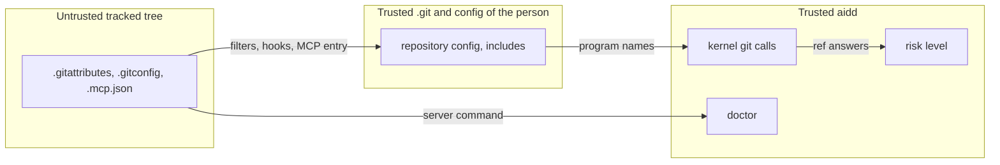

# Threat model: the git kernel

The living threat model of `aidd.kernel.git` and the code that reads its answers. First written for the batch fix of the speed branch (R448, R454), 2026-11-08. Each later change to the kernel's git calls updates this file in the same change.

## 1. What are we working on?

The kernel runs every git process aidd starts, through one function, `_git`. It reads refs, commits, trees, the index, and the work tree. It also writes, with `checkout`, `update-ref`, `symbolic-ref`, `worktree add`, and the records ref. `aidd risk` and `aidd doctor` use it to decide what to say, so a wrong answer can lower a level.

`.git/` is the person's own, because a clone copies no config, hooks, or `info/` folder. A repository received with its `.git` folder is untrusted to git itself, and aidd cannot make that safe. The kernel adds a net for what a tree carries without `.git/`, such as the tracked files `.gitattributes`, `.gitmodules`, `.mcp.json`, and a `.gitconfig` that the config includes.

## 2. What can go wrong?

| Threat (STRIDE) | Trust boundary or asset | Risk | Mitigation | Test | Owner |
| --- | --- | --- | --- | --- | --- |
| T-GIT-01 Elevation of privilege when a ref read runs a filter or another program from the tree | tracked tree → the person's machine | low | A read of refs, commits, or trees (`REF_READS`) runs no program in any form, and a read that can run a filter (`FILTER_READS`) blanks every filter the repository's config names, through the environment, with no `=` split. | `test_a_ref_read_starts_no_filter_probe_and_runs_no_filter`, `test_each_read_that_can_run_a_filter_blanks_them_and_runs_none`, `test_every_read_that_can_run_a_filter_hands_git_the_blanks` | security engineer |
| T-GIT-02 Tampering when a cached answer, or a name read as text, lowers a level | kernel → risk level | medium | `shared_reads` keeps only the exact read shapes aidd uses, keys each answer by folder and drops it on a write or a caller's environment. A merge resolves each named ref through git, reads it as unknown after an earlier command on the line that can move a ref (a `fetch` or `pull` counts, because git follows the tags it brings, unless it passes `--no-tags`), and a local upstream or a remote copy of another branch never lowers a merge into the default branch. The default branch is read by full ref names, so a tag or a branch called `origin/main` changes neither the ask rules nor a merge's level. | `test_shared_reads_keep_only_the_exact_shapes_aidd_reads_with`, `test_shared_reads_key_each_answer_by_the_folder_and_ignore_a_callers_environment`, `test_shared_reads_probe_the_filters_once_and_a_write_reads_them_afresh`, `test_a_local_upstream_never_lowers_a_merge_into_the_default_branch`, `test_only_a_remote_copy_of_the_same_branch_is_the_default_branchs_own_upstream`, `test_a_name_that_git_reads_as_another_ref_is_not_the_branch_checked_out`, `test_a_name_is_read_before_the_line_runs_so_an_earlier_command_that_moves_a_ref_makes_it_unknown`, `test_the_default_branchs_upstream_is_exactly_its_own_name_on_its_remote`, `test_default_branches_reads_full_ref_names_so_a_tag_origin_main_changes_nothing`, `test_the_ask_rules_still_cover_a_push_to_main_when_a_tag_is_called_origin_main`, `test_a_fetch_before_a_merge_makes_the_name_unknown_unless_it_takes_no_tags` | security engineer |
| T-GIT-03 Elevation of privilege when a config-based hook runs | tracked `.gitconfig` → the person's machine | high | Git 2.54 and later run `hook.<name>.command` for `hook.<name>.event`, whatever `core.hooksPath` says. Git has no switch for all of them, so each call that can start a hook turns off the hook names the repository's config lists with `hook.<name>.enabled=false`. Only exact read shapes skip this, and `status` gets `--no-optional-locks`. A `diff` is not one of them, because it refreshes the index when only a file's stat changed, and that starts `post-index-change`; the callers that reach it are `changed_since`, `numstat`, the test runner's changed files, and the Spec drift warnings of `aidd validate`. | `test_a_config_hook_a_tracked_file_includes_does_not_run_on_a_call_aidd_makes` (with a stat-only `diff`), `test_a_config_hook_does_not_run_on_a_remote_update_or_prune_aidd_makes`, `test_a_remote_update_and_a_remote_prune_start_hooks_so_only_the_read_forms_of_remote_and_config_skip_the_guard` | security engineer |
| T-GIT-04 Elevation of privilege when `aidd doctor` runs the program a tracked `.mcp.json` names | tracked tree → the person's machine | high | The probe starts only the entry `aidd init` writes (`mcp_wiring.mcp_server()`), built by aidd and never read from the file. Any other entry gets a warning that says it was not started. | `test_doctor_never_starts_a_program_a_tracked_mcp_file_names` | security engineer |
| T-GIT-05 Elevation of privilege when a signature field runs the repository's `gpg.program` | repository config → the person's machine | low | `log_fields` refuses `%G` and `%(signature` fields. aidd verifies no signature. | `test_a_signature_field_that_would_run_the_repositorys_gpg_program_is_refused` | security engineer |

## 3. What are we going to do about it?

Each control above is code in `src/aidd/kernel/git.py`, `src/aidd/kernel/git_calls.py`, `src/aidd/risk/commands.py`, or `src/aidd/setup/doctor_probes.py`, and each has the test beside it. No Spec exists for this batch, so the tests name the proof. ASVS Level 1 applies.

## 4. Did we do a good enough job?

- Security review of the speed branch (936ce5cb) found T-GIT-01 clean, and raised T-GIT-02 to T-GIT-05. The probes `hostile.py`, `cache.py`, `percall.py`, and `mutate.py` reproduce them.
- Automated review of the fix: widened the hook guard to `remote update`, `remote prune`, and `config` writes, and tightened the merge level. Both are in place.
- A mutation run on the kernel's calls changed the filter blanks, the hook guard, the cache keys, and the write classifier one at a time, and a test caught each mutant.
- Security review of 0a3dfbdb found four gaps, now closed. A `diff` started a config hook. A fetched tag took the name of a remote branch. A folder typed without a slash matched no pattern. `--all-branches` took an Intent's agreement from the file's text.

## Residual risk

- A filter or hook in the person's global or system config, such as git-lfs, still runs. The person owns that config.
- A git older than 2.40 cannot ignore the tree's attributes, and one without the fix for CVE-2024-32465 can fetch a missing object. aidd blanks the filters, and says so once.
- `checkout`, `worktree add`, and `stash create` run the repository's clean and smudge filters. aidd's callers run them on a tree the tests already run in.
- A remote call runs the repository's own ssh command, credential helper, askpass, and proxy by design.
- On the default branch, a name that git reads as two refs makes aidd ask, never allow.
- `default_base` answers with a short name, such as `origin/main`, when the local trunk is not ahead of it. A caller that resolves that name, such as `branch_base`, the test runner, or the work-item migration, reads a tag called `origin/main` instead of the branch. The base of a changed-file list or of a test selection is then wrong. No risk level reads it, so a level never drops.

A named person has not yet accepted this residual risk. The owner accepts it, or opens a change for an item.
