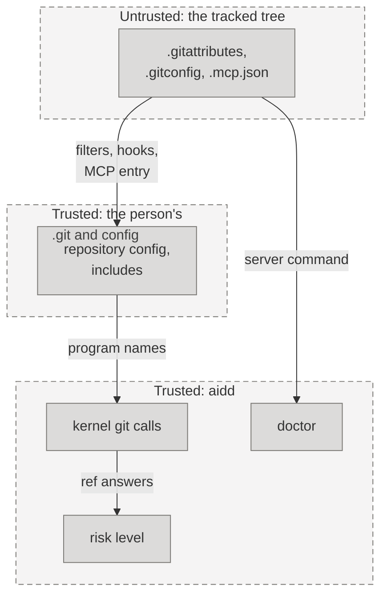

# Threat model: the git kernel

The living threat model of `aidd.kernel.git` and the code that reads its answers. First written for the batch fix of the speed branch, 2026-11-08. Each later change to the kernel's git calls updates this file in the same change.

## 1. What are we working on?

The kernel runs every git process aidd starts, through one function, `_git`. It reads refs, commits, trees, the index, and the work tree. It also writes, with `checkout`, `update-ref`, `symbolic-ref`, `worktree add`, and the records ref. `aidd risk` and `aidd doctor` use it to decide what to say, so a wrong answer can lower a level.

`.git/` is the person's own, because a clone copies no config, hooks, or `info/` folder. A repository received with its `.git` folder is untrusted to git itself, and aidd cannot make that safe. The kernel adds a net for what a tree carries without `.git/`, such as the tracked files `.gitattributes`, `.gitmodules`, `.mcp.json`, and a `.gitconfig` that the config includes.

Legend: each dashed box is a trust zone, from the untrusted tree at the top to aidd at the bottom. A line that crosses a
box's edge crosses a trust boundary.

## 2. What can go wrong?

| Threat (STRIDE) | Trust boundary or asset | Risk | Mitigation | Test | Owner |
| --- | --- | --- | --- | --- | --- |
| T-GIT-01 Elevation of privilege when a ref read runs a filter or another program from the tree | tracked tree → the person's machine | low | A read of refs, commits, or trees (`REF_READS`) runs no program in any form, and a read that can run a filter (`FILTER_READS`) blanks every filter the repository's config names, through the environment, with no `=` split. | `test_a_ref_read_starts_no_filter_probe_and_runs_no_filter`, `test_each_read_that_can_run_a_filter_blanks_them_and_runs_none`, `test_every_read_that_can_run_a_filter_hands_git_the_blanks` | security engineer |
| T-GIT-02 Tampering when a cached answer, or a name read as text, lowers a level | kernel → risk level | medium | `shared_reads` keeps only the reads a row of `git_forms.FORMS` names, and a call no row names is a write, so it fails closed. It keys each answer by folder and by the whole environment, ignores a caller's own environment, and drops what it kept on a write and when a program aidd starts ends (`forget_reads`). A scope lasts for the work of one command (`init`, `upgrade`, `uninstall`, `doctor`, `status`, `validate`, `risk`, `test`, and the delegate check) and ends with it. A merge resolves each named ref through git, reads it as unknown after an earlier command on the line that can move a ref (a `fetch` or `pull` counts, because git follows the tags it brings, unless it passes `--no-tags`), and a local upstream or a remote copy of another branch never lowers a merge into the default branch. The default branch is read by full ref names, so a tag or a branch called `origin/main` changes neither the ask rules nor a merge's level. | `test_every_kept_read_after_every_write_is_what_git_answers_fresh`, `test_a_call_that_changes_the_refs_or_config_is_classed_a_write`, `test_a_call_that_differs_from_a_row_by_one_word_is_a_write`, `test_each_literal_call_is_a_row_or_a_known_write`, `test_a_setting_read_in_one_environment_is_read_again_in_another`, `test_a_test_command_that_switches_the_branch_is_seen_by_the_next_read`, `test_every_program_the_product_starts_forgets_the_reads_or_writes_no_repository`, `test_shared_reads_keep_only_the_exact_shapes_aidd_reads_with`, `test_shared_reads_key_each_answer_by_the_folder_and_ignore_a_callers_environment`, `test_shared_reads_probe_the_filters_once_and_a_write_reads_them_afresh`, `test_a_local_upstream_never_lowers_a_merge_into_the_default_branch`, `test_only_a_remote_copy_of_the_same_branch_is_the_default_branchs_own_upstream`, `test_a_name_that_git_reads_as_another_ref_is_not_the_branch_checked_out`, `test_a_name_is_read_before_the_line_runs_so_an_earlier_command_that_moves_a_ref_makes_it_unknown`, `test_the_default_branchs_upstream_is_exactly_its_own_name_on_its_remote`, `test_default_branches_reads_full_ref_names_so_a_tag_origin_main_changes_nothing`, `test_the_ask_rules_still_cover_a_push_to_main_when_a_tag_is_called_origin_main`, `test_a_fetch_before_a_merge_makes_the_name_unknown_unless_it_takes_no_tags`, `test_every_command_gives_the_answer_it_gave_with_no_scope_and_leaves_none_open`, `test_status_validate_risk_and_init_each_run_inside_one_scope`, `test_the_test_run_reads_inside_one_scope_and_a_test_command_ends_what_it_kept` | security engineer |
| T-GIT-03 Elevation of privilege when a config-based hook runs | tracked `.gitconfig` → the person's machine | high | Git 2.54 and later run `hook.<name>.command` for `hook.<name>.event`, whatever `core.hooksPath` says. Git has no switch for all of them, so each call that can start a hook turns off the hook names the repository's config lists with `hook.<name>.enabled=false`. Only exact read shapes skip this, and `status` gets `--no-optional-locks`. A `diff` is not one of them, because it refreshes the index when only a file's stat changed, and that starts `post-index-change`; the callers that reach it are `changed_since`, `numstat`, the test runner's changed files, and the Spec drift warnings of `aidd validate`. | `test_a_config_hook_a_tracked_file_includes_does_not_run_on_a_call_aidd_makes` (with a stat-only `diff`), `test_a_config_hook_does_not_run_on_a_remote_update_or_prune_aidd_makes`, `test_a_remote_update_and_a_remote_prune_start_hooks_so_only_the_read_forms_of_remote_and_config_skip_the_guard` | security engineer |
| T-GIT-04 Elevation of privilege when `aidd doctor` runs the program a tracked `.mcp.json` names | tracked tree → the person's machine | high | The probe starts only the entry `aidd init` writes (`mcp_wiring.mcp_server()`), built by aidd and never read from the file. Any other entry gets a warning that says it was not started. | `test_doctor_never_starts_a_program_a_tracked_mcp_file_names` | security engineer |
| T-GIT-05 Elevation of privilege when a signature field runs the repository's `gpg.program` | repository config → the person's machine | low | `log_fields` refuses `%G` and `%(signature` fields. aidd verifies no signature. | `test_a_signature_field_that_would_run_the_repositorys_gpg_program_is_refused` | security engineer |
| T-GIT-06 Information disclosure when a program the repository's config names runs for a checkout aidd makes in a run of the tests, in aidd's own environment | the test command's change to the config → aidd's environment | medium | The test command is the change's own code, so it can add a filter to the repository's config. Its environment has no credential-like variable (`scrub_credentials`), and aidd's checkouts get that same environment: `aidd test`'s checkout of the base for the red runs, and back, and the delegate check's checkout of the head. What those checkouts can start is a `clean`, `smudge`, or `process` filter, and the same filter in a submodule when `submodule.recurse` is set. They also start a hook the person's global config names, with that environment (Residual risk). A filter the project needs still runs, so the red run proves what it did, and `--pass-env` passes a variable to it as it passes one to the test command. The scrub keeps a credential out of the environment of the test command and of a program a checkout starts, which stops accidental use and prints. It is no boundary (Residual risk). A filter that fails there stops the run with the next step, `--pass-env`. | `test_each_row_proves_the_same_red_and_no_program_sees_the_credential`, `test_the_submodule_the_in_place_checkout_updates_runs_its_filter_without_the_credential`, `test_a_filter_in_the_config_sees_no_credential_when_the_check_checks_out_the_head`, `test_a_repository_config_that_names_every_other_kind_of_program_starts_none`, `test_a_credential_the_person_passes_by_name_reaches_the_checkout_as_it_reaches_the_test_command`, `test_the_stop_names_pass_env_and_in_place_how_to_restore_the_files` | security engineer |

## 3. What are we going to do about it?

Each control above is code in `src/aidd/kernel/git.py`, `src/aidd/kernel/git_calls.py`, `src/aidd/kernel/git_forms.py`, `src/aidd/kernel/git_reads.py`, `src/aidd/risk/commands.py`, or `src/aidd/setup/doctor_probes.py`, and each has the test beside it. No Spec exists for this batch, so the tests name the proof. ASVS Level 1 applies.

## 4. Did we do a good enough job?

- Security review of the speed branch (936ce5cb) found T-GIT-01 clean, and raised T-GIT-02 to T-GIT-05. The probes `hostile.py`, `cache.py`, `percall.py`, and `mutate.py` reproduce them.
- Automated review of the fix: widened the hook guard to `remote update`, `remote prune`, and `config` writes, and tightened the merge level. Both are in place.
- A mutation run on the kernel's calls changed the filter blanks, the hook guard, the cache keys, and the write classifier one at a time, and a test caught each mutant.
- Security review of 0a3dfbdb found four gaps, now closed. A `diff` started a config hook. A fetched tag took the name of a remote branch. A folder typed without a slash matched no pattern. `--all-branches` took an Intent's agreement from the file's text.

## Residual risk

- A filter or hook in the person's global or system config, such as git-lfs, still runs. The person owns that config, but a test command runs as the person and can write the global one. A hook there starts on aidd's checkouts, with their environment. A filter there runs on aidd's later reads in aidd's full environment, because the blanks skip those scopes.
- A git older than 2.40 cannot ignore the tree's attributes, and one without the fix for CVE-2024-32465 can fetch a missing object. aidd blanks the filters, and says so once.
- `checkout`, `worktree add`, `stash create`, and `commit` run the repository's clean, smudge, and process filters. `commit` and `commit-tree` also run its `gpg.program` when `commit.gpgsign` is set. Only aidd's checkouts in a run of the tests get the test command's environment (T-GIT-06). After any run of the change's tests, the repository's config and hooks, and the person's global config, may hold a program those tests added. Any later git in a full environment starts it: the person's or the agent's own git, and a merge or push that a delegate's answer covers. aidd's own commands outside a run of the tests, `aidd eval`, `aidd approve`, and `aidd records push`, run a planted filter, `gpg.program`, or ssh command from the repository's config in that environment. aidd's own reads blank the repository's filters and hooks, so only a filter the global config names runs there. The delegate check runs the head's tests itself before a local merge. Where the tests run is the control: run a change you do not trust in CI or a disposable container, never on a machine that holds a credential.
- The scrub is no boundary. It removes credential-like variables from the environment of the test command and of a program a checkout starts, so neither uses or prints one by accident. Both run as the person, so they can read aidd's own environment, the ssh agent, and the person's files. Keep secrets out of the environment that runs `aidd test`, as the CI templates do.
- Inside one `aidd test`, git calls reuse the list of the repository's hook and filter names until a write, or the end of a test command, drops it. A process the test command left behind, outside its process group, can change the config after the list was read. A call that can start a hook then runs with the older list, so a hook added after the read can run. Only the checkouts have the test command's environment (T-GIT-06). The test job is untrusted (SECURITY.md).
- A remote call runs the repository's own ssh command, credential helper, askpass, and proxy by design.
- On the default branch, a name that git reads as two refs makes aidd ask, never allow.
- The repository's own `init.defaultBranch`, which an agent can write, names the trunk only after origin's default branch, `main`, and `master` found none. It moves a base or a push reading only where the repository has none of them, and a global value is never read.
- `default_base` answers with a short name, such as `origin/main`, when the local trunk is not ahead of it. A caller that resolves that name, such as `branch_base`, the test runner, or the work-item migration, reads a tag called `origin/main` instead of the branch. The base of a changed-file list or of a test selection is then wrong. No risk level reads it, so a level never drops.
- aidd reads a command line as a cooperative agent writes it. An exotic spelling can slip past the reading of a merge into the default branch. Examples are an alias set on the line, a ref moved inside a nested shell, an abbreviated long option (`--set-up`), and bundled short flags (`-ft`). There the harness's own ask rules and the platform's branch protection are the hard stops, as SECURITY.md says.
- A tag refspec in the repository's own `remote.<name>.fetch`, such as `+refs/tags/*:refs/tags/*`, fetches a tag even with `--no-tags`. `git fetch --no-tags && git merge origin/main` then reads allow, and the merge can bring in the tag's commit. The precondition is the person's own `.git/config`, or a tracked file they include.
- When the config probe that lists the filters and hooks times out under load or fails, a call runs without those blanks, and aidd says so once on stderr. The version probe and the empty tree fail toward every guard; this probe does not, because stopping every call under load would stop the work.

A named person has not yet accepted this residual risk. The owner accepts it, or opens a change for an item.
