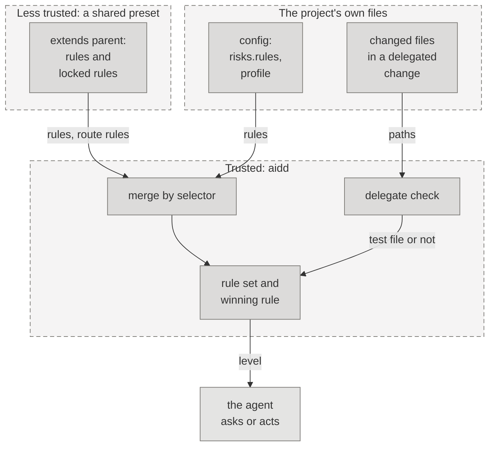

# Threat model: the risk rules

The living threat model of the built-in risk rules and the code that reads them. That code is `schemas/risks.json`, `schemas/profiles.json`, `aidd.risk.rules`, `aidd.config.loading`, and the delegate check's reading of test files, of the product scope's files, and of an Intent's agreement (`aidd.delegation.approvals`). First written for the change that made the `spec.approve` rules the one owner of Spec approval, and `test_paths` the one list of test files, 2026-11-09. Each later change to how rules merge or match updates this file in the same change.

## 1. What are we working on?

A risk rule sets the level of an action: `allow`, `report`, or `ask`. Four layers set rules. They are the built-in rules, the profile's, the config's, and, under a delegation, the rises to `ask`. Each layer replaces the one before it where a rule has the same selector. A config also takes rules from the parents it extends, and a parent can lock a rule. A rule that names a `route` decides `spec.approve` for that route only. `test_paths` says what a test file is, and the delegate check defers when a change with no Spec changes a test file the base holds. The `product_scope` area says which files are the product scope, and the same check defers on a change to one, or to what a person's agreement to an Intent covers.

Everything a preset or a config writes is the project's own text, and a preset can come from a shared place the project does not control. The agents read the levels and act on them, so a wrong level lowers how often a person is asked.

Legend: each dashed box is a trust zone. The less trusted preset and the project's own files feed trusted aidd below
them. A line that crosses a box's edge crosses a trust boundary.

## 2. What can go wrong?

| Threat (STRIDE) | Trust boundary or asset | Risk | Mitigation | Test | Owner |
| --- | --- | --- | --- | --- | --- |
| T-RISK-01 Elevation of privilege when a preset lowers Spec approval through `route` | extended parent → the level of `spec.approve` | medium | A rule with a `route` is one more selector, so a preset can lower one route and a child that asks on every route could fail to replace it. A rule with no `route` replaces the parent's unlocked rules for one route, in the merge and across the layers, and never the child's own. The merge applies it to the parent's rules before any child rule, so the order of a child's rules changes nothing. A parent's locked rule stays, as a floor (T-RISK-04), and a warning names a child rule it sets aside. A caller with no route reads only the rule for every route. Only `spec.approve` takes a `route`, so a rule that would never match is an error that names `route`. Built in, `spec.approve` asks on every route, and the one lower cell is the `solo` profile's `normal` route. | `test_a_child_rule_for_every_route_replaces_a_parents_rule_for_one`, `test_the_merged_levels_never_depend_on_the_order_of_a_childs_rules`, `test_a_parents_lock_for_one_route_is_a_floor_for_that_route_only`, `test_a_child_route_rule_a_parents_lock_sets_aside_is_named`, `test_a_route_belongs_to_spec_approve_alone`, `test_the_data_lowers_one_cell_and_only_in_solo` | security engineer |
| T-RISK-02 Tampering when a test file is not read as one at the delegate check | changed files → the delegate's yes | medium | The check defers when a change with no Spec changes a test file the base holds. It reads `test_paths`, the one list, which is the union of the three older lists, so nothing that counted before stops counting. The check ignores case, as macOS and Windows do, and the route advice and `aidd init` do not. A file in `e2e/` or `testing/` now counts in the check too. | `test_nothing_an_old_list_counted_stops_counting`, `test_a_changed_test_file_defers_in_any_test_folder`, `test_the_check_ignores_case_where_the_other_readers_do_not`, `test_the_case_must_match_unless_the_delegate_check_folds_it` | security engineer |
| T-RISK-03 Spoofing when a path looks like a test and is not, or the reverse | repository path → the route advice | low | The list reads a path, never its content. A source file named like a test counts as one, so the route advice skips its step to write a test first and a Task's scope keeps the file's own path. Neither lowers a level. | `test_the_list_is_broader_than_each_old_one_and_that_is_accepted`, `test_no_word_that_only_holds_test_is_one` | security engineer |
| T-RISK-04 Elevation of privilege when a preset's lock lowers a built-in `ask` | extended parent → the level of every action | high | A lock once won over every rule it did not lock, however narrow, and took the place of a lower layer's rule at its selector. So a preset that locked `code.edit: report` lowered edits in `auth` and `payments` from `ask` to `report`, and a locked `allow` lowered any `ask` it covered. A lock is now a floor and replaces no rule. The level is the higher of the most specific locked rule's and the most specific rule that is not locked, the built-in rules included, so a lock raises and never lowers, whatever it names and at whatever depth of `extends`. A child's rule with the lock's own selector and another level is still set aside with a warning, and a warning for a route rule names only a child rule below the lock. | `test_a_lock_never_lowers_a_level_and_raises_it_to_its_own`, `test_the_headline_case_an_edit_in_auth_and_payments_stays_ask_under_a_lock_at_report`, `test_a_lock_decides_with_a_child_rule_in_either_direction`, `test_a_lock_never_lowers_a_command`, `test_the_rise_beats_a_parents_locked_lower_level` | security engineer |
| T-RISK-05 Elevation of privilege when a write is read as a listing, a preview, or a request for help | a command line → the level `aidd risk --command` gives | high | A pattern matches leading words, so a listing and the same command with a write word both matched, and the listing asked. The `read_forms` and `help_forms` of `schemas/risks.json` now let a command read `allow` only when it is the listed program by its bare name, typed as it runs, with no setting, redirection, expansion, or unquoted glob, brace, tilde, comment, or backslash, and every word one the form lists. The form applies to the command as typed and never to one found inside `sudo`, `xargs`, `sh -c`, `$(...)`, or a subshell, because `xargs` adds words. A value-taking option takes the next word only when it starts with no `-`, a required preview option appears exactly once, and a word that names no option is allowed only where the form says so (`git tag` names a pattern only with `-l`). A form that only looks like a preview is not listed: a run showed `git push --dry-run` runs the pre-push hook, and `npm publish --dry-run` and `cargo publish --dry-run` run the package's scripts or build. A config cannot add a form. | `test_each_listed_read_or_preview_form_is_allow`, `test_the_same_forms_with_a_writing_word_keep_the_strict_level`, `test_a_second_command_a_redirection_or_an_expansion_keeps_the_strict_level`, `test_a_setting_a_program_path_or_a_wrapper_before_it_keeps_the_strict_level`, `test_git_options_before_the_command_keep_the_strict_level`, `test_a_preview_that_still_runs_project_code_or_sends_stays_strict`, `test_the_reader_clears_exactly_what_the_oracle_does`, `test_a_cleared_action_is_the_only_level_change_on_a_sample_through_command_level`, `test_a_config_cannot_add_or_widen_a_form` | security engineer |
| T-RISK-06 Elevation of privilege when a delegated change lands a product scope edit or an approval | the change's files and Intents → the product scope and the person's approval the default branch's tip holds | high | The `product_scope` area (the brief, the BRD, the PRD, the standing outcomes, and the intent order, under `**/product/` and under the tip config's `product_dir`) is a reserved area, so a delegated push, merge, or Spec approval defers (`reserved_path`) on a change to one, and on a Task scope that names one. The file names come from the built-in area as well as the config's, so a config or preset that redefines the area un-reserves nothing in `product_dir`. What an approval covers has one owner, `workitems.approved_changes`, which `aidd validate`, `aidd status`, and the delegate all read: everything in an Intent's front matter and body except what an agent keeps current, so a field added later is covered by default. What is kept is `workitems.AGENT_KEPT` and `PLANNED_SPEC_KEPT`. The body is compared whole, with its line endings read as one. A `_body_changed` key in a file is a covered change. Each entry says what it lets through and what `_kept_changes` takes back. A RAID item that is removed or moved to `accepted`, a result the approved version holds that is changed or removed, a removed blocker, a changed or removed `merged_in`, and a kept value that fails its schema are covered. A new `merged_in` is kept only when it names a commit of the default branch's tip that is newer than the approval's commit (`intent_approvals._unheld_commits`). A slice with a `repo` is left out, because its commit lies in a repository aidd reads none of, and the rule applies only to what the branch changes, never to the tip's own version. A delegated push, merge, or Spec approval defers (`intent_approval_changed`) on a change `base...head` makes to an Intent whose file claims an approval, or by removing it, and on any Intent whose `approval` it sets or changes. An Intent is found by its `id` in the files the change touches, from the commits alone, so a move changes nothing, a copy under a new path is no way round, and a file that cannot be read in today's shape counts. A delegated Spec approval defers (`intent_not_approved`) unless each Intent it answers to stands approved on the default branch's tip: the Intent its `parent` names in the head's Spec and in the tip's, and every Intent that lists the Spec as a slice on the tip or on the head. An Intent only the head holds is on no tip, so it defers. A person's commit with an `Approved-by:` line, an `Approves:` line of the Intent's exact id, and no delegate trailer, which changes nothing in the Intent but its `approval`, holds `approval.at` (`workitems.approved_document`), found across the move of the Intent by git's own record of renames. The approved version must list the Spec, nothing it covers may have changed since, and no person may have ended the Intent (`done`, `cancelled`, `no_go`). The head's Intent must also equal the tip's approval, so a branch behind the approval cannot carry its own version. Each Spec approval stop names its own next step in its detail: reopen the Intent or drop the Spec, add the slice line, or update the branch. The checks read the area from the tip's config, the changed paths from the commits alone, and the parent Intent and its approval from the default branch's tip, never the working tree. They read no trailer or approval field of the change's own files, so an `Approved-by:` or `Approves:` line, or an `approved_by` or `approval`, that the branch writes itself lifts no defer. The three only add stops: nothing becomes delegable and no level falls. A draft Intent no person approved and the kept fields pass, so a slice start and a merge are never held. False defers, accepted: a `docs/product/prd.md` and a `vendor/lib/product/brief.md`, because `**/product/` reaches every folder with that name. Left: the kept fields still let through a new owner or team, a re-link to another repository or tracker, an edited RAID item, a first `result` no person confirmed, a repointed `drafted_in`, an added blocker, any `merged_in` for a slice with a `repo`, and a `merged_in` for a commit after the approval that did not merge the slice. A Spec that no Intent on the tip or the head names or lists has no Intent to be approved. Forged `Approved-by:` and `Approves:` lines in a commit a person then merges count, the same limit as a Spec's `Approved-by`. A `product` folder that is a link or a submodule, and a file beside the five, are not held, and the reader of the product scope must refuse a link. A saved request in the specs folder and a proposal's `go_no_go` are not held, as before. The approval lookup takes the specs folder's name from the working tree's config, which only widens where git looks: a hold still needs a person's trailer, the same id, and the same content. A trailer that comes from a message file (`-F`), a template (`-t`), a reused message (`-c`, `-C`), or an amend asks in no harness, because the ask rules see only `-m` and `--trailer`, as before this change. A person reads the commits of a change that lands an approval. The delegate's packet carries no product scope text, so no tripwire reads it. The time cost is two `git show` calls for each changed Markdown file. | `test_what_changes_an_approved_intent_defers_and_what_a_slice_start_writes_passes`, `test_a_draft_no_person_approved_is_free_to_change_until_the_change_sets_an_approval`, `test_a_merged_in_is_kept_only_for_a_commit_of_the_default_branch_after_the_approval`, `test_a_push_defers_on_what_an_approval_covers_and_on_a_file_of_the_product_scope`, `test_a_spec_approval_waits_for_the_parent_intent_to_stand_approved_on_the_tip`, `test_an_intent_that_lists_the_spec_binds_it_whatever_its_parent_says`, `test_an_intent_only_the_head_adds_binds_the_spec_it_lists`, `test_a_branch_behind_the_approval_cannot_carry_its_own_version_of_the_intent`, `test_an_approval_stands_across_the_move_a_person_makes_with_git_mv`, `test_an_approval_only_the_change_holds_is_not_the_tips`, `test_an_approval_the_change_writes_itself_lifts_no_defer`, `test_an_approval_the_branch_writes_itself_is_not_the_tips`, `test_a_config_that_redefines_the_area_keeps_the_five_files_reserved_in_the_folder_it_names`, `test_the_delegate_check_reads_the_area_as_reserved_for_every_file_in_every_folder`, `test_every_route_and_edit_level_is_the_same_without_the_area`, `test_a_path_in_the_area_names_the_gate_its_change_needs`, `test_the_approved_version_every_view_reads_carries_the_body_mark_and_only_for_a_body_change` | security engineer |

## 3. What are we going to do about it?

Each control above is code or data, and each has the test beside it. The code is in `src/aidd/risk/rules.py`, `src/aidd/config/loading.py`, `src/aidd/config/model.py`, `src/aidd/delegation/diff_signals.py`, and `src/aidd/delegation/intent_approvals.py`. The data is in `schemas/risks.json`, `schemas/profiles.json`, and `schemas/risks.schema.json`. A seeded fault in each control fails a test. The faults were a child rule that no longer replaces the parent's route rule and a merge that depends on the order of the child's rules. They were also a lowered built-in or profile level, a dropped list entry, a private list in the check, and a check that matches case-sensitively. ASVS Level 1 applies.

## 4. Did we do a good enough job?

- A security review of the change found the unreplaced parent rule (T-RISK-01), the check's second reading of case (T-RISK-02), and the broader list (T-RISK-03). A second review found the order of a child's rules. The fixes are in place.
- A snapshot of 23 configs gave the same level for every action, every route, and every harness ask rule before and after the change. The configs covered each profile, a delegation, environments, and `spec.approve` rules.

## Residual risk

- A preset can lower a route for a project that extends it, when the preset's rule is not locked and the project sets no rule of its own. This is by design, because a preset sets defaults. `aidd risk --list` names each rule's source.
- The built-in rules never lower a route. Only a profile, a config, or a parent does.
- A file that a project names like a test still counts as one when its content is not a test. Review of the change is the control.

## Path families of the auth and infra areas, and where each convention comes from

The `auth` and `infra` areas reach a file by its folder or name stem, so a file in any language routes alike. A stem is a whole name or a dotted or joined part of one, never a word inside another, so `author.py` is in no area. A pattern is only ever added, so no route or edit level falls (`tests/test_area_stems.py`). The areas' excludes did not change, because an exclude would lower files the old lists reached.

| Family | Patterns | Convention it comes from |
| --- | --- | --- |
| Request middleware | `**/middleware.*` | Django's `middleware.py` and Next.js's `middleware.ts`, a file named for the request layer that decides who passes |
| Route guard | `**/*.guard.*` | Angular's and NestJS's style guides, which name a guard `name.guard.ts` |
| Auth joined to a layer | `**/*authmiddleware*.*`, `**/*authguard*.*`, `**/*authfilter*.*`, `**/*authinterceptor*.*` | Spring Security filters, ASP.NET filters and middleware, Angular and gRPC interceptors, Laravel guards |
| Auth inside a snake or kebab name | `**/*_auth_*.*`, `**/*-auth-*.*` | Python, Ruby, Rust, and Go file naming, where `basic_auth_handler` holds the stem between delimiters |
| Permission and access modules | `**/permission.*`, `**/permissions.*`, `**/rbac.*`, `**/acl.*` | Django REST framework's `permissions.py`, Casbin and Kubernetes RBAC modules, Zend and Symfony ACL |
| Infrastructure tools' own files | `Pulumi.yaml`, `Pulumi.*.yaml`, `terragrunt.hcl`, `*.tf.json`, `cdktf.json`, `cdk8s.yaml`, `Dockerfile.*`, `skaffold.yaml`, `Tiltfile`, `Vagrantfile`, `kustomization.yml`, `compose.yml`, `docker-bake.hcl`, `serverless.json`, `serverless.js` | each tool's own documentation, which fixes the file's name whatever language the program is in |
| Infrastructure folders | `infra/**`, `infrastructure/**`, `iac/**`, and the same under `apps/*/`, `packages/*/`, `services/*/` | the folder an infrastructure program lives in, anchored at the top or in a workspace package, so `docs/infra/` and a test fixture's `infra/` stay out |

What these can block: a middleware, a guard, or a permissions module that is not about sign-in or roles now routes as auth. A file named `middleware.*` for logging or CORS asks like an auth middleware, as `middleware.ts` did. A `.md` file under a top-level `infra/` routes as infra at the normal route. In this repository no tracked file changes area.
