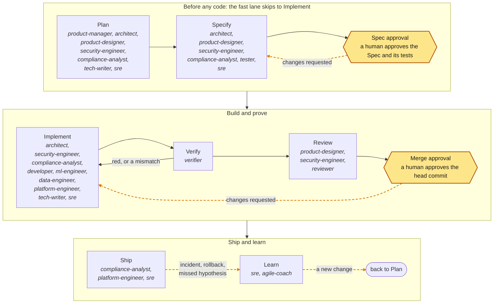

# aidd-team

The aidd skill is the rulebook; this skill only decides who does each step of its loop. Each role is a subagent that works only in its loop steps and writes only its own files; the aidd plugin's edit-time hook checks the files through the hook's `agent_type`, as a guide: it denies an edit or an obvious shell write outside the role's area, denies any write from a subagent that is not a role, and denies approving or merging; the gate's scope rule decides on the real diff.

<!-- aidd:gen roles:loop:diagram -->

<!-- aidd:end -->

Each role's loop steps, write area, and handoff: [references/roles.md](references/roles.md).

## Who does what

Each command runs the roles its flow names, in order; roles in one group run in parallel, and a flow stops where a human decides. The flows live in the roles registry (`schemas/roles.json` in the aidd project). As tables and diagrams: [references/flows.md](references/flows.md).

## Handoffs

Every handoff is a file plus the note the loop contract requires (also as an `aidd-handoff` block for `aidd next`): **Done**, **Next** (a role, Spec approval, or Merge approval), **Needs** (what only a human can give, or none), **Stopped at** (the stop rule that fired, or none). The next role reads the note, then the file. Who hands what to whom: [references/flows.md](references/flows.md).

Three rules keep it fast:

1. **One writer per file.** In Specify the architect holds the Spec and the specialists return their parts in fixed templates; in Implement each Task's assignee holds its scope, and Tasks with disjoint scope run in parallel in separate worktrees after the first Task lands green.
2. **Readers run in parallel.** In Review the reviewer, the security engineer, and the product designer read at the same time; in Ship the SRE, the platform engineer, and the compliance analyst do. The command that ran them merges their reports.
3. **Escalate through Needs; never guess.** A question only a human can answer goes on the note's Needs line, and the role stops. A fact the file already holds is never re-derived.

## Domain packs

Every domain has a pack, a skill named `aidd-team:<pack>` with the domain's standards, a checklist per loop step, and test commands for the Spec's tests. Load one for every domain the change touches. No pack, or a standard checked more than a year ago: the research-first rule applies. The list of packs and when each applies: [references/domain-packs.md](references/domain-packs.md).

## Practice skills

A practice skill (`aidd-team:<name>`) says how to do one kind of work well; the architect names at most two in each Task's `skills`. The list and which roles load each: [references/practice-skills.md](references/practice-skills.md).

## Extending a role

Any skill, plugin, MCP server, or tool the project already uses extends a role once it is verified, pinned, and installed through a change (the install paths are protected, so it is major); it never widens a role's write area or decides a gate. The starting points per role and the rules: [references/extensions.md](references/extensions.md).

## Rules

1. **On the spec lane, the tester and the implementer are different agents.** The one who writes the tests never makes them pass. On the fast and emergency lanes, where no tester runs and nothing is frozen, the developer writes the regression test with the fix, and `aidd test` shows it red on base. No reviewer reviews its own work.
2. **Files, not chat.** Roles hand off through files (the Epic, the Spec, the tests, the evidence, the review) and the handoff note, never through chat alone.
3. **The contract holds.** Every role keeps the loop contract in its agent file: its own steps and lanes only, no skipped approval, loop back instead of working around. Every stop in the aidd skill still stops the team and goes to the author.
4. **No approvals.** No role approves, merges, posts an `/aidd` command, or declares a route below what `aidd next` computes.
5. **Helpers inherit.** A role may delegate its own work to helper agents, terminals, or worktrees; helpers inherit its step, its area, and the loop contract, and never decide an approval. A read-only role works alone. In a subagent, `Agent(...)` types are advisory; the hook bounds writes.
6. **Few agents on the fast lane.** A minor change needs only the developer, verifier, and reviewer.
7. **Parallel by scope, serial by queue.** Run Tasks with disjoint scope in parallel after the first Task lands green, and specialists and readers in parallel, and never leave an Approver more open changes than they can decide today; the gate status and the handoff note are the status.
8. **Priced to value.** Each role's model `tier` follows the cost of its mistakes, with the reason in its agent file: `execution` (the session's model) where the tests, the gate, or a human catch them, and `reasoning` only for the architect, the security engineer, and the reviewer, whose judgment no test checks. Change a tier only when a role eval (`aidd eval roles`) or a retrospective shows the need.
9. **Proven over new.** The registry marks emerging standards and extensions; a role applies one of them, or any unlisted new tool, only when the change clearly needs it and says so in the Spec.
10. **Work with what the project has.** Git and the repository's files are enough for every step; a tracker, a forge, or any other service is used only when the project already has it connected.
11. **Explain visually.** A Spec's Design, a threat model, a plan, and a runbook each carry a Mermaid diagram in the file, so humans and agents read one shape and discuss on its lines; a diagram changed after Spec approval is a Spec change.
