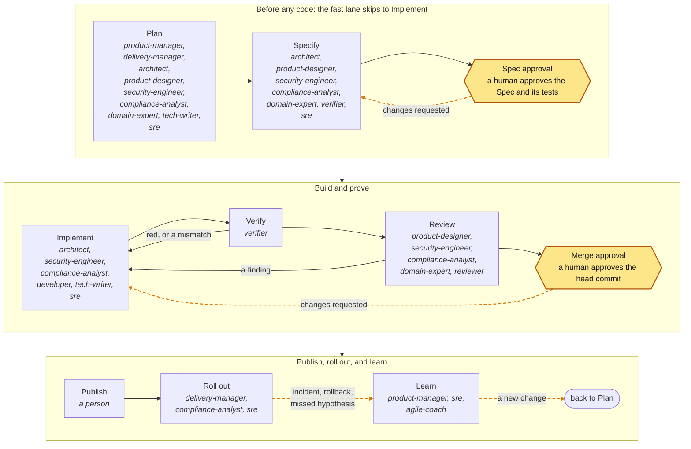

# aidd-team

The aidd skill is the rulebook; this skill only decides who does each step of its loop. Each role is a subagent that works only in its loop steps and writes only its own files. The guard hook, a guide, denies a write outside the role's area, any write from a subagent that is not a role, and an approval or a merge. The gate decides on the real diff.

<!-- aidd:gen roles:loop:diagram -->

<!-- aidd:end -->

Each role's steps, write area, handoff, and standards: [references/roles.md](references/roles.md).

## Who does what

A person starts each command; asked for a flow in words, name its command. Each command runs the roles its flow names, in order. Roles in one group run in parallel, and a flow stops where a human decides. The session that runs a command is the lead. It places each role: it plays only a role that adds a view to its own work, never one that checks it, and starts the rest. It names each role's model and starts fresh each command. The flows, as tables and diagrams: [references/flows.md](references/flows.md).

## Handoffs

Every handoff is a file plus the note the loop contract requires (also an `aidd-handoff` block for `aidd list` and the hooks). The note holds **Done**, **Next**, **Needs** (what only a human can give, or none), **Stopped at**, and **Spend**. The next role reads the note, then the file. A read-only role returns its note in its last message; the lead posts it. Who hands what to whom: [references/flows.md](references/flows.md).

Three rules keep it fast:

1. **One writer per file.** In Specify the architect holds the Spec. The specialists return their parts in fixed templates, or write their own doc with `aidd new <kind> <topic> --spec <ID> --no-link`, which the architect links in `docs`. In Implement each Task's assignee holds its scope, and Tasks with disjoint scope run in parallel in separate worktrees after the first Task lands green.
2. **Readers run in parallel.** In Review the reviewer, the security engineer, the product designer, and the domain expert read at once. In Roll out the SRE and the compliance analyst do. The command that ran them merges their reports.
3. **Escalate through Needs; never guess.** A question only a human can answer goes on the note's Needs line, and the role stops. No one re-derives a fact the file holds.

## Domain packs

Every domain has a pack, a skill `aidd-team:<pack>` with its standards, a checklist per loop step, and test commands for the Spec. Load one per domain the change touches. No pack, or a standard due for review (emerging every 90 days, established every year): the research-first rule applies. The list of packs and when each applies: [references/domain-packs.md](references/domain-packs.md).

## Practice skills

A practice skill (`aidd-team:<name>`) says how to do one kind of work well. The architect names at most two in each Task's `skills`. The list and which roles load each: [references/practice-skills.md](references/practice-skills.md).

## Extending a role

A skill, plugin, MCP server, or tool the project already uses extends a role once verified, pinned, and installed through a change. An extension never widens a write area or decides a gate. Per role: [references/extensions.md](references/extensions.md).

## Rules

1. **On the spec lane, the verifier and the implementer are different agents.** The one who writes the tests never makes them pass. On the fast and emergency lanes, nothing is frozen and the verifier only verifies. There the developer writes the regression test with the fix, and `aidd test` shows it red on base. No reviewer reviews its own work.
2. **Files, not chat.** Roles hand off through files and the handoff note, never through chat alone.
3. **The contract holds.** Each agent file carries the contract rules that bind its role (all of them: [references/roles.md](references/roles.md)). Every stop in the aidd skill still stops the team.
4. **No approvals.** No role approves, merges, posts an `/aidd` command, or declares a route below what the gate computes.
5. **Helpers inherit.** A role may delegate its own work to helper agents, terminals, or worktrees. Helpers inherit its step, its area, and the loop contract, and never decide an approval. A read-only role works alone. In a subagent, `Agent(...)` types are advisory; the hook bounds writes.
6. **Few agents on the fast lane.** A small minor fix runs one developer, and the reviewer past 20 changed lines (`/aidd-team:fix`); every other fast-lane change runs the developer, the verifier, and the reviewer.
7. **Parallel by scope, serial by queue.** Run Tasks with disjoint scope in parallel after the first Task lands green, and specialists and readers in parallel. Never leave an Approver more open changes than they can decide today. The gate status and the handoff note are the status.
8. **Priced to value.** A role's model `tier` follows the cost of its mistakes: `reasoning` (the strongest) is for roles whose judgment no test checks. `execution` is for the rest, the verifier included, where the tests, the gate, or a human catch their mistakes. `inherit`, or any model by name, is opt-in per tier or role in `agents.models`. Change a tier only on `aidd eval roles` or a retrospective.
9. **Proven over new.** A role applies an emerging standard, extension, or unlisted tool only when the change needs it, and says so in the Spec.
10. **Work with what the project has.** Git and the repository's files are enough. Use a tracker, a forge, or another service only when the project has it connected.
11. **Explain visually where a picture earns its place.** A Spec's Design, a threat model, a plan, or a runbook carries a Mermaid diagram when it shows what prose cannot.
