# Flows

Each command as a chain of role groups; a group with several roles runs in parallel, and each flow stops where a human decides. The table lists each flow; the diagram draws it.

**Contents**

<!-- aidd:gen toc -->
- [Handoffs](#handoffs)
<!-- aidd:end -->

<!-- aidd:gen roles:flows -->
| Command | Loop steps | Lanes | Runs, in order (a group runs in parallel) | Stops at |
| --- | --- | --- | --- | --- |
| `/aidd-team:plan` | Plan | spec | `product-manager` then `architect`, `product-designer`, `security-engineer`, `domain-expert` then `product-manager` | a human agrees to the plan |
| `/aidd-team:refine` | Plan | spec | `product-manager`, `delivery-manager` | a person accepts or rejects every proposed change in one table; the roles prepare only the accepted lines, and the person commits them |
| `/aidd-team:mvp` | Plan, Specify, Implement, Verify, Review, Roll out | fast, spec | `product-manager` then `architect`, `product-designer` then `sre` then `developer` then `verifier`, `reviewer` then `security-engineer`, `sre` | the launch: a person agrees to the plan, lands the Day-0 baseline, approves each slice's Spec and lands the slice, and decides the launch after the launch review. The baseline comes with its one-command local preview and the product defaults `project.defaults` leaves on |
| `/aidd-team:propose` | Plan | spec | `delivery-manager` then `product-manager` then `architect`, `product-designer`, `security-engineer`, `compliance-analyst`, `sre`, `delivery-manager` then `tech-writer` | sign-off: a person signs the proposal off before it is sent |
| `/aidd-team:onboard` | Plan | spec | `architect`, `product-designer`, `security-engineer`, `sre` | the author has the onboarding brief, ending with the exact `aidd init` command for a person to run |
| `/aidd-team:explore` | Plan, Specify | spec | `product-designer`, `architect` | a person picks one of two or three directions on the comparison page; the owning role records the pick and why |
| `/aidd-team:specify` | Specify | spec | `architect` then `product-designer`, `security-engineer`, `compliance-analyst`, `domain-expert`, `sre` then `architect` then `verifier` | Spec approval: an Approver approves the Spec, its tests, and its design |
| `/aidd-team:implement` | Implement | fast, spec, emergency | `developer`, `sre`, `tech-writer` then `architect`, `security-engineer`, `compliance-analyst`, `sre` | `aidd test --changed` is green on the head, which goes to Verify and Review |
| `/aidd-team:verify` | Verify | fast, spec, emergency | `verifier` | a clean report on this exact head lets its review count; a failure or a mismatch returns to Implement |
| `/aidd-team:review` | Verify, Review | fast, spec, emergency | `verifier`, `reviewer`, `security-engineer`, `product-designer`, `domain-expert`, `compliance-analyst` | Merge approval: an Approver approves the head, once its Verify is clean |
| `/aidd-team:sweep` | Implement, Verify | fast, spec, emergency | `developer`, `sre`, `tech-writer` then `verifier` | only Merge approval remains: every comment answered, the checks green, and an Approver to approve the new head |
| `/aidd-team:fix` | Implement, Verify, Review | fast | `developer` then `reviewer` | Merge approval: a person approves the fix's head (the reviewer reads a diff over 20 changed lines) |
| `/aidd-team:secure` | Specify, Review | spec, emergency | `security-engineer` | the human reviewer from the security pool |
| `/aidd-team:rollout` | Roll out | spec, emergency | `sre`, `compliance-analyst` | a clean observe window, or the rollback trigger |
| `/aidd-team:handover` | Implement, Roll out | spec | `delivery-manager` then `tech-writer`, `sre` then `delivery-manager` | the client's sign-off: a person records the acceptance and the handover, and the warranty starts |
| `/aidd-team:postmortem` | Learn | fast, spec, emergency | `sre` then `product-manager` | `review_due`: the backfill Spec and the postmortem are done |
| `/aidd-team:retro` | Learn | fast, spec, emergency | `agile-coach` | humans choose which improvements to adopt |
| `/aidd-team:maintain` | Learn | fast, spec, emergency | `sre` | each item routed to its command or to the person who decides, and nothing changed by this command |

```mermaid
flowchart TB
  subgraph plan["/aidd-team:plan"]
    direction LR
    plan_0["product-manager"]
    plan_1["architect<br/>product-designer<br/>security-engineer<br/>domain-expert<br/><i>in parallel</i>"]
    plan_2["product-manager"]
    plan_stop{{"a human agrees to the plan"}}
    plan_0 --> plan_1 --> plan_2 --> plan_stop
  end
  subgraph refine["/aidd-team:refine"]
    direction LR
    refine_0["product-manager<br/>delivery-manager<br/><i>in parallel</i>"]
    refine_stop{{"a person accepts or<br/>rejects every proposed<br/>change in one table; the<br/>roles prepare only the<br/>accepted lines, and the<br/>person commits them"}}
    refine_0 --> refine_stop
  end
  subgraph mvp["/aidd-team:mvp"]
    direction LR
    mvp_0["product-manager"]
    mvp_1["architect<br/>product-designer<br/><i>in parallel</i>"]
    mvp_2["sre"]
    mvp_3["developer"]
    mvp_4["verifier<br/>reviewer<br/><i>in parallel</i>"]
    mvp_5["security-engineer<br/>sre<br/><i>in parallel</i>"]
    mvp_stop{{"the launch: a person<br/>agrees to the plan, lands<br/>the Day-0 baseline,<br/>approves each slice's Spec<br/>and lands the slice, and<br/>decides the launch after<br/>the launch review. The<br/>baseline comes with its<br/>one-command local preview<br/>and the product defaults<br/>project.defaults leaves on"}}
    mvp_0 --> mvp_1 --> mvp_2 --> mvp_3 --> mvp_4 --> mvp_5 --> mvp_stop
  end
  subgraph propose["/aidd-team:propose"]
    direction LR
    propose_0["delivery-manager"]
    propose_1["product-manager"]
    propose_2["architect<br/>product-designer<br/>security-engineer<br/>compliance-analyst<br/>sre<br/>delivery-manager<br/><i>in parallel</i>"]
    propose_3["tech-writer"]
    propose_stop{{"sign-off: a person signs<br/>the proposal off before it<br/>is sent"}}
    propose_0 --> propose_1 --> propose_2 --> propose_3 --> propose_stop
  end
  subgraph onboard["/aidd-team:onboard"]
    direction LR
    onboard_0["architect<br/>product-designer<br/>security-engineer<br/>sre<br/><i>in parallel</i>"]
    onboard_stop{{"the author has the<br/>onboarding brief, ending<br/>with the exact aidd init<br/>command for a person to<br/>run"}}
    onboard_0 --> onboard_stop
  end
  subgraph explore["/aidd-team:explore"]
    direction LR
    explore_0["product-designer<br/>architect<br/><i>in parallel</i>"]
    explore_stop{{"a person picks one of two<br/>or three directions on the<br/>comparison page; the<br/>owning role records the<br/>pick and why"}}
    explore_0 --> explore_stop
  end
  subgraph specify["/aidd-team:specify"]
    direction LR
    specify_0["architect"]
    specify_1["product-designer<br/>security-engineer<br/>compliance-analyst<br/>domain-expert<br/>sre<br/><i>in parallel</i>"]
    specify_2["architect"]
    specify_3["verifier"]
    specify_stop{{"Spec approval: an Approver<br/>approves the Spec, its<br/>tests, and its design"}}
    specify_0 --> specify_1 --> specify_2 --> specify_3 --> specify_stop
  end
  subgraph implement["/aidd-team:implement"]
    direction LR
    implement_0["developer<br/>sre<br/>tech-writer<br/><i>in parallel</i>"]
    implement_1["architect<br/>security-engineer<br/>compliance-analyst<br/>sre<br/><i>in parallel</i>"]
    implement_stop{{"aidd test --changed is<br/>green on the head, which<br/>goes to Verify and Review"}}
    implement_0 --> implement_1 --> implement_stop
  end
  subgraph verify["/aidd-team:verify"]
    direction LR
    verify_0["verifier"]
    verify_stop{{"a clean report on this<br/>exact head lets its review<br/>count; a failure or a<br/>mismatch returns to<br/>Implement"}}
    verify_0 --> verify_stop
  end
  subgraph review["/aidd-team:review"]
    direction LR
    review_0["verifier<br/>reviewer<br/>security-engineer<br/>product-designer<br/>domain-expert<br/>compliance-analyst<br/><i>in parallel</i>"]
    review_stop{{"Merge approval: an<br/>Approver approves the<br/>head, once its Verify is<br/>clean"}}
    review_0 --> review_stop
  end
  subgraph sweep["/aidd-team:sweep"]
    direction LR
    sweep_0["developer<br/>sre<br/>tech-writer<br/><i>in parallel</i>"]
    sweep_1["verifier"]
    sweep_stop{{"only Merge approval<br/>remains: every comment<br/>answered, the checks<br/>green, and an Approver to<br/>approve the new head"}}
    sweep_0 --> sweep_1 --> sweep_stop
  end
  subgraph fix["/aidd-team:fix"]
    direction LR
    fix_0["developer"]
    fix_1["reviewer"]
    fix_stop{{"Merge approval: a person<br/>approves the fix's head<br/>(the reviewer reads a diff<br/>over 20 changed lines)"}}
    fix_0 --> fix_1 --> fix_stop
  end
  subgraph secure["/aidd-team:secure"]
    direction LR
    secure_0["security-engineer"]
    secure_stop{{"the human reviewer from<br/>the security pool"}}
    secure_0 --> secure_stop
  end
  subgraph rollout["/aidd-team:rollout"]
    direction LR
    rollout_0["sre<br/>compliance-analyst<br/><i>in parallel</i>"]
    rollout_stop{{"a clean observe window, or<br/>the rollback trigger"}}
    rollout_0 --> rollout_stop
  end
  subgraph handover["/aidd-team:handover"]
    direction LR
    handover_0["delivery-manager"]
    handover_1["tech-writer<br/>sre<br/><i>in parallel</i>"]
    handover_2["delivery-manager"]
    handover_stop{{"the client's sign-off: a<br/>person records the<br/>acceptance and the<br/>handover, and the warranty<br/>starts"}}
    handover_0 --> handover_1 --> handover_2 --> handover_stop
  end
  subgraph postmortem["/aidd-team:postmortem"]
    direction LR
    postmortem_0["sre"]
    postmortem_1["product-manager"]
    postmortem_stop{{"review_due: the backfill<br/>Spec and the postmortem<br/>are done"}}
    postmortem_0 --> postmortem_1 --> postmortem_stop
  end
  subgraph retro["/aidd-team:retro"]
    direction LR
    retro_0["agile-coach"]
    retro_stop{{"humans choose which<br/>improvements to adopt"}}
    retro_0 --> retro_stop
  end
  subgraph maintain["/aidd-team:maintain"]
    direction LR
    maintain_0["sre"]
    maintain_stop{{"each item routed to its<br/>command or to the person<br/>who decides, and nothing<br/>changed by this command"}}
    maintain_0 --> maintain_stop
  end
  plan ~~~ refine ~~~ mvp ~~~ propose ~~~ onboard ~~~ explore ~~~ specify ~~~ implement ~~~ verify ~~~ review ~~~ sweep ~~~ fix ~~~ secure ~~~ rollout ~~~ handover ~~~ postmortem ~~~ retro ~~~ maintain
  classDef human fill:#fde68a,stroke:#b45309,stroke-width:2px,color:#1c1917
  class plan_stop,refine_stop,mvp_stop,propose_stop,onboard_stop,explore_stop,specify_stop,implement_stop,verify_stop,review_stop,sweep_stop,fix_stop,secure_stop,rollout_stop,handover_stop,postmortem_stop,retro_stop,maintain_stop human
```

<!-- aidd:end -->

<!-- aidd:gen roles:flows:diagram -->

<!-- aidd:end -->

## Handoffs

What travels between roles: the table, then the same handoffs as a picture.

<!-- aidd:gen roles:handoffs -->
| From | To | Through | Artifact | The note adds |
| --- | --- | --- | --- | --- |
| `product-manager` | `architect` | the Epic and the Spec stub | the plan: the Initiative, the Epics, and the Spec stubs in the Specs folder | the outcome, the owner, and the ranked order |
| `product-manager` | `architect`, `product-designer`, `security-engineer`, `domain-expert` | the draft Initiative, Epics, and Spec stubs, for a perspective card each before a person sees the plan (the Plan consult round) | the plan: the Initiative, the Epics, and the Spec stubs in the Specs folder | which stubs each should weigh in on, and the question the plan cannot answer alone |
| `architect`, `product-designer`, `security-engineer`, `domain-expert` | `product-manager` | a perspective card in the final message, never a file edit | a perspective card: a role's final message to the lead in the Plan consult round (an assessment, the hard parts, changes to the stubs, a size per stub), which the product manager folds into the Initiative's `## Perspectives` section | what the plan should change, and why: a stub that is not feasible as cut, a missing need, a risk, a size |
| `domain-expert` | `architect`, `reviewer` | a perspective card in the final message on the Spec (Specify) or on the diff (Review), never a file edit | a perspective card: a role's final message to the lead in the Plan consult round (an assessment, the hard parts, changes to the stubs, a size per stub), which the product manager folds into the Initiative's `## Perspectives` section | the domain's rules the Spec or the diff must keep, the missed cases as Given/When/Then lines, and the words to fix |
| `architect` | `product-designer`, `security-engineer`, `compliance-analyst`, `domain-expert`, `sre` | the Spec's Context, Design, Tasks, and scope | the Spec: `specs/<ID>.md`: Intent, Context, Design, Tasks and their scope, risk, and rollback | what each specialist must add, and where |
| `product-designer`, `security-engineer`, `compliance-analyst`, `sre` | `architect` | each specialist's return in its fixed template (the Spec reference), which the architect folds into the Spec section the template names. Or its own linked doc (`aidd new design-spec`, `aidd new threat-model`), which the architect links from the Spec | the design files: the Spec's `design.files`, or the `design-spec` doc it links: the prototype, the flow diagram, and the accessibility notes; the security return: the Spec's delta, in the tech spec's `### Security and privacy` or the Spec's Design, and the component's living `threat-model` doc the Spec links (`aidd new threat-model <component>`): the threat table in the security engineer's return template, each row mapped to an Acceptance id; the compliance return: the tech spec's `### Compliance`, or a `compliance` doc the Spec links: each obligation's control and its evidence, in the compliance analyst's return template; the SRE return: the tech spec's `### Observability`, the Spec's `observe` and `rollback`, and the runbook it links: the SLO, the rollback trigger, and the observe signal, in the SRE's return template; the linked docs: the Spec's `docs`: the tech spec, the test plan, the prototype, ADRs, the threat model, and the runbook, each written from its template with `aidd new <kind> <topic> --spec <ID>`. A frozen one is approved with the Spec by hash; a living one (`frozen: false`) only has to exist | what the verifier must prove, and what Spec approval must freeze |
| `architect` | `verifier` | the folded Spec, its open questions recorded as assumptions, and the docs it links | the Spec: `specs/<ID>.md`: Intent, Context, Design, Tasks and their scope, risk, and rollback; the linked docs: the Spec's `docs`: the tech spec, the test plan, the prototype, ADRs, the threat model, and the runbook, each written from its template with `aidd new <kind> <topic> --spec <ID>`. A frozen one is approved with the Spec by hash; a living one (`frozen: false`) only has to exist | the quality targets and abuse cases to cover |
| `verifier` | the author, for Spec approval | `tests`, Acceptance, and `approve <ID>` to type | Acceptance and the tests: the Spec's `## Acceptance` and `tests`, and the words the person types to approve (`approve <ID>`); the test files: the Spec's `tests.files`, frozen by Spec approval | which new-behavior tests were seen failing on base |
| `developer`, `sre`, `tech-writer` | `verifier` | commits on the PR/MR and green `aidd test` output | the head: the commits on the PR/MR head, and the green `aidd test` output | the Task, its files, the head SHA, and what was left out and why |
| `verifier` | `reviewer`, `security-engineer`, `product-designer` | the verification report, starting with the harness, the model, and the head SHA it checked, which the author posts on the PR/MR | the verification report: a PR/MR comment the author posts, starting with the harness, the model, and the head SHA it checked | each failure or mismatch with an Acceptance line, which goes back to Implement with the review's findings, in one pass; a new push makes the report stale |
| `reviewer`, `security-engineer`, `product-designer` | the author, for Merge approval | one merged report, ranked Critical to Nit, each reader's part starting with the harness and the model it ran on | the review report: one PR/MR comment, ranked Critical to Nit, starting with the harness and the model of each reader | the findings the Approver must weigh |
| `sre`, `compliance-analyst` | the author | observe results in `outcome` and the evidence map | the rollout report: a PR/MR comment: the observe results, whether the rollback trigger fired, and the evidence map, for the Spec's `outcome` | whether the rollback trigger fired |
| `sre`, `agile-coach` | `product-manager`, the author | the postmortem or retrospective and its Spec stubs | the postmortem: `docs/postmortems/<ID>.md`, written inside a backfill Task's scope; the retrospective: `docs/retros/` and its improvement Spec stubs in the Specs folder | the improvements humans may adopt |
| `delivery-manager` | `product-manager` | the qualification in the proposal, before the go/no-go | the qualification: `qualification` in the proposal's front matter, with the RAID log (`assumptions`, `issues`, `dependencies`, `risks`) and the `milestones` beside it | what is known of fit, budget, authority, and decision process, and the questions left open |
| `product-manager` | `architect`, `product-designer`, `security-engineer`, `compliance-analyst`, `sre`, `delivery-manager` | the proposal's needs, after a person decides go | the proposal's needs: `needs.md` in the proposal's folder, after a person decides go | which needs each specialist answers, in its own file in the proposal's folder |
| `architect`, `product-designer`, `security-engineer`, `compliance-analyst`, `sre`, `delivery-manager` | `tech-writer` | each specialist's part in the proposal's folder | the proposal parts: each specialist's own file in the proposal's folder | one document for the addressee, ready for a person's sign-off |
| `delivery-manager` | `tech-writer`, `sre` | the Handover lists in the acceptance record and the runbook | the handover lists: the `## Handover` sections of the acceptance record and the runbook the Spec links. They hold the docs index, the credentials transfer log, the training log, the open issues, and the warranty start | which docs, trainings, access transfers, and open issues the client still needs |
| `tech-writer`, `sre` | `delivery-manager` | the docs index and the runbook's Handover section, in a docs change | the handed-over docs: the docs index, the runbook's Handover section, and the training material, in a docs change whose scope covers them | what is handed over, what is still open, and the warranty start |

```mermaid
flowchart TB
  subgraph h0[" "]
    direction LR
    h0_from["product-manager"]
    h0_to["architect"]
    h0_from -- "the Epic and the Spec stub" --> h0_to
  end
  subgraph h1[" "]
    direction LR
    h1_from["product-manager"]
    h1_to["architect<br/>product-designer<br/>security-engineer<br/>domain-expert"]
    h1_from -- "the draft Initiative,<br/>Epics, and Spec stubs, for<br/>a perspective card each<br/>before a person sees the<br/>plan (the Plan consult<br/>round)" --> h1_to
  end
  subgraph h2[" "]
    direction LR
    h2_from["architect<br/>product-designer<br/>security-engineer<br/>domain-expert"]
    h2_to["product-manager"]
    h2_from -- "a perspective card in the<br/>final message, never a<br/>file edit" --> h2_to
  end
  subgraph h3[" "]
    direction LR
    h3_from["domain-expert"]
    h3_to["architect<br/>reviewer"]
    h3_from -- "a perspective card in the<br/>final message on the Spec<br/>(Specify) or on the diff<br/>(Review), never a file<br/>edit" --> h3_to
  end
  subgraph h4[" "]
    direction LR
    h4_from["architect"]
    h4_to["product-designer<br/>security-engineer<br/>compliance-analyst<br/>domain-expert<br/>sre"]
    h4_from -- "the Spec's Context,<br/>Design, Tasks, and scope" --> h4_to
  end
  subgraph h5[" "]
    direction LR
    h5_from["product-designer<br/>security-engineer<br/>compliance-analyst<br/>sre"]
    h5_to["architect"]
    h5_from -- "each specialist's return<br/>in its fixed template (the<br/>Spec reference), which the<br/>architect folds into the<br/>Spec section the template<br/>names. Or its own linked<br/>doc (aidd new design-spec,<br/>aidd new threat-model),<br/>which the architect links<br/>from the Spec" --> h5_to
  end
  subgraph h6[" "]
    direction LR
    h6_from["architect"]
    h6_to["verifier"]
    h6_from -- "the folded Spec, its open<br/>questions recorded as<br/>assumptions, and the docs<br/>it links" --> h6_to
  end
  subgraph h7[" "]
    direction LR
    h7_from["verifier"]
    h7_to["the author, for Spec approval"]
    h7_from -- "tests, Acceptance, and<br/>approve <ID> to type" --> h7_to
  end
  subgraph h8[" "]
    direction LR
    h8_from["developer<br/>sre<br/>tech-writer"]
    h8_to["verifier"]
    h8_from -- "commits on the PR/MR and<br/>green aidd test output" --> h8_to
  end
  subgraph h9[" "]
    direction LR
    h9_from["verifier"]
    h9_to["reviewer<br/>security-engineer<br/>product-designer"]
    h9_from -- "the verification report,<br/>starting with the harness,<br/>the model, and the head<br/>SHA it checked, which the<br/>author posts on the PR/MR" --> h9_to
  end
  subgraph h10[" "]
    direction LR
    h10_from["reviewer<br/>security-engineer<br/>product-designer"]
    h10_to["the author, for Merge approval"]
    h10_from -- "one merged report, ranked<br/>Critical to Nit, each<br/>reader's part starting<br/>with the harness and the<br/>model it ran on" --> h10_to
  end
  subgraph h11[" "]
    direction LR
    h11_from["sre<br/>compliance-analyst"]
    h11_to["the author"]
    h11_from -- "observe results in outcome<br/>and the evidence map" --> h11_to
  end
  subgraph h12[" "]
    direction LR
    h12_from["sre<br/>agile-coach"]
    h12_to["product-manager<br/>the author"]
    h12_from -- "the postmortem or<br/>retrospective and its Spec<br/>stubs" --> h12_to
  end
  subgraph h13[" "]
    direction LR
    h13_from["delivery-manager"]
    h13_to["product-manager"]
    h13_from -- "the qualification in the<br/>proposal, before the<br/>go/no-go" --> h13_to
  end
  subgraph h14[" "]
    direction LR
    h14_from["product-manager"]
    h14_to["architect<br/>product-designer<br/>security-engineer<br/>compliance-analyst<br/>sre<br/>delivery-manager"]
    h14_from -- "the proposal's needs,<br/>after a person decides go" --> h14_to
  end
  subgraph h15[" "]
    direction LR
    h15_from["architect<br/>product-designer<br/>security-engineer<br/>compliance-analyst<br/>sre<br/>delivery-manager"]
    h15_to["tech-writer"]
    h15_from -- "each specialist's part in<br/>the proposal's folder" --> h15_to
  end
  subgraph h16[" "]
    direction LR
    h16_from["delivery-manager"]
    h16_to["tech-writer<br/>sre"]
    h16_from -- "the Handover lists in the<br/>acceptance record and the<br/>runbook" --> h16_to
  end
  subgraph h17[" "]
    direction LR
    h17_from["tech-writer<br/>sre"]
    h17_to["delivery-manager"]
    h17_from -- "the docs index and the<br/>runbook's Handover<br/>section, in a docs change" --> h17_to
  end
  subgraph h18[" "]
    direction LR
    h18_from["delivery-manager<br/>product-designer<br/>sre<br/>tech-writer"]
    h18_to["product-manager"]
    h18_from -- "a feedback entry drafted<br/>with its source in the<br/>handoff note" --> h18_to
  end
  h0 ~~~ h1 ~~~ h2 ~~~ h3 ~~~ h4 ~~~ h5 ~~~ h6 ~~~ h7 ~~~ h8 ~~~ h9 ~~~ h10 ~~~ h11 ~~~ h12 ~~~ h13 ~~~ h14 ~~~ h15 ~~~ h16 ~~~ h17 ~~~ h18
  classDef human fill:#fde68a,stroke:#b45309,stroke-width:2px,color:#1c1917
  class h7_to,h10_to,h11_to,h12_to human
```

| `delivery-manager`, `product-designer`, `sre`, `tech-writer` | `product-manager` | a feedback entry drafted with its source in the handoff note | the feedback log: `docs/feedback/` (`aidd new feedback <topic>`): what customers said after launch, by theme and severity. An agent drafts an entry with its source, and a person confirms it. The product manager is the only agent that writes the log; `aidd digest` counts the themes | what a customer said or did, where, and when; the product manager writes it to the log and a person confirms it |
<!-- aidd:end -->

<!-- aidd:gen roles:handoffs:diagram -->

<!-- aidd:end -->
