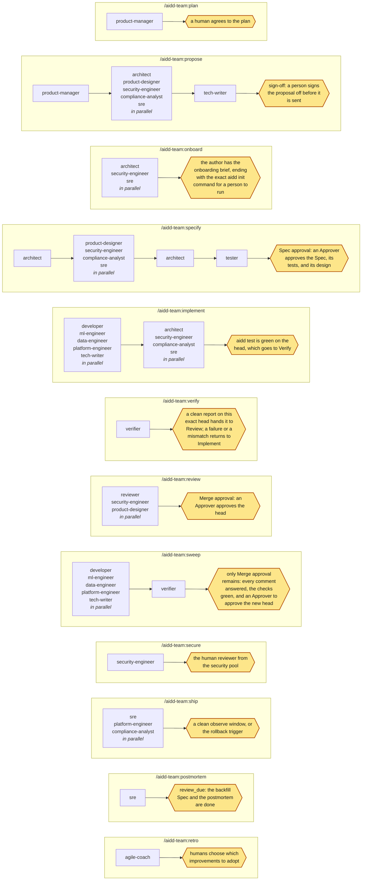

# Flows

Each command as a chain of role groups; a group with several roles runs in parallel, and each flow stops where a human decides. The table lists each flow; the diagram draws it.

<!-- aidd:gen roles:flows -->
| Command | Loop steps | Lanes | Runs, in order (a group runs in parallel) | Stops at |
| --- | --- | --- | --- | --- |
| `/aidd-team:plan` | Plan | spec | `product-manager` | a human agrees to the plan |
| `/aidd-team:propose` | Plan | spec | `product-manager` then `architect`, `product-designer`, `security-engineer`, `compliance-analyst`, `sre` then `tech-writer` | sign-off: a person signs the proposal off before it is sent |
| `/aidd-team:onboard` | Plan | spec | `architect`, `security-engineer`, `sre` | the author has the onboarding brief, ending with the exact `aidd init` command for a person to run |
| `/aidd-team:specify` | Specify | spec | `architect` then `product-designer`, `security-engineer`, `compliance-analyst`, `sre` then `architect` then `tester` | Spec approval: an Approver approves the Spec, its tests, and its design |
| `/aidd-team:implement` | Implement | fast, spec, emergency | `developer`, `ml-engineer`, `data-engineer`, `platform-engineer`, `tech-writer` then `architect`, `security-engineer`, `compliance-analyst`, `sre` | `aidd test` is green on the head, which goes to Verify |
| `/aidd-team:verify` | Verify | fast, spec, emergency | `verifier` | a clean report on this exact head hands it to Review; a failure or a mismatch returns to Implement |
| `/aidd-team:review` | Review | fast, spec, emergency | `reviewer`, `security-engineer`, `product-designer` | Merge approval: an Approver approves the head |
| `/aidd-team:sweep` | Implement, Verify | fast, spec, emergency | `developer`, `ml-engineer`, `data-engineer`, `platform-engineer`, `tech-writer` then `verifier` | only Merge approval remains: every comment answered, the checks green, and an Approver to approve the new head |
| `/aidd-team:secure` | Specify, Review | spec, emergency | `security-engineer` | the human reviewer from the security pool |
| `/aidd-team:ship` | Ship | spec, emergency | `sre`, `platform-engineer`, `compliance-analyst` | a clean observe window, or the rollback trigger |
| `/aidd-team:postmortem` | Learn | fast, spec, emergency | `sre` | `review_due`: the backfill Spec and the postmortem are done |
| `/aidd-team:retro` | Learn | fast, spec, emergency | `agile-coach` | humans choose which improvements to adopt |
<!-- aidd:end -->

<!-- aidd:gen roles:flows:diagram -->

<!-- aidd:end -->

## Handoffs

What travels between roles: the table, then the same handoffs as a picture.

<!-- aidd:gen roles:handoffs -->
| From | To | Through | Artifact | The note adds |
| --- | --- | --- | --- | --- |
| `product-manager` | `architect` | the Epic and the Spec stub | the plan: the Initiative, the Epics, and the Spec stubs in the Specs folder | the outcome, the owner, and the ranked order |
| `architect` | `product-designer`, `security-engineer`, `compliance-analyst`, `sre` | the Spec's Context, Design, Tasks, and scope | the Spec: `specs/<ID>.md`: Intent, Context, Design, Tasks and their scope, risk, and rollback | what each specialist must add, and where |
| `product-designer`, `security-engineer`, `compliance-analyst`, `sre` | `architect` | each specialist's return in its fixed template (the Spec reference), which the architect folds into the Spec section the template names | the design files: the Spec's `design.files`: the prototype, the flow diagram, and the accessibility notes; the security return: the Spec's `### Security and privacy`: the threat table in the security engineer's return template, each row mapped to an Acceptance id; the compliance return: the Spec's `### Compliance`: each obligation's control and its evidence, in the compliance analyst's return template; the SRE return: the Spec's `### Observability`, `[observe]`, and `rollback`: the SLO, the rollback trigger, and the observe signal, in the SRE's return template | what the tester must prove, and what Spec approval must freeze |
| `architect` | `tester` | the folded Spec, its open questions recorded as assumptions | the Spec: `specs/<ID>.md`: Intent, Context, Design, Tasks and their scope, risk, and rollback | the quality targets and abuse cases to cover |
| `tester` | the author, for Spec approval | `[tests]`, Acceptance, and the `aidd hash` approval line | Acceptance and the tests: the Spec's `## Acceptance` and `[tests]`, with the `aidd hash` approval line; the test files: the Spec's `tests.files`, frozen by Spec approval | which new-behavior tests were seen failing on base |
| `developer`, `ml-engineer`, `data-engineer`, `platform-engineer`, `tech-writer` | `verifier` | commits on the PR/MR and green `aidd test` output | the head: the commits on the PR/MR head, and the green `aidd test` output | the Task, its files, the head SHA, and what was left out and why |
| `verifier` | `reviewer`, `security-engineer`, `product-designer` | the verification report, starting with the harness, the model, and the head SHA it checked, which the author posts on the PR/MR | the verification report: a PR/MR comment the author posts, starting with the harness, the model, and the head SHA it checked | each failure or mismatch with an Acceptance line, which goes back to Implement before Review; a new push makes the report stale |
| `reviewer`, `security-engineer`, `product-designer` | the author, for Merge approval | one merged report, ranked Critical to Nit, each reader's part starting with the harness and the model it ran on | the review report: one PR/MR comment, ranked Critical to Nit, starting with the harness and the model of each reader | the findings the Approver must weigh |
| `sre`, `platform-engineer`, `compliance-analyst` | the author | observe results in `outcome` and the evidence map | the ship report: a PR/MR comment: the observe results, whether the rollback trigger fired, and the evidence map, for the Spec's `[outcome]` | whether the rollback trigger fired |
| `sre`, `agile-coach` | `product-manager`, the author | the postmortem or retrospective and its Spec stubs | the postmortem: `docs/postmortems/<ID>.md`, written inside a backfill Task's scope; the retrospective: `docs/retros/` and its improvement Spec stubs in the Specs folder | the improvements humans may adopt |
| `product-manager` | `architect`, `product-designer`, `security-engineer`, `compliance-analyst`, `sre` | the proposal's needs, after a person decides go | the proposal's needs: `needs.md` in the proposal's folder, after a person decides go | which needs each specialist answers, in its own file in the proposal's folder |
| `architect`, `product-designer`, `security-engineer`, `compliance-analyst`, `sre` | `tech-writer` | each specialist's part in the proposal's folder | the proposal parts: each specialist's own file in the proposal's folder | one document for the addressee, ready for a person's sign-off |

```mermaid
flowchart TB
  subgraph h0[" "]
    direction LR
    h0_from["product-manager"]
    h0_to["architect"]
    h0_from -- "the Epic and the Spec stub" --> h0_to
  end
  subgraph h1[" "]
    direction LR
    h1_from["architect"]
    h1_to["product-designer<br/>security-engineer<br/>compliance-analyst<br/>sre"]
    h1_from -- "the Spec's Context,<br/>Design, Tasks, and scope" --> h1_to
  end
  subgraph h2[" "]
    direction LR
    h2_from["product-designer<br/>security-engineer<br/>compliance-analyst<br/>sre"]
    h2_to["architect"]
    h2_from -- "each specialist's return<br/>in its fixed template (the<br/>Spec reference), which the<br/>architect folds into the<br/>Spec section the template<br/>names" --> h2_to
  end
  subgraph h3[" "]
    direction LR
    h3_from["architect"]
    h3_to["tester"]
    h3_from -- "the folded Spec, its open<br/>questions recorded as<br/>assumptions" --> h3_to
  end
  subgraph h4[" "]
    direction LR
    h4_from["tester"]
    h4_to["the author, for Spec approval"]
    h4_from -- "[tests], Acceptance, and<br/>the aidd hash approval<br/>line" --> h4_to
  end
  subgraph h5[" "]
    direction LR
    h5_from["developer<br/>ml-engineer<br/>data-engineer<br/>platform-engineer<br/>tech-writer"]
    h5_to["verifier"]
    h5_from -- "commits on the PR/MR and<br/>green aidd test output" --> h5_to
  end
  subgraph h6[" "]
    direction LR
    h6_from["verifier"]
    h6_to["reviewer<br/>security-engineer<br/>product-designer"]
    h6_from -- "the verification report,<br/>starting with the harness,<br/>the model, and the head<br/>SHA it checked, which the<br/>author posts on the PR/MR" --> h6_to
  end
  subgraph h7[" "]
    direction LR
    h7_from["reviewer<br/>security-engineer<br/>product-designer"]
    h7_to["the author, for Merge approval"]
    h7_from -- "one merged report, ranked<br/>Critical to Nit, each<br/>reader's part starting<br/>with the harness and the<br/>model it ran on" --> h7_to
  end
  subgraph h8[" "]
    direction LR
    h8_from["sre<br/>platform-engineer<br/>compliance-analyst"]
    h8_to["the author"]
    h8_from -- "observe results in outcome<br/>and the evidence map" --> h8_to
  end
  subgraph h9[" "]
    direction LR
    h9_from["sre<br/>agile-coach"]
    h9_to["product-manager<br/>the author"]
    h9_from -- "the postmortem or<br/>retrospective and its Spec<br/>stubs" --> h9_to
  end
  subgraph h10[" "]
    direction LR
    h10_from["product-manager"]
    h10_to["architect<br/>product-designer<br/>security-engineer<br/>compliance-analyst<br/>sre"]
    h10_from -- "the proposal's needs,<br/>after a person decides go" --> h10_to
  end
  subgraph h11[" "]
    direction LR
    h11_from["architect<br/>product-designer<br/>security-engineer<br/>compliance-analyst<br/>sre"]
    h11_to["tech-writer"]
    h11_from -- "each specialist's part in<br/>the proposal's folder" --> h11_to
  end
  h0 ~~~ h1 ~~~ h2 ~~~ h3 ~~~ h4 ~~~ h5 ~~~ h6 ~~~ h7 ~~~ h8 ~~~ h9 ~~~ h10 ~~~ h11
  classDef human fill:#fde68a,stroke:#b45309,stroke-width:2px,color:#1c1917
  class h4_to,h7_to,h8_to,h9_to human
```

<!-- aidd:end -->

<!-- aidd:gen roles:handoffs:diagram -->

<!-- aidd:end -->
