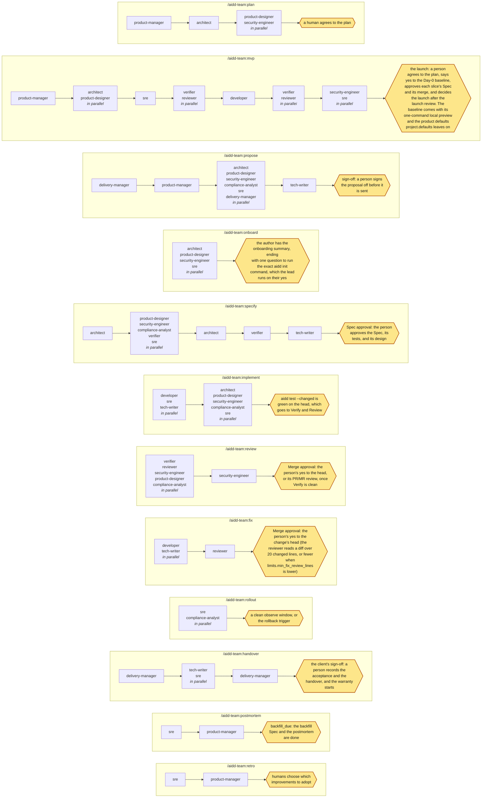

# Flows

Each command as a chain of role groups; a group with several roles runs in parallel, and each flow stops where a human decides. The table lists each flow; the diagram draws it.

**Contents**

<!-- aidd:gen toc -->
- [Handoffs](#handoffs)
- [Parallel Tasks in worktrees](#parallel-tasks-in-worktrees)
- [A role's life](#a-roles-life)
- [Independent review across providers](#independent-review-across-providers)
- [A second reviewer in another harness](#a-second-reviewer-in-another-harness)
<!-- aidd:end -->

<!-- aidd:gen roles:flows -->
| Command | Loop steps | Lanes | Runs, in order (a group runs in parallel) | Stops at |
| --- | --- | --- | --- | --- |
| `/aidd-team:plan` | Plan | spec | `product-manager` then `architect` then `product-designer`, `security-engineer` | a human agrees to the plan |
| `/aidd-team:plan refine` | Plan | spec | `product-manager`, `delivery-manager` | a person accepts or rejects every proposed change in one table, and commits the accepted lines |
| `/aidd-team:mvp` | Plan, Specify, Implement, Verify, Review, Roll out | fast, spec | `product-manager` then `architect`, `product-designer` then `sre` then `verifier`, `reviewer` then `developer` then `verifier`, `reviewer` then `security-engineer`, `sre` | the launch: a person agrees to the plan, says yes to the Day-0 baseline, approves each slice's Spec and its merge, and decides the launch after the launch review. The baseline comes with its one-command local preview and the product defaults `project.defaults` leaves on |
| `/aidd-team:propose` | Plan | spec | `delivery-manager` then `product-manager` then `architect`, `product-designer`, `security-engineer`, `compliance-analyst`, `sre`, `delivery-manager` then `tech-writer` | sign-off: a person signs the proposal off before it is sent |
| `/aidd-team:onboard` | Plan | spec | `architect`, `product-designer`, `security-engineer`, `sre` | the author has the onboarding summary, ending with one question to run the exact `aidd init` command, which the lead runs on their yes |
| `/aidd-team:specify` | Plan, Specify | spec | `architect` then `product-designer`, `security-engineer`, `compliance-analyst`, `verifier`, `sre` then `architect` then `verifier` then `tech-writer` | Spec approval: the person approves the Spec, its tests, and its design |
| `/aidd-team:specify explore` | Plan, Specify | spec | `product-designer`, `architect` | a person picks one of two or three directions on the comparison page; the owning role records the pick and why |
| `/aidd-team:implement` | Implement | fast, spec, emergency | `developer`, `sre`, `tech-writer` then `architect`, `product-designer`, `security-engineer`, `compliance-analyst`, `sre` | `aidd test --changed` is green on the head, which goes to Verify and Review |
| `/aidd-team:implement rework` | Implement | fast, spec, emergency | `developer`, `product-designer`, `sre`, `tech-writer` | the new head is green and goes to `/aidd-team:review`, which runs Verify on it and re-reviews each finding |
| `/aidd-team:review` | Verify, Review | fast, spec, emergency | `verifier`, `reviewer`, `security-engineer`, `product-designer`, `compliance-analyst` then `security-engineer` | Merge approval: the person's yes to the head, or its PR/MR review, once Verify is clean |
| `/aidd-team:fix` | Implement, Verify, Review | fast | `developer`, `tech-writer` then `reviewer` | Merge approval: the person's yes to the change's head (the reviewer reads a diff over 20 changed lines, or fewer when `limits.min_fix_review_lines` is lower) |
| `/aidd-team:rollout` | Roll out | spec, emergency | `sre`, `compliance-analyst` | a clean observe window, or the rollback trigger |
| `/aidd-team:handover` | Implement, Roll out | spec | `delivery-manager` then `tech-writer`, `sre` then `delivery-manager` | the client's sign-off: a person records the acceptance and the handover, and the warranty starts |
| `/aidd-team:postmortem` | Learn | fast, spec, emergency | `sre` then `product-manager` | `backfill_due`: the backfill Spec and the postmortem are done |
| `/aidd-team:retro` | Learn | fast, spec, emergency | `sre` then `product-manager` | humans choose which improvements to adopt |
| `/aidd-team:retro upkeep` | Learn | fast, spec, emergency | `sre` | each item routed to its command or to the person who decides, and nothing changed by this command |
<!-- aidd:end -->

<!-- aidd:gen roles:flows:diagram -->

<!-- aidd:end -->

## Handoffs

What travels between roles: the table, then the same handoffs as a picture.

A role that stops at its turn limit returns no note. The lead resumes it with its context, where the harness can, as Claude Code's `SendMessage` does, to finish its step and write the note. Otherwise the lead starts the role again, from its commits and the working tree. A role commits each green step, so a restart never redoes one.

<!-- aidd:gen roles:handoffs -->
| From | To | Through | Artifact | The note adds |
| --- | --- | --- | --- | --- |
| `product-manager` | `architect` | the agreed Intent, and the slice whose work starts | the plan: the Intent, `specs/INTENT-<n>.md`: its phases of slices, written from the request beside it | the outcome, the owner, and the ranked order |
| `product-manager` | `architect` | the draft Intent and its slices, for the architect's perspective card before a person sees the plan (the Plan consult round) | the plan: the Intent, `specs/INTENT-<n>.md`: its phases of slices, written from the request beside it | which slices to weigh in on, and the question the plan cannot answer alone |
| `architect` | `product-designer`, `security-engineer` | the architect's card, whose flags start each role it names on the draft Intent | the plan: the Intent, `specs/INTENT-<n>.md`: its phases of slices, written from the request beside it | the concern each flag names, and the slices it touches |
| `architect`, `product-designer`, `security-engineer` | the author (the lead), who folds them into the Intent | a perspective card in the final message, never a file edit | a perspective card: a role's final message to the lead in the Plan consult round (an assessment, the hard parts, changes to the slices, a size per slice), which the lead folds into the Intent's `## Perspectives` section | what the plan should change, and why: a slice that is not feasible as cut, a missing need, a risk, a size |
| `architect` | `product-designer`, `security-engineer`, `compliance-analyst`, `sre` | the Spec's Context, Design, Tasks, and scope | the Spec: `specs/<ID>.md`: Intent, Context, Design, Tasks and their scope, risk, and rollback | what each specialist must add, and where |
| `product-designer`, `security-engineer`, `compliance-analyst`, `sre` | `architect` | each specialist's return in its fixed template (`references/spec-returns.md`), which the architect folds into the Spec section the template names. Or its own linked doc (`aidd new design-spec`, `aidd new threat-model`), which the architect links from the Spec | the design files: the Spec's `design.files`, or the `design-spec` doc it links: the prototype, the flow diagram, and the accessibility notes; the security return: the Spec's delta, in the tech spec's `### Security and privacy` or the Spec's Design, and the component's living `threat-model` doc the Spec links (`aidd new threat-model <component> --spec <ID> --no-link`): the threat table in the security engineer's return template, each row mapped to an Acceptance id; the compliance return: the tech spec's `### Compliance`, or a `compliance-record` doc the Spec links: each obligation's control and its evidence, in the compliance analyst's return template; the SRE return: the tech spec's `### Observability`, the Spec's `observe`, `rollback`, and `## Rollout`: the SLO, the rings, the rollback trigger, and the observe signal, in the SRE's return template; the linked docs: the Spec's `docs`: the tech spec, the test plan, the prototype, ADRs, the threat model, and the runbook, each written from its template with `aidd new <type> <topic> --spec <ID>`. A frozen one is approved with the Spec; a living one (`frozen: false`) only has to exist | what the verifier must prove, and what Spec approval must freeze |
| `architect` | `verifier` | the folded Spec, its open questions recorded as assumptions, and the docs it links | the Spec: `specs/<ID>.md`: Intent, Context, Design, Tasks and their scope, risk, and rollback; the linked docs: the Spec's `docs`: the tech spec, the test plan, the prototype, ADRs, the threat model, and the runbook, each written from its template with `aidd new <type> <topic> --spec <ID>`. A frozen one is approved with the Spec; a living one (`frozen: false`) only has to exist | the quality targets and abuse cases to cover |
| `verifier` | the author, for Spec approval | `tests` and Acceptance, which the lead asks the person to approve | Acceptance and the tests: the Spec's `## Acceptance` and `tests`, which the person reads before Spec approval; the test files: the Spec's `tests.files`, frozen by Spec approval: a later edit is `spec.revise` | which new-behavior tests were seen failing on base |
| `developer`, `sre`, `tech-writer` | `verifier` | commits on the PR/MR and green `aidd test` output | the head: the commits on the PR/MR head, and the green `aidd test` output | the Task, its files, the head SHA, and what was left out and why |
| `verifier` | `reviewer`, `security-engineer`, `product-designer` | the verification report, starting with the harness, the model, and the head SHA it checked, which the author posts on the PR/MR | the verification report: a PR/MR comment the author posts, starting with the harness, the model, and the head SHA it checked | each failure or mismatch with an Acceptance line, which goes back to Implement with the review's findings, in one pass; a new push makes the report stale |
| `reviewer`, `security-engineer`, `product-designer` | the author, for Merge approval | one merged report, ranked Critical to Nit, each reader's part starting with the harness and the model it ran on | the review report: one PR/MR comment, ranked Critical to Nit, starting with the harness and the model of each reader | the findings the person must weigh |
| `sre`, `compliance-analyst` | the author | observe results in `outcome` and the evidence map | the rollout report: a PR/MR comment: the observe results, whether the rollback trigger fired, and the evidence map, for the Spec's `outcome` | whether the rollback trigger fired |
| `sre` | `product-manager`, the author | the postmortem, or the retrospective and its improvements, which the product manager drafts as suggested Specs | the postmortem: `docs/postmortems/<ID>.md`, written inside a backfill Task's scope; the retrospective: `docs/retros/`, its RFC drafts in `docs/rfcs/`, and its improvements in `.aidd/returns/retro-<date>/sre.md`, which the product manager drafts as suggested Specs | the improvements humans may adopt |
| `delivery-manager` | `product-manager` | the qualification in the proposal, before the go/no-go | the qualification: `qualification` in the proposal's front matter, with the RAID log (`assumptions`, `issues`, `dependencies`, `risks`) and the `phases` beside it | what is known of fit, budget, authority, and decision process, and the questions left open |
| `product-manager` | `architect`, `product-designer`, `security-engineer`, `compliance-analyst`, `sre`, `delivery-manager` | the proposal's needs, after a person decides go | the proposal's needs: `needs.md` in the proposal's folder, after a person decides go | which needs each specialist answers, in its own file in the proposal's folder |
| `architect`, `product-designer`, `security-engineer`, `compliance-analyst`, `sre`, `delivery-manager` | `tech-writer` | each specialist's part in the proposal's folder | the proposal parts: each specialist's own file in the proposal's folder | one document for the addressee, ready for a person's sign-off |
| `delivery-manager` | `tech-writer`, `sre` | the Handover list in the acceptance record | the handover list: the `## Handover` section of the acceptance record. It holds the docs index, the credentials transfer log, the training log, the open issues, and the warranty start | which docs, trainings, access transfers, and open issues the client still needs |
| `tech-writer`, `sre` | `delivery-manager` | the docs index and the runbooks, in a docs change | the handed-over docs: the docs index, the runbooks, and the training material, in a docs change whose scope covers them | what is handed over, what is still open, and the warranty start |
| `delivery-manager`, `product-designer`, `sre`, `tech-writer` | `product-manager` | a feedback entry drafted with its source in the handoff note | the feedback log: `docs/feedback/` (`aidd new feedback <topic>`): what customers said after launch, by theme and severity. An agent drafts an entry with its source, and a person confirms it. The product manager is the only agent that writes the log | what a customer said or did, where, and when; the product manager writes it to the log and a person confirms it |
| `delegate` | the author (the lead) | one `delegate_answer` record, accept or defer, on the exact head the check covered | the head: the commits on the PR/MR head, and the green `aidd test` output | the reason in one line; on accept the lead runs the covered command, on defer it asks the person |

```mermaid
flowchart TB
  subgraph h0[" "]
    direction LR
    h0_from["product-manager"]
    h0_to["architect"]
    h0_from -- "the agreed Intent, and the<br/>slice whose work starts" --> h0_to
  end
  subgraph h1[" "]
    direction LR
    h1_from["product-manager"]
    h1_to["architect"]
    h1_from -- "the draft Intent and its<br/>slices, for the<br/>architect's perspective<br/>card before a person sees<br/>the plan (the Plan consult<br/>round)" --> h1_to
  end
  subgraph h2[" "]
    direction LR
    h2_from["architect"]
    h2_to["product-designer<br/>security-engineer"]
    h2_from -- "the architect's card,<br/>whose flags start each<br/>role it names on the draft<br/>Intent" --> h2_to
  end
  subgraph h3[" "]
    direction LR
    h3_from["architect<br/>product-designer<br/>security-engineer"]
    h3_to["the author (the lead), who folds them into the Intent"]
    h3_from -- "a perspective card in the<br/>final message, never a<br/>file edit" --> h3_to
  end
  subgraph h4[" "]
    direction LR
    h4_from["architect"]
    h4_to["product-designer<br/>security-engineer<br/>compliance-analyst<br/>sre"]
    h4_from -- "the Spec's Context,<br/>Design, Tasks, and scope" --> h4_to
  end
  subgraph h5[" "]
    direction LR
    h5_from["product-designer<br/>security-engineer<br/>compliance-analyst<br/>sre"]
    h5_to["architect"]
    h5_from -- "each specialist's return<br/>in its fixed template<br/>(references/spec-returns.md),<br/>which the architect folds<br/>into the Spec section the<br/>template names. Or its own<br/>linked doc (aidd new<br/>design-spec, aidd new<br/>threat-model), which the<br/>architect links from the<br/>Spec" --> h5_to
  end
  subgraph h6[" "]
    direction LR
    h6_from["architect"]
    h6_to["verifier"]
    h6_from -- "the folded Spec, its open<br/>questions recorded as<br/>assumptions, and the docs<br/>it links" --> h6_to
  end
  subgraph h7[" "]
    direction LR
    h7_from["verifier"]
    h7_to["the author, for Spec approval"]
    h7_from -- "tests and Acceptance,<br/>which the lead asks the<br/>person to approve" --> h7_to
  end
  subgraph h8[" "]
    direction LR
    h8_from["developer<br/>sre<br/>tech-writer"]
    h8_to["verifier"]
    h8_from -- "commits on the PR/MR and<br/>green aidd test output" --> h8_to
  end
  subgraph h9[" "]
    direction LR
    h9_from["verifier"]
    h9_to["reviewer<br/>security-engineer<br/>product-designer"]
    h9_from -- "the verification report,<br/>starting with the harness,<br/>the model, and the head<br/>SHA it checked, which the<br/>author posts on the PR/MR" --> h9_to
  end
  subgraph h10[" "]
    direction LR
    h10_from["reviewer<br/>security-engineer<br/>product-designer"]
    h10_to["the author, for Merge approval"]
    h10_from -- "one merged report, ranked<br/>Critical to Nit, each<br/>reader's part starting<br/>with the harness and the<br/>model it ran on" --> h10_to
  end
  subgraph h11[" "]
    direction LR
    h11_from["sre<br/>compliance-analyst"]
    h11_to["the author"]
    h11_from -- "observe results in outcome<br/>and the evidence map" --> h11_to
  end
  subgraph h12[" "]
    direction LR
    h12_from["sre"]
    h12_to["product-manager<br/>the author"]
    h12_from -- "the postmortem, or the<br/>retrospective and its<br/>improvements, which the<br/>product manager drafts as<br/>suggested Specs" --> h12_to
  end
  subgraph h13[" "]
    direction LR
    h13_from["delivery-manager"]
    h13_to["product-manager"]
    h13_from -- "the qualification in the<br/>proposal, before the<br/>go/no-go" --> h13_to
  end
  subgraph h14[" "]
    direction LR
    h14_from["product-manager"]
    h14_to["architect<br/>product-designer<br/>security-engineer<br/>compliance-analyst<br/>sre<br/>delivery-manager"]
    h14_from -- "the proposal's needs,<br/>after a person decides go" --> h14_to
  end
  subgraph h15[" "]
    direction LR
    h15_from["architect<br/>product-designer<br/>security-engineer<br/>compliance-analyst<br/>sre<br/>delivery-manager"]
    h15_to["tech-writer"]
    h15_from -- "each specialist's part in<br/>the proposal's folder" --> h15_to
  end
  subgraph h16[" "]
    direction LR
    h16_from["delivery-manager"]
    h16_to["tech-writer<br/>sre"]
    h16_from -- "the Handover list in the<br/>acceptance record" --> h16_to
  end
  subgraph h17[" "]
    direction LR
    h17_from["tech-writer<br/>sre"]
    h17_to["delivery-manager"]
    h17_from -- "the docs index and the<br/>runbooks, in a docs change" --> h17_to
  end
  subgraph h18[" "]
    direction LR
    h18_from["delivery-manager<br/>product-designer<br/>sre<br/>tech-writer"]
    h18_to["product-manager"]
    h18_from -- "a feedback entry drafted<br/>with its source in the<br/>handoff note" --> h18_to
  end
  subgraph h19[" "]
    direction LR
    h19_from["delegate"]
    h19_to["the author (the lead)"]
    h19_from -- "one delegate_answer<br/>record, accept or defer,<br/>on the exact head the<br/>check covered" --> h19_to
  end
  h0 ~~~ h1 ~~~ h2 ~~~ h3 ~~~ h4 ~~~ h5 ~~~ h6 ~~~ h7 ~~~ h8 ~~~ h9 ~~~ h10 ~~~ h11 ~~~ h12 ~~~ h13 ~~~ h14 ~~~ h15 ~~~ h16 ~~~ h17 ~~~ h18 ~~~ h19
  classDef human fill:#fde68a,stroke:#b45309,stroke-width:2px,color:#1c1917
  class h3_to,h7_to,h10_to,h11_to,h12_to,h19_to human
```

<!-- aidd:end -->

<!-- aidd:gen roles:handoffs:diagram -->

<!-- aidd:end -->

## Parallel Tasks in worktrees

How the lead runs Tasks with disjoint scope at once in Claude Code (checked 2026-11-04 against the [subagent](https://code.claude.com/docs/en/sub-agents) and [worktree](https://code.claude.com/docs/en/worktrees) docs). aidd adds no worktree tool: Claude Code makes and removes the worktrees. The lead starts one developer per Task with `isolation: "worktree"`, all in one message, after the first Task is green. It gives each Task's role one line each for the four steps below. The developer's own file does not set `isolation`, because a lone no-Spec developer works on the change's branch, not in a worktree.

1. **Base.** A subagent's worktree branches from the repository's default branch, unless the project's `.claude/settings.json` holds `"worktree": {"baseRef": "head"}`. `aidd init --aidd-team` and `aidd upgrade` write it, and `aidd doctor` notes when it is missing. Without it, a Task would lack the frozen tests and the first Task's code. Before the first parallel call, check that setting. If it is missing, ask the person once whether to run `aidd upgrade --yes`, which adds it, and run the Tasks one at a time until it is there. Before you start each role, check the level of each command its Task tells it to run (`aidd risk --command`), so no Task gives an `ask` command as a routine step. The lead gives each developer the base SHA. The developer's first command is the read-only check `git merge-base --is-ancestor <sha> HEAD`. If it fails, the developer stops and hands back with Needs, and never resets, checks out, or switches to reach the SHA.
2. **Setup, per worktree.** A worktree is a fresh checkout with no installed dependencies. The lead names the project's setup command, such as the install step the `tests` need. The developer runs it first, then `aidd test --changed`.
3. **Copy list.** A `.worktreeinclude` file at the repository root lists the ignored files each new worktree gets (`.env`, a local config), in `.gitignore` syntax. Only ignored files that match are copied. List what the Tasks need and no more: a copied secret is a secret in one more place. Add `.claude/worktrees/` to `.gitignore`.
4. **Cleanup, as its own step.** A Task never removes its own worktree. Claude Code removes a worktree with no changes by itself, and keeps one with commits. After the lead merges a Task branch and `aidd test --changed` is green, it removes that Task's worktree and branch (`git worktree remove`), after an ask for `git.branch.delete`. A red or unmerged Task's worktree stays for the person, and `git worktree list` shows what is left. Remove a worktree only when its commits are on the change's branch, and `aidd doctor` lists each such worktree from git's own answer. A commit brought over with a conflict resolved has a new patch, so git counts it as missing, and that worktree waits for the review. Use `git worktree remove <path>`, never a recursive delete.

## A role's life

How the lead watches each role it starts, and closes what the role leaves, so no role looks stuck and nothing stays open. Lead rule 3 covers a role that stopped at its turn cap, and step 4 above covers a worktree.

1. **A status file.** In each Task, and in the start message of every other role it starts, the lead names one status file for the role by its full path: `.aidd/tmp/roles/<role name>.log` in the lead's checkout, which git ignores. A reviewer or a security engineer gets one too. The lead creates it with a first line before the role starts, so the list of ignored files that a read-only review compares does not change. Where the harness lets the role write only in its worktree, the lead names a file in the harness's scratchpad instead. For a role that can write no file, the lead names none, and tells working from stuck by the harness's own view of the role.
2. **A status line per step.** Every role with tools does this (loop contract rule 10), a read-only role too. The role appends one line at the start of each step, and before each command that may run past two minutes: `<HH:MM> <step>: <what runs now>`. It writes no secret there. Its last line is `DONE <commit ids, or none>`. `aidd status` shows each running role's last line and how long ago it came.
3. **A check every 15 minutes.** The lead checks each running role: its status line, its edits, its commits, and its running command. A role with none of them for 15 minutes gets one message. When it stays quiet after that, the lead stops it with the harness's own stop, and starts a narrower Task.
4. **Close what it left.** When a role reports, the lead reads `run.opened` on its handoff note. It stops each thing the role left open for it, such as a server or a browser, and checks that none is left: the process list, and the port. A role that names nothing it opened leaves nothing open.
5. **The close-out.** At the end of a change, `git worktree list`, `aidd doctor`, and the notes' `run.opened` show what is still open. The lead closes each thing, or names it on its own note with why and who closes it.

## Independent review across providers

An opt-in. With `agents.independent_review: true` in `.aidd/config.yaml`, the verifier and the reviewer run on a different provider from the developer of the same Task, so a mistake one model family makes is checked by another. It advises and never blocks.

- **Set it.** Give the developer, verifier, and reviewer a `provider/model` in `agents.models`, by role or by tier, such as `openai/gpt-5.5` for the reviewer. `inherit` or no entry runs the session's model, which aidd cannot see.
- **aidd checks the config.** `aidd init --aidd-team` prints a `warn` line when `agents.models` leaves a role blind or puts the verifier or the reviewer on the developer's provider.
- **The lead checks the run.** The reviewer never commits, so `Assisted-by` cannot show who reviewed. The reviewer's and the verifier's reports start with `<harness>/<model actually used>`. Before it posts them, the lead compares those lines with the `Assisted-by` trailers of the Task's commits. When the providers match, or a line is missing, the lead says so once on the note's **Needs**: set the models, or turn the key off. It never re-runs a role to change the answer.

## A second reviewer in another harness

The review flow asks the person before it runs this reviewer, once, and runs it only on a yes. The reviewer runs read-only, so it writes no file.

- **Codex.** Run it headless: `codex exec -s read-only --ephemeral --ignore-user-config -C <checkout> -`, with the prompt on stdin. `-s read-only` stops both a shell write and a patch write (checked on codex-cli 0.164.0). `--ignore-user-config` keeps out the person's MCP servers and hooks, which that check did not cover.
- **Google Antigravity.** It has no read-only switch that the same check has proved, so use it only once that check passes on it.
- **Its prompt** holds only the diff, the Spec, and REVIEW.md, never another reader's findings or reasoning, so its review stays independent.
