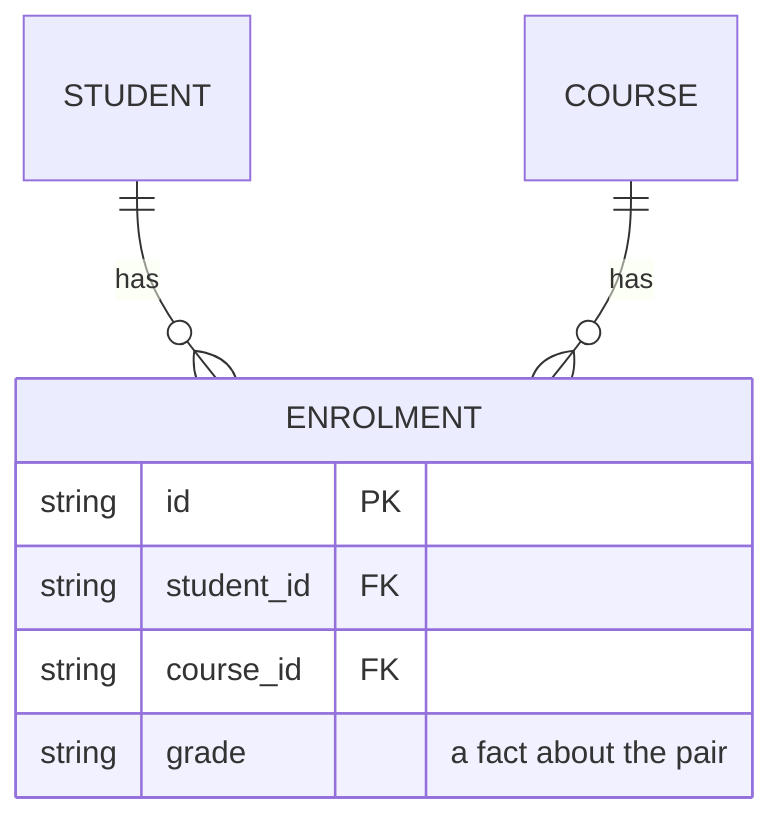

# The design proof

Load this before a person sees a design that adds an object with a state, a set of codes, or rules and settings that people write by hand. Load it too before a design removes, renames, or merges a stored value. A design can keep every rule and still lose its reader, or fail on the first hard case. The author cannot see either, because the author already knows what each name means and how each step should go. So show that the design works first. The ids in brackets are the standards in the skill's table.

## When it is due

What a change owes follows from what the model is, never from who approves it. Spec approval alone adds no part.

| The change | What it owes |
| --- | --- |
| One field or one value that joins a family the project already has | the sibling sentence and the skill's checks, and no proof |
| An internal record with no state, such as a lookup table or a join row, whoever writes its rows | the same, and no proof |
| A new object with a state, a new state field, or a new set of codes | parts 1 to 5 |
| Rules or settings that a person writes by hand to steer the system, such as a config or a policy; or an interface that another team or another system builds against | all six parts |
| A stored field, state, or value is removed, renamed, or merged | the list of readers, in "The hard cases", and the skill's answer table |

A record that people enter through a screen that checks it is not written by hand. Size the proof to the change. For a small model, parts 1 to 5 fit on one page. Never write a part only to fill it, and never ask in review for a part that the change does not owe.

## The six parts

1. **The model on one page.** The page holds every object, with its fields, an example value for each, and who writes it. It holds one state table for each state field (`states.md`). It has one paragraph that says how each kind of name is written. A reader then needs no second document to answer "where does this fact live?". A model too large for one page gets a first page that lists the objects, and one page for each.
2. **A worked example in real files.** Take one real case through its whole life. Write the files or records as they stand after each event, such as a loan at the checkout, after a renewal, and after a late return with its fee. Use the real format, with the real field names and likely values. Prose hides the gaps that a file shows: a field with no writer, a state that nothing moves into, a date with no source.
3. **The normal-form table.** Ask of each field whether it states a fact about its object's key, the whole key, and nothing but the key. Then write a table of the facts that need a decision: each derived value and what it reads, each link and the one side that stores it, and each stored value that another field decides. A fact with two owners is a finding. So is a stored value that another field decides, unless it is one of the three that `states.md` allows. For each stored fact, also search the system as it stands for another place that states it. Show the search, and name the one owner. [relational-normal-forms]
4. **Prior art and the likely changes.** `aidd-team:system-design` owns both. Its Options step reads how the readers' own tools hold and name the thing, and its `references/try-the-design.md` names the likely changes. Put the two short tables on the page.
5. **The hard cases.** Try to break the design, and write down what happened.
6. **The cold read.** A fresh reader answers task questions from part 1 alone.

## The entity-relationship diagram

Draw it to find faults, never to decorate. A model of two or three entities of its own needs none, because its tables say it all. From four entities of its own on, part 1 holds one: the entities, their keys, and their links, drawn as `aidd-team:diagrams` draws an `erDiagram`. Then read each line of it as a question.

Legend: a box is an entity. `||` is exactly one, and `o{` is none or many. `PK` is the key, and `FK` is a link to another entity's key.

- Every entity has a key. Every link has a mark at both ends: exactly one, none or one, or many.
- A link with many at both ends has no place to live. It needs an entity between the two, as the enrolment is.
- A fact that needs two keys to find it sits on that middle entity, never on either end.
- A derived value is left out of the diagram, or it is marked as derived.

## The hard cases

Write a short table of what you tried and what the design answered, for each of these that the design has.

- **Each state table.** Walk it through the hard cases that `states.md` lists, old records among them.
- **Each guarantee, each event, each setup, each count, each removed thing, and each existing-part or quality claim.** `aidd-team:system-design` owns these (`references/try-the-design.md`).
- **Each value that goes.** Where the change removes, renames, or merges a stored value, list every reader of it: code, tests, rules, documents, and people's habits. Show the search that found them, and the commit it ran on. Beside each reader, write the fact it takes from the value, and that fact's owner in the new model.

## A change to a shipped model

- Removing or renaming a field is a breaking change. Break a name only for a real misreading, and only before the first release. After it, use expand and contract. [aip-180]
- Before you remove or rename a field, list each value it could hold and that value's destination in the new model, or say that the reader refuses it. Nothing drops silently, because a dropped value can loosen what it used to control, as a missing "restricted" flag falls back to open. `aidd-team:schema-migration` owns the migration.
- Prove a change that removes or renames a field, or changes what a field decides, by its answers, never by reading the diff. Build a table of inputs over the input space, with the boundary rows: empty, one, many, and unknown. Run every reader on it before and after. The answers must match, except the ones the change intends, and you list each of those. `aidd-team:test-design` holds the technique for choosing rows.

## The cold read

It follows the cognitive walkthrough, which tests whether a new user can learn a system, on tasks set in advance. It differs in one way: a real fresh reader does the tasks, where a walkthrough has experts imagine one. [cognitive-walkthrough]

- **The reader has no context.** It is a person who was not in the design, or a new agent session that receives only the page. It is never the author. It is never a reader who saw the chat, a summary, or an earlier draft.
- **The questions are two or three tasks.** Never ask "is this clear?". Ask what a person does with the model: "A member returns a book three days late. What do you write, and where?" "What is the difference between `due_on` and overdue?" "Who acts next on a lost loan?" Write the questions, and your own answer to each, before the reader starts.
- **The reader asks you nothing.** It answers from the page, and it says "the page does not say" where the page is silent.
- **Paste the answers as the reader wrote them,** under the design. A wrong answer is a finding about the page or the model, never about the reader. So is each "the page does not say". Never answer a finding with the rule that a name keeps.
- **List one fix for each finding, and make it:** a word, a row, a change to the model, or a line that says the model leaves the matter out. When a fix changes the model, run the cold read again with a new reader. If findings are still open after the second read, stop, and bring them to the person as open questions.
- **Add a break read for a design that another team or another system builds on.** A second fresh reader gets the same page and one task: find a case where a state reads wrong, a guarantee fails, or a fact has no writer. Paste what it finds, and fix or answer each finding.

## Hand it over

Put the page, the example, the tables, the hard cases, and, where a cold read was due, its questions, pasted answers, and fixes in the Spec's Design or in a document it links.
