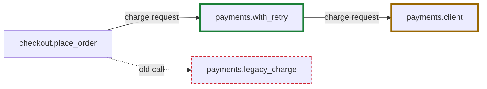

# Diagrams

**Use it when** a person must understand a file to decide or review it: a Spec's Design (Spec approval), a threat model, an Initiative plan, an ADR, a pipeline, a runbook. One diagram of the shape, then the words. Mermaid, because it is text every agent can write and diff.

**Do not use when** prose already answers the question and a picture would only restate it; a diagram of independent local fixes is decoration. Say so in one line instead.

## Standards

<!-- aidd:gen practice:diagrams -->
| Standard | Edition |
| --- | --- |
| Mermaid diagrams as text (flowchart, sequenceDiagram, stateDiagram-v2, erDiagram, gantt), rendered by GitHub and GitLab, and in VS Code with an extension | — |
| C4 model diagrams | — |
| STRIDE threat modeling with data-flow diagrams | — |
| ISO/IEC/IEEE 42010 (stakeholders, concerns, views) | 2022 |

Each standard's checked date and source are in the aidd-team roles reference (`references/roles.md` in `aidd-team:aidd-team`), section `aidd-team:diagrams`.
<!-- aidd:end -->

## Specify

One diagram answers one question; the question is its title.

| Question | Diagram | Where it lives |
| --- | --- | --- |
| What does this change touch, and in what order do data and control move? | `flowchart LR`, the change's path highlighted | the Spec's Design |
| Who calls whom, in what order? | `sequenceDiagram` | the Spec's Design or an ADR |
| What states can this screen or entity be in? | `stateDiagram-v2` with every state the designer named (empty, loading, error, partial, success, offline) | `design.files` |
| Where does untrusted data cross a trust boundary? | `flowchart`, a `subgraph` per trust zone and labeled boundaries, as STRIDE draws it | the threat model |
| How do Epics and Specs depend on each other? | `flowchart TB` from the Initiative to the Specs, edges for `depends_on` | the Initiative's file |
| What does on-call decide, and when do we roll back? | `flowchart TD` of decision points, the rollback trigger a diamond | the runbook |
| What moves through the pipeline, and where is lineage lost? | `flowchart LR` of datasets and jobs | the Spec's Design |
| What does this change add, remove, and move? | `flowchart LR` of the after state, with `added`, `changed`, and `removed` classes, and a table of the changes | the Spec's Design |
| What does the data look like, and what refers to what? | `erDiagram` of the tables the change adds or alters | the Spec's Design or the migration plan |

- Draw the smallest true picture, one screen of about a dozen nodes, and split anything bigger by question. Draw C4 levels (context, container, component) as flowcharts with subgraphs.
- Label edges with what travels (a request, an event, a file) and nodes with the code's names, so the reviewer can grep them.
- Mark the nodes this Spec adds or alters with a class that changes the border too, such as `classDef changed stroke-width:3px`, and a legend, so the delta shows without color. Give each diagram `accTitle` and `accDescr`.
- Keep the source in the Markdown file beside the words. No exported image without its source, and a design tool's image goes in `design.files`.
- Spec approval freezes a diagram in a Spec or `design.files`, so a later change needs a new Spec approval.

### What a change adds, removes, and moves

Draw the after state. Give each node a class, and keep the removed ones, dashed, so the reviewer sees what goes. A moved node takes `changed`. Add a table keyed by node id, so the delta reads without color.

| Node id | Change | What |
| --- | --- | --- |
| `retry` | added | retries a timed-out charge up to three times |
| `client` | changed | its timeout moves from 30 s to 10 s |
| `legacy` | removed | no caller is left, so it goes |

### Existing code

A diagram of code that already exists is a claim about the source, so make each part checkable.

- Name the base commit the diagram reads, in a line under its title.
- Give each node and each edge a `%% path:lines` comment, such as `%% src/pay/client.py:40-62`.
- Trace each edge to its real call site, never to a module's description of itself.
- Draw an edge the source does not show as dashed, and label it `unverified`.

## Review

- GitHub and GitLab render `mermaid` fences in files, PRs/MRs, and comments. VS Code previews them with a Mermaid extension.
- Reviewers comment on the diagram's lines as on code, and the author updates the source.
- `aidd validate` warns when a major Spec's Design has no diagram and little prose, and no linked tech spec has one; it never blocks.

## Test commands

| Command | Proves | How |
| --- | --- | --- |
| Mermaid syntax check | every diagram parses | `npx -y @mermaid-js/mermaid-cli -i <file>.md -o <tmp>/out.md` on each Markdown file with a `mermaid` fence, as a `tests` entry in CI |

## Stop if

- The diagram restates prose, or draws unrelated local fixes.
- One diagram tries to answer two questions, or runs past one screen.
- A frozen diagram is about to change after Spec approval without a new approval.

## Hand off

- Done: the file and the question each diagram answers. Next: its reader (the verifier for `design.files`, the reviewer for the Spec, on-call for a runbook). Needs: a fact the diagram had to assume, named in the Spec's Context. Stopped at: none, or the stop rule that fired.
