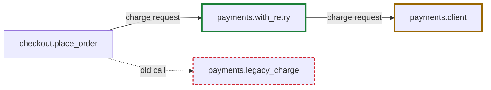

# What a change adds, removes, and moves: a worked example

Draw the after state. Give each node a class, and keep the removed ones, dashed, so the reviewer sees what goes. A moved node takes `changed`. Add a table keyed by node id, so the delta reads without color.

| Node id | Change | What |
| --- | --- | --- |
| `retry` | added | retries a timed-out charge up to three times |
| `client` | changed | its timeout moves from 30 s to 10 s |
| `legacy` | removed | no caller is left, so it goes |
